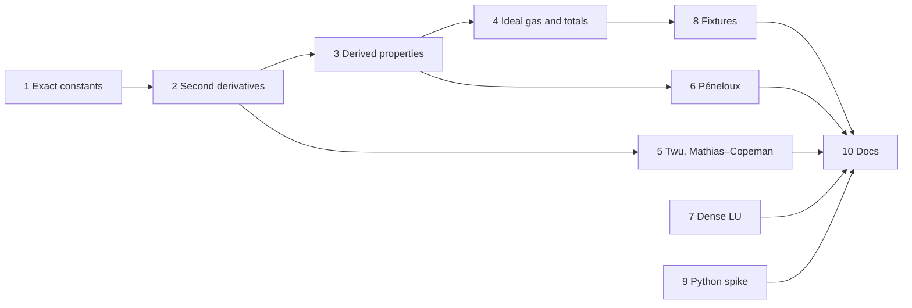

# M1 plan — thermo core

Status: **in progress.** Steps 1–9 are done. The roadmap entry is
[M1 in roadmap.md](roadmap.md#m1--thermo-core); this file is the detailed
plan.

## Goal

After M1, any `Model` at any composition gives:

- total H, S, G, U, A, Cp, Cv, speed of sound and the Joule–Thomson
  coefficient;
- ln φᵢ together with its derivatives in T, P and n, which is everything
  M3's flash needs;
- the same results for PRSV, Twu, Mathias–Copeman and volume-shifted
  variants of each cubic.

M1 also delivers a pure-V dense LU solver, and a spike that answers whether
a V shared library works when Python loads it.

## Exit criteria

Everything below is checked by `v -W test .`, so CI enforces it.

1. **Derivatives.** Every new derivative of F agrees with central finite
   differences to a relative 1e-6. This holds on a grid of states for every
   cubic and α function, and for a three-component mixture with non-zero kᵢⱼ.
2. **Identities.** These hold to a relative 1e-10 unless noted:
   - the Hessian is symmetric, F_nᵢnⱼ = F_nⱼnᵢ;
   - Euler's theorem on the first derivatives, which are homogeneous of
     degree 0: V·F_VV + Σ nᵢF_Vnᵢ = 0 and V·F_Vnᵢ + Σⱼ nⱼF_nᵢnⱼ = 0;
   - Gibbs–Duhem: Σᵢ nᵢ·∂ln φᵢ/∂nⱼ = 0 at constant T and P;
   - ∂ln φᵢ/∂T at constant P equals −H̄ʳᵢ/RT², and ∂ln φᵢ/∂P at constant T
     equals V̄ᵢ/RT − 1/P;
   - Cp − Cv = −T·(∂P/∂T)²_V / (∂P/∂V)_T;
   - H(T₂) − H(T₁) at constant P equals the quadrature of Cp (to 1e-8);
   - every residual property tends to 0 as P → 0.
3. **Critical point.** Each cubic, with the exact constants, has a triple
   root Z = Zc at (Tc, Pc). The tolerance is 1e-5, limited by cube-root
   sensitivity.
4. **Same model, other implementation.** Z, ln φᵢ, Hʳ, Sʳ and Cpʳ for PR and
   SRK, pure and mixed, match Caleb Bell's `thermo` library to a relative
   1e-9. The values are stored in `testdata/`.
5. **Model against reality.** For n-butane, PR's H, S, Cp and speed of sound
   are compared with a reference equation of state (CoolProp's, which follows
   Bücker & Wagner). The deviations are recorded in the fixture, and a test
   fails if any of them grows. This is a regression guard on accuracy, not a
   claim of accuracy.
6. **Volume shift.** A Péneloux-shifted PR gives the same Psat as plain PR
   (a volume shift doesn't change phase equilibrium) and the shifted ln φ.
7. **LU.** Random well-conditioned systems solve to a residual of
   1e-12·‖A‖·‖x‖. A singular matrix gives an error, not a NaN.
8. **Python spike.** Its result is written down, with a go / no-go for the
   approach in M10a.
9. CI is green, and the design notes, README and V notes are updated.

## Decisions

| # | Decision | Choice | Why |
|---|---|---|---|
| D1 | Ωa, Ωb | **Exact**, computed from the critical-point conditions when the program starts (your call) | The EOS critical point lands on (Tc, Pc), and `thermo` uses the same values, so fixtures can be tight. SVA's four-figure tables still pass. |
| D2 | Second-derivative API | A third tier on `Model`, `residual2`, alongside `volume_derivs` and `residual` | Callers pay only for what they use. The nc×nc Hessian is the expensive part, and the volume solver and plain ln φ never need it. |
| D3 | Reference state | Elements in their standard states at 298.15 K and P° = 1 bar: Hᵢᵍ = ΔH°f + ∫Cp dT, Sᵢᵍ = S° + ∫Cp/T dT − R ln(P/P°) | Reactors (M9) then need no separate heat-of-reaction bookkeeping, and it matches thermochemical tables. Until M2 supplies ΔH°f and S°, missing values are 0, and the result is marked as "relative only". |
| D4 | Where ideal-gas data lives | A `Fluid` that holds a residual `Model` plus per-component `IdealGas` data | `Model` stays purely residual: CPA and SAFT don't care about Cp. M2 fills both from ChemSep. |
| D5 | Cp forms in M1 | `Polynomial` (Σ aₖTᵏ, including negative k) and `AlyLee` (DIPPR 107), as a sum type | Each form gives Cp, ∫Cp dT and ∫Cp/T dT in closed form. NASA-7 and other DIPPR forms arrive with M2, when real data needs them. |
| D6 | Molar mass | A new required field on `Component`, in kg/mol | The speed of sound needs it. Being required means the compiler finds every literal that has to change. |
| D7 | α functions | `Alpha.eval` returns α, dα/dTr and d²α/dTr² | Cp needs F_TT, which needs α″. |
| D8 | Allocation | Keep allocating per call | Measure in M3 before optimising (roadmap A5). |
| D9 | Who writes what | No preference, so I write it all. Steps 5, 6 and 7 are good exercises; claim one before it starts. | |

## Steps

Steps 7 and 9 don't depend on the thermo chain and can happen at any point.

### 1. Exact critical constants — done
- `critical_constants(δ₁, δ₂)` in [thermo/cubic.v](../thermo/cubic.v): at
  (Tc, Pc) the cubic in Z must be (Z − Zc)³. That gives
  Zc = (1 − (δ₁+δ₂−1)Ωb)/3, Ωa in terms of Ωb, and one equation in Ωb.
  It's solved with `numeric.bisect`, which is new: slow but it can't fail,
  which is fine for constants computed once per model.
- Tests in [thermo/critical_test.v](../thermo/critical_test.v):
  - vdW gives exactly 27/64, 1/8 and 3/8;
  - SRK matches the closed form Ωb = (2^⅓ − 1)/3;
  - PR matches Peng & Robinson's closed form for η = b/Vc, and the
    ten-figure literature values;
  - all four cubics have a triple root at (Tc, Pc) to 1e-5;
  - δ₁ = δ₂ = δ gives van der Waals shifted in volume (Ωa = 27/64 for any
    δ);
  - δ₁ = δ₂ = −1, which has no critical point, is reported as an error.
- Existing tests still pass: the SVA volumes move by less than the book
  rounds them.
- One note for exit criterion 3: the triple-root tolerance had to be 1e-5,
  not 1e-6. Rounding of about 1e-16 in the coefficients moves a triple root
  by about (1e-16)^⅓ ≈ 5e-6.

### 2. Second derivatives of F (Cubic) — done
- `Model` has a third method, `residual2(t, v, n) Residual2`. `Residual2`
  embeds `Residual` and adds F_TT, F_TV, F_Vnᵢ, F_Tnᵢ and F_nᵢnⱼ (flat,
  row-major).
- [thermo/cubic.v](../thermo/cubic.v): g and f to second order in (V, B),
  and A to second order through `attraction2`. A shared `sqrt_a` gives sᵢ,
  s′ᵢ and s″ᵢ. Every line matches the table in
  [design.md](design.md#second-derivatives-of-the-cubic), which was written
  first.
- `Alpha.eval` returns α, α′ and α″ for all four α variants.
- [thermo/residual2_test.v](../thermo/residual2_test.v): 496 assertions over
  the four pure cubics and two ternaries with asymmetric-looking kᵢⱼ and a
  PRSV component, each at liquid-like and gas-like volumes and two
  temperatures. The tests check:
  - every second derivative against finite differences, with F_Vnᵢ both
    ways (Schwarz);
  - Hessian symmetry;
  - three Euler identities (one more than planned: V·F_TV + Σ nᵢF_Tnᵢ = F_T);
  - α′ and α″ for each α variant, PRSV on both sides of Tr = 0.7;
  - that `residual2`'s first-order fields match `residual`'s.
- The tests have teeth: six planted mistakes (in f_BB, g_BB, D_TT, F_TT,
  F_Tnᵢ and PRSV's h″) were each caught.

### 3. Model-independent derived properties — done
[thermo/properties.v](../thermo/properties.v) is written once against
`Model`, so CPA gets all of it for free:

- `pressure_derivs(m, t, v, n)`: P, (∂P/∂V)_T,n, (∂P/∂T)_V,n,
  (∂P/∂nᵢ)_T,V and the partial molar volumes V̄ᵢ;
- `ln_phi_derivs(m, state)`: ∂ln φᵢ/∂T at constant P, ∂ln φᵢ/∂P at
  constant T, and n·∂ln φᵢ/∂nⱼ at constant T and P;
- `residual_props(m, state)`: Hʳ, Sʳ, Gʳ, Uʳ, Aʳ, Cvʳ and Cpʳ, extensive.

[thermo/properties_test.v](../thermo/properties_test.v) has 260 assertions
over PR and vdW n-butane and the two ternaries, each at a vapor point and a
dense point. It checks:

- every derivative against finite differences of *re-solved* states, so the
  volume solver is in the loop too;
- Cpʳ = ∂Hʳ/∂T at constant P, Sʳ = −∂Gʳ/∂T, ∂Gʳ/∂P = V − nRT/P, and
  Cvʳ = ∂Uʳ/∂T at constant V;
- Σ nᵢV̄ᵢ = V;
- Gibbs–Duhem and the symmetry of n·∂ln φᵢ/∂nⱼ;
- Σ nᵢ·∂ln φᵢ/∂T = −Hʳ/RT² and Σ nᵢ·∂ln φᵢ/∂P = Vʳ/RT;
- Gʳ = RT·Σ nᵢ ln φᵢ;
- every residual property falling below 1e-5·nR at 1 Pa.

Seven planted mistakes in properties.v were each caught.

One thing came up: the SRK ternary's "liquid" point (250 K, 60 bar) turned
out to be a single dense root near the mixture's critical region. There, a
temperature step of 1e-4·T left a truncation error of 6e-6. Shrinking the
step showed it converging as h² onto the analytic value, so the formula was
right and the step was too big. The tests now use 1e-5·T.

### 4. Ideal gas and total properties — done
- [thermo/ideal.v](../thermo/ideal.v): `CpForm = AlyLee | Polynomial`, each
  with `cp`, `int_cp` and `int_cp_over_t` in closed form. The Aly–Lee terms
  are overflow-safe. `IdealGas` holds Cp plus ΔH°f and S° as Options (D3),
  and `t_ref` and `p_ref` are defined there.
- [thermo/fluid.v](../thermo/fluid.v): `Fluid` (a `Model` plus `[]IdealGas`)
  and `Fluid.props(state)`, giving total H, S, G, U, A, Cp, Cv, speed of
  sound and Joule–Thomson coefficient, and `absolute`.
- `Component` has a required `mw` in kg/mol (D6). The compiler found every
  literal that needed it.
- [thermo/ideal_test.v](../thermo/ideal_test.v) (79 assertions):
  - both integrals against Simpson quadrature, for Smith, Van Ness & Abbott
    four-constant polynomials, an Aly–Lee form, and a polynomial with the
    T⁻¹ and T⁰ powers whose integrals are logarithms;
  - Aly–Lee limits, and finiteness from 1 K to 10⁵ K;
  - the overflow-safe helpers against accurate references.
- [thermo/fluid_test.v](../thermo/fluid_test.v) (55 assertions):
  - the reference state, exactly, at T° and P°;
  - missing formation data shifts only the zero;
  - ΔH = ∫Cp dT and ΔS = ∫Cp/T dT along an isobar;
  - Cp and Cv against finite differences;
  - w against an isentropic finite difference, and μ_JT against an
    isenthalpic one;
  - the ideal-gas limits;
  - a component "mixed with itself" adds exactly −R Σ nᵢ ln xᵢ and nothing
    else.
- Eleven planted mistakes across ideal.v and fluid.v were each caught.
- One fix along the way: ln cosh x lost relative precision for small x
  (cosh x ≈ 1). It now uses log1p(2 sinh²(x/2)) there.

### 5. Twu and Mathias–Copeman α — done
- [thermo/alpha.v](../thermo/alpha.v): `Twu{l, m, n}` and
  `MathiasCopeman{c1, c2, c3, truncated}`, each with α, α′ and α″. Both
  definitions were checked against Caleb Bell's `thermo` (Twu91, and
  Mathias–Copeman truncated above Tc).
- The two variants were added to the `Alpha` type *before* their `match`
  branches, to see the compiler at work. It reported "match must be
  exhaustive (add match branches for: `MathiasCopeman`, `Twu` …)".
- Truncation is the default, as in the original paper and `thermo`. It makes
  α″ (and Cp) step by exactly c₂ at Tc; `truncated: false` is smooth.
- [thermo/alpha_test.v](../thermo/alpha_test.v) (138 assertions):
  - α′ and α″ for all seven α forms against finite differences, on both
    sides of Tr = 0.7 and Tr = 1;
  - α(1) = 1 for every form;
  - Mathias–Copeman with only c₁ is exactly Soave (truncated or not);
  - Twu with N = 0 is exactly 1;
  - Twu stays positive and falls up to Tr = 50;
  - the c₂ step in α″ at Tc, exactly.
- residual2_test.v gained a ternary with Twu on methane and
  Mathias–Copeman on CO₂ (on both sides of CO₂'s Tc). It's now 588
  assertions.
- Six planted mistakes in the new branches were each caught.

### 6. Péneloux volume shift — done
- [thermo/translated.v](../thermo/translated.v): `Translated { inner Model,
  c []f64 }` implements `Model` by evaluating the inner model at W = V + C,
  so F′ = F(T, W, n) + n·ln(V/W). All five methods follow by the chain rule
  (the table is in [design.md](design.md#volume-shift)).
  `translate(model, c)` rejects any cᵢ ≥ bᵢ. Shifts nest:
  `translate(translate(m, c1)!, c2)!` works.
- [thermo/translated_test.v](../thermo/translated_test.v) (203 assertions):
  - V moves by exactly −C and ln φᵢ by exactly −cᵢP/RT;
  - Psat is unchanged at four temperatures;
  - Gʳ and Hʳ move by −PC, while Sʳ and Cpʳ don't move;
  - two shifts equal their sum;
  - every first and second derivative against finite differences;
  - Euler, Gibbs–Duhem and Σ nᵢ·∂ln φᵢ/∂T = −Hʳ/RT²;
  - the packing limit moves to B − C;
  - a compressed liquid whose shifted volume lies below the inner B is
    still found.
- The planted-mistake check found a gap. A wrong sign in `min_volume` went
  undetected, because ordinary liquids sit far from the packing limit.
  The last two tests above were added for it, and now catch it. All seven
  planted mistakes are caught.

### 7. Dense LU — done
- [numeric/lu.v](../numeric/lu.v): `lu_factor(a, n) !LU` with partial
  pivoting (row-major; a copy, so `a` is left alone), then `solve(b)`,
  `solve_into(b, mut x)` (no allocation, for use inside iterations) and
  `det()`.
- A pivot no larger than n·ε·max|aᵢⱼ| makes it an error: "singular to
  working precision", never a NaN.
- [numeric/lu_test.v](../numeric/lu_test.v) (397 assertions):
  - 30 random systems from 1×1 to 50×50, from a fixed-seed xorshift
    generator, so results are the same on every machine. Each meets the
    exit criterion ‖Ax − b‖ ≤ 1e-12·‖A‖·‖x‖ and recovers x to 1e-9;
  - a zero and a 1e-20 leading entry, which only pivoting survives;
  - three singular matrices, each rejected;
  - Hilbert(8), condition number about 3e10: a tiny residual and a forward
    error below 1e-4;
  - determinants, including the sign from a row swap and
    det(Hilbert(3)) = 1/2160;
  - `solve_into` agreeing with `solve`;
  - the input left unchanged and sizes checked.
- Seven planted mistakes were each caught: pivot choice, the singularity
  tolerance, the permutation, the stored multipliers, both substitution
  loops, and the determinant sign.

### 8. Reference fixtures — done
- [tools/gen_m1_fixtures.py](../tools/gen_m1_fixtures.py) runs with
  `uv run tools/gen_m1_fixtures.py`. Its dependencies are declared inline
  and pinned: thermo 0.6.1 and CoolProp 8.0.0, on Python 3.14.
- It writes `testdata/m1_thermo.json` and `testdata/m1_coolprop_butane.json`,
  each with a provenance block (date, generator, Python and library
  versions).
- Before writing it I checked two things against the libraries:
  - `thermo` uses the same exact Ωa and Ωb as reflux;
  - CoolProp's `smolar_residual` is on the (T, ρ) basis, so the generator
    adds R ln Z to put it on reflux's (T, P) basis. That was verified against
    an independent construction from a 1 Pa state.
- [thermo/fixtures_test.v](../thermo/fixtures_test.v) reads them with
  `json2` (212 assertions):
  - **Exit criterion 4:** Z, V, ln φᵢ, Hʳ, Sʳ and Cpʳ agree with `thermo`
    to 1e-9. That's 21 phases, covering PR and SRK, pure and ternary, both
    roots near saturation and single roots elsewhere.
  - **Exit criterion 5:** PR's deviations from CoolProp's reference equation
    for n-butane match the recorded ones and haven't grown. CoolProp's own
    ideal-gas Cp is used at each point, so only the residual model is
    compared.
- The fixture tests caught six small model changes: textbook-rounded Ωb, a
  fifth-digit change to PR's or SRK's m(ω), kᵢⱼ ignored on either code path,
  and R from CODATA 2014 instead of 2018, a relative change of about 3e-7.

PR's recorded deviations from the reference equation for n-butane, with
the component constants used throughout the tests:

| State | V | Hʳ (J/mol) | Sʳ (J/mol K) | Cp | w |
|---|---|---|---|---|---|
| vapor, 350 K, 2 bar | −0.1% | +43 | +0.13 | −0.9% | −0.2% |
| vapor, 400 K, 5 bar | −0.6% | +24 | +0.11 | −1.0% | −0.6% |
| supercritical, 450 K, 50 bar | +1.5% | +320 | +0.99 | −10.0% | +6.9% |
| dense, 430 K, 100 bar | +0.5% | +230 | +0.66 | +3.6% | −17.7% |
| liquid, 300 K, 30 bar | −5.1% | +13 | +0.06 | −1.1% | −20.7% |
| liquid, 250 K, 10 bar | −5.1% | +189 | +0.67 | −4.0% | −16.0% |

These are the textbook picture of Peng–Robinson: good vapor volumes, liquid
volumes about 5% low (which a Péneloux shift fixes), and a liquid speed of
sound 15–20% low.

### 9. Python shared-library spike — done: go, with conditions
- [spike/python_ffi/](../spike/python_ffi) is a V module of `@[export]`
  functions over `thermo`, built with `v -shared`, plus eight Python and
  NumPy scenarios. Each scenario runs in its own process, so a crash is
  reported, not hidden.
- The full write-up is [spike-python-ffi.md](spike-python-ffi.md). The
  answers to the plan's questions:
  - **Does V's GC start inside the host?** Yes, and its heap levels off
    under load.
  - **Is an explicit init call needed?** No; initialisation runs when the
    DLL loads.
  - **Do allocations survive across calls?** Only if V itself still refers
    to them. A handle held only by Python was freed; a pinned one survived.
  - **tcc and gcc?** gcc only on Windows: tcc DLLs export nothing.
- Seven problems found, each of which would have hurt M10a later:
  1. V's `int` is 64-bit at the C boundary, which corrupted the heap;
  2. tcc DLLs export nothing;
  3. the libgcc DLL dependency, which Python doesn't look for on PATH;
  4. handles freed by the GC;
  5. panics killing the Python process;
  6. Python threads unknown to the GC on Linux (found in CI and fixed:
     every entry point now registers the calling thread);
  7. tcc `.so` files that Linux won't load.
- Measured with `-prod`: 5.5 µs per PR point in one vectorised call, 9.1 µs
  from a Python loop, so about 3.6 µs of `ctypes` overhead per call.
- CI runs the spike with gcc on Linux and Windows, and all eight scenarios
  pass on both (run 40235402623).
- Still open: two Python threads allocating inside V at the same moment,
  since `ctypes` releases the GIL. That's a test for the start of M10a.

### 10. Docs
- `design.md`: the second-derivative formulas, the full property table, the
  reference state, and `Fluid`.
- `README.md`: status. `v-for-go.md`: Option fields, `@[export]`,
  `v -shared`, `json2`.

## Risks

| Risk | What happens if it bites | Fallback |
|---|---|---|
| `thermo` or CoolProp has no wheels for Python 3.14 on Windows | step 8 can't run | `uv run --python 3.12`; uv installs it automatically |
| V's GC misbehaves inside a Python host | M10a's design changes | that is exactly what the spike is for, and it's found in M1, not M10a |
| Aly–Lee terms overflow (sinh) at extreme T | NaN in H or S | stable formulations, and tests at the edges of each fit's range |
| Soave α reaches 0 and turns back up at very high Tr | division by √α in A_T | guard it, and note that Twu (step 5) is the physical fix |
| Changing the `Model` interface | every model must add `residual2` | only `Cubic` exists today, so it's cheapest to do now |

## Not in M1

Flash (M3), ChemSep import (M2), the Python API beyond the spike (M10a),
CPA (M12), transport properties (M5), and units parsing (M4).
