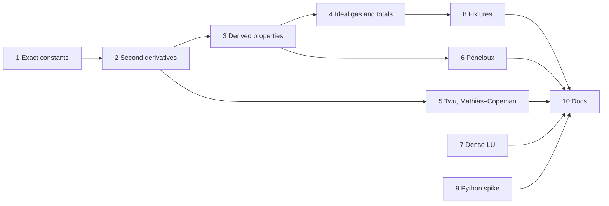

# M1 plan — thermo core

Status: **in progress.** Steps 1–3 are done. The roadmap entry is
[M1 in roadmap.md](roadmap.md#m1--thermo-core); this file is the detailed
plan.

## Goal

After M1, any `Model` at any composition gives:

- total H, S, G, U, A, Cp, Cv, speed of sound and the Joule–Thomson
  coefficient;
- ln φᵢ together with its derivatives in T, P and n, which is everything
  M3's flash needs;
- the same results for PRSV, Twu, Mathias–Copeman and volume-shifted
  variants of each cubic.

M1 also delivers a pure-V dense LU solver, and a spike that answers whether
a V shared library works when Python loads it.

## Exit criteria

Everything below is checked by `v -W test .`, so CI enforces it.

1. **Derivatives.** Every new derivative of F agrees with central finite
   differences to a relative 1e-6. This holds on a grid of states for every
   cubic and α function, and for a three-component mixture with non-zero kᵢⱼ.
2. **Identities.** These hold to a relative 1e-10 unless noted:
   - the Hessian is symmetric, F_nᵢnⱼ = F_nⱼnᵢ;
   - Euler's theorem on the first derivatives, which are homogeneous of
     degree 0: V·F_VV + Σ nᵢF_Vnᵢ = 0 and V·F_Vnᵢ + Σⱼ nⱼF_nᵢnⱼ = 0;
   - Gibbs–Duhem: Σᵢ nᵢ·∂ln φᵢ/∂nⱼ = 0 at constant T and P;
   - ∂ln φᵢ/∂T at constant P equals −H̄ʳᵢ/RT², and ∂ln φᵢ/∂P at constant T
     equals V̄ᵢ/RT − 1/P;
   - Cp − Cv = −T·(∂P/∂T)²_V / (∂P/∂V)_T;
   - H(T₂) − H(T₁) at constant P equals the quadrature of Cp (to 1e-8);
   - every residual property tends to 0 as P → 0.
3. **Critical point.** Each cubic, with the exact constants, has a triple
   root Z = Zc at (Tc, Pc). The tolerance is 1e-5, limited by cube-root
   sensitivity.
4. **Same model, other implementation.** Z, ln φᵢ, Hʳ, Sʳ and Cpʳ for PR and
   SRK, pure and mixed, match Caleb Bell's `thermo` library to a relative
   1e-9. The values are stored in `testdata/`.
5. **Model against reality.** For n-butane, PR's H, S, Cp and speed of sound
   are compared with a reference equation of state (CoolProp's, which follows
   Bücker & Wagner). The deviations are recorded in the fixture, and a test
   fails if any of them grows. This is a regression guard on accuracy, not a
   claim of accuracy.
6. **Volume shift.** A Péneloux-shifted PR gives the same Psat as plain PR
   (a volume shift doesn't change phase equilibrium) and the shifted ln φ.
7. **LU.** Random well-conditioned systems solve to a residual of
   1e-12·‖A‖·‖x‖. A singular matrix gives an error, not a NaN.
8. **Python spike.** Its result is written down, with a go / no-go for the
   approach in M10a.
9. CI is green, and the design notes, README and V notes are updated.

## Decisions

| # | Decision | Choice | Why |
|---|---|---|---|
| D1 | Ωa, Ωb | **Exact**, computed from the critical-point conditions when the program starts (your call) | The EOS critical point lands on (Tc, Pc), and `thermo` uses the same values, so fixtures can be tight. SVA's four-figure tables still pass. |
| D2 | Second-derivative API | A third tier on `Model`, `residual2`, alongside `volume_derivs` and `residual` | Callers pay only for what they use. The nc×nc Hessian is the expensive part, and the volume solver and plain ln φ never need it. |
| D3 | Reference state | Elements in their standard states at 298.15 K and P° = 1 bar: Hᵢᵍ = ΔH°f + ∫Cp dT, Sᵢᵍ = S° + ∫Cp/T dT − R ln(P/P°) | Reactors (M9) then need no separate heat-of-reaction bookkeeping, and it matches thermochemical tables. Until M2 supplies ΔH°f and S°, missing values are 0, and the result is marked as "relative only". |
| D4 | Where ideal-gas data lives | A `Fluid` that holds a residual `Model` plus per-component `IdealGas` data | `Model` stays purely residual: CPA and SAFT don't care about Cp. M2 fills both from ChemSep. |
| D5 | Cp forms in M1 | `Polynomial` (Σ aₖTᵏ, including negative k) and `AlyLee` (DIPPR 107), as a sum type | Each form gives Cp, ∫Cp dT and ∫Cp/T dT in closed form. NASA-7 and other DIPPR forms arrive with M2, when real data needs them. |
| D6 | Molar mass | A new required field on `Component`, in kg/mol | The speed of sound needs it. Being required means the compiler finds every literal that has to change. |
| D7 | α functions | `Alpha.eval` returns α, dα/dTr and d²α/dTr² | Cp needs F_TT, which needs α″. |
| D8 | Allocation | Keep allocating per call | Measure in M3 before optimising (roadmap A5). |
| D9 | Who writes what | No preference, so I write it all. Steps 5, 6 and 7 are good exercises; claim one before it starts. | |

## Steps

Steps 7 and 9 don't depend on the thermo chain and can happen at any point.

### 1. Exact critical constants — done
- `critical_constants(δ₁, δ₂)` in [thermo/cubic.v](../thermo/cubic.v): at
  (Tc, Pc) the cubic in Z must be (Z − Zc)³. That gives
  Zc = (1 − (δ₁+δ₂−1)Ωb)/3, Ωa in terms of Ωb, and one equation in Ωb.
  It's solved with `numeric.bisect`, which is new: slow but it can't fail,
  which is fine for constants computed once per model.
- Tests in [thermo/critical_test.v](../thermo/critical_test.v):
  - vdW gives exactly 27/64, 1/8 and 3/8;
  - SRK matches the closed form Ωb = (2^⅓ − 1)/3;
  - PR matches Peng & Robinson's closed form for η = b/Vc, and the
    ten-figure literature values;
  - all four cubics have a triple root at (Tc, Pc) to 1e-5;
  - δ₁ = δ₂ = δ gives van der Waals shifted in volume (Ωa = 27/64 for any
    δ);
  - δ₁ = δ₂ = −1, which has no critical point, is reported as an error.
- Existing tests still pass: the SVA volumes move by less than the book
  rounds them.
- One note for exit criterion 3: the triple-root tolerance had to be 1e-5,
  not 1e-6. Rounding of about 1e-16 in the coefficients moves a triple root
  by about (1e-16)^⅓ ≈ 5e-6.

### 2. Second derivatives of F (Cubic) — done
- `Model` has a third method, `residual2(t, v, n) Residual2`. `Residual2`
  embeds `Residual` and adds F_TT, F_TV, F_Vnᵢ, F_Tnᵢ and F_nᵢnⱼ (flat,
  row-major).
- [thermo/cubic.v](../thermo/cubic.v): g and f to second order in (V, B),
  and A to second order through `attraction2`. A shared `sqrt_a` gives sᵢ,
  s′ᵢ and s″ᵢ. Every line matches the table in
  [design.md](design.md#second-derivatives-of-the-cubic), which was written
  first.
- `Alpha.eval` returns α, α′ and α″ for all four α variants.
- [thermo/residual2_test.v](../thermo/residual2_test.v): 496 assertions over
  the four pure cubics and two ternaries with asymmetric-looking kᵢⱼ and a
  PRSV component, each at liquid-like and gas-like volumes and two
  temperatures. The tests check:
  - every second derivative against finite differences, with F_Vnᵢ both
    ways (Schwarz);
  - Hessian symmetry;
  - three Euler identities (one more than planned: V·F_TV + Σ nᵢF_Tnᵢ = F_T);
  - α′ and α″ for each α variant, PRSV on both sides of Tr = 0.7;
  - that `residual2`'s first-order fields match `residual`'s.
- The tests have teeth: six planted mistakes (in f_BB, g_BB, D_TT, F_TT,
  F_Tnᵢ and PRSV's h″) were each caught.

### 3. Model-independent derived properties — done
[thermo/properties.v](../thermo/properties.v) is written once against
`Model`, so CPA gets all of it for free:

- `pressure_derivs(m, t, v, n)`: P, (∂P/∂V)_T,n, (∂P/∂T)_V,n,
  (∂P/∂nᵢ)_T,V and the partial molar volumes V̄ᵢ;
- `ln_phi_derivs(m, state)`: ∂ln φᵢ/∂T at constant P, ∂ln φᵢ/∂P at
  constant T, and n·∂ln φᵢ/∂nⱼ at constant T and P;
- `residual_props(m, state)`: Hʳ, Sʳ, Gʳ, Uʳ, Aʳ, Cvʳ and Cpʳ, extensive.

[thermo/properties_test.v](../thermo/properties_test.v) has 260 assertions
over PR and vdW n-butane and the two ternaries, each at a vapor point and a
dense point. It checks:

- every derivative against finite differences of *re-solved* states, so the
  volume solver is in the loop too;
- Cpʳ = ∂Hʳ/∂T at constant P, Sʳ = −∂Gʳ/∂T, ∂Gʳ/∂P = V − nRT/P, and
  Cvʳ = ∂Uʳ/∂T at constant V;
- Σ nᵢV̄ᵢ = V;
- Gibbs–Duhem and the symmetry of n·∂ln φᵢ/∂nⱼ;
- Σ nᵢ·∂ln φᵢ/∂T = −Hʳ/RT² and Σ nᵢ·∂ln φᵢ/∂P = Vʳ/RT;
- Gʳ = RT·Σ nᵢ ln φᵢ;
- every residual property falling below 1e-5·nR at 1 Pa.

Seven planted mistakes in properties.v were each caught.

One thing came up: the SRK ternary's "liquid" point (250 K, 60 bar) turned
out to be a single dense root near the mixture's critical region. There, a
temperature step of 1e-4·T left a truncation error of 6e-6. Shrinking the
step showed it converging as h² onto the analytic value, so the formula was
right and the step was too big. The tests now use 1e-5·T.

### 4. Ideal gas and total properties
- `CpForm = AlyLee | Polynomial`, each with `cp(t)`, `int_cp(t1, t2)` and
  `int_cp_over_t(t1, t2)`. The Aly–Lee integrals are written in their
  numerically stable forms, using ln sinh and ln cosh.
- `IdealGas { cp CpForm, dhf f64, s0 f64 }`; `Fluid { model Model,
  ideal []IdealGas }`; the reference state from D3.
- `props(fluid, state) Props`: total H, S, G, U, A, Cp, Cv, speed of sound
  and Joule–Thomson coefficient. Adds `mw` to `Component` (D6).
- Tests: integrals against adaptive quadrature; the Cp-quadrature identity
  for total H; mixing terms (−R Σ nᵢ ln xᵢ) checked against a mixture of a
  component with itself.

### 5. Twu and Mathias–Copeman α (exercise candidate)
- New `Alpha` variants with α, α′ and α″.
- Tests: finite differences on α′ and α″ with the same test pattern as PRSV;
  each matches Soave when its parameters reduce to it, where such a
  reduction exists.

### 6. Péneloux volume shift (exercise candidate)
- `Translated { inner Model, c []f64 }` implements `Model`:
  F′(T, V, n) = F(T, V + C, n) + n·ln(V/(V + C)), with C = Σ nᵢcᵢ, and
  `residual2` follows by the chain rule.
- Tests: Psat unchanged; ln φ′ᵢ = ln φᵢ − cᵢP/RT; the liquid volume shifts
  by exactly C; all the step-3 identities still hold.

### 7. Dense LU (exercise candidate)
- `numeric.LU`: `lu_factor(a []f64, n int) !LU` with partial pivoting, then
  `solve(b)` and `solve_into(b, mut x)`. Row-major storage.
- Tests: random systems with known solutions, residual bounds, a singular
  matrix, a nearly singular matrix (Hilbert n = 8: the solve succeeds and
  the residual stays small even though the error grows), and n = 1 and
  n = 2 edge cases.

### 8. Reference fixtures
- `tools/gen_m1_fixtures.py`, run with `uv run`. Its dependencies (thermo,
  CoolProp) are declared inline, so there's no virtual environment to
  manage.
- It writes `testdata/m1_thermo_pr.json` and `testdata/m1_coolprop_butane.json`.
  Each value records the library version and the date.
- V tests read them with `json2`.

### 9. Python shared-library spike
- A V function exported with `@[export: 'reflux_scale']` and built with
  `v -shared`. It scales a NumPy array in place, called through `ctypes`,
  on Windows. If it works there, it goes into CI on Linux too.
- Questions to answer: does V's GC start correctly inside the host? Does
  module initialisation need an explicit call? Do allocations survive across
  calls? Does it work with both tcc and gcc?
- Output: a short write-up in `docs/` and a go / no-go for M10a's design.

### 10. Docs
- `design.md`: the second-derivative formulas, the full property table, the
  reference state, and `Fluid`.
- `README.md`: status. `v-for-go.md`: Option fields, `@[export]`,
  `v -shared`, `json2`.

## Risks

| Risk | What happens if it bites | Fallback |
|---|---|---|
| `thermo` or CoolProp has no wheels for Python 3.14 on Windows | step 8 can't run | `uv run --python 3.12`; uv installs it automatically |
| V's GC misbehaves inside a Python host | M10a's design changes | that is exactly what the spike is for, and it's found in M1, not M10a |
| Aly–Lee terms overflow (sinh) at extreme T | NaN in H or S | stable formulations, and tests at the edges of each fit's range |
| Soave α reaches 0 and turns back up at very high Tr | division by √α in A_T | guard it, and note that Twu (step 5) is the physical fix |
| Changing the `Model` interface | every model must add `residual2` | only `Cubic` exists today, so it's cheapest to do now |

## Not in M1

Flash (M3), ChemSep import (M2), the Python API beyond the spike (M10a),
CPA (M12), transport properties (M5), and units parsing (M4).
