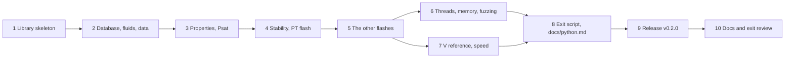

# M10a plan — thermo and the flash from Python

M10a makes reflux's thermodynamics and flash callable from Python, with NumPy
arrays in and out, through a C API that any language can load. It answers one
of the README's DWSIM complaints directly: you can't bring NumPy, pandas or
Jupyter to your own analysis. It's planned like M1 to M4: research first, then
exit criteria, decisions and steps. The roadmap entry is in
[roadmap.md](roadmap.md), and M1's spike, which retired the biggest risks, in
[spike-python-ffi.md](spike-python-ffi.md).

Status: **approved** on 2026-11-04. Step 1 is next.

## Goal

- **A C API** in a shared library built with `v -shared`: plain functions
  with explicit integer widths, `f64` arrays passed as pointer and length, so
  that NumPy arrays cross without copying (roadmap I1).
- **Vectorised calls:** one call evaluates or flashes a whole array of
  states, with a status for each, so a failure at one point doesn't throw away
  the rest.
- **What it covers:** the component database and fluids built from it; a
  phase's properties at (T, P, z); pure-component vapour pressure; and every
  flash M3 has: stability, PT, PH, PS, TV, UV, and the vapour-fraction flashes
  with bubble and dew points.
- **A `reflux` Python package** over the C API with `ctypes`, so users need no
  compiler. Results come back as NumPy arrays.
- **Safe from Python threads,** which `ctypes` lets into the library at the
  same time.

Flowsheets from Python are M10b. Wheels that bundle the library come later
(I2): M10a's package installs from the source tree.

## What the research found

**What M1's spike settled** ([spike-python-ffi.md](spike-python-ffi.md)), and
CI has run since on Windows and Linux:
- V's runtime and its garbage collector work inside a Python process. Module
  initialisation runs when the library loads, so there's no init call.
- **Integers at the boundary must be `i32` or `i64`.** V's `int` is 64-bit
  and C's 32-bit; the first version wrote 8-byte statuses into a 4-byte array
  and corrupted the heap.
- **Shared libraries need gcc** (or clang): tcc's Windows DLLs export nothing,
  and its Linux `.so` asks for an executable stack that glibc refuses. On
  Windows, `-static-libgcc` removes a DLL Python wouldn't find, and gcc
  exports all 1,600 symbols unless told otherwise.
- **A handle only Python holds is freed by the collector,** which can't see
  Python's memory. Handles must live in a V-side registry.
- **A V panic takes Python down with it,** so no input may reach one.
- **A Python call costs about 3.6 µs** in `ctypes` overhead, against 5.5 µs
  for a PR volume root. Calls must be vectorised.

**What this plan's probes found** (V 0.5.2, gcc 16.2, Windows 11, Python 3.13,
NumPy 2):
- **The collector has thread support on Windows too.** V 0.5.2 defines
  `GC_THREADS` and `GC_WIN32_THREADS` for gcc builds on every OS
  (`vlib/builtin/builtin_d_gcboehm.c.v`). A probe DLL reports the thread that
  loaded it as registered, and a thread Python starts as not. So the spike's
  note that "V's Windows build has none" is wrong. Registering the calling
  thread at every entry point, as the spike's `gc_threads.h` does, is needed on
  Windows as much as on Linux. The spike's helper already does it, since it
  tests `GC_THREADS`.
- **Concurrent calls are correct.** 8 Python threads, each solving PR for
  10,000 points 30 times through the spike's library while a ninth thread
  churned allocations and forced collections: every result equal to the serial
  one bit for bit, and no crash.
- **They don't scale far.** Without the forced collections, on 8 logical
  CPUs: 1.6× the serial rate with 2 threads, 2.0× with 4 and 2.1× with 8. Each
  point allocates, and the collector's lock and its collections are shared.
  Parallel speed is M8's question (its sweeps use `spawn`), not M10a's.
- **reflux has no global state:** no `__global` and no mutable module-level
  value in `thermo`, `flash`, `numeric`, `tdep` or `components`. The only state
  the library will share between threads is its registry of handles.

**Where the data comes from.** `components.load_default()` reads the compound
files from `$REFLUX_DATA`, or else from the source tree's `data/components/`,
whose path is baked in when V compiles (`@VMODROOT`). But the kᵢⱼ banks
(`pr.ipd`, `srk.ipd`) and Mathias–Copeman's `mc-PR.lib` always come from the
source tree's `data/vendor/chemsep/`, whatever `REFLUX_DATA` says. A library
moved away from its source tree would lose its kᵢⱼ. The CLI has the same flaw,
which v0.1.0's "Known limitations" describes only in part.

**Bit for bit means one build.** M4 found tcc's and gcc's builds differing in
the last bits (a drum's duty of 0 under tcc, −9.3e-13 kW under gcc), and
Linux's libm and Windows' UCRT needn't agree in the last bit of `exp`, `log`
and `pow`. So "the same numbers as the V API" can only be checked against a V
program built by the same compiler, with the same flags, on the same machine.

**What other libraries do.** CoolProp's `PropsSI` accepts arrays and loops in
C++, one property at a time. Caleb Bell's `thermo` flashes one state per call,
as a Python object. reflux's flashes return a whole state, so a vectorised
call fills several arrays at once: β, the phases' compositions and
properties, and a status.

## Exit criteria

All checked by tests in CI: V tests of the C API under both compilers, and
Python tests against the library in the gcc jobs, on Windows and Linux.

1. **The C API is what its header says.** `capi/reflux.h` declares every
   function, and the library exports exactly those, checked against its symbol
   table on both OSes. Every integer is `i32` or `i64`, every array a pointer
   and a length, and `reflux_abi_version()` gives the ABI's version.
2. **Nothing panics.** Every function, called with bad input (NaN, ±∞, zero or
   negative sizes, mismatched lengths, a mole fraction below 0, an unknown,
   stale or freed handle, an empty name) returns an error, never a crash. Each
   is a test, and seeded fuzzing calls every function with mutated arguments.
3. **The same numbers as the V API, bit for bit.** For a reference set of
   states covering every function, Python's results equal a V program's that
   calls the V API directly, built with the same compiler and flags on the same
   machine.
4. **Vectorised, without copies.** A call takes arrays of N states and fills
   arrays the caller allocated. NumPy inputs that are already contiguous
   `float64` aren't copied. Python broadcasts T, P and z by NumPy's rules, and
   z can be one composition for every point.
5. **Each point has its own status.** A failure at one point leaves the others'
   answers as they would be alone. Each status names the flash's `Failure` kind
   (`no_convergence`, `more_phases`, …) or bad input, and the reason for a
   point can be had in words.
6. **Handles are safe and memory is flat.** A handle is an id that is never
   reused, so a stale or freed one is an error. Python frees its handles when
   its objects go, and the collector's heap levels off over 100,000 calls.
7. **Threads are safe.** 8 Python threads calling every vectorised function at
   once get the serial answers bit for bit, on Windows and Linux. The
   throughput is measured and recorded, with no target.
8. **The exit script.** A script computes a T–x–y diagram and a phase-fraction
   map into NumPy arrays and plots them with matplotlib. It runs in CI, and its
   numbers match the V API's (criterion 3).
9. **It installs, and finds its data.** On Windows and Linux, one command
   builds the library and another installs the package from the source tree.
   The package finds the component data, the kᵢⱼ banks and `mc-PR.lib` with it,
   from wherever it's installed.
10. **Speed is measured.** Per-call and per-point overhead against V's own
    loop, for properties and a PT flash at 1, 100 and 10,000 points, with gcc
    `-prod`, in `docs/benchmarks.md`. There's no target, as in M3 and M4.
11. CI is green, and the docs are updated: README, roadmap, design notes, V
    notes, the C API's header and a new `docs/python.md`, whose every example
    runs in CI.

## Decisions

| # | Decision | Choice | Why |
|---|---|---|---|
| D1 | Where it lives | A V module `capi` with the exported functions, the registry and the thread registration, and `capi/reflux.h`. A Python package in `python/` (`python/reflux/`, its `pyproject.toml` and `tests/`). `tools/python.vsh` builds the library into the package and runs the Python tests. The spike's scenarios move into those tests, and its code and CI step go; its write-up stays as the record, corrected on Windows threads. | One module owns the boundary, so nothing else in reflux needs `unsafe` or C types. The package beside it keeps the two in step. |
| D2 | ABI conventions | Every function is `reflux_*`, takes `i32`, `i64`, `f64` and pointers only, and returns an `i32`: 0, or a negative code for a failure of the whole call (a bad handle, wrong sizes, a lookup that fails), whose message it writes into a buffer the caller passes (pointer and length). Outputs go into arrays the caller allocated. No V memory crosses the boundary, only handles. | The caller owns every byte it sees, so nothing needs freeing on the Python side, and a message needs no shared state between threads. |
| D3 | Exports | Only the header's functions: on Linux by `-fvisibility=hidden`, since V marks its exports visible; on Windows by a `.def` file generated from the header. A test compares the symbol table with the header on both OSes. | Not the collector's internals, which gcc exports today on Windows, and one list of truth. |
| D4 | Handles | An `i64` id into a registry: a map from id to fluid (or database) behind a `sync.Mutex`, ids from a counter that never repeats. `reflux_free(id)` drops one. In Python each handle belongs to an object with `close()`, a context manager and a `weakref.finalize`. | The collector can't see Python's references (the spike). A fresh id per object turns a stale or doubly freed handle into an error, not a crash. |
| D5 | Threads | Every exported function registers the calling thread with the collector for the length of the call, on every OS (the spike's `gc_threads.h`). Concurrent calls are allowed; the registry's lock is the only shared state. | The probes: needed on Windows too, and correct under load. Their speed isn't M10a's target. |
| D6 | Vectorised results | Arrays of N points, C-contiguous `float64` (and `int32` for statuses), shaped for two phases: β, T, P, the number of phases, each phase's label, fraction, composition (N × 2 × c), molar V, H and S, and the whole's H, S and V. An absent phase is NaN. M6's third phase will be a new ABI version. | One layout for every flash, which is what a plot or a DataFrame wants. Two phases is all M3's flash returns. |
| D7 | Statuses | Per point, an `int32`: 0 for an answer, a stable number for each `FlashError` kind, and one for bad input. Python maps them to an `IntEnum`. A point's reason in words comes from the single-point form of the same call, which writes the message into the caller's buffer. | Numbers fill an array cheaply; words for every point would cost a string each. |
| D8 | The Python API | `reflux.Database()` (or a data directory), `db.fluid('PR', ['methane', 'n-butane'], alpha=..., kij=...)`, then on the fluid `props`, `psat`, `stability`, `flash_pt`, `flash_ph`, `flash_ps`, `flash_tv`, `flash_uv`, `flash_tvf`, `flash_pvf`, `bubble_t`, `bubble_p`, `dew_t` and `dew_p`, each taking arrays or scalars. A flash returns a `FlashResult` of arrays with a `status` array and `ok` mask. SI throughout, as the V API. Python 3.11 or later, NumPy 2. | The V API's names and units, so that the V docs and design notes serve Python too. |
| D9 | Data | A database opens on a data directory: the caller's, or `$REFLUX_DATA`, or the source tree's. The kᵢⱼ banks and `mc-PR.lib` come from the same root (`components` changes so they do), which fixes the CLI too. The package records the source tree it was built from. | A library away from its source tree must still find its kᵢⱼ. |
| D10 | Build and install | `v run tools/python.vsh build` makes `python/reflux/_lib/reflux.dll` (or `.so`) with gcc `-prod`, then `pip install -e python` (or `uv pip install -e python`). The package's version is v.mod's. | No compiler for users of a built tree, and wheels can come later without changing the package (I2). |
| D11 | Tests | V tests of `capi` call the exported functions in process, under tcc and gcc. Python tests with pytest, pinned, run by `tools/python.vsh test` in the gcc jobs on both OSes. A scenario that could crash runs in a process of its own, as the spike's did, so a crash is reported. | Most of the boundary's logic is tested in every job; what only Python can show is tested where the library can be built. |
| D12 | The V reference | A V program built by `tools/python.vsh` with the library's compiler and flags writes the V API's answers for the reference states to a temporary JSON file, and the Python tests compare bit for bit. It's never committed. | The research: bits differ between compilers and between OSes' maths libraries. |
| D13 | Versions | The ABI has its own number (`reflux_abi_version()`), as the file and report formats do. M10a ends with v0.2.0: a minor release before 1.0 for an addition, by the CHANGELOG's rules. | The CHANGELOG's policy, and a version Python can check before it calls anything. |
| D14 | Who writes what | As before, I write it all unless you claim a step. | |

## Steps

Each step from 2 on adds C functions with their V tests, their Python wrappers
and their Python tests together.

### 1. The library skeleton
- `capi` with the registry (D4), thread registration (D5), the error buffer
  (D2), `reflux_abi_version` and `reflux_free`; `capi/reflux.h`.
- Exports restricted on both OSes, and the test that compares them with the
  header (D3).
- `tools/python.vsh build` and `test`, the package's skeleton, and the spike's
  scenarios as its first tests. The CI step moves from the spike to them.
- The spike's write-up corrected: Windows has thread support, and needs the
  registration.

### 2. The database, fluids and data
- Opening a database on a directory, lookup with suggestions, and a fluid
  from names, the equation, α and kᵢⱼ choices and overrides; each compound's
  constants readable.
- The kᵢⱼ banks and `mc-PR.lib` from the same root as the compounds (D9), with
  a test that moves a copy of the data away from the source tree.

### 3. Properties and vapour pressure
- Vectorised properties of a phase at (T, P, z), by root (liquid, vapour or
  stable): Z, V, H, S, G, U, A, Cp, Cv, the speed of sound, μ_JT and ln φ.
- Pure components' Psat.

### 4. Stability and the PT flash
- The stability test (tm and its verdict) and the PT flash, vectorised, with
  statuses (D6, D7), and the single-point form for a reason in words.

### 5. The other flashes
- PH, PS, TV, UV, and the vapour-fraction flashes with bubble and dew points.

### 6. Threads, memory and fuzzing
- 8 threads on every vectorised function, against the serial answers, on both
  OSes (criterion 7), with the throughput recorded.
- The heap over 100,000 calls, stale and freed handles, and seeded fuzzing of
  every function (criteria 2 and 6).

### 7. The V reference and speed
- The V program of D12 and the bit-for-bit comparison over every function
  (criterion 3).
- The overhead benchmarks (criterion 10), in `docs/benchmarks.md`.

### 8. The exit script and the Python docs
- A T–x–y diagram of a binary below its critical locus and a phase-fraction
  map over T and P, into NumPy arrays and plotted with matplotlib, run in CI
  and checked against the V reference.
- `docs/python.md`: install, the API, statuses and threads, with every example
  run in CI.

### 9. Release v0.2.0
- The CHANGELOG entry, v.mod's version, and the release gate, as for v0.1.0.

### 10. Docs and exit review
- README, roadmap, design notes, the V notes, and a criterion-by-criterion
  review, as in M1 to M4.

## Risks

| Risk | Effect | Fallback |
|---|---|---|
| Restricting exports on Windows breaks V's own initialisation, which runs from the DLL's entry | a library that loads but doesn't start | export by `__declspec(dllexport)` through a C wrapper instead of a `.def` file; or keep gcc's export-all and test that the header's functions are present |
| Concurrent calls fail on Linux, where the probes didn't run | crashes under threads | a lock around every call (correct, if slower), and a report to V upstream |
| A flash path panics on input the V tests never gave it | Python dies | the fuzzing of step 6; each panic found becomes a typed error in the module it came from |
| A V update changes the collector or `-shared` | the library breaks | V is pinned (`.v-version`); the Python tests run in CI on every change |
| `ctypes` overhead dominates small calls | slow scalar use from Python | vectorised calls are the way in; the benchmarks say how small is too small |

## Not in M10a

- Flowsheets from Python, and units written in Python: M10b.
- Wheels with the library inside, and publishing to PyPI (I2).
- Parallel calls inside the library (`spawn`): M8's sweeps.
- A third phase in the results: M6, as a new ABI version.
- Units of measure in Python: SI only, as the V API. `quantity` could be
  exposed later.
