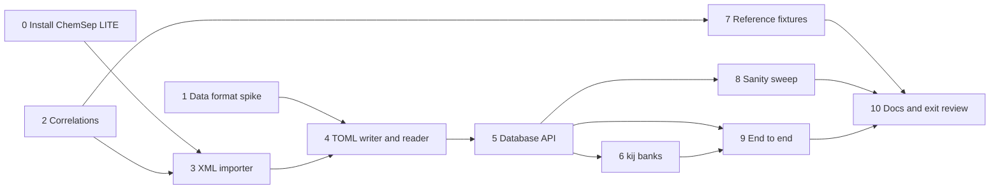

# M2 plan — component data

Status: **done,** and merged as PR #2. The criterion-by-criterion review is
in "Exit review", at the end. The official files are in
`data/vendor/chemsep/` (see their [NOTICE](../data/vendor/chemsep/NOTICE.md)),
and the format is TOML ([data-format.md](data-format.md)). The roadmap entry
is
[M2 in roadmap.md](roadmap.md#m2--component-data); this file is the detailed
plan.

## Goal

After M2, reflux can build any of the 642 compounds in ChemSep 8.50 by
name, CAS number or InChIKey. Each compound comes with:

- its constants, in SI per-mol units, each traceable to its source;
- the temperature-dependent correlations the flash and energy balances
  need (vapour pressure, ideal-gas Cp, liquid density, heat of
  vaporisation, liquid Cp), with the integrals H and S need;
- PR and SRK kᵢⱼ for the pairs ChemSep has.

One call should go from names to a ready `thermo.Fluid`:

```v
db := components.load_default()!
fl := db.fluid(.pr, ['methane', 'n-butane'])!   // Cubic + ideal gas + kij
```

M3's flash then starts from real data instead of hand-typed constants.

## What the research found

All of this comes from looking at the files themselves (October 2026).
The plan was first written from the copies in DWSIM's repository (v8.3,
2022). It was then checked against the official ChemSep LITE 8.50 install
(step 0), and the official files are what reflux uses. Where the two
differ, the official values are given here.

| Question | Answer |
|---|---|
| What is the data? | ChemSep pure-component databases `chemsep1.xml` (v8.49, **433 compounds**) and `chemsep2.xml` (v8.50, **209 compounds**). They don't overlap: 642 compounds in all. |
| Licence | Stated in each file's root element: *"ChemSep v8.49 pure component data 1 - Copyright (c) Harry Kooijman and Ross Taylor (2024)"*, with a link to the **Artistic License 2.0**, and the licence text ships in the same folder. |
| Defects | The XML is **not well-formed**: 43 SMILES attribute values end in a stray `<`. Strict XML parsers reject the files as shipped. |
| New in the official files | `InChIKey` and `PubChemID` per compound. Real revisions to Tc, Pc or ω for a few dozen compounds since v8.3; most other differences are reformatting. |
| What Artistic 2.0 allows | Verbatim redistribution with notices (§2); a converted copy is a "Modified Version", distributable if the changes are documented and it stays under Artistic 2.0 (§4(c)(i)); bundling with MIT code is fine (§7). |
| Identifiers | Name, CAS number (present, well-formed and unique in every record), InChIKey, PubChemID, SMILES, a structural formula, a family code. |
| Units | Per **kmol**: J/kmol, m³/kmol, kg/kmol. K and Pa elsewhere. |
| What M3 needs, and coverage | Tc, Pc, Vc, Zc, Tb, M, ω, ΔH°f, ΔG°f, S°: 431/431. Vapour pressure, ideal-gas Cp and heat of vaporisation: 431/431. Liquid density 424, liquid Cp 422. |
| Equation forms | Ideal-gas Cp is ChemSep **eq. 16**, A + exp(B/T + C + DT + ET²), for 429 compounds. It has no closed-form integral. Vapour pressure is DIPPR 101 (421), eq. 10 Antoine (8) and **eq. 200 (2, form unknown)**. Liquid density is DIPPR 105, heat of vaporisation DIPPR 106. Transport properties use 101, 102, 16 and others. |
| Extras | Mathias–Copeman c₁–c₃ in the XML (the EOS isn't stated), plus a separate `mc-PR.lib` explicitly fitted for Peng–Robinson; UNIQUAC r and q; UNIFAC, modified-UNIFAC and ASOG group assignments; Lennard-Jones parameters; a name-synonyms file. |
| kᵢⱼ | `pr.ipd` and `srk.ipd`: 292 pairs each, keyed by CAS pair, "DECHEMA Peng-Robinson [SRK] Parameters", "Copyright 2009 Harry Kooijman and Ross Taylor". **No licence named.** Also NRTL, UNIQUAC and Wilson files, for M6. |
| An oracle for tests | Caleb Bell's `chemicals` 1.5.2 implements DIPPR 100–107, 114–116 and 127, including integrals. It reproduces n-butane's Psat(350 K) = 9.467 bar and ρL(300 K) = 9.836 kmol/m³ from the ChemSep coefficients. |

The ChemSep-specific equations, from ChemSep's PCDmanager documentation:

| Eq. | Form | Eq. | Form |
|---|---|---|---|
| 1–5 | A + BT + CT² + DT³ + ET⁴, truncated to 1–5 terms | 10 | exp(A − B/(T + C)) (Antoine; K, Pa) |
| 11–15 | exp of the 1–5 polynomial | 16 | A + exp(B/T + C + DT + ET²) |
| 17 | A + exp(B + CT + DT² + ET³) | 45 | the integral of the eq. 5 polynomial |

## Exit criteria

All checked by `v -W test .`, so CI enforces them.

1. **Import is complete.** All 644 records import as 642 compounds,
   despite the 43 malformed SMILES values, which are repaired and listed.
   The import report lists zero unparsed records. The two compounds that
   `chemsep2.xml` lists twice are resolved by the documented rule (D8).
   Unsupported equation forms (such as eq. 200) are kept verbatim and
   reported, never dropped.
2. **The data files are reproducible.** Re-running the importer on the
   vendored XML regenerates `data/components/` byte for byte, and the
   vendored files still match the SHA-256 sums in their NOTICE. CI checks
   both, so neither the converted data nor its source can drift.
3. **Units are right.** Every scalar is SI per mol. Tests check a sample
   against hand conversions, for example n-butane's M of 58.123 kg/kmol
   becoming 0.058123 kg/mol, and ΔH°f in J/kmol becoming J/mol.
4. **Correlations are exact.** Every equation form used by the five
   M3-critical properties is implemented with its value, dY/dT,
   ∫Y dT and ∫Y/T dT:
   - DIPPR forms match `chemicals.dippr` to 1e-12 relative;
   - ChemSep-only forms match an independent evaluation to 1e-12;
   - numerical integrals (eq. 16) match high-resolution quadrature to 1e-10.
5. **The data is sane, and outliers are visible.** A sweep over all
   compounds checks that each correlation is finite, and positive where it
   must be, across its [Tmin, Tmax], and that Psat(Tb) is within 2% of
   1 atm. Failures go into a committed data-quality report rather than
   failing the build, but the report can't silently grow.
6. **Cross-checks are recorded.** Deviations are recorded at generation and
   can't grow, as in M1:
   - for fluids that also have a reference equation in CoolProp (about a
     dozen: light hydrocarbons, CO₂, N₂, water and others), ChemSep's Tc,
     Pc, ω and M, and its eq.-16 ideal-gas Cp, against CoolProp;
   - for 20 representative compounds, PR's Psat (from ChemSep's constants)
     against ChemSep's own vapour-pressure correlation, across Tr 0.5–0.95.
7. **Lookup works.** By CAS, by name (case-insensitive) or by alias. An
   unknown name is an error that lists the closest matches.
8. **kᵢⱼ works.** PR and SRK kᵢⱼ load from the ChemSep files. The matrix for
   any component list is symmetric, and pairs with no data get 0 and are
   listed in a report.
9. **End to end.** `db.fluid(.pr, […])` builds a working `thermo.Fluid`. An
   integration test reproduces M1's n-butane Psat and enthalpy changes using
   database constants.
10. CI is green, and the docs are updated.

## Decisions

| # | Decision | Choice | Why |
|---|---|---|---|
| D1 | Licence and layout | Verbatim ChemSep XML in `data/vendor/chemsep/`, with the Artistic 2.0 text and a NOTICE (source, version, SHA-256). The converted files in `data/components/` are a Modified Version, also under Artistic 2.0 (§4(c)(i)), with a CHANGES file. Code stays MIT. | It's exactly what the licence allows, and it keeps code and data licences visibly separate. |
| D2 | kᵢⱼ files | **Shipped, as DWSIM does (your call).** They go in `data/vendor/chemsep/` too. The NOTICE says plainly that the files name no licence and are assumed to fall under the database's Artistic 2.0, with a note to confirm with the authors. | Practical; the assumption is written down where anyone redistributing will see it. |
| D3 | Where the XML comes from | **The official ChemSep LITE download (your call).** Done with ChemSep LITE 8.50; the files come from its `pcd` and `ipd` folders. | The Standard Version, straight from the copyright holders. |
| D4 | reflux's own format | TOML, one file per compound (`data/components/<CAS>.toml`): readable, diffable, and the same format a user writes for their own compounds. Every value carries a source tag. | A per-compound diff is reviewable; one large file isn't. Step 1 checks V's `toml` module can do it, with JSON as the fallback. |
| D5 | Units of correlations | Coefficients are stored **verbatim**, along with the correlation's native output unit, and the evaluator converts the *result* to SI per mol. Scalars are converted at import. | Forms like A + exp(…) can't be rescaled coefficient by coefficient. Verbatim coefficients also compare directly with ChemSep and `chemicals`. |
| D6 | Where it lives | A new module `components`, which imports `thermo` and builds `thermo.Component`, `thermo.IdealGas` and `thermo.Fluid`. | `thermo` stays about models. Data handling is its own concern. |
| D7 | Outside [Tmin, Tmax] | Evaluate anyway (extrapolate) and say so: each evaluation returns the value plus an in-range flag. | A flash's trial temperatures often step outside a correlation's range briefly. Refusing would break the iteration, while silence would hide bad data. |
| D8 | Overlapping compounds | The first occurrence of a CAS number, in reading order (`chemsep1.xml`, then `chemsep2.xml`, top to bottom), wins. Each duplicate is listed in the import report with the elements that differ. **One named exception (your call, step 8):** R-23's vapour pressure and Antoine fit come from its second copy, as reported repairs. | Simple and deterministic. In 8.50 the only duplicates are two compounds listed twice within `chemsep2.xml`. The first copy is the more complete one both times (step 3). But step 8's CoolProp check showed R-23's first-copy vapour pressure is 94–100% too low across its range, where the second copy's is within 3%. |
| D9 | Ideal-gas Cp from the database | A new `CpForm` variant, `thermo.Correlated`, wrapping a correlation, so eq. 16 drops into M1's `Fluid` unchanged. Integrals use adaptive Gauss–Kronrod quadrature (`numeric.integrate`) when there's no closed form. A failed integral is NaN rather than an error. | It reuses M1's whole total-property machinery, and `Fluid.props` keeps its signature. |
| D10 | Mathias–Copeman parameters | The XML's values are imported and stored but not used by default, since their EOS isn't stated. `mc-PR.lib`, fitted for PR, is the better source. It's vendored and read in step 6, under D2's licence assumption. None of its sets matches the XML's for the 573 compounds that have both. | Using parameters fitted for one EOS in another would be guessing. |
| D11 | Who writes what | As in M1, I write it all unless you claim a step. Good candidates are marked. | |
| D12 | A kᵢⱼ pair listed more than once | **The first listing is used (your call).** The matrix keeps every other listing and its report shows them, and any pair can be overridden by hand. The same goes for compounds listed more than once in `mc-PR.lib`. | 53 of `pr.ipd`'s 187 pairs have several DECHEMA fits, each with its own value. Their temperature ranges overlap in 38 of them, so temperature can't pick one, and ChemSep itself makes you choose. First-listed is deterministic, and the report makes the choice visible. |

## Steps



### 0. Get the official files — done
- ChemSep LITE **8.50** is installed at
  `%LOCALAPPDATA%\ChemSepL8v50`. `chemsep1.xml`, `chemsep2.xml`, `pr.ipd`,
  `srk.ipd` and ChemSep's own `Artistic_license_2_0.txt` were copied into
  `data/vendor/chemsep/`, and they're byte-identical to the installed files.
- [NOTICE.md](../data/vendor/chemsep/NOTICE.md) records the versions,
  SHA-256 sums, the licence statements quoted from the files, the kᵢⱼ
  licence assumption (D2), the 43 malformed SMILES values, and how the
  files differ from DWSIM's.
- `.gitattributes` marks `data/vendor/` as `-text`, so Git doesn't rewrite
  the CRLF line endings and the checksums stay true.

### 1. Data format spike — done: TOML
- n-butane was written by hand in the schema
  ([spike/data_format/106-97-8.toml](../spike/data_format/106-97-8.toml)) and
  read with V's `toml` module
  ([spike/data_format/spike.v](../spike/data_format/spike.v)). Everything the
  schema needs works: nested tables, arrays, inline-table overrides with
  their own source, quoted numeric group keys, comments, file order kept,
  and missing keys and malformed files reported.
- On all 53,977 distinct numbers in the ChemSep XML, the TOML parser and
  `strconv` agree exactly. V's `f64.str()` round-trips and always prints a
  TOML float, so the writer can be deterministic.
- Parsing takes about 1 ms per file under tcc. So the importer also writes an
  `index.toml` for name lookup, and components are parsed only when asked
  for.
- Two V gotchas found:
  - `toml.Any.f64()` on a string silently returns 0.0, so the reader checks
    types;
  - string interpolation of an inline `.map(…)` result prints the array's
    internals, a V bug (assign to a variable first).
- The schema is written down in [data-format.md](data-format.md).

### 2. Correlations — done
- A new module, `tdep`. It has `Correlation` (form, A–E, Tmin, Tmax, and Tc
  for the forms that need it) with `eval`, `deriv`, `integral` and
  `integral_over_t`. It's pure mathematics in the correlation's own units:
  the native unit and the conversion to SI belong to the `components`
  layer (D5).
- The forms: ChemSep 1–5, 10–17 and 45; DIPPR 100–102, 104–107 and 114–116.
  - Derivatives are closed-form for all of them.
  - ∫Y dT is closed-form for 1–5, 45, 100, 104, 107, 114 and 116, and
    ∫Y/T dT for 1–5, 45, 100, 104 and 107.
  - The rest use a new `numeric.integrate` (below).
- `new()` refuses forms it can't evaluate, so the data layer keeps them
  verbatim and reports them. ChemSep 8.50 uses five such forms:
  - 120 and 121, relative permittivity (324 and 5 records). These matter
    only for electrolytes.
  - 200, vapour pressure (5 records). Step 5 falls back to the Antoine
    record.
  - 118, liquid viscosity (1 record).
  - 124, liquid Cp (1 record).
- Findings that shaped the code:
  - 101 eq. 106 records (heats of vaporization, surface tensions, water's
    liquid density) end a little past their compound's own Tc, by up to
    48 K. n-butane's ends at 425.16 K against Tc = 425.12 K. Form 106 is for
    properties that vanish at Tc, so it returns 0 at and above Tc instead
    of NaN. 114 and 116 aren't defined above Tc, and `new()` refuses such
    ranges; none occur in the data.
  - Some solid-phase records start at 0 K, so Tmin = 0 is allowed.
- `numeric.integrate` is globally adaptive Gauss–Kronrod 7–15 (QUADPACK's
  QAG): it always splits the panel with the largest error, uses QUADPACK's
  error estimate and roundoff floor, and has a 2000-panel budget. My first
  version halved locally with a halved tolerance per side. When asked for
  1e-14, below what roundoff allows, it ran for two minutes; QAG settles in
  one panel. A divergent integral or noise is an error, not a hang.
- Fixtures: [tools/gen_m2_fixtures.py](../tools/gen_m2_fixtures.py) writes
  [testdata/m2_tdep.json](../testdata/m2_tdep.json).
  - It has 68 cases covering all 24 forms: up to three real ChemSep records
    per form, n-butane's main records, and synthetic sets for the forms
    ChemSep never uses. Two synthetic sets cover hard cases:
    - an Aly–Lee set run from 2 K to 10⁵ K, where sinh overflows a float;
    - an eq.-104 set where every term counts (see the mutation check).
  - Values, dY/dT and both integrals are mpmath at 40 digits, from formulas
    written separately from the V code.
  - For the DIPPR forms the script checks itself against `chemicals` 1.5.2,
    and stops rather than write a bad fixture: values to 1e-12, derivatives
    to 1e-9, closed-form integrals to 1e-10.
- Tests: values match mpmath to 1e-13, and derivatives and integrals to
  1e-11, which meets criterion 4. The DIPPR values also match `chemicals`
  to 1e-12. Unit tests cover:
  - the refusals;
  - the zero-fill of missing coefficients, `unused_nonzero` and the range ends;
  - closed forms against quadrature;
  - the behaviour at and above Tc;
  - Aly–Lee at 1 mK and 10⁹ K, with C = 0 and with negative C and E;
  - the hyperbolic helpers' series.
- Mutation check: of 26 planted mistakes, 25 were caught first time. The
  one that got through was a wrong D/T⁷ coefficient in the eq.-104
  integral. In ChemSep's second virial coefficients the D and E terms are
  about 1e-14 of the total over each record's range, so no test could see
  them. The synthetic eq.-104 set fixes that, and it and four more
  mutations of the D and E terms are now caught: 30 of 30.

### 3. ChemSep XML importer — done
- New module `components`, for now just the record model
  ([components/record.v](../components/record.v)). Its struct field names
  are the component-file keys. Values are set by key through V's
  compile-time reflection, so an unknown key is an error, and the step 4
  writer will take its key order from the same structs.
- New module `components.chemsep`, the importer.
  - [fields.v](../components/chemsep/fields.v) is the one table that maps
    each of the 68 ChemSep elements to a key, a kind, the unit it must carry,
    and whether it's per kmol.
  - [chemsep.v](../components/chemsep/chemsep.v) parses with V's
    `encoding.xml`.
  - The provenance is `ChemSep v8.49 (data/vendor/chemsep/chemsep1.xml)`
    and the like, with the version taken from the file itself.
- Strict, so a new ChemSep release can't be misread silently. These are all
  errors:
  - an unknown element or attribute;
  - a unit other than the expected one;
  - a malformed, NaN or infinite number;
  - a gap in a coefficient set;
  - an element twice in a compound;
  - text where elements belong;
  - a CAS number that fails its check digit. It becomes a file name, so
    this also keeps anything path-like out.
- Per-kmol values are converted by moving the decimal point in the text
  before parsing. Dividing by 1000 would be one unit in the last place off
  for 220 of the 2,637 distinct per-kmol values.
- The whole vendored database imports in about 4 s under tcc. What it found:
  - **644 records, 642 compounds.** Trifluoromethane and 3-chloropropene
    are each in `chemsep2.xml` twice. The first copy is the more complete
    one both times, so D8 now reads "first occurrence wins". Step 8 found
    one exception, R-23's vapour pressures.
  - **50 repairs.** Step 3 found 47; step 4's round trip found the 48th,
    and step 8's two R-23 takeovers make 50.
    - 41 stray SMILES `<`s; the other 2 of the 43 are in the dropped copies.
    - Six ASOG group lists that name a group twice. Summing the two is right
      every time: diglyme's 2 + 1 ether groups for its three ether oxygens.
    - One zero group count, diphenyl disulfide's UNIFAC-LLE list. It's
      dropped: a zero count contributes nothing.
  - **Findings, kept verbatim and reported:**
    - 42 impossible correlation ranges, such as chloroform's solid Cp over
      [283, 0] K and several liquid viscosities ending at 1 K;
    - 334 correlations in forms reflux can't evaluate, 327 of them
      permittivities;
    - 8 records with suspect unused coefficients;
    - one correlation with no coefficients, para-hydrogen's RPP Cp;
    - 5 partial Mathias–Copeman sets;
    - 1,2-dichloroethylene carbonate, with no Tc, Pc or ω.
- Tests ([chemsep_test.v](../components/chemsep/chemsep_test.v)): the real
  import's counts, duplicates, repairs and findings. They were all
  cross-checked with an independent Python/ElementTree survey of the XML.
  Also:
  - n-butane against hand conversions, value by value;
  - the decimal shift;
  - CAS validation;
  - a synthetic file for each refusal, the repairs, and duplicates across
    files;
  - every table key against the record structs.
- Mutation check: 21 planted mistakes, all caught. They covered the decimal
  shift, each strictness check, the repairs, the duplicate rule, each kind
  of finding, the CAS check digit, a per-kmol flag in the table, and the
  reflection setters.

### 4. TOML writer and reader — done
- `components.write_toml` and `components.parse_toml`/`read_toml`
  ([components/file.v](../components/file.v)). Both walk the record structs
  by compile-time reflection, so key order and key names come from one
  place.
  - **The writer is deterministic:** struct order, empty tables left out,
    floats in V's shortest round-trip form, strings escaped. SMILES have
    `\` in them.
  - **It refuses** NaN, infinities, control characters, and a `sources`
    override that names no value.
  - **The reader is strict.** These are errors naming the file and key:
    - an unknown key;
    - a wrong type;
    - a missing required key;
    - a file not named after its CAS number;
    - a group number that isn't canonical, or a count that isn't positive.
  - V's toml parser reads `nan` as a string and `inf` as a huge integer.
    So a float field takes an integer only if it's exact (|i| ≤ 2⁵³), and
    both are refused.
- `index.toml` ([components/index.v](../components/index.v)) gives each
  compound's name, InChIKey and aliases, sorted by CAS number. Lookup by
  name reads only this file.
- `components.chemsep.generate` renders the whole of `data/components/`:
  - 642 compound files;
  - `index.toml`;
  - `README.md`: generated, don't edit, the licence;
  - `CHANGES.md`: how this Modified Version differs from ChemSep's Standard
    Version (D1). It's also criterion 1's import report: every repair, the
    dropped duplicates, and every finding.
- [tools/import_chemsep.vsh](../tools/import_chemsep.vsh) writes exactly
  that set: it rewrites what changed and removes what's no longer
  generated. 645 files, 2.9 MB.
- Tests:
  - **Criterion 2, in [generate_test.v](../components/chemsep/generate_test.v):**
    - the committed directory equals a fresh generation byte for byte,
      with no extra or missing files;
    - all five vendored files match the size and SHA-256 in their NOTICE.
    CI runs both as part of `v test .`.
  - Every committed file reads back as the record it was written from (V's
    `==` compares the structs deeply).
  - The index lists every file.
  - [file_test.v](../components/file_test.v) checks the writer's
    determinism and escaping, and gives each reader refusal its own case.
- The round trip found a data defect the importer had passed: a zero group
  count. It's now a reported repair (step 3).
- Mutation check: 25 planted mistakes, 23 caught on the first run.
  - **Missed, and fixed:** the index reader's unknown-key check. The test
    appended its stray key at the end of the file, where TOML puts it
    inside the last compound table, so a different check refused it. The
    test now puts the key at the top level, and each index refusal is
    matched to its message. That mutation and two new ones are caught.
  - **Missed, and left:** the reader's NaN/infinity check on floats. V's
    toml never produces a non-finite float (see above), so no file can
    reach it. It stays, documented, in case the parser changes.

### 5. Database API — done
- `components.load(dirs)` and `load_default()`
  ([components/database.v](../components/database.v)).
  - The built-in directory is `data/components/`, found through `@VMODROOT`
    at compile time, or `$REFLUX_DATA`.
  - A directory with an `index.toml` is read through it, and a stale index
    (one listing a missing file) is an error. A directory without one, such
    as your own, has its `*.toml` files read.
  - A later directory's compound replaces an earlier one with the same CAS
    number, whole: that's how user components override built-in ones.
  - Files are parsed only when a compound is asked for.
- `db.find(query)` matches a CAS number, an InChIKey, or a name or alias
  (ignoring case and spaces). Criterion 7:
  - A miss is a typed `LookupError` with the five closest names: those
    containing the query first, shortest first, then by edit distance.
    "butane" suggests N-butane and Isobutane, "watr" Water.
  - A query matching several compounds is a `LookupError` listing them all.
    That happens in the shipped data: ChemSep gives carbon monoxide
    formaldehyde's InChIKey. A name used again in a user directory
    triggers it too.
- What a record builds ([components/build.v](../components/build.v)):
  - `rec.component()` builds a `thermo.Component`. It fails, naming what's
    missing, for the one compound without Tc, Pc and ω.
  - `rec.ideal_gas()` builds a `thermo.IdealGas`. Its Cp is a new
    `thermo.Correlated` form (D9) wrapping the `ideal_gas_cp` correlation,
    scaled from J/(kmol·K).
  - `rec.property(key)` gives any correlation converted to SI per mol. Its
    `at(T)` returns the value and whether T is in the fitted range (D7).
- The step 3 findings, decided:
  - a correlation with no coefficients or an impossible range is refused,
    and the message points to CHANGES.md;
  - a vapour pressure that can't be used falls back to the Antoine record,
    with a note saying why. That covers 26 compounds: 5 in eq. 200, the rest
    without a usable eq.-101 record. Only the stub compound has no vapour
    pressure at all.
  - the reduced-temperature forms take the compound's Tc unless the
    correlation has its own.
- In thermo:
  - **`Correlated`** integrates numerically where it must. A failed
    integral, which takes a correlation that overflows, returns NaN, so
    `Fluid.props` stays infallible and M1's API is unchanged.
  - **`AlyLee`** now evaluates through tdep's eq. 107, so the duplicated
    overflow-safe helpers are gone from thermo. Their naive-form test moved
    to tdep. M1's fixtures still pass unchanged.
- Tests ([database_test.v](../components/database_test.v)): every lookup
  path and refusal, overrides and clashes in temporary user directories,
  n-butane's conversions against the formulas written out, and a sweep
  building every compound. Its counts were checked with Python's tomllib:
  - an ideal gas for 640 compounds (none for the stub or for R-1234yf);
  - a component for 641;
  - a vapour pressure for 641.
- Mutation check: 22 planted mistakes, all caught. They covered each lookup
  path, the suggestion ranking, directory order, the stale-index check,
  the unit scales, the fallback, each refusal, Tc and ΔH°f wiring, the
  in-range flag, and thermo's new Cp form.

### 6. kᵢⱼ banks — done
- **The parameter files** ([components/params.v](../components/params.v)).
  `load_kij(.pr)` and `load_kij(.srk)` read ChemSep's `pr.ipd` and
  `srk.ipd` straight from `data/vendor/chemsep/`; they're small and need no
  conversion. ChemSep has no kᵢⱼ for vdW or RK. `load_mathias_copeman_pr()`
  reads `mc-PR.lib`, now vendored with its size and SHA-256 in the NOTICE,
  and `entry.alpha()` gives a `thermo.MathiasCopeman`.
- **One reader for both text formats.**
  - Tabs and spaces are both field separators; the files mix them.
  - A `*` is a missing value.
  - A data line that can't be read is skipped and kept as a `Defect`, never
    dropped silently. Tests pin the exact defects.
- **`bank.matrix(cas, overrides: …)`** ([components/kij.v](../components/kij.v))
  gives the n×n symmetric, row-major array `thermo.new_cubic` takes, plus a
  record of how each pair got its value:
  - the first listing (D12), with the others kept;
  - an override;
  - or no data, so 0, as ChemSep also defaults it.

  `report()` prints every pair, its source and the unused alternatives.
  Criterion 8.
- What the files hold:
  - **`pr.ipd`**: 302 entries for 187 pairs, 53 of them repeated, and no
    defects. **`srk.ipd`**: 306 entries for 189 pairs, 54 repeated.
  - Six of their CAS numbers aren't in ChemSep LITE's database (R-22, R-32
    and others), so those pairs can never be asked for.
  - **`mc-PR.lib`**: 668 entries for 597 compounds. 60 are listed more than
    once, some four times. One line, propane, has no CAS number. Eight lines
    use `*`.
- An example of why the report matters: "first listed" gives CO₂/water
  0.0063, DECHEMA's 523–623 K fit. Whitson's widely used 0.1896 is the
  third line. The report shows both, and an override picks one.
- Tests ([params_test.v](../components/params_test.v)):
  - lines checked by hand against the files;
  - pairs found either way round;
  - a matrix that's symmetric, uses first listings, lists the missing pair,
    reports the alternatives, and is accepted by `thermo.new_cubic`;
  - overrides and the mistakes in them;
  - the Mathias–Copeman counts and the first-listing rule;
  - every rule of the file format, on synthetic text.

  The counts were checked with an independent Python parse.
- Mutation check: 23 planted mistakes, all caught. They covered each line
  rule and defect kind, field splitting on tabs, `*` as unknown, the
  first-listing rule in both files, the symmetric fill, overrides and
  their errors, missing pairs, and the report.

### 7. Reference fixtures — done
- The DIPPR values from `chemicals` were done in step 2.
  `tools/gen_m2_fixtures.py` now also writes
  [testdata/m2_coolprop.json](../testdata/m2_coolprop.json) (CoolProp 8.0.0,
  pinned as in M1).
  - It covers every CoolProp fluid that ChemSep has, matched by CAS number:
    85 of CoolProp's 136. Ortho- and parahydrogen match too, since CoolProp
    uses the same CAS suffixes as ChemSep. CoolProp's air is a pseudo-pure
    fluid with no real CAS number, so it doesn't.
  - For each fluid it records CoolProp's Tc, Pc, ω and M. It also takes four
    temperatures each for the ideal-gas Cp and the vapour pressure, where
    ChemSep's range and CoolProp's overlap (the vapour pressure up to
    0.98 Tc).
  - Each value carries ChemSep's deviation from CoolProp at generation:
    relative, except ω, which is absolute. ChemSep's correlations are read
    from `data/components/` and evaluated with the generator's own mpmath
    formulas. The vapour-pressure rule (fall back to Antoine) is restated
    there.
- [components/coolprop_test.v](../components/coolprop_test.v) recomputes all
  1,016 deviations through the database, its unit conversions, tdep and
  `thermo.Correlated`. Each must match the recorded one to 1e-10 and must
  not be larger. That's criterion 6's first half; the PR-Psat half is
  step 8.
- What the comparison shows. The medians are pinned by a test:

  | Quantity | Median deviation |
  |---|---|
  | Tc | 0.03% |
  | Pc | 0.4% |
  | ω | 0.0025 (absolute) |
  | M | 4e-7 |
  | Ideal-gas Cp | 0.3% |
  | Vapour pressure | 0.8% |

  The outliers go to step 8's report.
- Mutation check: 8 mistakes planted along the path the comparison
  exercises, all caught. They covered:
  - the unit scales, one of them off by just 1e-4;
  - the Antoine fallback;
  - the eq. 10, 16, 101 and 107 formulas;
  - the scale in `thermo.Correlated`.

### 8. Sanity sweep and data-quality report — done
- New module `components.quality`
  ([components/quality/](../components/quality/)). The tool
  [tools/data_quality.vsh](../tools/data_quality.vsh) writes
  [docs/data-quality.md](data-quality.md), and a test fails when the
  committed report differs from a fresh run. So a failure never breaks the
  build, but it can't appear without showing in a diff. Criterion 5.
- **The sweep.** Every correlation reflux can use (8,932) is checked at 11
  temperatures across its range: finite, and positive where it must be.
  - 222 fail. 211 of them fail within 1% of Tc, as fits that cross zero
    (mostly surface tensions) or reach a pole there. The few elsewhere, such
    as a negative vapour conductivity at T/Tc 0.40, are bad records.
  - **Psat(Tb) within 2% of 1 atm:** 132 of 641 compounds miss. These are
    data. Several Tb values are at reduced pressure (methyl palmitate's
    469 K, where it boils near 690 K at 1 atm), and some fits miss their
    own Tb (styrene by 5.7%, checked independently in Python).
- **PR against ChemSep's vapour pressure** for 20 representative compounds
  at Tr 0.5, 0.65, 0.8 and 0.95. Criterion 6, second half.
  - It's within a few percent for simple fluids from Tr 0.65 up.
  - It's poor at Tr 0.5, and for polar compounds: methanol −23%, water −11%.
  - n-decane's +60% at Tr 0.95 is ChemSep's correlation, not PR: CoolProp
    puts the correlation 37% low there.
- **Checks across records:**
  - the shared InChIKey;
  - the compounds without an ideal-gas Cp or critical constants;
  - the 26 Antoine fallbacks (eq. 200 looks like Wagner, which would be
    worth supporting);
  - the 99 eq.-106 ranges running past Tc;
  - the CoolProp outliers: R-236fa's ω, propylene glycol, the siloxanes,
    the methyl esters, and vapour pressures near triple points;
  - the parameter files' repeats, defects and unknown CAS numbers;
  - the import's findings, counted.
- **The R-23 duplicate, decided by you.** The CoolProp outliers showed the
  kept copy's vapour pressure 94–100% too low. The importer now takes R-23's
  vapour pressure and Antoine fit from the second copy:
  - the takeover is a named list, `take_from_duplicate` in
    [components/chemsep/chemsep.v](../components/chemsep/chemsep.v);
  - each one is reported as a repair;
  - an entry that no longer applies fails the import.

  D8 is amended to match. With the fix, R-23 meets 1 atm at its Tb.
- Tests ([quality_test.v](../components/quality/quality_test.v)): the
  report is current; the sweep's headline numbers are pinned, including
  R-23's fix; and PR's expected strengths and weaknesses show. Every
  property rule is checked on small synthetic correlations.
- The gcc run of the check caught a portability bug. The report printed
  one temperature, an exact tie (267.25 K to four figures), as 267.3 under
  tcc and 267.2 under gcc, because the two C libraries round ties
  differently. Every formatted number is now rounded by reflux first (see
  docs/v-for-go.md §14), and both builds write the same bytes.
- Mutation check: 14 planted mistakes, all caught. They covered each
  property rule, the 0 K skip, the near-Tc window, the 2% Tb threshold, the
  past-Tc test, the fallback and shared-InChIKey checks, PR's EOS and
  temperatures, the outlier threshold, and the R-23 takeover and its
  staleness check.

### 9. End to end — done
- `db.fluid(.pr, ['methane', 'n-butane'])` builds a `thermo.Fluid`
  ([components/fluid.v](../components/fluid.v)) from:
  - each compound's constants;
  - its ideal-gas Cp and formation data;
  - kᵢⱼ from ChemSep's bank for the equation (D12's first listing), with
    any `overrides`, or `kij: false` for none;
  - α as chosen.

  `alpha: .mathias_copeman` uses `mc-PR.lib`, and only for PR. A compound it
  lacks keeps PR's own α. `db.setup(…)` returns the same fluid with a record
  of how it was built: the records, the kᵢⱼ matrix with its report, and each
  α's origin. thermo's `CubicKind.default_alpha` became public for this.
- The integration test ([components/fluid_test.v](../components/fluid_test.v)),
  criterion 9:
  - **Wiring.** The database-built methane/n-butane fluid gives
    bit-identical properties to one built by hand from the same numbers.
    Its kᵢⱼ is `pr.ipd` line 133's 0.0244.
  - **M1 reproduced.** On M1's six CoolProp states, PR with ChemSep's
    constants deviates from the reference equation within 0.2% of M1's
    recorded deviations for V, Cp and w, and within 50 J/mol for Hʳ. M1
    used Smith, Van Ness & Abbott's constants, which differ by 0.02 K in Tc
    and 0.001 in ω.
  - **Psat.** 9.4747 bar at 350 K, +0.18% against SVA Example 3.9's
    measured 9.4573 bar. Against CoolProp it's within 0.05–1.2% from 250 to
    400 K. The deviations are recorded and can't grow.
  - **Enthalpy changes** against CoolProp, recorded and can't grow, with
    CoolProp's states added to `m2_coolprop.json`:

    | Change | Deviation |
    |---|---|
    | Heating vapour | +1.1% |
    | Heating liquid | +1.0% |
    | Heat of vaporization at 300 K | +0.55% |
    | Liquid to vapour across the dome | +0.5% |
    | Supercritical step | −4.5% |
    | Compressing liquid from 5 to 100 bar | −13.7%, only 57 J/mol: PR's liquid volumes |
- The demo (`v run .`) now runs on database components:
  - n-butane's EOS table, with ChemSep's own vapour pressure beside it;
  - water at its boiling point with PR's Soave α (0.963 bar) and with
    Mathias–Copeman (1.015 bar; measured 1.01325);
  - the methane/n-butane mixture, with its kᵢⱼ and where it came from;
  - absolute H and S;
  - a lookup miss with its suggestions.

  The PRSV example went: its κ₁ is fitted together with a particular ω, so
  it can't take database constants. PRSV stays covered by thermo's tests.
- Mutation check: 7 planted mistakes, all caught. They covered the kᵢⱼ
  bank and overrides, the PR-only rule and use of Mathias–Copeman, the
  default α, the order of the ideal gases, and the fallback note.

### 10. Docs and exit review — done
- **README:** M2 marked done, with the status list rewritten.
- **Roadmap:** M2 marked done. Wagner is called out as the one listed form
  not done.
- **Data format:** a generated file as the full example, and a section on
  your own components.
- **V notes:** `encoding.xml`'s node sum type, `os.ls` order and line
  endings. Earlier steps already covered `toml`.
- **What the review added:**
  - a test of lookup by alias. ChemSep has no aliases, so criterion 7's
    alias path was untested;
  - [testdata/m2_pr_psat.json](../testdata/m2_pr_psat.json). PR's vapour
    pressure for the 20 compounds is now recorded independently, with
    Caleb Bell's `thermo`, as M1 did, rather than only in the report reflux
    generates. reflux matches `thermo` to 1e-9 at all 80 points.

## Risks

| Risk | Effect | Fallback |
|---|---|---|
| V's `toml` module can't handle the schema | step 1 changes format | JSON via `json2`, which M1 already uses |
| `encoding.xml` is slow, or rejects the malformed files | import fails | **Happened as expected, and handled.** V's parser rejects the stray `<`, so the importer escapes that one pattern first and lists each repair. Speed is fine: 4 s for both files under tcc, and import runs only when the vendored XML changes. |
| ChemSep LITE's files differ from DWSIM's copies | different numbers | **Happened**, and harmlessly: the official files win (D3), and the NOTICE records the differences. |
| The kᵢⱼ licence assumption (D2) turns out wrong | files must be removed | they're isolated in `data/vendor/chemsep/`, and the importer can read them from a local install instead |
| Bad entries in the data | wrong results downstream | the sanity sweep and data-quality report make them visible; no silent fixes |
| Repository size (about 5 MB vendored plus the converted files) | slower clones | acceptable at this scale; revisit with Git LFS if it grows |

## Exit review

Checked on 2026-10-26 at the tip of `m2-component-data`. All 24 test files
pass locally, with 14,041 assertions, under `v run tools/check.vsh` with
tcc and with gcc (Windows). CI then passed on Windows and Linux, with tcc
and gcc, on the last pushed commit (`35abfac`, pull-request run
40388664213), and the branch was merged into main as PR #2.

| # | Criterion | Verdict | Evidence |
|---|---|---|---|
| 1 | Import is complete | **met** | `chemsep_test.v`. All 644 records parse, as 642 compounds; an unparsable record would fail the import, so none can be skipped. 43 stray SMILES `<`s repaired (41 in records kept). The two in-file duplicates resolved by D8, with R-23's named exception. Unsupported forms kept verbatim and listed in [CHANGES.md](../data/components/CHANGES.md). |
| 2 | The data files are reproducible | **met** | `generate_test.v`: `data/components/` equals a fresh import byte for byte, with no extra or missing files, and all six vendored files match the size and SHA-256 in their NOTICE. |
| 3 | Units are right | **met** | `chemsep_test.v`: n-butane value by value against hand conversions (M = 0.0581222 kg/mol, ΔH°f = −125790 J/mol, …), the decimal shift, and the per-kmol table rule. `coolprop_test.v` then confirms the conversions end to end. |
| 4 | Correlations are exact | **met, with two exceptions** | `tdep/fixtures_test.v`: all 24 forms against mpmath (values 1e-13, derivatives and integrals 1e-11) and `chemicals` (1e-12). Tighter than the 1e-12 and 1e-10 asked. The exceptions are forms the five properties use that aren't evaluated. **ChemSep's eq. 200** (5 vapour pressures): its form isn't documented in what ChemSep ships, so it falls back to Antoine. **DIPPR 124** (one liquid Cp, oleyl alcohol): neither ChemSep's help nor `chemicals` defines it, so there's nothing to check an implementation against. |
| 5 | The data is sane, and outliers are visible | **met** | `quality_test.v` keeps [data-quality.md](data-quality.md) current. It covers 8,932 correlations (222 fail, 211 of them at Tc) and Psat(Tb) for 641 compounds (132 miss by more than 2%: data, not reflux). |
| 6 | Cross-checks are recorded and can't grow | **met** | `coolprop_test.v`: 85 CoolProp fluids, 1,016 deviations; the criterion expected about a dozen fluids. `quality_test.v` against `m2_pr_psat.json`: PR's Psat for 20 compounds × 4 Tr, from `thermo`, matched to 1e-9. |
| 7 | Lookup works | **met** | `database_test.v`: by CAS, name (any case, spaces trimmed), alias and InChIKey; a miss lists the 5 closest; an ambiguous query lists every match, as the real CO/formaldehyde InChIKey clash shows. |
| 8 | kᵢⱼ works | **met** | `params_test.v`: PR and SRK load (302 and 306 entries, no defects); pairs checked by hand against the files; matrices symmetric with zero diagonal; missing pairs 0 and listed in `report()`; repeated pairs take the first listing (D12), with the rest reported. |
| 9 | End to end | **met** | `fluid_test.v`: `db.fluid(.pr, …)` is bit-identical to a hand-built fluid. M1's six CoolProp states are reproduced with ChemSep's constants (within 0.2% of M1's recorded deviations). Psat(350 K) is +0.18% on SVA Example 3.9. Enthalpy changes against CoolProp are recorded. |
| 10 | CI green; docs updated | **met** | Run 40388664213: all eight jobs (Windows and Linux, tcc and gcc). Docs: step 10 above. |

**Planted mistakes.** 153 were planted across the milestone, one per
change, and all but one were caught. The miss was the reader's NaN check on
floats (step 4), which no file can reach because V's toml never produces a
non-finite float. Two misses along the way exposed real test gaps, and both
were fixed:
- eq. 104's D and E terms, invisible in ChemSep's data (step 2);
- the index's top-level key check (step 4).

**Changed from the plan along the way:**
- **Records.** 644 records and 642 compounds, not 642 records, because two
  compounds are listed twice in `chemsep2.xml`. D8 became "first occurrence
  wins", with one named exception for R-23's vapour pressures (your call,
  step 8).
- **ChemSep's own defects** turned out to be many more than the plan's one,
  and each is handled by a stated rule:
  - summed duplicate ASOG groups, and a dropped zero group count;
  - impossible ranges kept and refused at use;
  - eq.-106 ranges past Tc, extended by zero;
  - CO's borrowed InChIKey.
- **Reading strictness.** `.ipd` and `.lib` files are read where they're
  vendored, not converted, and a line that can't be read becomes a reported
  defect rather than an error. Their defects are rows, not structure.
- **Repeated kᵢⱼ pairs** were a decision of their own (D12, your call):
  the first listing is used, and the rest are reported.
- **`mc-PR.lib` was vendored and read** (D10). Its sets agree with none of
  the XML's.
- **thermo changes.** It gained `Correlated` (D9). `AlyLee` now evaluates
  through tdep, and `CubicKind.default_alpha` is public.
- **One more fixture file:** `m2_pr_psat.json`.

**Carried forward, not done in M2:**
- **ChemSep's eq. 200** looks like a Wagner equation. Supporting it needs
  its form confirmed, from ChemSep's documentation or its authors. Then it
  can be checked against CoolProp for the fluids both have.
- **DIPPR 124,** for the one liquid Cp, needs a reference to check against.
- **The data defects** in [data-quality.md](data-quality.md) are worth
  reporting upstream to ChemSep's authors: R-236fa's ω, R-23's duplicate,
  CO's InChIKey, and the reduced-pressure Tb values.
- **Speed.** The database loads lazily, and a compound file parses in
  about 2 ms under tcc. `thermo.Correlated` integrates numerically on every
  H and S evaluation. Both are for M3 to measure, with the allocation work
  carried over from M1.
- **From M1:** the Soave α → 0 guard, and concurrent Python calls (M10a).

**Verdict: M2 is done.**

## Not in M2

- Transport properties (viscosity, thermal conductivity, surface tension):
  their correlations are imported verbatim but not wired up until M5.
- Activity models. The group counts (UNIFAC, modified UNIFAC, ASOG, UMR,
  PPR78) and UNIQUAC's r, q and q′ are imported, for M6. The NRTL, UNIQUAC
  and Wilson binary tables in ChemSep's `ipd/` folder aren't vendored yet.
- Estimation methods (Joback and others): M6.
- Petroleum pseudo-components: after M7.
- The Soave α → 0 guard carried over from M1: still open, and not part of
  M2.
