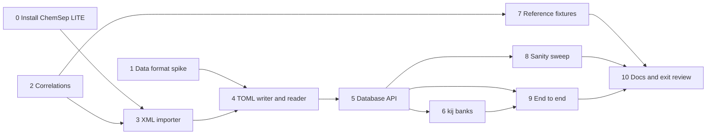

# M2 plan — component data

Status: **in progress.** Step 0 is done: the official files are in
`data/vendor/chemsep/`, and their [NOTICE](../data/vendor/chemsep/NOTICE.md)
records versions, checksums and licence. The roadmap entry is
[M2 in roadmap.md](roadmap.md#m2--component-data); this file is the detailed
plan.

## Goal

After M2, reflux can build any of the 642 compounds in ChemSep 8.50 by
name, CAS number or InChIKey. Each compound comes with:

- its constants, in SI per-mol units, each traceable to its source;
- the temperature-dependent correlations the flash and energy balances
  need (vapour pressure, ideal-gas Cp, liquid density, heat of
  vaporisation, liquid Cp), with the integrals H and S need;
- PR and SRK kᵢⱼ for the pairs ChemSep has.

One call should go from names to a ready `thermo.Fluid`:

```v
db := components.load_default()!
fl := db.fluid(.pr, ['methane', 'n-butane'])!   // Cubic + ideal gas + kij
```

M3's flash then starts from real data instead of hand-typed constants.

## What the research found

All of this comes from looking at the files themselves (October 2026).
The plan was first written from the copies in DWSIM's repository (v8.3,
2022). It was then checked against the official ChemSep LITE 8.50 install
(step 0), and the official files are what reflux uses. Where the two
differ, the official values are given here.

| Question | Answer |
|---|---|
| What is the data? | ChemSep pure-component databases `chemsep1.xml` (v8.49, **433 compounds**) and `chemsep2.xml` (v8.50, **209 compounds**). They don't overlap: 642 compounds in all. |
| Licence | Stated in each file's root element: *"ChemSep v8.49 pure component data 1 - Copyright (c) Harry Kooijman and Ross Taylor (2024)"*, with a link to the **Artistic License 2.0**, and the licence text ships in the same folder. |
| Defects | The XML is **not well-formed**: 43 SMILES attribute values end in a stray `<`. Strict XML parsers reject the files as shipped. |
| New in the official files | `InChIKey` and `PubChemID` per compound. Real revisions to Tc, Pc or ω for a few dozen compounds since v8.3; most other differences are reformatting. |
| What Artistic 2.0 allows | Verbatim redistribution with notices (§2); a converted copy is a "Modified Version", distributable if the changes are documented and it stays under Artistic 2.0 (§4(c)(i)); bundling with MIT code is fine (§7). |
| Identifiers | Name, CAS number (present, well-formed and unique in every record), InChIKey, PubChemID, SMILES, a structural formula, a family code. |
| Units | Per **kmol**: J/kmol, m³/kmol, kg/kmol. K and Pa elsewhere. |
| What M3 needs, and coverage | Tc, Pc, Vc, Zc, Tb, M, ω, ΔH°f, ΔG°f, S°: 431/431. Vapour pressure, ideal-gas Cp and heat of vaporisation: 431/431. Liquid density 424, liquid Cp 422. |
| Equation forms | Ideal-gas Cp is ChemSep **eq. 16**, A + exp(B/T + C + DT + ET²), for 429 compounds. It has no closed-form integral. Vapour pressure is DIPPR 101 (421), eq. 10 Antoine (8) and **eq. 200 (2, form unknown)**. Liquid density is DIPPR 105, heat of vaporisation DIPPR 106. Transport properties use 101, 102, 16 and others. |
| Extras | Mathias–Copeman c₁–c₃ in the XML (the EOS isn't stated), plus a separate `mc-PR.lib` explicitly fitted for Peng–Robinson; UNIQUAC r and q; UNIFAC, modified-UNIFAC and ASOG group assignments; Lennard-Jones parameters; a name-synonyms file. |
| kᵢⱼ | `pr.ipd` and `srk.ipd`: 292 pairs each, keyed by CAS pair, "DECHEMA Peng-Robinson [SRK] Parameters", "Copyright 2009 Harry Kooijman and Ross Taylor". **No licence named.** Also NRTL, UNIQUAC and Wilson files, for M6. |
| An oracle for tests | Caleb Bell's `chemicals` 1.5.2 implements DIPPR 100–107, 114–116 and 127, including integrals. It reproduces n-butane's Psat(350 K) = 9.467 bar and ρL(300 K) = 9.836 kmol/m³ from the ChemSep coefficients. |

The ChemSep-specific equations, from ChemSep's PCDmanager documentation:

| Eq. | Form | Eq. | Form |
|---|---|---|---|
| 1–5 | A + BT + CT² + DT³ + ET⁴, truncated to 1–5 terms | 10 | exp(A − B/(T + C)) (Antoine; K, Pa) |
| 11–15 | exp of the 1–5 polynomial | 16 | A + exp(B/T + C + DT + ET²) |
| 17 | A + exp(B + CT + DT² + ET³) | 45 | the integral of the eq. 5 polynomial |

## Exit criteria

All checked by `v -W test .`, so CI enforces them.

1. **Import is complete.** All 642 records import, despite the 43 malformed
   SMILES values, which are repaired and listed. The import report lists
   zero unparsed records. Any overlap between the files is resolved by the
   documented rule (D8); there is none in 8.50. Unsupported equation forms
   (such as eq. 200) are kept verbatim and reported, never dropped.
2. **The data files are reproducible.** Re-running the importer on the
   vendored XML regenerates `data/components/` byte for byte, and the
   vendored files still match the SHA-256 sums in their NOTICE. CI checks
   both, so neither the converted data nor its source can drift.
3. **Units are right.** Every scalar is SI per mol. Tests check a sample
   against hand conversions, for example n-butane's M of 58.123 kg/kmol
   becoming 0.058123 kg/mol, and ΔH°f in J/kmol becoming J/mol.
4. **Correlations are exact.** Every equation form used by the five
   M3-critical properties is implemented with its value, dY/dT,
   ∫Y dT and ∫Y/T dT:
   - DIPPR forms match `chemicals.dippr` to 1e-12 relative;
   - ChemSep-only forms match an independent evaluation to 1e-12;
   - numerical integrals (eq. 16) match high-resolution quadrature to 1e-10.
5. **The data is sane, and outliers are visible.** A sweep over all
   compounds checks that each correlation is finite, and positive where it
   must be, across its [Tmin, Tmax], and that Psat(Tb) is within 2% of
   1 atm. Failures go into a committed data-quality report rather than
   failing the build, but the report can't silently grow.
6. **Cross-checks are recorded.** Deviations are recorded at generation and
   can't grow, as in M1:
   - for fluids that also have a reference equation in CoolProp (about a
     dozen: light hydrocarbons, CO₂, N₂, water and others), ChemSep's Tc,
     Pc, ω and M, and its eq.-16 ideal-gas Cp, against CoolProp;
   - for 20 representative compounds, PR's Psat (from ChemSep's constants)
     against ChemSep's own vapour-pressure correlation, across Tr 0.5–0.95.
7. **Lookup works.** By CAS, by name (case-insensitive) or by alias. An
   unknown name is an error that lists the closest matches.
8. **kᵢⱼ works.** PR and SRK kᵢⱼ load from the ChemSep files. The matrix for
   any component list is symmetric, and pairs with no data get 0 and are
   listed in a report.
9. **End to end.** `db.fluid(.pr, […])` builds a working `thermo.Fluid`. An
   integration test reproduces M1's n-butane Psat and enthalpy changes using
   database constants.
10. CI is green, and the docs are updated.

## Decisions

| # | Decision | Choice | Why |
|---|---|---|---|
| D1 | Licence and layout | Verbatim ChemSep XML in `data/vendor/chemsep/`, with the Artistic 2.0 text and a NOTICE (source, version, SHA-256). The converted files in `data/components/` are a Modified Version, also under Artistic 2.0 (§4(c)(i)), with a CHANGES file. Code stays MIT. | It's exactly what the licence allows, and it keeps code and data licences visibly separate. |
| D2 | kᵢⱼ files | **Shipped, as DWSIM does (your call).** They go in `data/vendor/chemsep/` too. The NOTICE says plainly that the files name no licence and are assumed to fall under the database's Artistic 2.0, with a note to confirm with the authors. | Practical; the assumption is written down where anyone redistributing will see it. |
| D3 | Where the XML comes from | **The official ChemSep LITE download (your call).** Done with ChemSep LITE 8.50; the files come from its `pcd` and `ipd` folders. | The Standard Version, straight from the copyright holders. |
| D4 | reflux's own format | TOML, one file per compound (`data/components/<CAS>.toml`): readable, diffable, and the same format a user writes for their own compounds. Every value carries a source tag. | A per-compound diff is reviewable; one large file isn't. Step 1 checks V's `toml` module can do it, with JSON as the fallback. |
| D5 | Units of correlations | Coefficients are stored **verbatim**, along with the correlation's native output unit, and the evaluator converts the *result* to SI per mol. Scalars are converted at import. | Forms like A + exp(…) can't be rescaled coefficient by coefficient. Verbatim coefficients also compare directly with ChemSep and `chemicals`. |
| D6 | Where it lives | A new module `components`, which imports `thermo` and builds `thermo.Component`, `thermo.IdealGas` and `thermo.Fluid`. | `thermo` stays about models. Data handling is its own concern. |
| D7 | Outside [Tmin, Tmax] | Evaluate anyway (extrapolate) and say so: each evaluation returns the value plus an in-range flag. | A flash's trial temperatures often step outside a correlation's range briefly. Refusing would break the iteration, while silence would hide bad data. |
| D8 | Overlapping compounds | `chemsep1.xml` wins; `chemsep2.xml` adds compounds. Overlaps are listed in the import report. | Simple and deterministic. Revisit if the two disagree badly. |
| D9 | Ideal-gas Cp from the database | A new `CpForm` variant wrapping a correlation, so eq. 16 drops into M1's `Fluid` unchanged. Integrals use Gauss–Legendre quadrature when there's no closed form. | It reuses M1's whole total-property machinery. |
| D10 | Mathias–Copeman parameters | The XML's values are imported and stored but not used by default, since their EOS isn't stated. `mc-PR.lib`, fitted for PR, is the better source; vendoring it is a small addition to step 6. | Using parameters fitted for one EOS in another would be guessing. |
| D11 | Who writes what | As in M1, I write it all unless you claim a step. Good candidates are marked. | |

## Steps



### 0. Get the official files — done
- ChemSep LITE **8.50** is installed at
  `%LOCALAPPDATA%\ChemSepL8v50`. `chemsep1.xml`, `chemsep2.xml`, `pr.ipd`,
  `srk.ipd` and ChemSep's own `Artistic_license_2_0.txt` were copied into
  `data/vendor/chemsep/`, and they're byte-identical to the installed files.
- [NOTICE.md](../data/vendor/chemsep/NOTICE.md) records the versions,
  SHA-256 sums, the licence statements quoted from the files, the kᵢⱼ
  licence assumption (D2), the 43 malformed SMILES values, and how the
  files differ from DWSIM's.
- `.gitattributes` marks `data/vendor/` as `-text`, so Git doesn't rewrite
  the CRLF line endings and the checksums stay true.

### 1. Data format spike
Write n-butane by hand as TOML in the D4 schema, and check that V's `toml`
module reads the nested tables and arrays it needs. Decide between TOML and
JSON, and write the schema down in `docs/data-format.md`.

### 2. Correlations (exercise candidate: the polynomial and exponential forms)
- A `Correlation` (form, A–E, Tmin, Tmax, Tc where the form needs it, native
  unit) with `eval`, `deriv`, `int` and `int_over_t`.
- The forms: ChemSep 1–5, 10–17 and 45; DIPPR 100–107, 114 and 116.
  Unsupported forms (200 and any others) are representable but not
  evaluable, and are reported.
- Tests: fixtures from `chemicals.dippr`; quadrature for integrals;
  finite differences for derivatives.

### 3. ChemSep XML importer
- Parse with `encoding.xml` into records. Convert scalars to SI; keep
  correlation coefficients verbatim (D5). Attach provenance: file,
  version, compound index.
- Tests: every record parses; spot values against hand conversions; the
  overlap rule.

### 4. TOML writer and reader
- `tools/import_chemsep.vsh` writes `data/components/<CAS>.toml`, and the
  reader loads them back.
- Tests: round trip (write, read, identical records); the CI check that
  regenerating gives no diff (criterion 2).

### 5. Database API
- `load_default()`, `load(dir)`; lookup by CAS, name or alias, with
  suggestions for unknown names; `component(...)` gives a `thermo.Component`
  and `ideal_gas(...)` a `thermo.IdealGas`.
- User components in the same TOML format, in a directory listed after the
  built-in one, so they can add to or override it.

### 6. kᵢⱼ banks
- An IPD parser; a symmetric matrix for a component list; a report of
  missing pairs.
- Tests: a few pairs against the file by hand; symmetry; reporting of
  missing pairs.

### 7. Reference fixtures
- Extend `tools/` with a generator (uv, pinned) that writes DIPPR values
  from `chemicals` and CoolProp constants and Cp⁰ for the overlapping
  fluids.
- The V tests read them (criteria 4 and 6).

### 8. Sanity sweep and data-quality report
- Over every compound: finiteness, sign, Psat(Tb) ≈ 1 atm, and the PR-Psat
  comparison for the 20 representative compounds.
- `docs/data-quality.md` lists what fails, with numbers, generated by a
  tool and checked by a test.

### 9. End to end
- `db.fluid(.pr, names)`; the integration test from criterion 9; the demo
  updated to use database components.

### 10. Docs and exit review
- README, roadmap, the data-format doc, the V notes (`encoding.xml`,
  `toml`, file walking), and a criterion-by-criterion review, as in M1.

## Risks

| Risk | Effect | Fallback |
|---|---|---|
| V's `toml` module can't handle the schema | step 1 changes format | JSON via `json2`, which M1 already uses |
| `encoding.xml` is slow, or rejects the malformed files | import fails | the importer repairs the known defect (the stray `<`) before parsing, and lists each repair. If V's parser still can't cope, a small purpose-built reader for this flat format will. Import runs only when the vendored XML changes; the TOML is what loads at run time. |
| ChemSep LITE's files differ from DWSIM's copies | different numbers | **Happened**, and harmlessly: the official files win (D3), and the NOTICE records the differences. |
| The kᵢⱼ licence assumption (D2) turns out wrong | files must be removed | they're isolated in `data/vendor/chemsep/`, and the importer can read them from a local install instead |
| Bad entries in the data | wrong results downstream | the sanity sweep and data-quality report make them visible; no silent fixes |
| Repository size (about 5 MB vendored plus the converted files) | slower clones | acceptable at this scale; revisit with Git LFS if it grows |

## Not in M2

- Transport properties (viscosity, thermal conductivity, surface tension):
  their correlations are imported verbatim but not wired up until M5.
- UNIFAC, UNIQUAC and NRTL parameters: imported and stored raw, used in M6.
- Estimation methods (Joback and others): M6.
- Petroleum pseudo-components: after M7.
- The Soave α → 0 guard carried over from M1: still open, and not part of
  M2.
