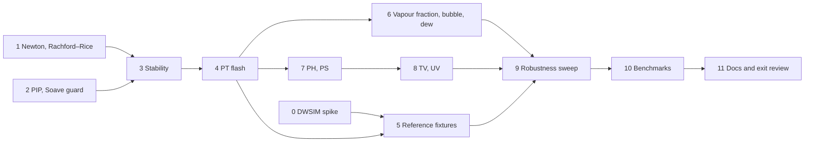

# M3 plan — flash

M3 makes reflux answer the question every unit operation asks: given a
mixture and two specifications, how many phases are there, and what are
they? It's planned like M1 and M2: research first, then exit criteria,
decisions and steps. The roadmap entry is in [roadmap.md](roadmap.md).

## Goal

Equilibrium flash calculations for any `thermo.Model`:

- **stability analysis:** does a phase split?
- **PT flash:** the split at given temperature and pressure;
- **PH, PS, TV and UV flashes**, and **vapour-fraction flashes**: the split
  at other pairs of specifications;
- **bubble and dew points**;
- a **Newton solver** with line search and trust region (roadmap track B2),
  and a **benchmark harness** (A5).

The flash is vapour–liquid only: two phases at most. Three-phase VLLE and
free water are M6. Right after M3 comes M10a, thermo and flash from Python,
so the API is designed for that from the start.

## What the research found

**What M1 and M2 give the flash.**
- `thermo.ln_phi_derivs` returns ln φᵢ and its T, P and composition
  derivatives at a solved state. Those are exactly what a second-order
  (Newton) flash and stability analysis need.
- `Root.stable` picks the volume root with the lower Gibbs energy.
- `Residual2` carries every second derivative of F.
- `numeric` has a dense LU solver.
- M2's `db.fluid` builds PR or SRK fluids with real kᵢⱼ for 642 compounds,
  640 of them with an ideal-gas Cp, which gives the robustness sweep real
  mixtures to draw from.

**The algorithms.** They're standard and well documented:
- Michelsen & Mollerup, *Thermodynamic Models: Fundamentals and
  Computational Aspects*, chapters 9–11, already the reference in
  [design.md](design.md);
- Michelsen 1982, *The isothermal flash problem*, Part I (stability) and
  Part II (phase split), in Fluid Phase Equilibria 9;
- Whitson & Michelsen 1989, the negative flash;
- Michelsen 1999, *State function based flash specifications*, Fluid Phase
  Equilibria 158–160, 617–626.

What they say:
- **Stability:** minimise the tangent-plane distance (TPD) over a trial
  phase W:

      tm(W) = 1 + Σ Wᵢ (ln Wᵢ + ln φᵢ(W) − dᵢ − 1),  dᵢ = ln zᵢ + ln φᵢ(z)

  - Start from Wilson's K, with one vapour-like trial (Wᵢ = zᵢKᵢ) and one
    liquid-like (zᵢ/Kᵢ).
  - Iterate by successive substitution on ln W, accelerated by Michelsen's
    dominant-eigenvalue method (DEM).
  - Finish with a second-order step in αᵢ = 2√Wᵢ, whose Hessian is
    well-conditioned.
  - tm < 0 means unstable, and the trial phase is a good first guess for
    the split. A trial that converges back to z is the trivial solution
    and tells you nothing, so it must be detected.
- **PT flash:**
  - Solve Rachford–Rice for the vapour fraction β inside the window where
    it has no poles (Leibovici & Neoschil). Nichita & Leibovici 2013 give a
    convex transformation that converges monotonically, a robust
    alternative.
  - Iterate ln Kᵢ = ln φᵢᴸ − ln φᵢⱽ by successive substitution with DEM.
  - Switch to Newton on the Gibbs energy, in vapour mole numbers with a
    line search, when successive substitution slows.
  - The negative flash, which lets β lie outside [0, 1] while iterating,
    is what bubble and dew points and phase boundaries need.
- **PH, PS and UV flashes:** Michelsen 1999 writes each specification as
  finding a stationary point of a state function, his Q-function. This
  handles **pure components and narrow-boiling mixtures**. The textbook
  nested loop (guess T, PT-flash, correct T) fails on those: at fixed P,
  a pure component's H jumps at Tsat, so no T gives a specified H inside
  the jump.
- **TV and UV flashes** are natural for reflux. Its models are Helmholtz
  functions F(T, V, n), so these need no volume-root solve at all.

**References.**
- **`thermo` 0.6.1** (Caleb Bell), checked by inspecting the installed
  library:
  - `FlashVL` does TP, PH, PS, TV and vapour-fraction flashes with PR
    phases;
  - it labels phases by the phase identification parameter (PIP);
  - `chemicals.rachford_rice` has Leibovici–Neoschil and other
    Rachford–Rice solvers;
  - its ideal-gas Cp takes a polynomial (`poly_fit`), so reflux and
    `thermo` can share one Cp and agree to 1e-9 on H and S, as in M1.
- **DWSIM 9.0.5** is installed here, on .NET Framework 4.6.2.
  - DWSIM's modern Python route, the FluentAPI, needs DWSIM 10 or later,
    which you couldn't use.
  - A probe showed that `pythonnet` 3.0.5, on Python 3.13, loads DWSIM 9's
    `DWSIM.Automation.Automation3` from the install. It offers
    `CreateFlowsheet`, `AvailableCompounds`, `AvailablePropertyPackages`
    and `CalculateFlowsheet`.
  - A scripted capture of reference flashes is therefore possible, but
    unproven beyond loading the assembly, which is why step 0 is a spike.
  - DWSIM's compounds come from its own, older ChemSep copy, whose
    constants differ from M2's for some compounds. So the comparison
    records DWSIM's constants and kᵢⱼ and uses those: the same model with
    the same numbers.

**Phase labels.** A single phase has to be called liquid or vapour, and
unit operations and users both depend on the label.
- `thermo` uses the PIP of Venkatarathnam & Oellrich (2011):
  V·[(∂²P/∂T∂V)/(∂P/∂T) − (∂²P/∂V²)/(∂P/∂V)], liquid above 1.
- It needs ∂²P/∂V² and ∂²P/∂T∂V, which are third derivatives of F that the
  `Model` contract doesn't have. Finite differences of the analytic first
  derivatives are plenty for a label.

**Carried into M3:**
- from M1, the Soave α → 0 guard (supercritical components are where it
  bites), the benchmark harness, and the allocation work (M1 D8);
- from M2, the cost of `thermo.Correlated`, which integrates ChemSep's
  ideal-gas Cp numerically on every H and S. A PH flash evaluates H many
  times.

## Exit criteria

All checked by tests in CI, except the full sweep and DWSIM's capture,
which are tools whose committed output tests check.

1. **Stability is right.** On a reference set (binaries, ternaries, a
   10-component gas condensate, points near a critical point), stability
   analysis agrees with `thermo`'s on stable or unstable. The trivial
   solution is detected, never reported as a result.
2. **PT flash matches `thermo`.** On the same set, β and both phases'
   compositions agree to 1e-8 with `thermo`'s `FlashVL`, run with the same
   PR, constants and kᵢⱼ.
3. **Every converged split is an equilibrium**, in every test and sweep:
   - fugacities equal, |ln fᵢⱽ − ln fᵢᴸ| ≤ 1e-10;
   - each component's mass balance to 1e-12;
   - Σx = Σy = 1;
   - neither phase unstable (TPD ≥ −1e-8 on each).
4. **Every specification round-trips.** From each reference PT flash, take
   its H, S, V, U and β, then run the PH, PS, TV, UV and vapour-fraction
   flashes from them. Each must recover T, P and the split, to 1e-8
   relative. Bubble and dew points are β = 0 and β = 1 splits that satisfy
   criterion 3. The set includes pure components and a narrow-boiling
   mixture.
5. **Robust.**
   - A sweep of 10,000 random (T, P, z) points, PR with 2 to 10 components
     drawn from the database with its kᵢⱼ, has **zero unexplained
     failures**. D8 defines unexplained, and every failure is classified.
   - The sweep's report is committed. A fixed, seeded 1,000-point subset
     runs in CI.
6. **Agrees with DWSIM 9.** On about 20 cases (PT, PH, PS, bubble, dew),
   using DWSIM's own constants and kᵢⱼ, reflux agrees within DWSIM's
   convergence tolerance. The target is β and compositions to 1e-4, T to
   0.01 K and P to 0.01%. The deviations are recorded and can't grow.
7. **The Newton solver works.** It solves a standard set of test problems
   (from Moré, Garbow & Hillstrom) and reports non-convergence as an error,
   never a wrong answer.
8. **Speed is measured.** The benchmark harness times PT, PH and
   bubble-point flashes for 2-, 5- and 10-component mixtures, with gcc
   `-prod`. It compares reflux with `thermo` and with DWSIM on the same
   flashes, the last because slow flowsheets were a reason to start
   reflux. The results are kept in `docs/benchmarks.md`. There's no speed
   target yet: M3 makes the first honest measurement.
9. **Soave α is safe at any Tr.** α and its derivatives stay finite through
   the point where Soave's form reaches zero, and M1's fixtures are
   unchanged.
10. CI is green, and the docs are updated: README, roadmap, design notes
    and V notes.

## Decisions

| # | Decision | Choice | Why |
|---|---|---|---|
| D1 | Where it lives | A new module `flash`, importing `thermo` and `numeric`. | `thermo` stays about models, as `components` is about data. |
| D2 | Which models | Any `thermo.Model`: the flash uses only ln φ, its derivatives and volume roots. | CPA and SAFT (M12) must drop in without touching the flash. |
| D3 | Stability | Michelsen's TPD: Wilson vapour- and liquid-like trials; successive substitution with DEM acceleration every fifth step; a second-order finish in α = 2√W. Re-checking a split uses each phase as a trial too. **Amended in step 4:** plus a nearly pure trial of each component, since Wilson's trials alone miss liquid–liquid splits. | The standard, well-tested formulation, and the one `thermo` follows. |
| D4 | PT flash | Initial K from stability's unstable trial. Rachford–Rice in the Leibovici–Neoschil window, with Newton safeguarded by bisection. Successive substitution with DEM, then Newton on G in vapour mole numbers with a line search when it slows. Negative flash internally. | Fast where easy, robust where hard (near-critical), and the negative flash is what phase boundaries need. |
| D5 | PH, PS, TV, UV | Michelsen's state-function (Q-function) formulation. TV and UV work directly in F(T, V, n). | It handles pure components and narrow-boiling mixtures, where nested T-loops fail. |
| D6 | Phase labels | PIP, with finite-difference second derivatives of P. In a split, the less dense phase is the vapour. | `thermo`'s choice, so comparisons line up. No change to the `Model` contract. |
| D7 | The result | `FlashResult`: T, P, β, the phases (each a label, a `thermo.State` and its fraction), iterations, and which path converged. It allows N phases for M6. Failure is a typed `FlashError` (no convergence, bad specification, …), never a panic. | M10a wraps this for Python next: no panics across the C boundary, and failures carry a reason. |
| D8 | The robustness sweep | Seeded. Components drawn from the database among those with Tc, Pc, ω, M and an ideal-gas Cp. T and P log-uniform over wide ranges; z random. **Unexplained:** no convergence, a broken invariant (criterion 3), or a contradiction such as a single-phase answer that stability calls unstable. **Explained, and counted separately:** a specification outside the model's range, or a point within 1e-6 of a critical point, where the two phases can't be told apart. | "Zero failures" needs a definition, or it means nothing. |
| D9 | References | `thermo` 0.6.1 fixtures with the same PR, constants and kᵢⱼ, and a shared polynomial Cp, to 1e-8. DWSIM 9.0.5 through `pythonnet` and `DWSIM.Automation`, run by hand like the CoolProp fixtures, with DWSIM's own constants and kᵢⱼ recorded and used. **Fallback** if automation fails: capture by hand in the DWSIM GUI, following a written procedure. | `thermo` checks the implementation; DWSIM checks what M4 will be compared with. |
| D10 | Benchmarks | A `benchmark` module (roadmap A5), built with gcc `-prod`. Results, with machine and compiler, in `docs/benchmarks.md`. DWSIM's timings come from the same automation script. | Speed claims have to be real, and kept so that regressions show. |
| D11 | The Soave α guard | Compute Soave's α through its square root, s = 1 + m(1 − √Tr), so the zero at Tr = (1 + 1/m)² is harmless instead of a division by zero. Past it, keep the published form, which rises again, document that, and recommend Twu for supercritical components such as H₂. | The fix is exact and changes nothing below the zero, so M1's fixtures hold. |
| D12 | Who writes what | As before, I write it all unless you claim a step. | |

## Steps

### 0. DWSIM automation spike — done: go, with conditions
- [spike/dwsim/run.py](../spike/dwsim/run.py) drives DWSIM 9.0.5 headless
  through `pythonnet` and `Automation3`:
  - it builds the methane/n-butane PR flowsheet;
  - it flashes PT both through the flowsheet solver and through the
    property package (bit-identical), then PH back to the same T;
  - it reads back β, the compositions, H, the constants, the Cp
    coefficients and kᵢⱼ.
- The write-up is [spike-dwsim.md](spike-dwsim.md). The GUI fallback in D9
  isn't needed.
- Every part of DWSIM's difference from an exact PR is accounted for:
  - its PR has Ωa = 0.45724, Ωb = 0.0778 and R = 8.314, reproduced to
    5e-16 in the enthalpy departures;
  - its flash stops at a fugacity residual of 8e-7, however tight the
    tolerance;
  - its ideal-gas enthalpy is a 1e-5 approximation of the Cp integral.
- Two things step 5 has to change:
  - compare PH and PS with DWSIM by state, not by feeding DWSIM's H to
    reflux, because the rounded constants move a liquid's H by 1e-4
    (about 0.015 K);
  - tighten `thermo`'s `PT_SS_TOL` to 1e-30, since its default leaves β
    2.7e-8 off, more than criterion 2's 1e-8.
- Timings for D10: warm PT 1.0–1.6 ms, PH 6.7–15 ms, a one-stream
  flowsheet solve 2.3–4 ms, and 7–10 s to start.

### 1. Newton solver and Rachford–Rice — done
- **[numeric/rachford_rice.v](../numeric/rachford_rice.v):**
  `rachford_rice(z, k)` returns β, L = 1 − β, x, y and the iteration count.
  - β is written as a position t in the pole-free window, with s = 1 − t.
    Every denominator then becomes 1 + β(Kᵢ − 1) = s·uᵢ + t·vᵢ, where
    uᵢ, vᵢ ≥ 0, so no composition is ever formed by a cancelling
    subtraction.
  - Whichever of t and s is smaller is stored exactly, so trace phases
    keep their digits.
  - It runs Newton on the Leibovici–Neoschil function, safeguarded by
    bisection, from a guess interpolated between the window's ends.
  - It needs a median of 4 iterations and at most 7, and a binary is done
    in 1, because the function is linear in t for two components.
  - It solves the negative flash (β outside [0, 1]) as is, and fails only
    when every K is on one side of 1.
- **[numeric/newton.v](../numeric/newton.v):** `newton(system, x0)`
  globalises Newton with a line search (Dennis & Schnabel A6.3.1) or a
  dogleg trust region.
  - Where J is singular it takes a Levenberg–Marquardt step.
  - A system can refuse a point outside its domain, and the solver then
    steps back.
  - It succeeds only when |F| ≤ ftol, or when a true Newton step is
    shorter than xtol. Every other outcome is a `NewtonError` with a
    reason and the best point reached.
- **Rachford–Rice tests**, against `testdata/m3_rachford_rice.json` from
  the new [tools/gen_m3_fixtures.py](../tools/gen_m3_fixtures.py):
  - **The fixture:** 87 seeded cases. The reference is the exact root of
    each case's floats, by bisection at 100 digits, and agrees with
    `chemicals`' own mpmath solver.
  - **Accuracy:**
    - compositions to 1e-15 relative;
    - β and L to 4 ulps of what the K-values allow (ε·(|β| + min(|c₁|, cₙ)));
    - trace liquid or vapour fractions down to 1e-15, to 4 ulps of
      themselves.
  - **Against `chemicals`:** across the fixture, reflux's worst error is
    below that of each of `chemicals`' four float solvers. Their worst
    errors, in β and then in the compositions:
    - Leibovici–Neoschil: 2.4e-8 and 3.9e-15;
    - LN2: 2.4e-8 and 2.9e-12;
    - `flash_inner_loop`: 4.4e3 and 8.2e-4;
    - `Rachford_Rice_solution`: 1.7e-2 and 1.0, the last on a trace liquid.
    - All four worst β errors come from the near-critical cases.
  - **Mass balance** holds component by component on 2,000 random feeds
    with K over twenty decades.
- **Newton tests:**
  - **The MGH runs:** 12 Moré–Garbow–Hillstrom problems, each from 1× and
    10× its standard start and with both methods: 48 runs.
    - 46 converge. Each answer is checked by evaluating F afresh, and
      against the root where it's known.
    - The 2 that fail are the trigonometric problem from 10× its start.
      Both are reported errors, and the dogleg's stopping point is checked
      to be a genuine non-root minimum of ‖F‖: JᵀF is 4e-10 where |F| is
      6e-4.
    - This failure list is recorded and can't grow.
  - **Freudenstein–Roth** is either solved at (5, 4) or refused.
  - **Edge cases:**
    - a system with no root;
    - stepping back into the domain;
    - a singular Jacobian;
    - a stationary starting point;
    - the xtol path where ftol is out of reach;
    - bad input.
- **Bugs found and fixed:**
  1. The line search refused a full Newton step shorter than its
     backtracking floor, so the variably dimensioned problem stopped at
     |F| = 2.6e-10.
  2. Rachford–Rice's last, tiny Newton step could leave its own bracket
     and set off bisection: up to 48 iterations instead of 7.
  3. At a rounding floor the decrease test could reject a converged
     Newton step, so such steps are now taken without it.
- **Planted mistakes:** 22 of 22 caught. Three survivors along the way
  showed code no test needed: geometric bisection, an equivalent branch in
  the window arithmetic, and a second formula for L. That code was
  deleted, and the xtol test was added.

### 2. Phase identification and the Soave guard — done
- **The Soave guard (D11)** is in [thermo/alpha.v](../thermo/alpha.v) and
  [thermo/cubic.v](../thermo/cubic.v).
  - `Alpha.root` returns √α and its derivatives: k itself, signed, for the
    α = k² forms (Soave, PRSV, Mathias–Copeman).
  - `sqrt_a` builds sᵢ = √a_c·k from it, with no division, so the old 0/0
    at the zero is gone.
  - Soave's zero falls at about 1,400 K for N₂ and 2,400 K for CH₄ with
    PR.
  - Past it, a pure component is the published α = k². A mixture's cross
    term goes negative instead of taking `thermo`'s |k|, which would kink
    a(T) and make Hʳ jump. This is documented, with Twu as the α to use.
- **PIP (D6)** is in [thermo/phase.v](../thermo/phase.v).
  - `pip` uses analytic ∂P/∂V and ∂P/∂T, and central differences for the
    second derivatives. The V step scales with V − V_min.
  - `phase_label` returns liquid when Π > 1, as `thermo` does.
- **A volume-solver fix**, found here, in
  [thermo/model.v](../thermo/model.v).
  - At (Tc, Pc), P(V) − p has a triple root, so Newton slows to linear
    convergence and rounding limits V to about 1e-5. M1's solver failed
    there, and on 276 of 528 requests within 1e-6 of Tc and 1e-8 of Pc.
  - It now stops once the residual is at P's rounding floor and the step
    test can't be met. Elsewhere nothing changes.
- **Tests:**
  - `testdata/m3_pip.json` comes from
    [tools/gen_m3_fixtures.py](../tools/gen_m3_fixtures.py) and `thermo`
    0.6.1: 1,327 PR and SRK roots, pure and mixed, across saturation and
    the critical point, plus liquids within 0.02% of the covolume.
    - Volumes agree to 1e-9 (1.8e-11 measured), PIP to 1e-7 (5e-9
      measured), and every label is the same.
    - Pure components' exact critical points are left out, since Π is 0/0
      there.
  - Pure CO₂ from 0.9 to 1.5 times its Soave zero matches `thermo` to
    1e-9 (Z, ln φ, Hʳ, Sʳ, Cpʳ). For a pure component `thermo`'s α has no
    division, so it's a valid reference there.
  - A mixture with a component exactly at its zero (m = 0.5, Tr = 9)
    stays finite, and its F_T and F_TT match central differences.
  - `root` is checked against `eval` and against finite differences for
    every α form.
  - At every critical point the liquid and vapour roots straddle Vc within
    1e-4, and all 528 states around them solve.
  - M1's fixtures are unchanged.
- **Planted mistakes:** 16 of 16 caught. Two survivors along the way led
  to the compressed-liquid states and to dropping a redundant second exit
  in the volume solver. The same exercise found that `solve_tp`'s fallback
  to the other branch could hide a failing branch, so the critical-point
  test now requires the two roots to differ.

### 3. Stability analysis — done
- **The new `flash` module** (D1), with
  [flash/stability.v](../flash/stability.v): `stability(model, t, p, z)`
  for any `thermo.Model` (D2).
  - It runs Wilson's vapour- and liquid-like trials, plus any the caller
    passes in to re-check a split (D3).
  - Each trial is successive substitution with DEM every fifth step. After
    20 steps comes a second-order finish that minimises tm* in α = 2√W.
  - A trial ending within 1e-5 of z is flagged trivial and never offered
    as a phase. The feed is unstable when a non-trivial trial reaches
    tm < −1e-10; a trial out of steps still proves it so.
  - Failures are a typed `FlashError` (D7). There's also `wilson_k`, and
    a `max_steps` option.
- **New in `numeric`:** `cholesky`, and `minimize`, Newton minimisation
  with a Levenberg–Marquardt shift.
  - Each step solves (H + μI)p = −g, with μ raised until the factorisation
    exists and f falls.
  - Where f stops showing progress it finishes on the gradient (`fscale`
    sets the size of f's rounding). That counts as convergence only if the
    unshifted Newton model agrees.
  - It reports whether the end is a minimum or a saddle.
- **What made the finish work:** near the methane/n-butane critical locus,
  the first version, Newton on g = 0 through `numeric.newton`, stopped in
  dips of ‖g‖ along a flat valley of tm*.
  - Substitution then took up to 465 steps, and one state failed.
  - Minimising tm* itself, with `fscale` and the polish, brings 33,600
    states 0.1 bar apart there to 0 failures and at most 42 steps.
  - On 6,000 random PR states with 2 to 10 components, at 150–600 K and
    1–400 bar, there are 0 failures.
- **Tests:**
  - **The fixture:** `testdata/m3_stability.json` has 513 states.
    - Binaries on grids, plus 62 near the critical locus, 33 of them
      0.1 bar apart. The pressures are exact doubles, since an ulp decides
      the hard path.
    - A ternary, and a 10-component gas condensate.
    - Every binary is judged by a brute-force TPD scan over the whole
      composition range; every state also has `thermo`'s FlashVL, which
      agrees with all the scans.
    - `thermo` hits rounding cycles at `PT_SS_TOL` 1e-30, so the generator
      steps the tolerance down to 1e-25.
  - **Verdicts:** all 513 match (166 unstable). For the binaries, the
    lowest tm matches the scans' global minima to 1e-11 (measured: 2e-14).
  - **Instability:** every "unstable" is proved by a TPD computed from
    scratch at the incipient phase, which is also checked to be a
    stationary point.
  - **Stability:** stable feeds have no negative stationary point, trivial
    trials are flagged and never offered, and each phase of `thermo`'s
    splits is stable, with the other phase as a given trial at tm ≈ 0.
  - **Running out of steps:** with no proof it's a FlashError; a negative
    tm is still proof.
  - **Derivatives:** the finish's gradient and Hessian are checked against
    finite differences.
  - **Iteration budget:** 10,850 steps and 125 finishes over 1,026 trials,
    recorded with 5% room. Without DEM it's 14,485 and 356.
  - **`minimize`** is tested on Rosenbrock (including from an indefinite
    start), Wood (past its saddle), Powell's singular quartic, a domain
    wall, a saddle, noise in f and in g, a step that raises f, and an
    unbounded function.
- **Planted mistakes:** 24 of 26 caught. Two survive, for stated reasons:
  - Counting trivial trials in the verdict can't change one, since their
    |tm| is below the threshold.
  - Dropping `fscale` at the stability call shows only at 2 of the 33,600
    near-critical states, and only under `gcc -prod`. The same mistake
    inside `minimize` is caught.
  - Three earlier survivors led to deleting Michelsen's DEM guard (no
    effect on 6,000 states), to `max_steps` and its tests, and to the
    derivative and budget tests.

### 4. PT flash — done
- **[flash/pt.v](../flash/pt.v):** `pt(model, t, p, z)` returns a
  `FlashResult` (D7): T, P, the feed, β, the phases (label, `thermo.State`,
  fraction; vapour first), the path (single phase, substitution or Newton),
  the iterations and the feed's stability test.
  - A stable feed is one phase, labelled by PIP.
  - An unstable one is split (D4). K starts at W/z from the unstable
    trials, lowest tm first. Then successive substitution with
    Rachford–Rice (negative flash on the way) and DEM.
  - After 20 steps it switches to Newton on G in the vapour mole numbers
    through `numeric.minimize`, with the analytic Hessian.
  - Each phase takes its lower-Gibbs root, and the less dense phase is the
    vapour (D6).
  - A split is accepted only at |ln fⱽ − ln fᴸ| ≤ tol (1e-12) with
    0 < β < 1, and not once it has collapsed onto the feed.
  - `verify` (on by default) re-tests each phase. An unstable phase is a
    `FlashError` of the new kind `more_phases`.
- **D3 amended: pure-component trials in stability, on by default.**
  - Water, n-decane and methane (PR, water–hydrocarbon kᵢⱼ 0.5) at 350 K
    and 5 bar has three phases: a methane-rich vapour, nearly pure water,
    and a decane-rich liquid.
  - A two-phase flash, reflux's or `thermo`'s FlashVL, finds a split whose
    fugacities are equal. Wilson's trials call each of its phases stable,
    but a nearly pure water trial finds tm = −2.2.
  - With a nearly pure trial of each component, the flash correctly
    reports `more_phases`.
  - On 6,000 random PR mixtures the pure trials find 29 instabilities that
    Wilson's two miss. With them on, dropping either Wilson trial changes
    no verdict.
  - They cost about 2.4 times the stability work. `pure_trials: false`
    turns them off. Whether Wilson's trials are still worth their cost is
    a question for step 10's benchmarks.
- **Tests,** on the stability fixture's 513 states and some new ones:
  - **Against `thermo`'s splits:** all 166 have β and both compositions
    within 1e-8 (exit criterion 2 for PT; 4e-9 and 2e-10 measured).
  - **Every split an equilibrium** (exit criterion 3), checked from
    scratch:
    - fugacities to 1e-10 (1e-12 measured);
    - mass balance to 1e-12;
    - Σx = Σy = 1;
    - each phase stable.
  - **Single phases** labelled by PIP.
  - **Retrograde condensation:** the 10-component condensate at 400 K
    condenses up to 110 bar, vaporises again, and is single-phase at
    170 bar.
  - **Light beside heavy:** N₂ (Tr ≈ 2) beside n-decane (Tr ≈ 0.4), with
    the decane trace in the gas matching Raoult's law to 5%.
  - **Three phases** refused as `more_phases`.
  - **The tolerance contract:** at `tol` 1e-16 every answer meets it, or
    is an error.
  - **A split budget:** 2,246 steps and 44 Newton finishes over the 166
    splits, recorded with 2.4% room.
  - **Internal tests** of the negative-flash and collapse guards.
- **Planted mistakes:** all 16 caught.
  - The first survivors showed three things. Newton on G rescues any poor
    start, so the budget became the test of efficiency. The start's
    orientation (W/z or z/W) is exactly equivalent, by the K ↔ 1/K
    symmetry, so that logic was deleted. The Wilson fallback was never
    needed, so it was deleted too.
  - The stability mistakes, rerun with pure trials on: all caught but the
    two explained before, plus the liquid-like Wilson trial, which is now
    redundant on all the evidence.

### 5. Reference fixtures
- `tools/gen_m3_fixtures.py` writes `testdata/m3_thermo.json`: `thermo`'s
  PT, PH, PS, TV and vapour-fraction flashes and bubble and dew points on
  the reference set, with a shared polynomial Cp.
- `tools/gen_m3_dwsim.py`, grown from the spike, writes
  `testdata/m3_dwsim.json`: about 20 DWSIM cases, with DWSIM's constants,
  kᵢⱼ and version.
- Both generators follow "What step 5 must do" in
  [spike-dwsim.md](spike-dwsim.md): tight tolerances, each case's
  fugacity residual stored, and PH and PS compared by state.
- Tests: criteria 1, 2 and 6.

### 6. Vapour-fraction flashes, bubble and dew points
- β given with T, or with P; bubble (β = 0) and dew (β = 1) points.
  Newton on ln K together with T or P, started from Wilson.
- Retrograde cases have two dew points at one T, so the API says which one
  it returns.
- Tests: consistency with the PT flash; retrograde cases; clear errors near
  the cricondenbar and cricondentherm.

### 7. PH and PS flashes
- Michelsen's Q-function (D5), including pure components (H jumps at Tsat)
  and a narrow-boiling mixture.
- Tests: criterion 4's round trips; agreement with `thermo`.

### 8. TV and UV flashes
- The Helmholtz-natural specifications (D5).
- Tests: round trips from PT; agreement with `thermo` (TV).

### 9. Robustness sweep
- `tools/flash_sweep.vsh` runs the 10,000-point sweep (D8) and writes
  `docs/flash-robustness.md`, with every failure classified.
- A test runs the seeded 1,000-point subset in CI.

### 10. Benchmarks and a performance pass
- The `benchmark` module and `docs/benchmarks.md` (D10), with reflux,
  `thermo` and DWSIM on the same flashes.
- Then the carried items, measured before anything is changed:
  allocation in hot paths, and the cost of `Correlated` in PH and PS.

### 11. Docs and exit review
- README, roadmap, design notes on the flash, the V notes, and a
  criterion-by-criterion review, as in M1 and M2.

## Risks

| Risk | Effect | Fallback |
|---|---|---|
| DWSIM's automation can't be driven headless from Python | no DWSIM references | capture by hand in the GUI, following a written procedure (D9). The spike in step 0 finds out first. |
| Near-critical points converge slowly or to the trivial solution | sweep failures | the second-order finish, trivial-solution detection, and D8's explained class for true criticality |
| Pure and narrow-boiling PH flashes | wrong T or no convergence | the Q-function formulation (D5), with pure components in the tests from the start |
| `thermo` itself fails at hard points | no reference there | compare only where `thermo` converges, and record where it doesn't |
| The 10,000-point sweep is too slow under tcc | CI time | the full sweep is a tool with a committed report; CI runs 1,000 points |
| `Correlated`'s quadrature makes PH and PS slow | slow flashes | measure in step 10 first; then cache or tabulate Cp integrals if it matters |
| The Soave change perturbs M1's results | regressions | the square-root form is exact below the zero; M1's fixtures must still pass |

## Not in M3

- Three-phase VLLE and free-water handling: M6, with activity models.
- Phase envelope tracing (Michelsen 1980). Bubble and dew points come
  point by point here, and tracing a whole envelope comes later.
- Solids (SLE), electrolytes, and reactive or chemical-equilibrium flashes.
- γ–φ flashes with activity models: M6.
- The Python API: M10a, straight after M3.
