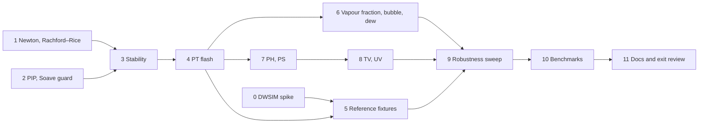

# M3 plan — flash

M3 makes reflux answer the question every unit operation asks: given a
mixture and two specifications, how many phases are there, and what are
they? It's planned like M1 and M2: research first, then exit criteria,
decisions and steps. The roadmap entry is in [roadmap.md](roadmap.md).

Status: **done.** The criterion-by-criterion review is in "Exit review", at
the end.

## Goal

Equilibrium flash calculations for any `thermo.Model`:

- **stability analysis:** does a phase split?
- **PT flash:** the split at given temperature and pressure;
- **PH, PS, TV and UV flashes**, and **vapour-fraction flashes**: the split
  at other pairs of specifications;
- **bubble and dew points**;
- a **Newton solver** with line search and trust region (roadmap track B2),
  and a **benchmark harness** (A5).

The flash is vapour–liquid only: two phases at most. Three-phase VLLE and
free water are M6. Right after M3 comes M10a, thermo and flash from Python,
so the API is designed for that from the start.

## What the research found

**What M1 and M2 give the flash.**
- `thermo.ln_phi_derivs` returns ln φᵢ and its T, P and composition
  derivatives at a solved state. Those are exactly what a second-order
  (Newton) flash and stability analysis need.
- `Root.stable` picks the volume root with the lower Gibbs energy.
- `Residual2` carries every second derivative of F.
- `numeric` has a dense LU solver.
- M2's `db.fluid` builds PR or SRK fluids with real kᵢⱼ for 642 compounds,
  640 of them with an ideal-gas Cp, which gives the robustness sweep real
  mixtures to draw from.

**The algorithms.** They're standard and well documented:
- Michelsen & Mollerup, *Thermodynamic Models: Fundamentals and
  Computational Aspects*, chapters 9–11, already the reference in
  [design.md](design.md);
- Michelsen 1982, *The isothermal flash problem*, Part I (stability) and
  Part II (phase split), in Fluid Phase Equilibria 9;
- Whitson & Michelsen 1989, the negative flash;
- Michelsen 1999, *State function based flash specifications*, Fluid Phase
  Equilibria 158–160, 617–626.

What they say:
- **Stability:** minimise the tangent-plane distance (TPD) over a trial
  phase W:

      tm(W) = 1 + Σ Wᵢ (ln Wᵢ + ln φᵢ(W) − dᵢ − 1),  dᵢ = ln zᵢ + ln φᵢ(z)

  - Start from Wilson's K, with one vapour-like trial (Wᵢ = zᵢKᵢ) and one
    liquid-like (zᵢ/Kᵢ).
  - Iterate by successive substitution on ln W, accelerated by Michelsen's
    dominant-eigenvalue method (DEM).
  - Finish with a second-order step in αᵢ = 2√Wᵢ, whose Hessian is
    well-conditioned.
  - tm < 0 means unstable, and the trial phase is a good first guess for
    the split. A trial that converges back to z is the trivial solution
    and tells you nothing, so it must be detected.
- **PT flash:**
  - Solve Rachford–Rice for the vapour fraction β inside the window where
    it has no poles (Leibovici & Neoschil). Nichita & Leibovici 2013 give a
    convex transformation that converges monotonically, a robust
    alternative.
  - Iterate ln Kᵢ = ln φᵢᴸ − ln φᵢⱽ by successive substitution with DEM.
  - Switch to Newton on the Gibbs energy, in vapour mole numbers with a
    line search, when successive substitution slows.
  - The negative flash, which lets β lie outside [0, 1] while iterating,
    is what bubble and dew points and phase boundaries need.
- **PH, PS and UV flashes:** Michelsen 1999 writes each specification as
  finding a stationary point of a state function, his Q-function. This
  handles **pure components and narrow-boiling mixtures**. The textbook
  nested loop (guess T, PT-flash, correct T) fails on those: at fixed P,
  a pure component's H jumps at Tsat, so no T gives a specified H inside
  the jump.
- **TV and UV flashes** are natural for reflux. Its models are Helmholtz
  functions F(T, V, n), so these need no volume-root solve at all.

**References.**
- **`thermo` 0.6.1** (Caleb Bell), checked by inspecting the installed
  library:
  - `FlashVL` does TP, PH, PS, TV and vapour-fraction flashes with PR
    phases;
  - it labels phases by the phase identification parameter (PIP);
  - `chemicals.rachford_rice` has Leibovici–Neoschil and other
    Rachford–Rice solvers;
  - its ideal-gas Cp takes a polynomial (`poly_fit`), so reflux and
    `thermo` can share one Cp and agree to 1e-9 on H and S, as in M1.
- **DWSIM 9.0.5** is installed here, on .NET Framework 4.6.2.
  - DWSIM's modern Python route, the FluentAPI, needs DWSIM 10 or later,
    which you couldn't use.
  - A probe showed that `pythonnet` 3.0.5, on Python 3.13, loads DWSIM 9's
    `DWSIM.Automation.Automation3` from the install. It offers
    `CreateFlowsheet`, `AvailableCompounds`, `AvailablePropertyPackages`
    and `CalculateFlowsheet`.
  - A scripted capture of reference flashes is therefore possible, but
    unproven beyond loading the assembly, which is why step 0 is a spike.
  - DWSIM's compounds come from its own, older ChemSep copy, whose
    constants differ from M2's for some compounds. So the comparison
    records DWSIM's constants and kᵢⱼ and uses those: the same model with
    the same numbers.

**Phase labels.** A single phase has to be called liquid or vapour, and
unit operations and users both depend on the label.
- `thermo` uses the PIP of Venkatarathnam & Oellrich (2011):
  V·[(∂²P/∂T∂V)/(∂P/∂T) − (∂²P/∂V²)/(∂P/∂V)], liquid above 1.
- It needs ∂²P/∂V² and ∂²P/∂T∂V, which are third derivatives of F that the
  `Model` contract doesn't have. Finite differences of the analytic first
  derivatives are plenty for a label.

**Carried into M3:**
- from M1, the Soave α → 0 guard (supercritical components are where it
  bites), the benchmark harness, and the allocation work (M1 D8);
- from M2, the cost of `thermo.Correlated`, which integrates ChemSep's
  ideal-gas Cp numerically on every H and S. A PH flash evaluates H many
  times.

## Exit criteria

All checked by tests in CI, except the full sweep and DWSIM's capture,
which are tools whose committed output tests check.

1. **Stability is right.** On a reference set (binaries, ternaries, a
   10-component gas condensate, points near a critical point), stability
   analysis agrees with `thermo`'s on stable or unstable. The trivial
   solution is detected, never reported as a result.
2. **PT flash matches `thermo`.** On the same set, β and both phases'
   compositions agree to 1e-8 with `thermo`'s `FlashVL`, run with the same
   PR, constants and kᵢⱼ.
3. **Every converged split is an equilibrium**, in every test and sweep:
   - fugacities equal, |ln fᵢⱽ − ln fᵢᴸ| ≤ 1e-10;
   - each component's mass balance to 1e-12;
   - Σx = Σy = 1;
   - neither phase unstable (TPD ≥ −1e-8 on each).
4. **Every specification round-trips.** From each reference PT flash, take
   its H, S, V, U and β, then run the PH, PS, TV, UV and vapour-fraction
   flashes from them. Each must recover T, P and the split, to 1e-8
   relative. Bubble and dew points are β = 0 and β = 1 splits that satisfy
   criterion 3. The set includes pure components and a narrow-boiling
   mixture.
5. **Robust.**
   - A sweep of 10,000 random (T, P, z) points, PR with 2 to 10 components
     drawn from the database with its kᵢⱼ, has **zero unexplained
     failures**. D8 defines unexplained, and every failure is classified.
   - The sweep's report is committed. A fixed, seeded 1,000-point subset
     runs in CI.
6. **Agrees with DWSIM 9.** On about 20 cases (PT, PH, PS, bubble, dew),
   using DWSIM's own constants and kᵢⱼ, reflux agrees within DWSIM's
   convergence tolerance. The target is β and compositions to 1e-4, T to
   0.01 K and P to 0.01%. The deviations are recorded and can't grow.
   **Amended in step 5:** a deviation may exceed a target only when the
   fixture explains it by reproducing DWSIM's number, to DWSIM's own
   convergence, from something in DWSIM itself (its rounded constants, or
   a modelling choice such as saturating a pure component on a
   correlation). The test then records it with a bound that can't grow.
   reflux must still match the exact model with DWSIM's constants to 1e-8,
   so no deviation can hide an error of reflux's.
7. **The Newton solver works.** It solves a standard set of test problems
   (from Moré, Garbow & Hillstrom) and reports non-convergence as an error,
   never a wrong answer.
8. **Speed is measured.** The benchmark harness times PT, PH and
   bubble-point flashes for 2-, 5- and 10-component mixtures, with gcc
   `-prod`. It compares reflux with `thermo` and with DWSIM on the same
   flashes, the last because slow flowsheets were a reason to start
   reflux. The results are kept in `docs/benchmarks.md`. There's no speed
   target yet: M3 makes the first honest measurement.
9. **Soave α is safe at any Tr.** α and its derivatives stay finite through
   the point where Soave's form reaches zero, and M1's fixtures are
   unchanged.
10. CI is green, and the docs are updated: README, roadmap, design notes
    and V notes.

## Decisions

| # | Decision | Choice | Why |
|---|---|---|---|
| D1 | Where it lives | A new module `flash`, importing `thermo` and `numeric`. | `thermo` stays about models, as `components` is about data. |
| D2 | Which models | Any `thermo.Model`: the flash uses only ln φ, its derivatives and volume roots. | CPA and SAFT (M12) must drop in without touching the flash. |
| D3 | Stability | Michelsen's TPD: Wilson vapour- and liquid-like trials; successive substitution with DEM acceleration every fifth step; a second-order finish in α = 2√W. Re-checking a split uses each phase as a trial too. **Amended in step 4:** plus a nearly pure trial of each component, since Wilson's trials alone miss liquid–liquid splits. | The standard, well-tested formulation, and the one `thermo` follows. |
| D4 | PT flash | Initial K from stability's unstable trial. Rachford–Rice in the Leibovici–Neoschil window, with Newton safeguarded by bisection. Successive substitution with DEM, then Newton on G in vapour mole numbers with a line search when it slows. Negative flash internally. | Fast where easy, robust where hard (near-critical), and the negative flash is what phase boundaries need. |
| D5 | PH, PS, TV, UV | Michelsen's state-function (Q-function) formulation. TV and UV work directly in F(T, V, n). | It handles pure components and narrow-boiling mixtures, where nested T-loops fail. |
| D6 | Phase labels | PIP, with finite-difference second derivatives of P. In a split, the less dense phase is the vapour. **Amended in step 6:** less dense by mass. Step 4 compared molar volumes, which called the decane-rich phase of methane/n-decane at 300 K and 200 bar the vapour (585 kg/m³, against the methane-rich phase's 168). | `thermo`'s choice, so comparisons line up. No change to the `Model` contract. Mass density is what a separator acts on. |
| D7 | The result | `FlashResult`: T, P, β, the phases (each a label, a `thermo.State` and its fraction), iterations, and which path converged. It allows N phases for M6. Failure is a typed `FlashError` (no convergence, bad specification, …), never a panic. | M10a wraps this for Python next: no panics across the C boundary, and failures carry a reason. |
| D8 | The robustness sweep | Seeded. Components drawn from the database among those with Tc, Pc, ω, M and an ideal-gas Cp. T and P log-uniform over wide ranges; z random. **Unexplained:** no convergence, a broken invariant (criterion 3), or a contradiction such as a single-phase answer that stability calls unstable. **Explained, and counted separately:** a specification outside the model's range, or a point within 1e-6 of a critical point, where the two phases can't be told apart. **Amended in step 9:** also a third phase. That's when every two-phase split the flash finds, from every start, has a phase that stability proves unstable (`more_phases`). M3 handles two phases, and VLLE is M6. | "Zero failures" needs a definition, or it means nothing. A refusal backed by a negative tm is a proof, not a failure. |
| D9 | References | `thermo` 0.6.1 fixtures with the same PR, constants and kᵢⱼ, and a shared polynomial Cp, to 1e-8. DWSIM 9.0.5 through `pythonnet` and `DWSIM.Automation`, run by hand like the CoolProp fixtures, with DWSIM's own constants and kᵢⱼ recorded and used. **Fallback** if automation fails: capture by hand in the DWSIM GUI, following a written procedure. | `thermo` checks the implementation; DWSIM checks what M4 will be compared with. |
| D10 | Benchmarks | A `benchmark` module (roadmap A5), built with gcc `-prod`. Results, with machine and compiler, in `docs/benchmarks.md`. DWSIM's timings come from the same automation script. **Amended in step 10:** the module is `benchmarks`, since V's standard library has a `benchmark` that V's test runner imports; and the DWSIM script is a separate one, `tools/gen_m3_bench.py`, on the same automation route. | Speed claims have to be real, and kept so that regressions show. |
| D11 | The Soave α guard | Compute Soave's α through its square root, s = 1 + m(1 − √Tr), so the zero at Tr = (1 + 1/m)² is harmless instead of a division by zero. Past it, keep the published form, which rises again, document that, and recommend Twu for supercritical components such as H₂. | The fix is exact and changes nothing below the zero, so M1's fixtures hold. |
| D12 | Who writes what | As before, I write it all unless you claim a step. | |

## Steps

### 0. DWSIM automation spike — done: go, with conditions
- [spike/dwsim/run.py](../spike/dwsim/run.py) drives DWSIM 9.0.5 headless
  through `pythonnet` and `Automation3`:
  - it builds the methane/n-butane PR flowsheet;
  - it flashes PT both through the flowsheet solver and through the
    property package (bit-identical), then PH back to the same T;
  - it reads back β, the compositions, H, the constants, the Cp
    coefficients and kᵢⱼ.
- The write-up is [spike-dwsim.md](spike-dwsim.md). The GUI fallback in D9
  isn't needed.
- Every part of DWSIM's difference from an exact PR is accounted for:
  - its PR has Ωa = 0.45724, Ωb = 0.0778 and R = 8.314, reproduced to
    5e-16 in the enthalpy departures;
  - its flash stops at a fugacity residual of 8e-7, however tight the
    tolerance;
  - its ideal-gas enthalpy is a 1e-5 approximation of the Cp integral.
- Two things step 5 has to change:
  - compare PH and PS with DWSIM by state, not by feeding DWSIM's H to
    reflux, because the rounded constants move a liquid's H by 1e-4
    (about 0.015 K);
  - tighten `thermo`'s `PT_SS_TOL` to 1e-30, since its default leaves β
    2.7e-8 off, more than criterion 2's 1e-8.
- Timings for D10: warm PT 1.0–1.6 ms, PH 6.7–15 ms, a one-stream
  flowsheet solve 2.3–4 ms, and 7–10 s to start.

### 1. Newton solver and Rachford–Rice — done
- **[numeric/rachford_rice.v](../numeric/rachford_rice.v):**
  `rachford_rice(z, k)` returns β, L = 1 − β, x, y and the iteration count.
  - β is written as a position t in the pole-free window, with s = 1 − t.
    Every denominator then becomes 1 + β(Kᵢ − 1) = s·uᵢ + t·vᵢ, where
    uᵢ, vᵢ ≥ 0, so no composition is ever formed by a cancelling
    subtraction.
  - Whichever of t and s is smaller is stored exactly, so trace phases
    keep their digits.
  - It runs Newton on the Leibovici–Neoschil function, safeguarded by
    bisection, from a guess interpolated between the window's ends.
  - It needs a median of 4 iterations and at most 7, and a binary is done
    in 1, because the function is linear in t for two components.
  - It solves the negative flash (β outside [0, 1]) as is, and fails only
    when every K is on one side of 1.
- **[numeric/newton.v](../numeric/newton.v):** `newton(system, x0)`
  globalises Newton with a line search (Dennis & Schnabel A6.3.1) or a
  dogleg trust region.
  - Where J is singular it takes a Levenberg–Marquardt step.
  - A system can refuse a point outside its domain, and the solver then
    steps back.
  - It succeeds only when |F| ≤ ftol, or when a true Newton step is
    shorter than xtol. Every other outcome is a `NewtonError` with a
    reason and the best point reached.
- **Rachford–Rice tests**, against `testdata/m3_rachford_rice.json` from
  the new [tools/gen_m3_fixtures.py](../tools/gen_m3_fixtures.py):
  - **The fixture:** 87 seeded cases. The reference is the exact root of
    each case's floats, by bisection at 100 digits, and agrees with
    `chemicals`' own mpmath solver.
  - **Accuracy:**
    - compositions to 1e-15 relative;
    - β and L to 4 ulps of what the K-values allow (ε·(|β| + min(|c₁|, cₙ)));
    - trace liquid or vapour fractions down to 1e-15, to 4 ulps of
      themselves.
  - **Against `chemicals`:** across the fixture, reflux's worst error is
    below that of each of `chemicals`' four float solvers. Their worst
    errors, in β and then in the compositions:
    - Leibovici–Neoschil: 2.4e-8 and 3.9e-15;
    - LN2: 2.4e-8 and 2.9e-12;
    - `flash_inner_loop`: 4.4e3 and 8.2e-4;
    - `Rachford_Rice_solution`: 1.7e-2 and 1.0, the last on a trace liquid.
    - All four worst β errors come from the near-critical cases.
  - **Mass balance** holds component by component on 2,000 random feeds
    with K over twenty decades.
- **Newton tests:**
  - **The MGH runs:** 12 Moré–Garbow–Hillstrom problems, each from 1× and
    10× its standard start and with both methods: 48 runs.
    - 46 converge. Each answer is checked by evaluating F afresh, and
      against the root where it's known.
    - The 2 that fail are the trigonometric problem from 10× its start.
      Both are reported errors, and the dogleg's stopping point is checked
      to be a genuine non-root minimum of ‖F‖: JᵀF is 4e-10 where |F| is
      6e-4.
    - This failure list is recorded and can't grow.
  - **Freudenstein–Roth** is either solved at (5, 4) or refused.
  - **Edge cases:**
    - a system with no root;
    - stepping back into the domain;
    - a singular Jacobian;
    - a stationary starting point;
    - the xtol path where ftol is out of reach;
    - bad input.
- **Bugs found and fixed:**
  1. The line search refused a full Newton step shorter than its
     backtracking floor, so the variably dimensioned problem stopped at
     |F| = 2.6e-10.
  2. Rachford–Rice's last, tiny Newton step could leave its own bracket
     and set off bisection: up to 48 iterations instead of 7.
  3. At a rounding floor the decrease test could reject a converged
     Newton step, so such steps are now taken without it.
- **Planted mistakes:** 22 of 22 caught. Three survivors along the way
  showed code no test needed: geometric bisection, an equivalent branch in
  the window arithmetic, and a second formula for L. That code was
  deleted, and the xtol test was added.

### 2. Phase identification and the Soave guard — done
- **The Soave guard (D11)** is in [thermo/alpha.v](../thermo/alpha.v) and
  [thermo/cubic.v](../thermo/cubic.v).
  - `Alpha.root` returns √α and its derivatives: k itself, signed, for the
    α = k² forms (Soave, PRSV, Mathias–Copeman).
  - `sqrt_a` builds sᵢ = √a_c·k from it, with no division, so the old 0/0
    at the zero is gone.
  - Soave's zero falls at about 1,400 K for N₂ and 2,400 K for CH₄ with
    PR.
  - Past it, a pure component is the published α = k². A mixture's cross
    term goes negative instead of taking `thermo`'s |k|, which would kink
    a(T) and make Hʳ jump. This is documented, with Twu as the α to use.
- **PIP (D6)** is in [thermo/phase.v](../thermo/phase.v).
  - `pip` uses analytic ∂P/∂V and ∂P/∂T, and central differences for the
    second derivatives. The V step scales with V − V_min.
  - `phase_label` returns liquid when Π > 1, as `thermo` does.
- **A volume-solver fix**, found here, in
  [thermo/model.v](../thermo/model.v).
  - At (Tc, Pc), P(V) − p has a triple root, so Newton slows to linear
    convergence and rounding limits V to about 1e-5. M1's solver failed
    there, and on 276 of 528 requests within 1e-6 of Tc and 1e-8 of Pc.
  - It now stops once the residual is at P's rounding floor and the step
    test can't be met. Elsewhere nothing changes.
- **Tests:**
  - `testdata/m3_pip.json` comes from
    [tools/gen_m3_fixtures.py](../tools/gen_m3_fixtures.py) and `thermo`
    0.6.1: 1,327 PR and SRK roots, pure and mixed, across saturation and
    the critical point, plus liquids within 0.02% of the covolume.
    - Volumes agree to 1e-9 (1.8e-11 measured), PIP to 1e-7 (5e-9
      measured), and every label is the same.
    - Pure components' exact critical points are left out, since Π is 0/0
      there.
  - Pure CO₂ from 0.9 to 1.5 times its Soave zero matches `thermo` to
    1e-9 (Z, ln φ, Hʳ, Sʳ, Cpʳ). For a pure component `thermo`'s α has no
    division, so it's a valid reference there.
  - A mixture with a component exactly at its zero (m = 0.5, Tr = 9)
    stays finite, and its F_T and F_TT match central differences.
  - `root` is checked against `eval` and against finite differences for
    every α form.
  - At every critical point the liquid and vapour roots straddle Vc within
    1e-4, and all 528 states around them solve.
  - M1's fixtures are unchanged.
- **Planted mistakes:** 16 of 16 caught. Two survivors along the way led
  to the compressed-liquid states and to dropping a redundant second exit
  in the volume solver. The same exercise found that `solve_tp`'s fallback
  to the other branch could hide a failing branch, so the critical-point
  test now requires the two roots to differ.

### 3. Stability analysis — done
- **The new `flash` module** (D1), with
  [flash/stability.v](../flash/stability.v): `stability(model, t, p, z)`
  for any `thermo.Model` (D2).
  - It runs Wilson's vapour- and liquid-like trials, plus any the caller
    passes in to re-check a split (D3).
  - Each trial is successive substitution with DEM every fifth step. After
    20 steps comes a second-order finish that minimises tm* in α = 2√W.
  - A trial ending within 1e-5 of z is flagged trivial and never offered
    as a phase. The feed is unstable when a non-trivial trial reaches
    tm < −1e-10; a trial out of steps still proves it so.
  - Failures are a typed `FlashError` (D7). There's also `wilson_k`, and
    a `max_steps` option.
- **New in `numeric`:** `cholesky`, and `minimize`, Newton minimisation
  with a Levenberg–Marquardt shift.
  - Each step solves (H + μI)p = −g, with μ raised until the factorisation
    exists and f falls.
  - Where f stops showing progress it finishes on the gradient (`fscale`
    sets the size of f's rounding). That counts as convergence only if the
    unshifted Newton model agrees.
  - It reports whether the end is a minimum or a saddle.
- **What made the finish work:** near the methane/n-butane critical locus,
  the first version, Newton on g = 0 through `numeric.newton`, stopped in
  dips of ‖g‖ along a flat valley of tm*.
  - Substitution then took up to 465 steps, and one state failed.
  - Minimising tm* itself, with `fscale` and the polish, brings 33,600
    states 0.1 bar apart there to 0 failures and at most 42 steps.
  - On 6,000 random PR states with 2 to 10 components, at 150–600 K and
    1–400 bar, there are 0 failures.
- **Tests:**
  - **The fixture:** `testdata/m3_stability.json` has 513 states.
    - Binaries on grids, plus 62 near the critical locus, 33 of them
      0.1 bar apart. The pressures are exact doubles, since an ulp decides
      the hard path.
    - A ternary, and a 10-component gas condensate.
    - Every binary is judged by a brute-force TPD scan over the whole
      composition range; every state also has `thermo`'s FlashVL, which
      agrees with all the scans.
    - `thermo` hits rounding cycles at `PT_SS_TOL` 1e-30, so the generator
      steps the tolerance down to 1e-25.
  - **Verdicts:** all 513 match (166 unstable). For the binaries, the
    lowest tm matches the scans' global minima to 1e-11 (measured: 2e-14).
  - **Instability:** every "unstable" is proved by a TPD computed from
    scratch at the incipient phase, which is also checked to be a
    stationary point.
  - **Stability:** stable feeds have no negative stationary point, trivial
    trials are flagged and never offered, and each phase of `thermo`'s
    splits is stable, with the other phase as a given trial at tm ≈ 0.
  - **Running out of steps:** with no proof it's a FlashError; a negative
    tm is still proof.
  - **Derivatives:** the finish's gradient and Hessian are checked against
    finite differences.
  - **Iteration budget:** 10,850 steps and 125 finishes over 1,026 trials,
    recorded with 5% room. Without DEM it's 14,485 and 356.
  - **`minimize`** is tested on Rosenbrock (including from an indefinite
    start), Wood (past its saddle), Powell's singular quartic, a domain
    wall, a saddle, noise in f and in g, a step that raises f, and an
    unbounded function.
- **Planted mistakes:** 24 of 26 caught. Two survive, for stated reasons:
  - Counting trivial trials in the verdict can't change one, since their
    |tm| is below the threshold.
  - Dropping `fscale` at the stability call shows only at 2 of the 33,600
    near-critical states, and only under `gcc -prod`. The same mistake
    inside `minimize` is caught.
  - Three earlier survivors led to deleting Michelsen's DEM guard (no
    effect on 6,000 states), to `max_steps` and its tests, and to the
    derivative and budget tests.

### 4. PT flash — done
- **[flash/pt.v](../flash/pt.v):** `pt(model, t, p, z)` returns a
  `FlashResult` (D7): T, P, the feed, β, the phases (label, `thermo.State`,
  fraction; vapour first), the path (single phase, substitution or Newton),
  the iterations and the feed's stability test.
  - A stable feed is one phase, labelled by PIP.
  - An unstable one is split (D4). K starts at W/z from the unstable
    trials, lowest tm first. Then successive substitution with
    Rachford–Rice (negative flash on the way) and DEM.
  - After 20 steps it switches to Newton on G in the vapour mole numbers
    through `numeric.minimize`, with the analytic Hessian.
  - Each phase takes its lower-Gibbs root, and the less dense phase is the
    vapour (D6).
  - A split is accepted only at |ln fⱽ − ln fᴸ| ≤ tol (1e-12) with
    0 < β < 1, and not once it has collapsed onto the feed.
  - `verify` (on by default) re-tests each phase. An unstable phase is a
    `FlashError` of the new kind `more_phases`.
- **D3 amended: pure-component trials in stability, on by default.**
  - Water, n-decane and methane (PR, water–hydrocarbon kᵢⱼ 0.5) at 350 K
    and 5 bar has three phases: a methane-rich vapour, nearly pure water,
    and a decane-rich liquid.
  - A two-phase flash, reflux's or `thermo`'s FlashVL, finds a split whose
    fugacities are equal. Wilson's trials call each of its phases stable,
    but a nearly pure water trial finds tm = −2.2.
  - With a nearly pure trial of each component, the flash correctly
    reports `more_phases`.
  - On 6,000 random PR mixtures the pure trials find 29 instabilities that
    Wilson's two miss. With them on, dropping either Wilson trial changes
    no verdict.
  - They cost about 2.4 times the stability work. `pure_trials: false`
    turns them off. Whether Wilson's trials are still worth their cost is
    a question for step 10's benchmarks.
- **Tests,** on the stability fixture's 513 states and some new ones:
  - **Against `thermo`'s splits:** all 166 have β and both compositions
    within 1e-8 (exit criterion 2 for PT; 4e-9 and 2e-10 measured).
  - **Every split an equilibrium** (exit criterion 3), checked from
    scratch:
    - fugacities to 1e-10 (1e-12 measured);
    - mass balance to 1e-12;
    - Σx = Σy = 1;
    - each phase stable.
  - **Single phases** labelled by PIP.
  - **Retrograde condensation:** the 10-component condensate at 400 K
    condenses up to 110 bar, vaporises again, and is single-phase at
    170 bar.
  - **Light beside heavy:** N₂ (Tr ≈ 2) beside n-decane (Tr ≈ 0.4), with
    the decane trace in the gas matching Raoult's law to 5%.
  - **Three phases** refused as `more_phases`.
  - **The tolerance contract:** at `tol` 1e-16 every answer meets it, or
    is an error.
  - **A split budget:** 2,246 steps and 44 Newton finishes over the 166
    splits, recorded with 2.4% room.
  - **Internal tests** of the negative-flash and collapse guards.
- **Planted mistakes:** all 16 caught.
  - The first survivors showed three things. Newton on G rescues any poor
    start, so the budget became the test of efficiency. The start's
    orientation (W/z or z/W) is exactly equivalent, by the K ↔ 1/K
    symmetry, so that logic was deleted. The Wilson fallback was never
    needed, so it was deleted too.
  - The stability mistakes, rerun with pure trials on: all caught but the
    two explained before, plus the liquid-like Wilson trial, which is now
    redundant on all the evidence.

### 5. Reference fixtures — done
- **`testdata/m3_thermo.json`**, from
  [tools/gen_m3_fixtures.py](../tools/gen_m3_fixtures.py) and `thermo`
  0.6.1, uses the stability components plus isobutane, with one quadratic
  ideal-gas Cp shared by both programs (`thermo`'s `poly_fit`, reflux's
  `Polynomial`). It holds:
  - **83 PT states:** binaries, the ternary, the condensate, near-critical
    points, pure n-butane and CO₂, and narrow-boiling n-butane/isobutane.
    Each has its split, its fugacity residual (at most 2.1e-13) and molar
    V, H, S and U. These are the specifications steps 6 to 8 get, and the
    PT state is the answer those flashes must recover.
  - **36 saturation states** of the pure components, from `FlashPureVLS`.
    No PT flash can reach these.
  - **42 bubble and dew points.**
    - `thermo` stops at fugacity residuals up to 1.1e-7, so the generator
      polishes each point with Newton on `thermo`'s own ln φ. That brings
      the residual to 1.2e-13 and moves T or P by at most 5.2e-9.
    - Each point is then checked to be a real boundary, with PT flashes
      1e-7 to either side.
    - 2 are `thermo` errors: the condensate's bubble points at a given T.
- **`thermo` 0.6.1 bugs, recorded in the fixture:**
  - FlashVL's PS and TV flashes fail on 24 and 60 of the 83 states. When
    its bisection fails, the Newton fallback has no starting guess (an
    `UnboundLocalError`).
  - Any vapour fraction strictly between 0 and 1 raises the same error,
    because `dew` is unbound in `flash_PVF_2P`.
  - So the PT state is the reference. Where `thermo`'s own PH, PS and TV
    flashes do run, they land within 6.1e-10 of it.
  - Once, `thermo` returned a non-boundary as a bubble point, with a feed
    volume that wasn't the feed's root. That happened because a previous
    case had left `PT_SS_TOL` changed. The generator now pins it at 1e-30,
    so no answer depends on the order of the cases, and the boundary check
    would reject such a point anyway.
- **`testdata/m3_dwsim.json`**, from the new
  [tools/gen_m3_dwsim.py](../tools/gen_m3_dwsim.py), grown from the spike,
  has 25 cases from DWSIM 9.0.5: PT, PH and PS by state, and bubble and dew
  points. Each case has three answers:
  - DWSIM's own, with its fugacity residual;
  - the exact PR with DWSIM's constants and kᵢⱼ (`thermo`, plus mpmath for
    the eq. 16 Cp integrals);
  - the PR with DWSIM's rounded constants, which explains the difference.
  - What it found about DWSIM is in "What step 5 found" in
    [spike-dwsim.md](spike-dwsim.md). The main points: DWSIM saturates a
    pure component on its vapour-pressure correlation instead of the EOS,
    and its ideal mixing entropy uses −R Σ zᵢ ln zᵢ·(M/Mᵢ).
- **Tests in [flash/thermo_test.v](../flash/thermo_test.v):**
  - **PT:** β and compositions to 1e-8 (2e-12 measured), and molar V, H, S
    and U to 1e-9 (9.8e-11 at worst). Single phases carry `thermo`'s PIP
    label.
  - **Saturation:** equal fugacities to 1e-10 (5.6e-13), and
    `saturation_pressure` to 1e-9 (3.8e-10, CO₂ at Tr = 0.99).
  - **Boundaries:** fugacities to 1e-10 (1.3e-13). reflux's PT flash sees
    every boundary: a single phase 1e-7 to one side, and a trace of the
    incipient phase (up to 2.5e-4) to the other.
- **Tests in [flash/dwsim_test.v](../flash/dwsim_test.v):**
  - **Against the exact PR:** the split to 1e-8 (1.9e-13), and H and S to
    1e-9 (1.9e-11 and 2.6e-11, through tdep's numerical eq. 16 integrals).
  - **Against DWSIM:** within 1e-4, and no further away than the exact
    answer is (plus 1e-8) in the split, H and S. That makes the fixture's
    deviations the recorded ones, which can't grow.
  - **DWSIM's differences explained:**
    - its split matches the rounded PR's to 1e-6;
    - its H is the exact one to 2e-4;
    - its S is the exact one plus its mixing error, to 0.02 J/(mol·K);
    - its bubble and dew points match the rounded PR's to 5e-5 K and 1e-6
      in P.
  - **PH and PS by state:**
    - reflux's H and S at each state match the exact ones to 1e-9.
    - DWSIM lands back within 1e-7 K of its own state, and for mixtures
      within 0.01 K of the exact one.
    - reflux's own landings come with steps 6 and 7.
- **Criterion 6: two DWSIM numbers miss its targets,** so the criterion
  was amended (approved). Both are explained, and neither is reflux's:
  - the methane/n-butane dew pressure at 300 K is 1.8e-4 from the exact PR,
    against the 0.01% target. It is 8e-7 from the rounded-constant PR, so
    all of it is DWSIM's rounded constants.
  - pure n-butane's Tsat at 5 bar is 0.118 K below PR's, against the
    0.01 K target. DWSIM's own vapour-pressure correlation gives 5 bar at
    its Tsat to 1e-6, so it's the correlation.
  - The tests reproduce both explanations and record both deviations, with
    bounds that can't grow.
- **The gcc check now takes about 6 minutes instead of 30, and the tcc
  check about 2 instead of 5** (382 s and 136 s, 35 test files).
  [tools/check.vsh](../tools/check.vsh) passes `-nocache` to gcc builds
  (V 0.5.2's module cache made each one about three times slower) and runs
  up to 4 test programs at once (V's runner allows one per 8 GiB).
- **Planted mistakes:** 13 of 15 caught by the two new tests. They covered
  ideal mixing, the S and H references, U, the polynomial and eq. 16
  integrals, Ωb rounded like DWSIM's, Psat, the stability and flash
  tolerances, and swapped PIP labels.
  - The two survivors are caught where their code is tested:
    - loosening tdep's quadrature to 1e-5 changes nothing here, because one
      Gauss–Kronrod panel integrates a smooth eq. 16 Cp to round-off. tdep's
      own tests catch it.
    - moving the PIP threshold to 1.2 relabels no state here. Step 2's
      phase tests catch it.
  - On the way, the U check was changed to use reflux's own U rather than
    H − PV recomputed in the test.

### 6. Vapour-fraction flashes, bubble and dew points — done
- **[flash/vf.v](../flash/vf.v):** `tvf(model, T, β, z)` finds P, and
  `pvf(model, P, β, z)` finds T. `bubble_p`, `dew_p`, `bubble_t` and
  `dew_t` are the β = 0 and β = 1 cases. Each returns a FlashResult with
  both phases, the vapour first, even when one has no moles.
  - The unknowns are ln Kᵢ and ln P (or ln T). The equations are equal
    fugacities plus Rachford–Rice at the given β.
  - Newton (line search, with the analytic Jacobian) starts from Wilson's
    K-values. If that fails, it starts from the nearest two-phase PT
    flash. A caller's `estimate` starts from the PT split there.
  - Phase x takes its liquid root and y its vapour root, and each must end
    on its lower-Gibbs root.
  - A pure component gets a one-variable Newton between its two roots.
- **What it refuses, with a typed FlashError:**
  - a collapse onto the feed;
  - a metastable root;
  - an answer whose phase of fraction β is the denser (the new
    `phases_swapped`);
  - no convergence with no PT split anywhere in a wide range of the
    unknown (the new `outside_envelope`): the evidence step 9's sweep needs
    to class "no such point";
  - an unstable phase (`more_phases`).
- **D6 amended: the vapour is the phase of lower mass density.**
  - Step 4 compared molar volumes. That called the decane-rich phase of
    methane/n-decane at 300 K and 200 bar the vapour, at 585 kg/m³ against
    the methane-rich phase's 168, and step 6's bubble point at 193 K
    tripped on the same mixture.
  - The PT flash, the new flash, the tests and both generators now use mass
    density. `m3_thermo.json` changed only in that one case's phase order
    and its note; `m3_dwsim.json` didn't change.
- **Tests in [flash/vf_test.v](../flash/vf_test.v):**
  - **`thermo`'s 40 bubble and dew points:** T or P to 1e-11 (9e-13
    measured) and the incipient phase to 1e-11 (1.3e-13). Each is an
    equilibrium by criterion 3, checked from scratch. The 40 take at most
    170 Newton steps in all (163 measured; the dogleg takes 182).
  - **36 pure-component saturation states:** to 1e-11 (9.1e-13).
  - **Criterion 4's round trips:** from each of the 39 PT splits, tvf and
    pvf at the same β come back to P, T and the split within 1e-8
    (2.6e-12, 8.5e-14 and 7e-13 measured).
    - One state has a twin. Methane/n-decane at 200 bar has β = 0.115 at
      both 450 K and 345.6 K, and Wilson's start finds the cooler one.
    - That one is checked to be an equilibrium. A start 2% from 450 K
      recovers the original.
  - **Retrograde cases:**
    - The condensate's two dew pressures at 400 K, 13.26 bar (`thermo`'s)
      and 157.3 bar.
    - Methane/n-butane's two at 393 K, 57.9 and 77.6 bar.
    - Its two bubble temperatures at 90 bar, about 327 and 379 K.
    - Each is checked to be a boundary by PT flashes 1e-7 to either side.
  - **Clear errors:**
    - At 90 bar methane/n-butane has no dew point, though the two-phase
      region reaches that pressure; the error says so.
    - At 100 bar, above the cricondenbar, and at 400 K, past the
      cricondentherm, it reports `outside_envelope`. PT scans confirm no
      split there.
  - **Three phases:** pt_test's water, n-decane and methane at 350 K. Asked
    for its false two-phase split's β, tvf finds 5 bar again and reports
    `more_phases`; without the re-test it returns the false split.
  - **A pure component from a poor start:** ten times, or a tenth of, its
    saturation pressure, where it has only one root, or 100 K off in T.
    Each start reaches the same answer to 1e-9.
  - **The tolerance contract:** at tol 1e-4 and 1e-8, every one of the 40
    boundaries meets tol in the fugacities and the mass balance.
  - **Bad input** of every kind is a `bad_input` error, each for its own
    stated reason.
- **The stability re-test's threshold now follows the flash's tolerance**
  in both flashes: tm ≥ −max(1e-8, 10·tol). An answer converged only to
  1e-4 has tm of about that size against its own phases, and the fixed
  1e-8 called it unstable.
- **In [flash/dwsim_test.v](../flash/dwsim_test.v):** reflux's bubble and
  dew points match the exact PR's to 1e-10, and so sit no further from
  DWSIM's than the exact answer does (criterion 6, as amended).
- **Internal tests:**
  - the Jacobian against central differences for each kind of flash;
  - a swapped answer is refused, not relabelled;
  - a phase on a metastable root is refused;
  - a Newton start at K = 1, where K = 1 solves the equations, is refused
    as a collapse.
- **Bugs found on the way:**
  - substitution steps from Wilson's start slid to K = 1 near a critical
    point, so they were dropped;
  - each phase on its lower-Gibbs root had the same effect, so the roots
    now follow the phases' roles;
  - a fallback search that trusted a single phase's label went the wrong
    way, so it now searches both ways;
  - a root check compared volumes exactly, and one root solved from two
    sides differs by an ulp;
  - the stability re-test's fixed threshold of 1e-8 refused answers
    converged to a looser tol, so it now follows tol.
- **Planted mistakes:** 17, all caught in the end.
  - **What the survivors led to:**
    - tests of a three-phase vapour-fraction flash, a pure component from a
      poor start, the tolerance contract, and bad input refused for its own
      reason, each added after a mistake survived;
    - direct tests of the collapse and metastable-root guards;
    - deleting the Rachford–Rice weight, since no answer could tell it was
      there;
    - going back from the dogleg to the line search. Without the weight
      the line search is faster, 163 steps against 182, and the budget now
      catches the dogleg.
  - Two mistakes whose first form only stopped compilation, by leaving a
    variable unused under `-W`, were rewritten and rerun.

### 7. PH and PS flashes — done
- **[flash/ph.v](../flash/ph.v):** `ph(fluid, P, H, z)` and
  `ps(fluid, P, S, z)` find T and the split from a molar H or S. They take
  a `thermo.Fluid`, since H and S need the ideal gas.
- **Michelsen's Q-function (D5).** The equilibrium is the saddle of
  Q(T, v) = (G − H_spec)/RT, or (G + T·S_spec)/R: a minimum in the vapour
  mole numbers and a maximum in T. Over the PT flash's minimum,
  dQ*/dT = −(H(T) − H_spec)/RT², and H(T) never falls as T rises. So:
  - start at the ideal gas's T for the specification;
  - step T out by 50% with PT flashes until the residual changes sign;
  - narrow with Brent's method (new in [numeric/roots.v](../numeric/roots.v))
    to 1e-3 in T;
  - finish with Newton on Q's stationary conditions in (v, ln T), with Q's
    analytic Hessian, from the PT split there;
  - answer with a verified PT flash at the final T, held to
    |H − H_spec| ≤ etol·RT (etol 1e-10). Brent goes on wherever Newton
    can't.
- **A pure component's H jumps at Tsat.**
  - Inside the jump, within etol of either end, the answer is the
    two-phase state at Tsat (from pvf), with β from the energy balance.
  - Outside it, the answer is a single phase found by Brent on its own
    side of Tsat.
  - The etol margin matters. A saturated vapour's H from `thermo` sits
    1e-10 outside reflux's own, and a single phase found there sat on a
    tie between its two roots.
- **Tests in [flash/ph_test.v](../flash/ph_test.v):**
  - **Criterion 4's round trips:** from each of the 83 PT states' H and S
    (`thermo`'s own numbers, so this is also agreement with `thermo`),
    both flashes come back to T and the split within 1e-8 (2.2e-11 and
    2.6e-11 measured), in at most 1990 PT flashes and Newton steps (1947;
    2018 without the Q-function Newton).
    - These include the narrow-boiling n-butane/isobutane at 5 bar, whose
      6 two-phase states lie within 4 K, and under 0.4 K at 5% isobutane.
  - **The 36 pure-component saturation states:** saturated liquid,
    vapour and β = 0.3 come back to Tsat to 1e-9 and β to 1e-8 (1.5e-11
    and 8e-11 measured).
  - **Three phases:** water, n-decane and methane at 350 K, given its
    false split's H, is refused as `more_phases`.
  - **The tolerance contract:** at etol 1e-4 every answer meets it. At
    1e-16, below what H can be computed to, every answer meets it or is an
    error (1 and 10 of 11 states).
    - That test found a bug. A pure component's single-phase answer
      wasn't held to etol: Brent stops when its bracket can't shrink,
      short of ftol, and that answer was returned.
  - **An H no temperature from 10 K to 10⁴ K reaches** is `bad_input`,
    and so is every other kind of bad input, each for its stated reason.
- **In [flash/dwsim_test.v](../flash/dwsim_test.v):** reflux's PH and PS
  flashes from its own H or S at DWSIM's 9 states land on them, T and β to
  1e-8.
  - For mixtures that puts reflux within 0.01 K of DWSIM's landing
    (criterion 6).
  - For pure n-butane DWSIM lands 0.118 K away, on its vapour-pressure
    correlation, as step 5 found.
- **Internal tests:**
  - Q's Hessian against central differences, for PH and PS;
  - Brent's method on smooth roots (8 and 9 evaluations), on a jump, on a
    flat function with a jump, where its guard falls back to bisection
    (54 evaluations), at xtol (the last bracket no wider than it) and
    ftol, and with errors from f passed on.
  - Brent's method is slow on a multiple root: x³ = 0 takes more than 100
    steps to 1e-12. A flash's residual has no multiple roots, so this is
    documented rather than tested.
- **What Newton buys:** without it the round trips take 2018 steps instead
  of 1947, and about 10% more time. The PT flashes in bracketing and Brent
  are most of the cost, which step 10 will measure.
- **Also:** the feed checks now live in one place, `check_feed`, shared by
  every flash.
- **Planted mistakes:** 20 planted, 14 caught at first. The survivors led
  to:
  - deleting the pure single-phase metastable-root check, since that root
    is the stable one by construction;
  - tests of Brent's method on a flat function with a jump and of its last
    bracket's width;
  - the test at etol 1e-16, which found the missing check on the pure
    single-phase path. Removing that check, planted afterwards, is caught.
  - choosing the bracket's step from measurements (1.5×), and a budget
    tight enough to catch the missing Q-function Newton and 1.25× steps.
  - One survivor is explained: steps of 3× take 1959, as few as 1.5×
    (1947), so the factor is a tuning choice, not a mistake.

### 8. TV and UV flashes — done
- **[flash/tv.v](../flash/tv.v):** `tv(model, T, V, z)` finds P and the
  split from a molar volume, and `uv(fluid, U, V, z)` finds T, P and the
  split from a molar internal energy and volume.
- **Michelsen's Q-functions (D5).** At fixed T and V, dQ*/dP = V(P) − V_spec
  with V(P) falling; at fixed U and V, dQ*/dT = −(U(T) − U_spec)/T² with
  U(T) rising. So each has a monotone residual to bracket and narrow, as
  in step 7.
- **TV works in F(T, V, n), as D5 asks.** It minimises A over the vapour's
  mole numbers and volume, the liquid taking the rest, with
  `numeric.minimize`, the gradient (μⱽ − μᴸ, Pᴸ − Pⱽ) and the Hessian from
  F's second derivatives. No volume root is solved there.
  - The feed as one phase at P(T, V) is tried first: a PT flash there
    confirms it, or splits, and the split starts the minimisation.
  - Starting the minimisation from the liquid's own volume rather than the
    PT split's, and these two fast paths, cut TV from 15.6 s to 5.8 s on
    the round trips.
- **UV** brackets ln T with TV flashes and finishes with Newton:
  - in (nⱽ, Vⱽ, ln T) for a split, the Helmholtz conditions plus the
    energy balance with F_Tn, F_TV and Cv;
  - on U(T) at fixed V from F alone for one phase.
  - UV's `iterations` counts TV flashes only, the expensive part. Counting
    Newton steps alongside them hid what the Newton saves.
  - The bracket starts from 300 K when the ideal gas's T for a liquid's U
    (24 K for CO₂) has no TV answer.
- **Found:** starting UV with the one-phase Newton was rejected. From a
  split's U it found a one-phase answer at 5035 K, where the test data's
  quadratic Cp has turned negative (n-butane's above 3290 K). The bracket
  finds the nearest change of sign instead.
- **Tests in [flash/tv_test.v](../flash/tv_test.v):**
  - **Criterion 4's round trips** start from reflux's own V and U at each
    of the 83 PT states. A liquid's P amplifies an error in V by its bulk
    modulus over P, and `thermo`'s V differs from reflux's by 1e-11,
    worth 9e-8 in liquid n-butane's P.
    - TV comes back to P within 1e-8 (2e-12 measured) and the split
      within 1e-8 (2e-11), in at most 450 steps (436).
    - UV comes back to T, P and the split (4.6e-12, 3.9e-11 and 1.2e-11),
      in at most 980 TV flashes (958; 1122 without the split's Newton,
      which saves about 18% of the time).
  - **Agreement with `thermo`** is two facts that are tested already.
    reflux's V matches `thermo`'s to 1.9e-11 (thermo_test), and `thermo`'s
    own TV flash, on the 23 states where it runs, lands on the PT state.
  - **The 36 pure saturation states**, from `thermo`'s V and U: Psat, Tsat
    and β to 1.2e-10, 1.5e-11 and 1.5e-10. Inside the dome P is Psat
    whatever V.
  - **Three phases** refused as `more_phases`.
  - **The tolerance contract:** at vtol and etol 1e-4 every answer meets
    them; at 1e-16 every answer meets them or is an error (all 11 refused).
  - **Bad input** of every kind, each for its own stated reason, including
    a V below the covolume and an unreachable U.
- **Internal tests:** the Helmholtz gradient and Hessian, and the UV
  Jacobian, against central differences.
- **Speed:** a UV flash makes about 14 TV flashes, so the UV round trips
  take 28–36 s under tcc, for step 10 to measure and improve.
- **Planted mistakes:** 23, and 20 caught at first. Of the other three:
  - one only broke the build; rewritten, it's caught.
  - two showed code no test needed, which is now deleted:
    - the bracket's step-halving, which the 300 K fallback makes
      unnecessary;
    - a tolerance margin at saturation, which TV, unlike PH, doesn't need
      (just outside the dome its answer is solved at P(T, V) directly).
  - Counting UV's TV flashes rather than its total steps let the budget
    catch a missing Newton finish, for a split and for one phase.

### 9. Robustness sweep — done
- **[sweep/](../sweep/)** is a module of its own: the one place that uses
  both `components` and `flash`.
  - `points` draws seeded points with splitmix64. Each has 2 to 10
    compounds from the 640 with Tc, Pc, ω, M and an ideal-gas Cp. T is
    log-uniform over 100–1000 K, P over 0.1–1000 bar, and z is uniform
    over the simplex.
  - `run` flashes a point with PR and ChemSep's kᵢⱼ, then checks the
    answer from scratch and classifies it (D8). "The robustness sweep" in
    [design.md](design.md) has every check.
  - **No verdict rests on the flash's own tests.** `flash.stability` only
    searches. At every composition its trials reach, the sweep computes the
    tangent-plane distance from `thermo` alone, and the lowest one decides.
  - **A third phase is proved, not taken on trust.** Unverified, the flash
    returns the split it refused, and one of that split's phases must have
    a tangent-plane distance below −1e-8.
- **[tools/flash_sweep.vsh](../tools/flash_sweep.vsh)** runs 10,000 points
  and writes [flash-robustness.md](flash-robustness.md), which lists every
  failure. With gcc and `-prod` it takes 157–193 s, the build included.

  | Outcome | All 10,000 | First 1,000 (CI) |
  |---|---|---|
  | One phase, checked stable | 5480 | 564 |
  | Two phases, every invariant checked | 3344 | 311 |
  | Explained: a third phase | 1176 | 125 |
  | Explained: at a critical point | 0 | 0 |
  | **Unexplained** | **0** | **0** |

- **D8 amended: a third phase is explained.** The flash refuses a split
  with an unstable phase, and the sweep proves each refusal, so these are
  M6's VLLE points rather than failures. They're mostly cold: 789 of the
  1,176 lie below 200 K, where only 30% of all points do. Their tm runs
  from −1.6e-6 to −987, all far below −1e-8.
- **No point landed at a critical point,** near enough for its split to
  collapse onto the feed. Random points almost never do, so that class
  stays empty.
- **Bugs found:**
  - **K beyond a double.** The first full run had 54 unexplained points,
    49 of them with K = 0 or +inf in Rachford–Rice. A component with
    |ln K| beyond 709 had overflowed: tripalmitin in the vapour below about
    150 K, for one. Every K that Rachford–Rice sees, in substitution and in
    DEM's jump, is now held within e^±700 (`k_of`). A component below
    1e-300 (`trace_floor`) in either phase is left out of the fugacity
    test, since its amount there is zero to double precision.
  - **One refused split ended the flash.** A split with an unstable phase
    can be a local minimum of G that another start avoids. Now every start
    is tried before the flash refuses, and at 11 points a later one finds
    the verified split.
  - **The refusal could be lost.** Once every start was tried, a later
    start's failure to converge replaced an earlier start's proof of a
    third phase. Points 322, 1269 and 1989 failed that way. Now the proof
    is the answer.
  - **`numeric.minimize` could loop forever.** A planted mistake found it,
    at point 3430: 9.4e-306 of trilinolein in the vapour puts 1.06e305 on
    the Hessian's diagonal. The shift's limit, 1e20 times that, had
    overflowed to +inf, so μ reached +inf and stayed there. Now μ's own
    overflow ends the loop too, and the flash carries on substituting.
  - **The sweep's own checks** took stability's word, so a wrong "stable"
    or "unstable" could have passed. Planted mistakes showed it, and the
    verdict now comes from the tangent-plane distance alone, as above.
- **Tests:**
  - **[sweep/sweep_test.v](../sweep/sweep_test.v):**
    - the first 1,000 points, with no unexplained failure: 98–119 s
      under tcc;
    - the 14 points beyond them that found the bugs above;
    - the 11 points where a later start finds the verified split;
    - the committed report's counts row;
    - the seeded points, against splitmix64's reference values, in range,
      with z normalised.
  - **[sweep/sweep_internal_test.v](../sweep/sweep_internal_test.v)**
    shows each check refusing a wrong answer. A check that passes every
    flash proves nothing until it's seen to fail.
    - **A split:** check_split refuses each of these:
      - β off by 1e-9;
      - 1e-12 moved between phases, so Σx ≠ 1 while the mass balance and
        fugacities hold;
      - some of one component traded for another, which leaves the sums
        and mass balance exact but breaks the fugacities;
      - two copies of a stable feed;
      - β = 1;
      - the unverified split at a third-phase point.
    - **One phase:** check_single refuses a two-phase feed.
    - **The proof** fails for a verified split and for one phase.
    - **The report** counts every class, with the CI column holding only
      the first 1,000.
  - **In flash and numeric:** `k_of` keeps K finite and normal for any
    ln K, and `minimize` fails, within a 10 s deadline, on a Hessian of
    1e305 rather than hanging.
- **Planted mistakes:** 31 in the first round, and 21 caught at first, one
  of them (comparing trace components' fugacities) by the sweep test
  running past 40 minutes. Of the other ten:
  - three found bugs, and each now has a test:
    - DEM's K unclamped found the `minimize` hang;
    - refusing at the first refused split found the 11 points;
    - letting any tm prove a third phase showed that the threshold was
      only consulted after stability had already said "unstable".
  - two now have new tests:
    - a clamp at e^710, beyond the largest double: `k_of`'s own test;
    - z off the simplex: the seeded-points test.
  - three showed code that wasn't needed, now deleted:
    - the clamp on the starting K, which the split's clamp covers (an
      infinite start enters ln K for one step, and DEM never sees it);
    - the other phase as a stability trial, twice: at a converged split it
      sits on the other phase's tangent plane, a stationary point with
      tm = 0, so it can't show anything.
  - two are explained:
    - without the five random trials, the single-phase check would repeat
      the flash's own test exactly. They're what make it a check, and in
      10,000 points they found nothing the flash's trials missed;
    - not recognising a critical point changes nothing, since no point
      lands at one.
- **Second round,** on the code that changed: 11, and 8 caught. The
  `minimize` mistake first hung its test past the timeout. The test now
  runs it in a thread with a 10 s deadline, and fails instead. Of the
  other three:
  - dropping the random trials, or using stability's own tm in place of
    the from-scratch tpd, changes nothing while stability is right: at a
    converged trial its tm and the tpd are the same number. The random
    trials widen stability's search, and the tpd keeps the verdict from
    resting on it;
  - DEM's K unclamped now costs only speed, with `minimize` fixed. At
    point 3430 it takes 64 ms instead of 33. Unclamped, a jump that takes
    any K beyond a double fails Rachford–Rice and isn't taken, so DEM
    stops working for exactly the mixtures with heavy traces.

### 10. Benchmarks and a performance pass — done
- **[benchmarks/](../benchmarks/)** times reflux on the same flashes as
  `thermo` and DWSIM. D10 named it `benchmark`. **Amended in step 10:** it's
  `benchmarks`, because V's standard library has a `benchmark` module that
  V's own test runner imports, and an external test of a module with that
  name fails with "redefinition" errors.
  - **The flashes:** PT with two phases and with one, PH, and the bubble
    point at a given P, for a 2-, a 5- and a 10-component mixture
    (methane/n-butane, a natural gas, and a gas condensate from N₂ and CO₂
    to n-decane). That covers criterion 8, plus a one-phase PT flash,
    which is what most of a flowsheet's streams are.
  - **The same model** in all three programs: Peng–Robinson with DWSIM's
    constants and kᵢⱼ, read back from DWSIM, and DWSIM's ideal-gas Cp for
    reflux's PH.
  - **40 nearby states per case,** so that nothing is merely repeated. PH
    runs by state: each program computes its own H at the PT state,
    untimed, and its PH flash from that H is timed.
  - **Each flash timed on its own** after a warm pass, for at least 1 s and
    200 flashes. The median is the headline, the minimum beside it.
- **[tools/gen_m3_bench.py](../tools/gen_m3_bench.py)** writes
  [m3_bench.json](../testdata/m3_bench.json). For each case it times
  reflux (through [tools/bench_case.v](../tools/bench_case.v), built with
  gcc `-prod`), `thermo`'s FlashVL, and DWSIM's property package at its
  default tolerances and at 1e-8, through pythonnet, one straight after
  the other. **[tools/benchmarks.vsh](../tools/benchmarks.vsh)** writes
  [benchmarks.md](benchmarks.md) from that. With `--time` it also times
  reflux alone, to spot a regression without DWSIM.
- **Timings move with the machine's state,** so the programs time each
  case within seconds of each other. On this laptop the same flash's
  median varied by up to 3× between sessions: DWSIM's 10-component PT
  split took 3.09 ms in one and 1.18 ms in another. Timed minutes apart,
  as at first, DWSIM ÷ reflux for the 5-component split came out 1.2× in
  one run and 2.5× in the next. Even case by case a median can double
  while the CPU throttles. The minimum is steadier, so the report gives
  ratios for both.

- **The result** (the fastest flash of each case, reflux's against the
  others'; [benchmarks.md](benchmarks.md) has the medians and everything
  else):

  | DWSIM ÷ reflux | 2 components | 5 | 10 |
  |---|---|---|---|
  | PT, two phases | 3.5× | 1.9× | 1.4× |
  | PT, one phase | 5.6× | 2.5× | 3.7× |
  | PH | 1.0× | 0.50× | 0.25× |
  | bubble point at P | 6.7× | 10× | 3.9× |

  reflux is faster than DWSIM on every PT flash and bubble point, and as
  fast on the binary's PH. On PH for 5 and 10 components it takes two and
  four times as long. It's faster than `thermo` on all twelve, by 1.8× (PH,
  10 components) to 110×.

- **What the profile found, and what changed.** V's profiler (`-profile`,
  under tcc: the gcc `-prod` build crashed) on the first measurements:
  - **The volume roots took 88% of a PT flash.** Every Newton step on V
    called `Model.volume_derivs(t, v, n)`, which for a cubic recomputed
    every αᵢ(T) and A = ΣΣ nᵢnⱼ(1 − kᵢⱼ)√(aᵢaⱼ): about 2,200 times in a
    binary flash. **M1's D2 is amended:** the volume solver's tier is now
    `volume_function(t, n)`, F at fixed T and n as a function of V, so A
    and B are computed once per root. Its `residual(v)` gives the state at
    the root from the same A, which `solve_tp` had computed a second time.
    Timed back to back against the step-9 code, on the same flashes,
    every flash is 2.3–5.7 times faster (medians: the binary's PT split
    from 1.24 ms to 270 µs, the 10-component PH from 85 ms to 27 ms).
  - **`Correlated` is 0.6% of a PH flash** (its quadrature, 180 ms of
    29 s), so it stays as it is.
  - **A PH flash is about 12 PT flashes,** each with a stability test and,
    for a split, each phase re-tested. That's where its time goes, and
    what's left between reflux and DWSIM on PH for 5 and 10 components.
    Verification is what makes an answer proven (D7), so it stays.
  - **Allocation** is no longer near the top of the profile.
- **Bug found: the flashes leaked memory.** V 0.5.2 never frees a closure:
  a probe made 2 million and the heap grew by 660 MiB, while the same
  values as an interface were reclaimed. `numeric`'s solvers took function
  values, so every call made closures. A binary PH flash leaked 18 KB and a
  bubble point 3 KB, which a sensitivity study of a million flashes would
  turn into gigabytes. The solvers now take interfaces (`Function`,
  `FallibleFunction`, `System`, `Objective`, in
  [numeric/functions.v](../numeric/functions.v)). Each of the 22 closures
  in their callers is now a small struct with one method, or a struct that
  already had one. Over thousands of flashes the heap now stays at 1 MiB.
- **Nothing else changed:** the 10,000-point sweep rewrote
  [flash-robustness.md](flash-robustness.md) byte for byte the same, in
  128 s instead of 157–193.
- **Tests:**
  - **[benchmarks/benchmarks_test.v](../benchmarks/benchmarks_test.v):**
    - the same flashes: reflux's answers against `thermo`'s (β to 1e-7, T
      to 1e-7 K) and DWSIM's (criterion 6's targets, β to 1e-4 and T to
      0.01 K). DWSIM's rounded constants put its bubble points 2–3 mK low;
    - reflux's H at each PH state against DWSIM's, from the same constants
      and Cp: 0.7–1.7 J/mol apart, 9e-5 of H, within 2e-4;
    - every one of the 480 states runs the flash it says, at its T and P.
  - **[benchmarks_internal_test.v](../benchmarks/benchmarks_internal_test.v):**
    the median and minimum, the number formats, the report's failures and
    ratios, and that the committed report has a row for every case in each
    table, timed with gcc `-prod`.
  - **numeric:** each solver through its interface, with the tests' own
    adapters wrapping function values (a closure leaked once in a test
    costs nothing).
  - **flash:** the one-phase UV Newton's Jacobian against central
    differences, and the ideal-gas start of PH and PS against
    `Fluid.props`, which computes the ideal gas on its own. They agree to
    5e-13. Both came from planted mistakes, below.
  - Every test of the flash, thermo, tdep and numeric passes unchanged.
    The tcc check takes 249 s instead of 409, and the sweep test
    51 s instead of 170.
- **Planted mistakes:** 31, and 25 caught at first. Of the other six:
  - two now have tests:
    - the one-phase UV Jacobian without its −r_U term. Newton converges
      without it, only more slowly. Step 8 tested the split's Jacobian
      but not this one;
    - a wrong sign on the ideal mixing entropy in PS's ideal-gas start.
      Only the start depends on it, and the bracket finds the answer from
      anywhere.
  - four are explained:
    - skipping the warm pass, or not reporting `-prod`, changes only
      timings and their labels, which no test can assert (and tests
      never run as `-prod` builds). The committed report is checked for
      gcc `-prod`;
    - Brent's method doesn't care which way its residual is signed, so
      negating PH's energy balance there changes nothing;
    - unscaled, a pure component's one-phase PH or PS residual is in
      J/mol, not RT: a stricter stop at these temperatures, which every
      answer still meets. The scaling is what etol means, as for
      mixtures.
- **Also found:** `ideal_t` bisects over 10–10,000 K, and a polynomial Cp
  that turns negative before 10,000 K (the textbook one in the tests)
  leaves it no change of sign, so it falls back to 300 K. The bracket
  still finds the answer; only the start is worse.

### 11. Docs and exit review — done
- **README:** M3 marked done, with what it brought in the status list, its
  plan and its two reports in the list of docs. `v run .` now ends with a
  flash: methane/n-butane split at 250 K and 30 bar, its bubble point, and
  PH back from the split's H.
- **Roadmap:** M3 marked done, with what the plan went beyond its exit.
  A4, opt-in iteration tracing, moved to M4. M3 didn't need it, since its
  flashes report every failure with a reason and the iterations taken, and
  M4's solver is where per-iteration convergence reports are planned.
- **Design notes:** how CPA fits the new volume-solver tier. Step 10 had
  already written the `Model` contract, the measurements and the closures.
- **V notes:** the `Model` example and the mutable-callback passage
  brought up to date for interfaces; in §10, closures as the GC's one
  exception, and the profile that found the volume solver; the test count.
- **What the review added:** criterion 3 asks for an equilibrium "in every
  test and sweep", and the PH, PS, TV and UV tests compared their splits
  only with the PT state's, to 1e-8. Every one of their 204 two-phase
  answers is now checked from scratch: 39 PT states' splits by four
  flashes each, and 12 saturated pure components by four flashes each.
  All pass.

## Risks

| Risk | Effect | Fallback |
|---|---|---|
| DWSIM's automation can't be driven headless from Python | no DWSIM references | capture by hand in the GUI, following a written procedure (D9). The spike in step 0 finds out first. **Didn't happen:** the spike drove DWSIM through pythonnet, and steps 5 and 10 used the same route. |
| Near-critical points converge slowly or to the trivial solution | sweep failures | the second-order finish, trivial-solution detection, and D8's explained class for true criticality. **Happened, and handled:** near the methane/n-butane locus substitution took up to 465 steps, until the stability test's finish minimised tm* itself (step 3). Collapsed splits are refused. No sweep point landed at a critical point. |
| Pure and narrow-boiling PH flashes | wrong T or no convergence | the Q-function formulation (D5), with pure components in the tests from the start. **Handled:** a pure component inside its jump at Tsat gets β from the energy balance, and n-butane/isobutane, two-phase over less than 4 K, round-trips (step 7). |
| `thermo` itself fails at hard points | no reference there | compare only where `thermo` converges, and record where it doesn't. **Happened:** FlashVL's PS and TV flashes fail on 24 and 60 of the 83 states, and any vapour fraction strictly between 0 and 1 raises an error (step 5). The PT state is the reference; where `thermo` does run, it agrees. |
| The 10,000-point sweep is too slow under tcc | CI time | the full sweep is a tool with a committed report; CI runs 1,000 points. **As planned:** CI's 1,000 take 51 s under tcc, and the full sweep 128 s with gcc `-prod`. |
| `Correlated`'s quadrature makes PH and PS slow | slow flashes | measure in step 10 first; then cache or tabulate Cp integrals if it matters. **Didn't happen:** it's 0.6% of a PH flash (step 10). |
| The Soave change perturbs M1's results | regressions | the square-root form is exact below the zero; M1's fixtures must still pass. **Didn't happen:** M1's fixtures are unchanged (step 2). |

## Exit review

Checked on 2026-10-29 at the tip of `m3-flash`. All 45 test files pass
locally under `v run tools/check.vsh` with tcc (232 s) and gcc (576 s, with
the `-prod` build), on Windows. CI passed on Windows and Linux, with tcc and
gcc, on step 10's commit (`d005a11`, run 40771840098), and again on this
step's (`f2cf9d0`, runs 40779603116 and 40779775365). The branch was then
merged into main as PR #3, where CI passed once more (run 40780652847).

| # | Criterion | Verdict | Evidence |
|---|---|---|---|
| 1 | Stability is right | **met** | `stability_test.v`: 513 states (binaries on grids, 62 near the methane/n-butane critical locus, a ternary, the 10-component condensate), and every verdict matches `thermo`'s FlashVL and, for each binary, a brute-force TPD scan (166 unstable). The lowest tm matches the scans' global minima to 2e-14. Every "unstable" is proved by a TPD computed from scratch at a stationary point. Trivial trials are flagged and never offered. |
| 2 | PT flash matches `thermo` | **met** | `pt_test.v`: β and both compositions of all 166 splits within 1e-8 of `thermo`'s (4e-9 and 2e-10 measured). `thermo_test.v`: 83 PT states to 2e-12, and V, H, S and U to 1e-9. |
| 3 | Every converged split is an equilibrium | **met** | Checked from scratch on every split in `pt_test.v`, every bubble and dew point in `vf_test.v`, every two-phase answer of `ph_test.v` and `tv_test.v` (added by this review), and the sweep's 3,344 splits: fugacities to 1e-10 (1e-12 measured), mass balance to 1e-12, Σx = Σy = 1 to 1e-14, each phase stable at tm ≥ −1e-8. |
| 4 | Every specification round-trips | **met** | From the 83 PT states: PH and PS to 2.2e-11 in T and 2.6e-11 in the split (`ph_test.v`); TV to 2e-12 in P and UV to 4.6e-12 in T and 3.9e-11 in P (`tv_test.v`); tvf and pvf at each split's β to 2.6e-12 (`vf_test.v`). The 36 pure saturation states to 1.5e-11 (PH, PS) and 1.2e-10 (TV, UV). Narrow-boiling n-butane/isobutane is among them. `thermo`'s 40 bubble and dew points to 1e-11, each an equilibrium. |
| 5 | Robust | **met** | [flash-robustness.md](flash-robustness.md): 10,000 seeded points, 0 unexplained. 5,480 are one phase, 3,344 splits, and 1,176 third phases (explained, as D8 was amended), each proved by a TPD from scratch. `sweep_test.v` runs the first 1,000 points in CI, and 25 others that found bugs or need a later start, and checks the committed report. |
| 6 | Agrees with DWSIM 9 | **met, as amended** | `dwsim_test.v`, 25 cases: reflux matches the exact PR with DWSIM's constants to 1e-8 (1.9e-13 measured), and H and S to 1e-9. It's within 1e-4 of DWSIM, and no further than the exact answer is. The two deviations beyond the targets (the dew pressure at 300 K, 1.8e-4; n-butane's Tsat at 5 bar, 0.118 K) are reproduced from DWSIM's rounded constants and its vapour-pressure correlation, with bounds that can't grow. Step 10's benchmark flashes agree too. |
| 7 | The Newton solver works | **met** | `newton_test.v`: the 12 Moré–Garbow–Hillstrom problems, from 1× and 10× their starts, with both methods: 46 of 48 runs converge, each checked by evaluating F afresh. The 2 failures (the trigonometric problem from 10×) are reported errors at a genuine non-root minimum of ‖F‖, and the list can't grow. |
| 8 | Speed is measured | **met** | [benchmarks.md](benchmarks.md): PT, PH and bubble-point flashes for 2, 5 and 10 components, with gcc `-prod`, against `thermo` and DWSIM on the same flashes, timed case by case. `benchmarks_test.v` checks that the three got the same answers. |
| 9 | Soave α is safe at any Tr | **met** | Step 2: √α is computed directly, so the 0/0 at the zero is gone. Pure CO₂ from 0.9 to 1.5 times its zero matches `thermo` to 1e-9; a mixture with a component exactly at its zero stays finite, its F_T and F_TT matching central differences. M1's fixtures are unchanged. |
| 10 | CI green; docs updated | **met** | Run 40771840098: all four jobs. Docs: step 11 above. |

**Planted mistakes.** 228 were planted across steps 1–10, one change at a
time, in scratch copies. Every survivor got a new test, had its code
deleted as unneeded, or is explained in its step. The 12 explained are
probes that can't fail while the code they double-check is right, timing
or tuning choices, or a class no input reaches. Survivors also led to two
of the bugs below, the PH etol check and the `minimize` hang, and to tests
of code that had none: the one-phase UV Jacobian and the ideal-gas start
among them (step 10).

**Bugs found along the way,** each fixed in its step:
- `newton`'s line search refused a full step shorter than its
  backtracking floor, and Rachford–Rice's last step could leave its own
  bracket (step 1, by the MGH and fixture tests);
- M1's volume solver failed at a critical point, on 276 of 528 states near
  one (step 2, by the PIP tests);
- Wilson's two trials missed a water-rich liquid, so D3 now adds a nearly
  pure trial of each component (step 4);
- comparing molar volumes called the decane-rich phase the vapour, so D6
  compares mass densities (step 6);
- a pure component's one-phase PH answer wasn't held to etol (step 7, by a
  test a survivor led to);
- K-values beyond a double at 49 sweep points; a start loop that ended at
  one refused split; and a refusal lost behind a later start's failure
  (step 9, by the sweep);
- `numeric.minimize` looping forever on a Hessian of 1e305 (step 9, by a
  planted mistake);
- the volume solver recomputing a(T, n) on every step, 88% of a PT flash,
  and every PH and bubble point leaking memory through closures (step 10,
  by the benchmarks and a profile);
- in `thermo` 0.6.1: FlashVL's PS, TV and two-phase vapour-fraction
  flashes fail, and a `PT_SS_TOL` left changed between calls changed a
  later answer (step 5);
- in DWSIM 9: its ideal mixing entropy is −R Σ zᵢ ln zᵢ·(M/Mᵢ) (step 5).

**Changed from the plan along the way:**
- **Decisions amended:** D3 (step 4), D6 (step 6), criterion 6 (after step
  5), D8 (step 9), D10 (step 10), and M1's D2 (step 10). Each is marked in
  its table.
- **New failure kinds:** `more_phases`, a third phase refused rather than
  returned; `phases_swapped`, where bubble and dew meet near a critical
  point; and `outside_envelope`, a vapour fraction that very likely
  doesn't exist.
- **`numeric` grew** `cholesky`, `minimize` and `brent`, and its solvers
  now take interfaces, not closures.
- **The volume solver** stops at P's rounding floor at a critical point
  (step 2), and fixes T and n before it iterates (step 10).
- **The benchmarks** time the three programs case by case, because the
  same flash's timing drifted by up to 3× between sessions on this laptop.
- **A4,** iteration tracing, moved to M4.

**Carried forward, not done in M3:**
- **PH for 5 and 10 components** takes 2–4 times as long as DWSIM's. Each
  answer is about 12 PT flashes, each with a stability test and verified.
  Reusing one bracket flash's K-values and stability trials as the next
  one's start is the obvious step, before M4's flowsheets call PH in every
  loop.
- **VLLE.** Third phases are found and refused; solving them is M6.
- **`ideal_t`** falls back to 300 K when an ideal-gas Cp turns negative
  before 10,000 K. The answer is still found; only the start is worse.
- **Allocation:** each residual call still allocates a few small arrays.
  They're no longer near the top of the profile.
- **Upstream reports:** to V, that closures are never freed and that
  `-profile` with gcc `-prod` crashed on a PH flash; to `thermo`, the
  FlashVL failures; to DWSIM, the mixing entropy. The ChemSep data defects
  from M2 are still open too.
- **From M1 and M2:** concurrent Python calls (M10a), ChemSep's eq. 200 and
  DIPPR 124.

**Verdict: M3 is done.**

## Not in M3

- Three-phase VLLE and free-water handling: M6, with activity models.
- Phase envelope tracing (Michelsen 1980). Bubble and dew points come
  point by point here, and tracing a whole envelope comes later.
- Solids (SLE), electrolytes, and reactive or chemical-equilibrium flashes.
- γ–φ flashes with activity models: M6.
- The Python API: M10a, straight after M3.
