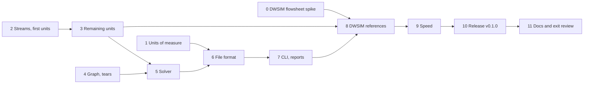

# M4 plan — the first flowsheet

M4 makes reflux solve a process: streams through unit operations, with a
recycle, from a text file, headless, and the same answer as DWSIM 9. It's
the vertical slice the roadmap's critical path has been heading for, and
the first place reflux can be compared with DWSIM on what users actually
complain about: whole flowsheets. It's planned like M1 to M3: research
first, then exit criteria, decisions and steps. The roadmap entry is in
[roadmap.md](roadmap.md).

Status: **approved** on 2026-10-29, with D9's composition bases added at
the owner's question. Step 0 is next.

## Goal

A steady-state flowsheet solver, from a file:

- **material and energy streams**, ports, the unit-operation interface and
  the flowsheet graph (roadmap F1);
- **the unit operations of G1:** mixer, splitter, valve, heater and cooler,
  pump, compressor and expander, flash drum, and component separator;
- **a sequential-modular solver:** strongly connected components, tear
  streams, direct substitution, Wegstein and Broyden, with a convergence
  report at each iteration (F3, A4);
- **a versioned TOML flowsheet format** with units of measure at the
  boundary (F2, A2, A6);
- **the CLI** `reflux solve plant.toml --json results.json`, and reports:
  JSON, a stream table, CSV and the convergence history (F6);
- **a reference flowsheet with a recycle** that matches DWSIM 9, and every
  flowsheet's balances checked.

The flowsheet is two-phase, as the flash is: a unit that meets a third
phase fails with `more_phases`. Columns, reactors and heat exchangers are
M7 and M9; design specifications and warm starts across solves are M8.

## What the research found

**What M1 to M3 give the flowsheet.**
- `db.fluid(.pr, names, opts)` builds a fluid with ChemSep's constants and
  kᵢⱼ, and `FluidOptions.overrides` sets kᵢⱼ pairs by hand. A directory of
  your own component files overrides the built-in data, so a flowsheet can
  run on DWSIM's constants without special code.
- Every flash a unit needs exists and is verified: PT, PH, PS, TV, UV, and
  the vapour-fraction flashes. Each returns a `FlashResult` or a typed
  `FlashError`, never a panic.
- `Fluid.props` gives H, S, V, Cp and the rest of any phase, so every
  stream can report its own.
- `numeric` has `newton`, `brent` and dense LU, and its solvers take
  interfaces, so the flowsheet's iterations won't leak closures.
- M3's benchmarks: a PT flash costs 0.05–2 ms here and a PH flash 2–25 ms.
  A flowsheet calls PH in every mixer, valve and adiabatic drum, on every
  iteration, so PH's cost will show.

**DWSIM 9's flowsheets, probed headless through the M3 route**
(pythonnet, `DWSIM.Automation`):
- **Every G1 unit exists, with its own specification modes.**
  - Mixer (`NodeIn`): outlet pressure the minimum, average or maximum of
    the inlets.
  - Splitter (`NodeOut`): split ratios, or a stream's molar or mass flow.
  - Valve: outlet pressure or ΔP, isenthalpic (or Kv modes).
  - Heater and Cooler: duty, outlet T, outlet vapour fraction or ΔT, with
    a pressure drop and an energy stream.
  - Pump: ΔP, outlet pressure or power, with an efficiency (75% by
    default).
  - Compressor and Expander: outlet pressure, ΔP or pressure ratio, with
    adiabatic or polytropic efficiency.
  - Vessel (the flash drum): adiabatic, or with heating or cooling at
    fixed T or P.
  - ComponentSeparator, by component.
- **A recycle is a block the user places** (`OT_Recycle`), which tears its
  stream, with Wegstein, dominant-eigenvalue or Broyden acceleration and
  at most 50 iterations by default. DWSIM doesn't choose tears.
- **A recycle flowsheet solves headless.** Feed, mixer, cooler to 230 K, a
  flash drum, a splitter, a pump back to the mixer through a recycle block,
  and a valve to a second drum: 5 recycle iterations, 0.99 s for the first
  solve and 56 ms for each warm re-solve.
- **Its failures are silent.** `CalculateFlowsheet2` returned no errors
  while a splitter had failed ("Index was out of range": it wants a ratio
  for each of its three ports) and everything after it was left
  uncalculated. The message was only in that unit's `ErrorMessage`. A
  reference script has to check every unit and stream.
- **Its default recycle tolerance doesn't close the balance.** With a
  100 mol/s feed, the converged products summed to 99.825 mol/s: the
  overall mass balance was 0.17% off. The reference needs DWSIM's
  tolerances tightened, and that's step 0's first job.
- **Its pump** gave 0.22 kW for 34.6 mol/s and 1 bar at 75%: about
  F·v·ΔP/η with a liquid volume of 49 cm³/mol, the incompressible model.
  Step 0 confirms it, and the compressor's efficiency definition.

**The algorithms.** Standard, and well documented:
- Westerberg, Hutchison, Motard & Winter, *Process Flowsheeting* (1979),
  and Biegler, Grossmann & Westerberg, *Systematic Methods of Chemical
  Process Design* (1997), chapter 4, for sequential-modular simulation;
- Tarjan 1972, *Depth-first search and linear graph algorithms* (SIAM J.
  Comput. 1), for strongly connected components;
- Johnson 1975, *Finding all the elementary circuits of a directed graph*
  (SIAM J. Comput. 4), for the cycles a tear set must break;
- Upadhye & Grens 1975, *Selection of decompositions for chemical process
  simulation* (AIChE J. 21): tear sets fall into families with the same
  direct-substitution behaviour, and a nonredundant set, which tears no
  cycle twice, converges best;
- Wegstein 1958 (Commun. ACM 1) and Broyden 1965 (Math. Comp. 19) for the
  acceleration;
- NIST SP 811 for the unit conversion factors.

What they say:
- **Partition, then order.** The flowsheet graph's strongly connected
  components are the units that must be solved together. Between them the
  graph is acyclic, so they're solved once each, in topological order.
- **Tear within each component.** Choose streams whose removal leaves no
  cycle. Fewest streams is the usual aim, but among equal sets a
  nonredundant one converges better under direct substitution.
- **Converge the tears.** Guess the torn streams, solve the units in order,
  and compare what comes back with the guess. Direct substitution is
  robust but slow when a loop's gain is near 1. Wegstein's secant step,
  bounded, is the usual default. Broyden's quasi-Newton suits tears that
  interact.
- **Mass and energy accumulate where a tear hasn't converged.** Each unit
  closes its own balances to its flash's tolerance, so the overall
  imbalance equals the tear residual. Closing the balances is the test of
  convergence.

## Exit criteria

All checked by tests in CI, except DWSIM's capture, a tool whose committed
output the tests check.

1. **The graph is right.** On a set of graphs from the literature and of
   our own, with nested and interlocking loops, the strongly connected
   components match hand-worked answers, the tear set is a minimal one
   that breaks every cycle, and a tear the file names is honoured. A
   malformed flowsheet is refused for its own stated reason: a port left
   open, a stream with two sources, a unit with the wrong number of ports,
   a specification missing or given twice.
2. **Each unit is right.** Each unit operation, alone, against checks from
   scratch: its component and energy balances to 1e-10; its outlet state
   to the specification (a valve's H unchanged, a compressor's isentropic
   outlet at the inlet's S, a heater's outlet at its T or duty); and its
   phases an equilibrium by M3's criterion 3. Then against DWSIM 9, unit
   by unit, from the same inlet: T to 0.01 K, P to 0.01%, β and
   compositions to 1e-4, duty and power to 0.01%, with every deviation
   recorded and explained as M3's criterion 6 was amended.
3. **Every flowsheet balances.** Every solved flowsheet in every test
   checks its component, element and energy balances, overall and for each
   unit. Each unit closes to 1e-10, and the whole flowsheet to the tear
   tolerance.
4. **The solver converges, and says how.** Direct substitution, Wegstein
   and Broyden each converge the reference flowsheet to the same answer,
   within the tear tolerance. The iterations are recorded and can't grow,
   and the convergence history (each tear's residual at each iteration) is
   part of the result. Running out of iterations is a typed error carrying
   that history, never a result.
5. **The reference flowsheet matches DWSIM 9.** A flowsheet with a recycle,
   using the mixer, cooler, flash drums, splitter, pump and valve at least,
   solves headless in CI. With DWSIM's constants and kᵢⱼ, every stream's T,
   P, flows and β, and every unit's duty or power, agree with DWSIM's
   within criterion 2's targets, with DWSIM's recycle tolerances tightened
   to its own limit. The deviations are recorded and can't grow.
6. **The file format holds.** Flowsheets are TOML with a format version.
   Loading, writing and loading again gives the same flowsheet. Every
   field is validated, and a wrong one is refused with its line and a
   reason, with suggestions for misspelt names. Fuzzed and mutated files
   never panic.
7. **Units of measure are exact.** Every unit the format accepts converts
   to SI by the factors in NIST SP 811, checked against a table. Celsius
   and Fahrenheit are affine, and gauge pressure is only ever explicit
   (`barg`, `psig`).
8. **The CLI works end to end.** `reflux solve plant.toml --json
   results.json` solves the reference flowsheet in CI and writes JSON whose
   schema is versioned and documented. A failure exits non-zero with its
   report.
9. **Speed is measured.** The reference flowsheet's solve time, cold and
   warm, against DWSIM's on the same machine, with gcc `-prod`, in
   `docs/benchmarks.md`. There's no target yet, as in M3.
10. CI is green, and the docs are updated: README, roadmap, design notes, V
    notes, and a new `docs/flowsheet-format.md`.

## Decisions

| # | Decision | Choice | Why |
|---|---|---|---|
| D1 | Where it lives | A new module `flowsheet`: streams, ports, the unit interface, M4's unit operations, the graph, the solver and the file format. It imports `components`, `thermo`, `flash` and `numeric`. Unit families of later milestones (columns, reactors) go in their own modules and implement the same interface; the file loader takes a table of unit constructors, so they plug in without `flowsheet` importing them. A small module `quantity` holds units of measure. | One module keeps M4 simple with no import cycles, and the constructor table is the seam for M7 and M9. |
| D2 | Streams | A material stream holds component molar flows (mol/s), and its state: T, P and the `FlashResult` that produced it, so H, S, V and the phases are always at hand. An energy stream holds a rate in W. A feed is specified by (T, P), (P, H), or (P or T, vapour fraction). | Every unit needs the inlet's state, and a stream that's always flashed can't be half-specified. |
| D3 | Units | All of G1: mixer, splitter, valve, heater and cooler (one unit, with the duty's sign), pump, compressor and expander, flash drum, component separator. Specifications as DWSIM's main modes: outlet T, duty, outlet vapour fraction or ΔT for a heater; outlet P or ΔP for a valve, pump, compressor and expander; split fractions; and so on. Exactly one specification of each kind, checked when the file loads. | G1 lists them all for M4, and each is a few flashes once the interface exists. The roadmap's M4 list left out the compressor, expander and component separator; G1 has them. |
| D4 | Unit models | Mixer: Σn, ΣH, P the lowest inlet's unless given, then a PH flash. Splitter: the inlet's intensive state, unflashed. Valve: isenthalpic, PH at the outlet P. Heater: PT, PH or a vapour-fraction flash by its specification. Pump: ΔH = v·ΔP/η with the inlet's liquid volume, refused for a vapour inlet. Compressor and expander: isentropic outlet by PS, then ΔH_s/η (or η·ΔH_s), then PH. Flash drum: the inlets mixed, then PT, PH (adiabatic) or with a duty, vapour and liquid out. Component separator: fractions of each component to the first outlet, outlet T and P given, its duty from the balance. | The standard models, and the pump as DWSIM's, so the comparison compares solvers rather than models. Step 0 confirms DWSIM's pump and compressor; if they differ, reflux follows the textbook and the fixture explains the gap. |
| D5 | Graph | Ports by name on each unit; a stream joins one outlet to one inlet. Tarjan's strongly connected components, solved in topological order. Within each, enumerate its cycles (Johnson), then choose the fewest tear streams that break them all, preferring a nonredundant set (Upadhye–Grens) and then the fewest torn variables. Exhaustive for up to 12 cycles; beyond that, a greedy cover, and a note in the report. A tear named in the file wins. | Exact on the flowsheets M4 will see, explainable, and close to what textbooks recommend. Naming a tear keeps the user in charge, as DWSIM's recycle block does. |
| D6 | Tear variables | Component molar flows, P and molar H. A torn stream is rebuilt by a PH flash, started from its last T. | Mixing is linear in flows and H, which helps Wegstein. H also specifies a saturated pure stream, which T and P can't, and steam in M5 will need that. |
| D7 | Convergence | Direct substitution, bounded Wegstein (q in [−5, 0], applied every other iteration) as the default, and Broyden on all of a component's tear variables together, added to `numeric` as a general quasi-Newton solver. Converged when every tear variable changes by at most 1e-9 of its scale: a component flow against the stream's total flow, P against itself, and H against RT, since H can be near zero. At most 100 iterations. Each iteration's residuals are kept. | The three the roadmap names. Tight tolerances, because the overall balance closes to exactly that, and flashes converge to 1e-12. |
| D8 | Results and failures | `solve` returns a `Solution` only when every component converged and every balance has been checked. Each stream's state, each unit's duty and work, the tears chosen and the convergence history come with it. A failure is a typed `FlowsheetError` (a bad file, a bad specification, a unit that failed with its `FlashError`, no convergence with the history), never a panic. | The flash's rule, D7 of M3, carried up: nothing that hasn't been shown right is returned. M10b exposes this to Python. |
| D9 | File format | TOML, `format = 1`. Components by name or CAS from the database, plus your own data directories; the model and kᵢⱼ options; then streams and units, each unit with its ports and specifications. Every number with a unit, as a string ("230 K", "30 bar", "100 kmol/h"). A feed's composition is given as mole fractions, mass fractions, or each component's molar or mass flow, as in DWSIM, and converted to molar flows with the components' molar masses when the file loads. The results report flows and fractions on both bases. Unknown keys are errors. | Consistent with M2's data files, readable, and diffable. Units on every number remove the commonest input error. A version from the first file makes migration possible later (A6). |
| D10 | Units of measure | `quantity` parses "value unit" for a stated dimension: temperature (K, degC, degF, R), pressure (Pa, kPa, MPa, bar, barg, atm, psi, psig, mmHg), molar and mass flow, energy rate and power, molar and specific enthalpy, volume flow. Gauge pressure takes 1 atm of ambient. An unknown unit gets suggestions. | A2 asks for the boundary; a fixed table is easy to check against NIST SP 811 and has nothing hidden. |
| D11 | CLI and reports | `main.v` becomes `reflux solve plant.toml [--json out.json] [--csv streams.csv] [--trace]`, with the current demo as `reflux demo`. The JSON has a `format` version, every stream, every unit, the balances and the convergence history. A stream table goes to stdout. `--trace` prints every iteration. | F2 and F6. JSON is what Python and pandas read, and the version lets M10 depend on it. |
| D12 | DWSIM references | A by-hand tool, `tools/gen_m4_dwsim.py`, builds each reference flowsheet in DWSIM 9 from the same definition and records DWSIM's constants, kᵢⱼ and results in `testdata/`. It checks every unit's `ErrorMessage` and every stream, and tightens the recycle to its limit. reflux runs the same flowsheet on DWSIM's constants. Unit-by-unit cases go through the same route. **Fallback** if a recycle won't converge tightly in DWSIM: compare with the loop opened, giving DWSIM reflux's converged tear stream, which it must hand back unchanged within its tolerance. | M3's route, which works. The open loop tests the same claim without DWSIM's recycle. |
| D13 | Golden flowsheets | `testdata/flowsheets/`: the reference flowsheet and a few others (no recycle, two interlocking loops, and a loop carrying a saturated pure component, which D6's H is for), each with its expected results, compared to 1e-9. They're regenerated only on purpose, with the change explained. | The roadmap's golden-flowsheet layer: whole-plant results that can't drift unnoticed. |
| D14 | Speed | Measure first, as in M3: the reference flowsheet's solve, cold and warm, against DWSIM's, in the `benchmarks` harness. Within a solve each unit passes its last T as the next flash's estimate (PH and PS already take one). K-value warm starts across solves stay in M8 (F5), unless the measurement says the flowsheet needs them now. | M3 found that measuring first was worth it. Warm starts are a cache with real design questions, and M8 is where the roadmap puts them. |
| D15 | Release | M4 ends with reflux's first tagged release, v0.1.0: a CHANGELOG, semver from here, and the golden suite as the gate. | A8 asks for it by M4, and a first flowsheet is the first thing worth releasing. |
| D16 | Who writes what | As before, I write it all unless you claim a step. | |

## Steps

### 0. DWSIM flowsheet spike
- Build the reference flowsheet in DWSIM 9 headless, from the probe above:
  feed, mixer, cooler, flash drum, splitter, pump and recycle, valve,
  second drum.
- Find how tight DWSIM's recycle will converge, and what its balances then
  close to.
- Confirm DWSIM's unit models: the pump's ΔH, the compressor's efficiency,
  the mixer's pressure, the drum's modes.
- Go or no-go for D12, with the open-loop fallback tried either way.

### 1. Units of measure
- The `quantity` module (D10), tested against NIST SP 811's factors.

### 2. Streams and the first units
- Material and energy streams (D2), the unit interface and ports.
- The mixer, splitter, valve and heater, each tested alone (criterion 2,
  the checks from scratch).

### 3. The remaining units
- Pump, compressor and expander, flash drum, component separator, tested
  the same way.

### 4. The graph and tears
- Ports and connections, validation of a malformed flowsheet,
  strongly connected components, cycles and tear selection (D5).
- Criterion 1's graph set.

### 5. The solver
- Ordering, tear convergence by direct substitution, Wegstein and Broyden
  (D7), balances, the convergence history, `Solution` and
  `FlowsheetError` (D8).

### 6. The file format
- TOML load, validate and write (D9), with the fuzz tests, and
  `docs/flowsheet-format.md`.

### 7. The CLI and reports
- `reflux solve`, `reflux demo`, the JSON and CSV reports and the stream
  table (D11). `tools/check.vsh` runs the demo now; it'll run `reflux
  demo` and solve the reference flowsheet instead.

### 8. DWSIM references and golden flowsheets
- `tools/gen_m4_dwsim.py` and its fixtures: unit by unit, and the
  reference flowsheet (D12).
- The golden flowsheets (D13).

### 9. Speed
- The flowsheet benchmark against DWSIM (D14). Then, measured before
  anything is changed, the carried item from M3: PH for 5 and 10
  components takes 2–4 times as long as DWSIM's, and a flowsheet calls it
  in every loop.

### 10. Release v0.1.0
- CHANGELOG, the version, and the golden suite as the release gate (D15).

### 11. Docs and exit review
- README, roadmap, design notes, the V notes, and a criterion-by-criterion
  review, as in M1 to M3.

## Risks

| Risk | Effect | Fallback |
|---|---|---|
| DWSIM's recycle won't converge tightly, or its flowsheet automation fails silently in ways the script misses | no trustworthy flowsheet reference | check every unit and stream (the probe already had to); compare with the loop opened (D12) |
| DWSIM's unit models differ from the textbook ones (pump, compressor efficiency) | deviations in duty or T | follow the textbook in reflux, reproduce DWSIM's number in the fixture from its own model, and record it, as M3's criterion 6 allows |
| PH's cost makes the flowsheet slow | a slow first flowsheet | measure (D14); warm starts inside PH first, then across solves (F5) if needed |
| Tear selection by enumeration blows up on many loops | slow or no tear set | the cycle bound and greedy cover (D5); M4's flowsheets are small |
| V's `toml` module can't report the line of a bad value, or rejects valid TOML | poor error messages | validate after parsing with the keys' paths; M2 already parses TOML with it |
| A unit meets three phases in a loop | no convergence | the flash already refuses with `more_phases`; the unit passes it on, and the flowsheet fails with its reason |

## Not in M4

- Design specifications converged with the tears ("vary the cooler's T
  until the vapour has 95% methane"), and warm starts across solves: M8.
- Columns (M7), reactors and heat exchangers (M9).
- Equation-oriented solving and dynamics: M13.
- Three-phase units and free water: M6.
- Python access to flowsheets: M10b, after M10a gives Python the thermo and
  the flash.
- A UI: M14.
