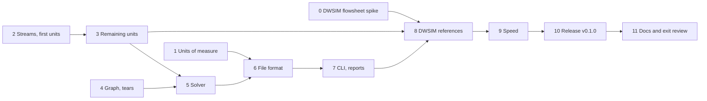

# M4 plan — the first flowsheet

M4 makes reflux solve a process: streams through unit operations, with a
recycle, from a text file, headless, and the same answer as DWSIM 9. It's
the vertical slice the roadmap's critical path has been heading for, and
the first place reflux can be compared with DWSIM on what users actually
complain about: whole flowsheets. It's planned like M1 to M3: research
first, then exit criteria, decisions and steps. The roadmap entry is in
[roadmap.md](roadmap.md).

Status: **approved** on 2026-10-29, with D9's composition bases added at
the owner's question. Steps 0 to 7 are done, and step 8 is next.

## Goal

A steady-state flowsheet solver, from a file:

- **material and energy streams**, ports, the unit-operation interface and
  the flowsheet graph (roadmap F1);
- **the unit operations of G1:** mixer, splitter, valve, heater and cooler,
  pump, compressor and expander, flash drum, and component separator;
- **a sequential-modular solver:** strongly connected components, tear
  streams, direct substitution, Wegstein and Broyden, with a convergence
  report at each iteration (F3, A4);
- **a versioned TOML flowsheet format** with units of measure at the
  boundary (F2, A2, A6);
- **the CLI** `reflux solve plant.toml --json results.json`, and reports:
  JSON, a stream table, CSV and the convergence history (F6);
- **a reference flowsheet with a recycle** that matches DWSIM 9, and every
  flowsheet's balances checked.

The flowsheet is two-phase, as the flash is: a unit that meets a third
phase fails with `more_phases`. Columns, reactors and heat exchangers are
M7 and M9; design specifications and warm starts across solves are M8.

## What the research found

**What M1 to M3 give the flowsheet.**
- `db.fluid(.pr, names, opts)` builds a fluid with ChemSep's constants and
  kᵢⱼ, and `FluidOptions.overrides` sets kᵢⱼ pairs by hand. A directory of
  your own component files overrides the built-in data, so a flowsheet can
  run on DWSIM's constants without special code.
- Every flash a unit needs exists and is verified: PT, PH, PS, TV, UV, and
  the vapour-fraction flashes. Each returns a `FlashResult` or a typed
  `FlashError`, never a panic.
- `Fluid.props` gives H, S, V, Cp and the rest of any phase, so every
  stream can report its own.
- `numeric` has `newton`, `brent` and dense LU, and its solvers take
  interfaces, so the flowsheet's iterations won't leak closures.
- M3's benchmarks: a PT flash costs 0.05–2 ms here and a PH flash 2–25 ms.
  A flowsheet calls PH in every mixer, valve and adiabatic drum, on every
  iteration, so PH's cost will show.

**DWSIM 9's flowsheets, probed headless through the M3 route**
(pythonnet, `DWSIM.Automation`):
- **Every G1 unit exists, with its own specification modes.**
  - Mixer (`NodeIn`): outlet pressure the minimum, average or maximum of
    the inlets.
  - Splitter (`NodeOut`): split ratios, or a stream's molar or mass flow.
  - Valve: outlet pressure or ΔP, isenthalpic (or Kv modes).
  - Heater and Cooler: duty, outlet T, outlet vapour fraction or ΔT, with
    a pressure drop and an energy stream.
  - Pump: ΔP, outlet pressure or power, with an efficiency (75% by
    default).
  - Compressor and Expander: outlet pressure, ΔP or pressure ratio, with
    adiabatic or polytropic efficiency.
  - Vessel (the flash drum): adiabatic, or with heating or cooling at
    fixed T or P.
  - ComponentSeparator, by component.
- **A recycle is a block the user places** (`OT_Recycle`), which tears its
  stream, with Wegstein, dominant-eigenvalue or Broyden acceleration and
  at most 50 iterations by default. DWSIM doesn't choose tears.
- **A recycle flowsheet solves headless.** Feed, mixer, cooler to 230 K, a
  flash drum, a splitter, a pump back to the mixer through a recycle block,
  and a valve to a second drum: 5 recycle iterations, 0.99 s for the first
  solve and 56 ms for each warm re-solve.
- **Its failures are silent.** `CalculateFlowsheet2` returned no errors
  while a splitter had failed ("Index was out of range": it wants a ratio
  for each of its three ports) and everything after it was left
  uncalculated. The message was only in that unit's `ErrorMessage`. A
  reference script has to check every unit and stream.
- **Its default recycle tolerance doesn't close the balance.** With a
  100 mol/s feed, the converged products summed to 99.825 mol/s: the
  overall mass balance was 0.17% off. The reference needs DWSIM's
  tolerances tightened, and that's step 0's first job.
- **Its pump** gave 0.22 kW for 34.6 mol/s and 1 bar at 75%: about
  F·v·ΔP/η with a liquid volume of 49 cm³/mol, the incompressible model.
  Step 0 confirms it, and the compressor's efficiency definition.

**The algorithms.** Standard, and well documented:
- Westerberg, Hutchison, Motard & Winter, *Process Flowsheeting* (1979),
  and Biegler, Grossmann & Westerberg, *Systematic Methods of Chemical
  Process Design* (1997), chapter 4, for sequential-modular simulation;
- Tarjan 1972, *Depth-first search and linear graph algorithms* (SIAM J.
  Comput. 1), for strongly connected components;
- Johnson 1975, *Finding all the elementary circuits of a directed graph*
  (SIAM J. Comput. 4), for the cycles a tear set must break;
- Upadhye & Grens 1975, *Selection of decompositions for chemical process
  simulation* (AIChE J. 21): tear sets fall into families with the same
  direct-substitution behaviour, and a nonredundant set, which tears no
  cycle twice, converges best;
- Gundersen & Hertzberg 1983, *Partitioning and tearing of networks, applied
  to process flowsheeting* (Modeling, Identification and Control 4), found in
  step 4: ten test graphs with their cycles and minimum tears;
- Wegstein 1958 (Commun. ACM 1) and Broyden 1965 (Math. Comp. 19) for the
  acceleration;
- NIST SP 811 for the unit conversion factors.

What they say:
- **Partition, then order.** The flowsheet graph's strongly connected
  components are the units that must be solved together. Between them the
  graph is acyclic, so they're solved once each, in topological order.
- **Tear within each component.** Choose streams whose removal leaves no
  cycle. Fewest streams is the usual aim, but among equal sets a
  nonredundant one converges better under direct substitution.
- **Converge the tears.** Guess the torn streams, solve the units in order,
  and compare what comes back with the guess. Direct substitution is
  robust but slow when a loop's gain is near 1. Wegstein's secant step,
  bounded, is the usual default. Broyden's quasi-Newton suits tears that
  interact.
- **Mass and energy accumulate where a tear hasn't converged.** Each unit
  closes its own balances to its flash's tolerance, so the overall
  imbalance equals the tear residual. Closing the balances is the test of
  convergence.

## Exit criteria

All checked by tests in CI, except DWSIM's capture, a tool whose committed
output the tests check.

1. **The graph is right.** On a set of graphs from the literature and of
   our own, with nested and interlocking loops, the strongly connected
   components match hand-worked answers, the tear set is a minimal one
   that breaks every cycle, and a tear the file names is honoured. A
   malformed flowsheet is refused for its own stated reason: a port left
   open, a stream with two sources, a unit with the wrong number of ports,
   a specification missing or given twice.
2. **Each unit is right.** Each unit operation, alone, against checks from
   scratch: its component and energy balances to 1e-10; its outlet state
   to the specification (a valve's H unchanged, a compressor's isentropic
   outlet at the inlet's S, a heater's outlet at its T or duty); and its
   phases an equilibrium by M3's criterion 3. Then against DWSIM 9, unit
   by unit, from the same inlet: T to 0.01 K, P to 0.01%, β and
   compositions to 1e-4, duty and power to 0.01%, with every deviation
   recorded and explained as M3's criterion 6 was amended.
3. **Every flowsheet balances.** Every solved flowsheet in every test
   checks its component, element and energy balances, overall and for each
   unit. Each unit closes to 1e-10, and the whole flowsheet to the tear
   tolerance.
4. **The solver converges, and says how.** Direct substitution, Wegstein
   and Broyden each converge the reference flowsheet to the same answer,
   within the tear tolerance. The iterations are recorded and can't grow,
   and the convergence history (each tear's residual at each iteration) is
   part of the result. Running out of iterations is a typed error carrying
   that history, never a result.
5. **The reference flowsheet matches DWSIM 9.** A flowsheet with a recycle,
   using the mixer, cooler, flash drums, splitter, pump and valve at least,
   solves headless in CI. With DWSIM's constants and kᵢⱼ, every stream's T,
   P, flows and β, and every unit's duty or power, agree with DWSIM's
   within criterion 2's targets, with DWSIM's recycle tolerances tightened
   to its own limit. The deviations are recorded and can't grow.
6. **The file format holds.** Flowsheets are TOML with a format version.
   Loading, writing and loading again gives the same flowsheet. Every
   field is validated, and a wrong one is refused with its line and a
   reason, with suggestions for misspelt names. Fuzzed and mutated files
   never panic.
7. **Units of measure are exact.** Every unit the format accepts converts
   to SI by the factors in NIST SP 811, checked against a table. Celsius
   and Fahrenheit are affine, and gauge pressure is only ever explicit
   (`barg`, `psig`).
8. **The CLI works end to end.** `reflux solve plant.toml --json
   results.json` solves the reference flowsheet in CI and writes JSON whose
   schema is versioned and documented. A failure exits non-zero with its
   report.
9. **Speed is measured.** The reference flowsheet's solve time, cold and
   warm, against DWSIM's on the same machine, with gcc `-prod`, in
   `docs/benchmarks.md`. There's no target yet, as in M3.
10. CI is green, and the docs are updated: README, roadmap, design notes, V
    notes, and a new `docs/flowsheet-format.md`.

## Decisions

| # | Decision | Choice | Why |
|---|---|---|---|
| D1 | Where it lives | A new module `flowsheet`: streams, ports, the unit interface, M4's unit operations, the graph, the solver and the file format. It imports `components`, `thermo`, `flash` and `numeric`. Unit families of later milestones (columns, reactors) go in their own modules and implement the same interface; the file loader takes a table of unit constructors, so they plug in without `flowsheet` importing them. A small module `quantity` holds units of measure. | One module keeps M4 simple with no import cycles, and the constructor table is the seam for M7 and M9. |
| D2 | Streams | A material stream holds component molar flows (mol/s), and its state: T, P and the `FlashResult` that produced it, so H, S, V and the phases are always at hand. An energy stream holds a rate in W. A feed is specified by (T, P), (P, H), or (P or T, vapour fraction). | Every unit needs the inlet's state, and a stream that's always flashed can't be half-specified. |
| D3 | Units | All of G1: mixer, splitter, valve, heater and cooler (one unit, with the duty's sign), pump, compressor and expander, flash drum, component separator. Specifications as DWSIM's main modes: outlet T, duty, outlet vapour fraction or ΔT for a heater; outlet P or ΔP for a valve, pump, compressor and expander; split fractions; and so on. Exactly one specification of each kind, checked when the file loads. | G1 lists them all for M4, and each is a few flashes once the interface exists. The roadmap's M4 list left out the compressor, expander and component separator; G1 has them. |
| D4 | Unit models | Mixer: Σn, ΣH, P the lowest inlet's unless given, then a PH flash. **Amended in step 2:** a given P can't be above the lowest inlet's, a valve can't raise P, and an empty inlet doesn't set the mixer's P. So DWSIM's "inlet average" and "inlet maximum" mixer modes are refused. **Amended in step 3:** a flash drum follows the mixer: its P is the lowest inlet's unless given, and no higher. Its adiabatic mode is a duty of 0. A compressor and an expander take a wet inlet, since PS and PH handle it, and a component separator's outlet P may be above its inlet's, since it's a black box. Splitter: the inlet's intensive state, unflashed. Valve: isenthalpic, PH at the outlet P. Heater: PT, PH or a vapour-fraction flash by its specification. Pump: ΔH = v·ΔP/η with the inlet's liquid volume, refused for a vapour inlet. Compressor and expander: isentropic outlet by PS, then ΔH_s/η (or η·ΔH_s), then PH. Flash drum: the inlets mixed, then PT, PH (adiabatic) or with a duty, vapour and liquid out. Component separator: fractions of each component to the first outlet, outlet T and P given, its duty from the balance. | The standard models, and the pump as DWSIM's, so the comparison compares solvers rather than models. Step 0 confirms DWSIM's pump and compressor; if they differ, reflux follows the textbook and the fixture explains the gap. |
| D5 | Graph | Ports by name on each unit; a stream joins one outlet to one inlet. Tarjan's strongly connected components, solved in topological order. Within each, enumerate its cycles (Johnson), then choose the fewest tear streams that break them all, preferring a nonredundant set (Upadhye–Grens) and then the fewest torn variables. Exhaustive for up to 12 cycles; beyond that, a greedy cover, and a note in the report. A tear named in the file wins. **Amended in step 4:** the search is exact within a fixed work budget, whatever the number of cycles, and the greedy cover is only for a net of 50,000 cycles or more. Seven of the nine classical graphs have over 12 cycles, and step 4 found that a greedy method misses their minimum. Past the fewest tears and the fewest second breaks, ties go to the earliest stream: every stream has the same tear variables (D6), so the fewest torn variables never decides. A net with nothing coming into it is refused. **Amended in step 5:** among streams in exactly the same cycles, it takes one coming back to where material enters the block, the recycle, which can start empty. | Exact on the flowsheets M4 will see, explainable, and close to what textbooks recommend. Naming a tear keeps the user in charge, as DWSIM's recycle block does. |
| D6 | Tear variables | Component molar flows, P and molar H. A torn stream is rebuilt by a PH flash, started from its last T. | Mixing is linear in flows and H, which helps Wegstein. H also specifies a saturated pure stream, which T and P can't, and steam in M5 will need that. |
| D7 | Convergence | Direct substitution, bounded Wegstein (q in [−5, 0], applied every other iteration) as the default, and Broyden on all of a component's tear variables together, added to `numeric` as a general quasi-Newton solver. Converged when every tear variable changes by at most 1e-9 of its scale: a component flow against the stream's total flow, P against itself, and H against RT, since H can be near zero. At most 100 iterations. Each iteration's residuals are kept. **Amended in step 5:** Wegstein's steps start at the third pass, and Broyden takes one direct pass first, since the first pass starts from a guess and a secant through it says nothing about the loop. A tear starts from its estimate, or else empty where its unit has another inlet, or else as a mixture of what enters the block. An estimate tears its stream. | The three the roadmap names. Tight tolerances, because the overall balance closes to exactly that, and flashes converge to 1e-12. |
| D8 | Results and failures | `solve` returns a `Solution` only when every component converged and every balance has been checked. Each stream's state, each unit's duty and work, the tears chosen and the convergence history come with it. A failure is a typed `FlowsheetError` (a bad file, a bad specification, a unit that failed with its `FlashError`, no convergence with the history), never a panic. | The flash's rule, D7 of M3, carried up: nothing that hasn't been shown right is returned. M10b exposes this to Python. |
| D9 | File format | TOML, `format = 1`. Components by name or CAS from the database, plus your own data directories; the model and kᵢⱼ options; then streams and units, each unit with its ports and specifications. Every number with a unit, as a string ("230 K", "30 bar", "100 kmol/h"). A feed's composition is given as mole fractions, mass fractions, or each component's molar or mass flow, as in DWSIM, and converted to molar flows with the components' molar masses when the file loads. The results report flows and fractions on both bases. Unknown keys are errors. **Amended in step 6:** only feeds are declared, as `[feed.NAME]`, since every other stream is named by the ports at its two ends. `[estimate.NAME]` gives a tear a first value, with the same keys. A `\u` escape is refused, because it can crash V's parser. | Consistent with M2's data files, readable, and diffable. Units on every number remove the commonest input error. A version from the first file makes migration possible later (A6). |
| D10 | Units of measure | `quantity` parses "value unit" for a stated dimension: temperature (K, degC, degF, R), pressure (Pa, kPa, MPa, bar, barg, atm, psi, psig, mmHg), molar and mass flow, energy rate and power, molar and specific enthalpy, volume flow. Gauge pressure takes 1 atm of ambient. An unknown unit gets suggestions. **Amended in step 1:** also temperature and pressure differences (the same scales with no offset, and no gauge units), fractions (a bare number or a percentage), °C and °F beside degC and degF, mbar, torr, psia and lbmol/h. An absolute T or P must be above zero. | A2 asks for the boundary; a fixed table is easy to check against NIST SP 811 and has nothing hidden. |
| D11 | CLI and reports | `main.v` becomes `reflux solve plant.toml [--json out.json] [--csv streams.csv] [--trace]`, with the current demo as `reflux demo`. The JSON has a `format` version, every stream, every unit, the balances and the convergence history. A stream table goes to stdout. `--trace` prints every iteration. **Amended in step 7:** `--trace` prints the passes when the solve ends, not as they happen: no M4 flowsheet takes long enough for that to matter, and printing as it goes would need a callback in the solver, which M8 can add if its PFR needs one. A failure writes its JSON too, with the error and the passes so far, and removes a CSV left from an earlier run, so that nothing on disk can be taken for this run's results. Also `reflux version` and `reflux help`, and the exit status is 0, 1 for a flowsheet or report that failed, and 2 for a wrong command. | F2 and F6. JSON is what Python and pandas read, and the version lets M10 depend on it. |
| D12 | DWSIM references | A by-hand tool, `tools/gen_m4_dwsim.py`, builds each reference flowsheet in DWSIM 9 from the same definition and records DWSIM's constants, kᵢⱼ and results in `testdata/`. It checks every unit's `ErrorMessage` and every stream, and tightens the recycle to its limit. reflux runs the same flowsheet on DWSIM's constants. Unit-by-unit cases go through the same route. **Fallback** if a recycle won't converge tightly in DWSIM: compare with the loop opened, giving DWSIM reflux's converged tear stream, which it must hand back unchanged within its tolerance. | M3's route, which works. The open loop tests the same claim without DWSIM's recycle. |
| D13 | Golden flowsheets | `testdata/flowsheets/`: the reference flowsheet and a few others (no recycle, two interlocking loops, and a loop carrying a saturated pure component, which D6's H is for), each with its expected results, compared to 1e-9. They're regenerated only on purpose, with the change explained. | The roadmap's golden-flowsheet layer: whole-plant results that can't drift unnoticed. |
| D14 | Speed | Measure first, as in M3: the reference flowsheet's solve, cold and warm, against DWSIM's, in the `benchmarks` harness. Within a solve each unit passes its last T as the next flash's estimate (PH and PS already take one). K-value warm starts across solves stay in M8 (F5), unless the measurement says the flowsheet needs them now. | M3 found that measuring first was worth it. Warm starts are a cache with real design questions, and M8 is where the roadmap puts them. |
| D15 | Release | M4 ends with reflux's first tagged release, v0.1.0: a CHANGELOG, semver from here, and the golden suite as the gate. | A8 asks for it by M4, and a first flowsheet is the first thing worth releasing. |
| D16 | Who writes what | As before, I write it all unless you claim a step. | |

## Steps

### 0. DWSIM flowsheet spike — done: go, with conditions
- [spike/dwsim_flowsheet/run.py](../spike/dwsim_flowsheet/run.py) builds
  the reference flowsheet in DWSIM 9.0.5 headless and answers this step's
  questions. [spike-dwsim-flowsheet.md](spike-dwsim-flowsheet.md) has every
  number and the conditions for step 8.
- **The recycle converges as tightly as the comparison needs.** At DWSIM's
  default tolerances it takes 5 iterations and leaves the overall balances
  open by 0.2% in total flow and 1.4% in energy. Scaled by 1e-8, it takes
  32 iterations and closes the total flow to 1.3e-11. Each component stops
  at 9.3e-8 and the energy at 5.6e-7, DWSIM's floor, far below criterion
  2's targets.
- **The open-loop fallback works, and sharply.** The loop cut and fed
  DWSIM's converged recycle stream hands it back within 8e-14 in flows.
- **DWSIM's unit models:**
  - the pump is v·ΔP/η, as D4 has it, but with v from DWSIM's reported
    liquid density, 48.6 cm³/mol, where PR's own Z gives 73.6. So its
    work is a third below reflux's, and the fixture explains that from
    DWSIM's own density. D4 is unchanged;
  - the compressor and expander use the isentropic efficiency, exactly as
    D4 has them;
  - the valve is isenthalpic, the cooler's duty is ΔH, and the mixer takes
    the lowest inlet pressure and balances energy exactly;
  - **the flash drum is wrong with two inlets** in both modes tried (one
    flashes at the mean inlet temperature, the other created 62.7 kW), so
    the reference puts a mixer before any drum. reflux's drum keeps D4's
    energy balance.
- **Also found:** DWSIM reports no error when a unit fails (the message is
  only in that unit), its splitter needs a ratio for each of its three
  ports, and its Wegstein and dominant-eigenvalue acceleration change
  nothing through automation, while Broyden fails without iterating.
- No V code changed, so no planted mistakes: the spike's checks are its
  own, each a quantity DWSIM must reproduce from its own flashes.

### 1. Units of measure — done
- **[quantity/quantity.v](../quantity/quantity.v):** `parse(text,
  dimension) !f64` reads "value unit" into SI, `to_unit(si, unit,
  dimension)` converts back for reports, and `units(dimension)` lists what a
  dimension accepts.
  - **One table of 75 units** in 11 dimensions, each row SI = (x + pre)·scale
    + post. Celsius and Fahrenheit shift before they scale, and `barg` and
    `psig` add a standard atmosphere after.
  - **Every scale is built from SP 811's exact definitions**: the pound, the
    inch, standard gravity, the standard atmosphere, the IT Btu and
    kilocalorie, the conventional millimetre of mercury, the US gallon and
    the 550 ft·lbf/s horsepower. No rounded factor is typed in.
  - **D10 amended.** It now also has ΔT and ΔP, which the heater, valve,
    pump and compressor specifications need (D3), and fractions, for
    vapour fractions, split fractions and efficiencies. Its new units are
    °C, °F, mbar, torr, psia and lbmol/h.
- **Every refusal is a `QuantityError`** with the text, the dimension, a
  reason and any suggestions, so the file loader (step 6) can add the line.
  The reasons:
  - empty, or more than a number and one unit;
  - not a number, or not finite (`inf`, `nan`);
  - a number and its unit run together, with the fix: `"30 bar"`;
  - no unit, with examples (only a fraction may be bare);
  - a unit of another dimension, named as one: "K is a unit of
    temperature, not pressure";
  - a near miss, with up to three suggestions within two edits, ignoring
    case, nearest first. With nothing near, the dimension's units are
    listed;
  - an absolute temperature or pressure at or below zero.
- **Tests in [quantity/quantity_test.v](../quantity/quantity_test.v)**,
  against [testdata/m4_units.json](../testdata/m4_units.json), written by
  hand from SP 811's appendix B:
  - **The 67 factors:** the 56 exact ones to 4 ulps. The other 11 (7
    distinct factors: psi, mmHg, torr, lb/h, gal/min, Btu/h, hp) round to
    SP 811's 7 printed figures. The closest is gal/min, 0.72 of half a unit
    in the last figure.
  - **The 13 affine conversions** (Celsius, Fahrenheit, Rankine, barg,
    psig) to 1e-12.
  - **No unit escapes:** each of the 75 is in the fixture's factors or
    points.
  - **The round trip:** `to_unit` inverts `parse` to 1e-12 for every unit,
    at values of both signs where the dimension allows them.
  - **25 refusals,** each for its own reason. These include the
    suggestions for `Bar`, `bars`, `kmole/h`, `degc`, `KPA` and `ºC` (the
    masculine ordinal, a common slip for °), and exactly three for `ps`.
  - **Differences and fractions** take either sign, a bare fraction or a
    percentage.
  - **20,000 seeded random strings,** each read as all 11 dimensions:
    pieces of numbers and units, stray characters and Unicode, and the
    valid points with a character deleted, inserted or changed. None
    panics, every accepted answer is finite, and every absolute T and P is
    above zero.
- **Found along the way:**
  - V's `strconv.atof64` reads what Go's `ParseFloat` reads, `inf`, `nan`
    and `1_000` included. So `quantity` checks finiteness itself.
  - Both read `1e-400` as 0 with no error. That 0 then meets the same
    "above zero" check as a typed 0.
  - `strings.levenshtein_distance` counts bytes, so `°` costs two edits.
- **Planted mistakes:** 26, all caught in the end. The mistakes:
  - seven definitions (psi, mmHg, torr, Btu, kilocalorie, gallon,
    horsepower), the Fahrenheit offset and the Rankine scale;
  - three units' scales: lbmol/h as a pound, Btu/lb as per pound-mole,
    psig as bar;
  - barg without its atmosphere, and a ΔT given an offset;
  - the two above-zero checks and the finiteness check;
  - three refusals: the run-together fix without its space, another
    dimension's unit not named, and three parts allowed;
  - the suggestions made case-sensitive;
  - `to_unit`'s sign;
  - a bare fraction refused.

  One survived at first: capping the suggestions at one instead of three.
  It led to the test of `ps`'s three, and planting five, or one edit
  instead of two, is now caught as well.

### 2. Streams and the first units — done
- **[flowsheet/stream.v](../flowsheet/stream.v):** a `Stream` holds its
  molar flows and the `FlashResult` that gave its state, with T, P, β and
  its molar H, S and V (D2). `feed_tp`, `feed_ph`, `feed_tvf` and `feed_pvf`
  are D2's four ways of giving a feed.
  - An *empty* stream, from a split fraction of 0, keeps its composition in
    its flash, so it still has a state and passes through a valve or
    heater. A feed must have flow.
- **[flowsheet/unit.v](../flowsheet/unit.v):** the `Unit` interface: `name`,
  `inlet_ports()`, `outlet_ports()` and `calculate(fluid, inlets)
  !Outcome`.
  - A unit holds its specification and nothing about a solve, so the same
    inlets always give the same answer.
  - An `EnergyStream` is reported by the unit that takes it, with a rate
    above zero going into the material. In M4 energy streams don't connect
    to other units, so they aren't ports.
- **The units,** each with a constructor that refuses a bad specification:
  - [mixer.v](../flowsheet/mixer.v): `new_mixer(name, inlets, outlet_p:)`;
  - [splitter.v](../flowsheet/splitter.v): `new_splitter(name, fractions)`,
    which must sum to 1 within 1e-9;
  - [valve.v](../flowsheet/valve.v): outlet P or pressure drop;
  - [heater.v](../flowsheet/heater.v): outlet T, ΔT, outlet β or duty, with
    a pressure drop in any mode.
- **[flowsheet/error.v](../flowsheet/error.v):** `FlowsheetError`, part of
  D8. So far it has `.bad_specification` and `.flash_failed`, which names
  the unit and keeps the flash's own kind, such as `.more_phases`. Step 5
  adds the solver's failures.
- **D4 amended:** a mixer's given P can't be above its lowest inlet's, a
  valve can't raise P, and an empty inlet doesn't set the mixer's P.
- **Tests in [flowsheet/units_test.v](../flowsheet/units_test.v),** on the
  reference flowsheet's five components. Every unit run goes through
  `check_unit`, which recomputes H, S and V from T, P and each phase's
  composition, and holds each outlet to M3's criterion 3.
  - **The balances (criterion 2), over 37 unit runs:** components close
    exactly, and the worst energy balance is 1.55e-11 of F·RT, a valve,
    against the target of 1e-10.
  - **Checks that don't go through the flash:**
    - a valve's small drop is μ_JT·ΔP to 9.5e-8, with μ_JT from `Fluid.props`
      at the midpoint;
    - a heater's 1 K rise is F·Cp·ΔT to 2.0e-7, with Cp likewise;
    - propane's duty from saturated liquid to saturated vapour at 20 bar
      matches Clapeyron's T·Δv·dP/dT from the saturation curve alone, to
      2.1e-7: 11,691 J/mol;
    - throttling raises S.
  - **Round trips and state functions:**
    - mixing two parts of one state keeps it (T to 5.7e-14);
    - splitting and mixing back gives the inlet;
    - mixing then heating equals heating then mixing (T to 6.2e-12);
    - a heater's outlet T, ΔT, duty and β each reach the same state (the
      duty's T to 3.3e-12);
    - half a pure component's boiling duty gives β = 0.5 at Tsat.
  - **Every feed specification** comes back to the same state.
  - **Refusals:** each unit's and feed's, each for its own reason. A
    three-phase state in a heater reports `.more_phases`, by the unit's
    name.
- **Bug found and fixed: the PH flash could fail on an ordinary state.**
  - The mixture at 30 bar with H from −96,750 to −95,750 J/mol is two-phase
    at about 215 K. As an ideal gas it would be at 11 to 38 K, where the
    search started, and the PT flash refused there on PR's liquid–liquid
    splits (`.more_phases`). So `feed_ph` failed, though the units, which
    pass an estimate, didn't.
  - `ideal_t` in [flash/ph.v](../flash/ph.v) now starts no lower than half
    the feed's mean Tc. A scan from 70 to 500 K at five pressures from 1 to
    100 bar, 865 states, finds no PH or PS failure.
  - On M3's reference set PH and PS take fewer steps, 1941 against 1949.
    The budget stays at 1990, and a floor made too high is caught by it
    (2109 steps).
  - `tools/benchmarks.vsh --time` shows no slowdown, though raw times can't
    say so: PT, which didn't change, ran at 0.5 to 1.9 times the fixture's
    that day. A PH flash as a multiple of a two-phase PT flash went from
    11.7 to 12.1, 10.7 to 8.1 and 18.7 to 7.6 for the three mixtures. So
    `m3_bench.json`, which needs DWSIM by hand, isn't regenerated.
- **Found, not fixed:** the same scan fails `flash.uv` on 8 or 9 of 173
  states at each pressure, all cold liquids at or below 100 K. The failure
  is in its TV flash at about 59 to 89 K, so it isn't the bug above. No M4
  unit uses UV, so it's carried to the exit review.
- **Smart App Control** was on for most of this step. It refused V's cached
  `vfmt.exe` and `vvet.exe`, so `v fmt` and `v vet` couldn't run, and now
  and then a freshly built test program, so anything that loops over test
  runs must tell that from a failed test ([V notes](v-for-go.md), §1). The
  owner's machine had it off for the final checks, which ran in full.
- **Planted mistakes:** 69. 66 were caught, and the other 3 are explained.
  - **What the review before them led to:** tests for an inlet order with
    the lowest pressure first, and for a total flow that overflows.
    Deleting two pieces of code no answer needed: a splitter's upper bound
    on a fraction, and a skip of phases with no moles.
  - **The one survivor that led to a test:** an infinite heater pressure
    drop, which got past the constructor.
  - **The 3 that survive** drop the T estimate from the mixer's, valve's and
    heater's PH flash. That changes speed only: 12 → 12, 18 → 17 and
    13 → 11 steps. They stay, as D14 asks.

### 3. The remaining units — done
- **[flowsheet/pressure.v](../flowsheet/pressure.v):** `PressureMode`,
  outlet P or ΔP, now shared by everything that changes pressure, with the
  direction checked in one place. The valve's `.pressure_drop` became
  `.delta_p`. `MachineParams` adds an efficiency, which must be given.
- **The units:**
  - [pump.v](../flowsheet/pump.v): `new_pump`, D4's v·ΔP/η, refusing any
    vapour in its inlet;
  - [compressor.v](../flowsheet/compressor.v): `new_compressor` and
    `new_expander`, isentropic by a PS flash, then η, then a PH flash;
  - [drum.v](../flowsheet/drum.v): `new_flash_drum`, at a given T or duty,
    with any number of inlets, and the vapour and liquid leaving by their own
    ports;
  - [separator.v](../flowsheet/separator.v): `new_component_separator`, a
    fraction of each component to the first outlet, both at a given T and P.
- **A drum's outlets aren't flashed again.** A second flash at an exact
  bubble point could land on either side of it. So each outlet takes the
  first flash's result, with the phase's composition as z and the other
  phase at no moles: the form a bubble or dew point's answer already has.
- **[mixer.v](../flowsheet/mixer.v):** `blend` factored out of the mixer,
  since the drum starts the same way.
- **D4 amended:** see its row. These are for your review: the drum's pressure
  follows the mixer's, a compressor takes a wet inlet, and a component
  separator can raise P.
- **Tests in [flowsheet/units_test.v](../flowsheet/units_test.v),** by the
  same `check_unit`. It's 36 tests now.
  - **The balances (criterion 2), over 84 unit runs:** components to
    1.95e-16 of the flow, and energy to 1.55e-11 of F·RT, against 1e-10.
  - **Checks that don't go through the code under test:**
    - isentropic work against ∫v dP along the isentrope, by Simpson over 8
      panels, to 5.5e-8. H comes from the ideal gas and F, and v from the
      volume root, so each checks the other;
    - a pump at η = 1 against T·Δs = ½(v_in − v_out)·ΔP, to 3.2e-3, the
      third-order term;
    - a drum's liquid has its bubble point, and its vapour its dew point, at
      the drum's pressure, to 3e-13, by flashes that know nothing of the
      drum;
    - compressing and expanding at η = 1 returns to the inlet's T to
      1.7e-12 K, and the two works cancel to 3.5e-14 of F·RT.
  - **Against each other:**
    - a two-inlet drum is a mixer and then a one-inlet drum, exactly. This is
      the case DWSIM's drum gets wrong (step 0);
    - with a duty, it's a heater and then a drum, and at a lower pressure, a
      heater with that drop;
    - an expander leaves colder than a valve between the same pressures;
    - a compressor's and an expander's work follow η, and both raise S.
  - **Also:** an expander's two-phase outlet, half boiling a pure component
    in a drum, a drum with one phase, empty streams through every new unit,
    and every refusal for its own reason.
- **No bugs found** in the units.
- **Planted mistakes:** 131, step 2's again, as the refactor moved them, and
  step 3's. 124 were caught. The other 7 are explained.
  - **The two survivors that led to tests:** an empty stream through a
    compressor or expander, and a drum's duty at a given pressure.
  - **Three that only broke compilation,** by leaving a variable or an
    import unused under `-W`, were rewritten and caught.
  - **The floor in PH's start,** made unweighted, isn't seen here. It's a
    start, so it only costs steps, and `flash/ph_test.v`'s budget catches it.
  - **The 7 that survive** drop or worsen a T estimate for a PH or PS flash:
    the mixer's, valve's, heater's, a machine's, the isentropic PS, the
    compressor's PH and the drum's. They change speed only, and stay as D14
    asks.

### 4. The graph and tears — done
- **[flowsheet/sheet.v](../flowsheet/sheet.v):** a `Flowsheet` is units with
  a stream named on each port, and feeds. A stream joins one outlet to one
  inlet, and one with no inlet after it is a product.
  - `add_unit` refuses an open port or one the unit doesn't have, which is
    what the wrong number of ports for a mixer comes to.
  - `plan` checks the whole, so that units can be added in any order.
- **`Flowsheet.plan`** returns `Block`s in order, each with its units in
  calculation order, its tears and its cycle count, and notes for the report.
  A named tear is honoured, and more are chosen if the loops need them.
- **[flowsheet/graph.v](../flowsheet/graph.v):** Tarjan's components, Johnson's
  cycles by edges, so that parallel streams are separate cycles, and the
  order within a block.
- **[flowsheet/tear.v](../flowsheet/tear.v):** the exact search, by branch and
  bound on classes of streams in the same cycles, with a greedy cover past
  50,000 cycles.
- **D5 amended:** see its row. The search is exact within a work budget, not
  up to 12 cycles.
- **For your review:** FOQUS and Pyomo rank tear sets the other way round,
  keeping each cycle's breaks down first and counting tears second. D5 takes
  the fewest tears first, and that's kept. Step 5 can measure the difference.
- **The references,**
  [tools/gen_m4_graphs.py](../tools/gen_m4_graphs.py), which writes
  [testdata/m4_graphs.json](../testdata/m4_graphs.json):
  - **The literature:** problems 1 to 9 of Gundersen and Hertzberg (1983),
    the classical graphs of the field (Pho and Lapidus, Barkley and Motard,
    Sargent and Westerberg, Christensen and Rudd, Jain and Eakman, Shannon).
    I read them off the paper's figures by hand. The generator stops unless
    each reproduces the paper's tables exactly: units, streams, nets, cycles
    and minimum tears. That caught one misread edge in Problem 8. Problem 10,
    the heavy water plant, is too dense a figure to read reliably.
  - **Pyomo's** `simple_recycle_model`, whose test states that any of its
    three streams is a tear, is among the 10 graphs worked by hand.
  - **40 seeded graphs,** with self-loops and parallel streams.
  - **The answers** come from networkx and an exact integer program (scipy's
    HiGHS), independent of reflux.
- **Tests in [flowsheet/graph_test.v](../flowsheet/graph_test.v),** 8 functions
  on the 59 graphs. For every graph:
  - the nets, the cycle count, the minimum tears and the fewest second breaks
    exactly, down to 21 tears for the complete graph's 415 cycles, and 5
    tears with 36 second breaks for the sulfuric acid plant's 103;
  - from scratch, every stream that isn't torn is calculated before it's used,
    and no tear can be left out;
  - the same plan with the ports listed in reverse.
- **Also tested:**
  - a named tear honoured for each stream of Problem 5, and refused for a
    stream in no loop;
  - the greedy cover on the complete graph of 9 nodes: 125,673 cycles, cut
    off at 50,000, and a note in the plan;
  - a search out of work, which still gives a valid plan and says so;
  - ties going to the earliest streams;
  - each malformed flowsheet for its own reason: an open port, the wrong
    ports, two sources, two destinations, a stream from nowhere, a feed to
    nowhere, a loop nothing feeds, and a bad tear. The rest of criterion 1, a
    specification missing or given twice, is the file's (step 6).
  - the reference flowsheet's real units, added out of order.
- **Bugs:** every graph matched at the first run, so what the planted mistakes
  found was code that did nothing. One deletion went too far: with its second
  check gone, the cycle listing overshot its limit by a cycle per start. The
  assertion on `Block.cycles` showed it, and the one check moved to the head
  of the loop, which is exact.
- **Planted mistakes:** 63. 42 were caught at once, 2 of them by timing out.
  Of the other 21:
  - **7 led to deleting code:** `components`' group and cut, which are never
    used. Johnson's stay-in-the-group check, since a stream leaving a strong
    component can't come back. A second limit check, a guard for single
    units, the greedy cover's give-back step and a duplicate check.
  - **7 led to tests:** a loop fed by a unit, a unit with no inlets, the order
    of the tears, their ties, a named tear under the greedy cover, and
    `Block.cycles` stopping at its limit.
  - **1 was caught,** with no test named, by a panic.
  - **The 6 that survive** are explained. Five are speed only, on all 59
    graphs at 625 ms: the second-break prune (781 ms without it), classes
    (812), sorting the cycles (1328), and the two halves of the exclusions
    (671). Those stay for the worst cases, which these small graphs don't
    reach. The sixth sorts a set before comparing, and only matters to ties
    whose members arrive out of order.

### 5. The solver — done
- **[numeric/broyden.v](../numeric/broyden.v):** `numeric.broyden`, Broyden's
  good method, for any `Equations`: a system with no Jacobian. Its `eval` has
  a `mut` receiver, since a flowsheet's evaluation leaves streams behind. A
  step that can't be evaluated is halved.
- **[flowsheet/solve.v](../flowsheet/solve.v):** `Flowsheet.solve(fluid,
  params)` runs the plan's blocks in order, and iterates each with tears.
  - **Tear variables** as D6: flows, P and molar H. A direct step needs no
    flash, since the pass has left the answer in place. An accelerated one is
    rebuilt by a PH flash from its last T, with a flow past zero held at 0.
  - **`Solution`** has every stream, every unit as it was last calculated
    (`UnitResult`: its inlets, outlets and energy), the products, the plan,
    the history, and the balances.
  - **`FlowsheetError`** gains `.no_convergence` and `.unbalanced`, and
    carries the history in every failure during a solve.
  - **The balances (D8).** A unit must close to 1e-10 on the inlets it used.
    The whole must close to the gap the last pass actually left in its tears,
    plus rounding. Otherwise it's `.unbalanced`, never a result.
- **D5 and D7 amended:** see their rows. Three things came from measuring:
  - **Wegstein's first slope went through the guess.** On a nonlinear loop that
    took 26 passes, about what direct substitution takes (29). Starting at the
    third pass takes 14, for one pass more on a linear loop. D7's period stays:
    every 3 passes, 4 and 5 were no better anywhere and worse at high gain (88,
    115, 138 and 156 at a gain of 0.95).
  - **Broyden's first secant did the same to its Jacobian.** One real pass
    first takes it from 22 to 16.
  - **A first guess can reach a pump as a gas.** With the first value a mixture
    of the feed, a tear on a liquid line fails on the first pass. So among
    equivalent streams the tear goes on the recycle, which starts empty. A tear
    named on a liquid line needs an estimate, and is refused clearly without
    one.
- **The reference flowsheet is kinder than it looks.** Its recycle is the
  drum's liquid at the drum's own T and P, so adding it back leaves the
  equilibrium unchanged. The loop is affine, with a gain of exactly 0.5, which
  is why Wegstein takes 4 passes. The tests add the same flowsheet with the
  cooler on a duty, which is truly nonlinear.
- **Tests in [flowsheet/solve_test.v](../flowsheet/solve_test.v),** 17
  functions. Every solved flowsheet goes through `check`, from scratch: each
  unit's component, carbon, hydrogen and energy balances, with H recomputed,
  and the whole to the tear tolerance.
  - **Exact answers worked by hand:** a recycle of gain 0.6 (25 mol/s round the
    loop for 10 in), interlocking loops (28.57 mol/s), and loops in series, by
    all three methods, with one and two tears.
  - **The rates theory gives:** direct substitution's residuals fall by the
    gain, 0.6 a pass, and Wegstein held at q = −5 by (−5 + 6·0.95)·0.95 = 0.665
    every two passes.
  - **The iterations, which can't grow:**

    | Loop | Direct | Wegstein | Broyden |
    |---|---|---|---|
    | reference flowsheet | 29 | 4 | 9 |
    | cooler on a duty | 29 | 14 | 16 |

  - **One answer:** all three methods agree to 1e-7 on every stream, and so
    does every choice of tear in the loop, with an estimate where it needs one.
  - **The reference flowsheet's balances:** 9.5e-14 of the flow and 3.3e-12 of
    F·RT overall, and the worst unit 7.0e-17 and 1.6e-13.
  - **Failures, each typed with its history:** a loop with no steady state, by
    every method; running out of passes; a flash failing in a loop, with its
    cause; a unit that loses mass (`.unbalanced`); a unit with the wrong
    outlets; bad parameters. Also an empty recycle, a flowsheet with no loop,
    and a Wegstein step past zero, held there.
- **Tests in [numeric/broyden_test.v](../numeric/broyden_test.v):** it's the
  secant method step for step in one dimension. It finishes within Gay's 2n
  steps, plus one to show it, on linear systems up to 13 unknowns. It reaches
  Newton's root on Broyden's own tridiagonal test.
- **The tear ranking, measured.** Step 4 left open whether D5's order or FOQUS's
  converges better. On all nine classical graphs they need the same number of
  tears, so the order never costs a tear.
  - The most times any cycle is torn is the same on seven, and FOQUS's is lower
    on Problems 8 and 9 (2 against 3).
  - D5's total of second breaks is the same or lower on all nine, and much lower
    on two: 1 against 18 on Problem 7, and 36 against 65 on Problem 8.
  - Solved as flowsheets of mixing and splitting nodes, Problems 2 to 9, the
    default Wegstein ties on five, with D5 better on two (27 against 31 and 12
    against 14) and FOQUS on one (16 against 18). Direct substitution is the
    same or better with D5's, by at most 3 passes. Broyden is better with
    FOQUS's on seven of the eight, by up to about 20%.
  - So D5 stays. Those networks are linear, so that's evidence and not proof.
- **Bugs found and fixed:** the overall balance's first allowance was an
  estimate, and it refused a correct answer at a gain of 0.95. It missed that a
  tear's total can be off by the number of components times tol, carrying the
  stream's whole H. It now uses the gap the last pass actually left.
- **Planted mistakes:** 63, on the solver and on Broyden. 42 were caught at
  once, and 15 more after the following.
  - **New tests:** a step past zero and an empty tear, P's scale, a budget at a
    gain of 0.95, a first pass that's already converged, each block's own
    history, and for Broyden a plateau, a start that isn't finite, the best
    point, and converging on the last step.
  - **Rewritten:** three that only stopped compilation.
  - **2 led to deleting code:** a pressure clamp, since a negative P already
    fails cleanly in the flash, and a guard on q, which the guard on dx makes
    unreachable.
  - **The 4 that survive** are explained: a tear's T estimate is speed only.
    Broyden's scale on P can't matter, since P settles in a pass in any loop
    with a steady state. Which input seeds the first value can't change the
    answer. The whole flowsheet's balance check is a safety net that the units'
    own checks get to first, and two caught mistakes show it's live.

### 6. The file format — done
- **[flowsheet/file.v](../flowsheet/file.v):** `load(path)` and
  `load_text(text)` read a file, check all of it, and return a `Loaded`: the
  fluid, the flowsheet and the solver's settings. A file that loads can only
  fail in solving. [docs/flowsheet-format.md](flowsheet-format.md) is the
  format.
- **[flowsheet/section.v](../flowsheet/section.v):** a `Section` reads one table.
  Reading a key marks it used, `finish` refuses any left over, and every failure
  carries its line, key and reason. Lines come from `doc.ast`, whose leaves keep
  their positions, so the plan's fear about line numbers didn't come true.
- **[flowsheet/makers.v](../flowsheet/makers.v):** a table of `Maker`s, one for each
  unit type. `LoadParams.makers` adds others, which is D1's seam: a test plugs in a
  unit from outside the module.
- **[flowsheet/write.v](../flowsheet/write.v):** `Loaded.write` writes the file back
  in a fixed order, with numbers and units as they were given. It works from the
  parsed tree, so a plugged-in unit's keys need no code. Comments are lost.
- **D9 amended:** see its row.
- **V's TOML parser can panic, and nothing can catch that.** The plan's other risk
  did come true.
  - 30,000 mutated documents found it: a `\u` escape within a certain distance
    of its string's end. In V 0.5.2's `toml.checker`, `remaining() >= 10` guards a
    slice of 11. It's an off-by-one, so valid TOML can hit it too.
  - `check_text` scans the file first, aware of comments and strings, and refuses
    any `\u`. A Windows path in a literal string is left alone.
  - It also refuses nesting past 32 levels, which would overflow the stack. A
    planted mistake showed that it does: the test program crashed.
- **Tests in [flowsheet/file_test.v](../flowsheet/file_test.v),** 15 functions, on
  [testdata/flowsheets/reference.toml](../testdata/flowsheets/reference.toml) and a
  flowsheet with every unit type.
  - **A file builds what code builds:** the same flowsheet in V, with its fluid
    built independently, gives every stream the same to the last bit.
  - **Load, write, load:** the same to the last bit, and the writing is a fixed
    point, with names holding spaces, backslashes, tabs and quotes.
  - **Each composition basis,** six ways of stating one mixture, to 1e-12.
  - **Each state** a feed can be given by.
  - **About 60 wrong fields,** each with its exact line, key and reason, and its
    suggestion for a misspelt name. That finishes criterion 1: a specification
    missing or given twice, and a stream that doesn't join up, named by its unit.
  - **4,000 seeded fuzzed files** in every test run. Once, 40,000 more with another
    seed. None panicked, and all 1,690 of those that loaded wrote back and
    loaded again.
- **Bugs found and fixed:**
  - the writer put decoded strings back unescaped, so `c:\temp` came back with a
    tab in it;
  - a top-level error reported an arbitrary line, and a misspelt compound the
    `[components]` header rather than the `names` line.
- **Planted mistakes:** 61. 59 were caught, 41 at once, and 2 went with code they
  showed could do nothing, `finish` on tables whose every key is read. None
  survive. Getting there showed three of my own tests to be weak:
  - **File and code shared a fluid.** The test built its V flowsheet on the file's
    own fluid, so it couldn't see kᵢⱼ going wrong. It builds its own now.
  - **A check with no failure path.** `load(text) or { … }` with nothing after it
    passes when the file loads. It now fails.
  - **A name with no backslash in it.** A layer of escaping turned `\\t` into a
    tab, so the writer's backslash escape was never used.

### 7. The CLI and reports — done
- **[main.v](../main.v):** `reflux solve plant.toml [--json out.json] [--csv
  streams.csv] [--trace]`, `reflux demo [T P]`, `reflux version` and `reflux
  help`. The demo is the old `main.v` in [demo.v](../demo.v), and prints what it
  did, byte for byte. The exit status is 0 when it worked, 1 when the flowsheet
  or a report failed, and 2 for a wrong command.
  - **A failure says where,** as a compiler does: `reflux: plant.toml:26:
    unit.cooler.type: no unit type heatr (did you mean heater?)`. A misspelt
    command or option gets suggestions too.
  - **A report never overwrites the flowsheet,** nor the other report, whatever
    the spelling of its path (`./plant.toml`, or another case on Windows).
- **[flowsheet/report.v](../flowsheet/report.v):** a `Report`, from
  `Loaded.report(sol)`, `Loaded.failure(err)` or `load_failure(err)`. The JSON
  and the CSV are both written from it, so they can't disagree.
  [docs/report-format.md](report-format.md) is format 1, key by key, with the
  exit statuses.
  - **The JSON is `json2`'s,** a value to a line so that two reports diff well,
    and each double the shortest decimal that reads back as it: 1,004 lines for
    the reference flowsheet.
  - **A list by component is an array,** in the file's order, because `json2`
    sorts a map's keys, which would have put a mixture in alphabetical order.
  - **A failure's report** has the error and the passes as far as they got, but
    no streams or units (D8).
- **[flowsheet/table.v](../flowsheet/table.v):** the stream table in K, bar,
  mol/s, kg/s and kJ/mol, to 5 significant figures, with as many streams to a
  table as fit in 100 columns; each unit's duty and work in kW; and `--trace`'s
  passes. Numbers are rounded by `math.round` and printed as integers, so tcc's
  build and gcc's print the same.
- **Changes to steps 5 and 6:**
  - **A failure outside a loop lost the loops before it.** A valve that failed
    after the loop had converged reported no passes. `solve` now keeps the
    history on every failure.
  - `UnitResult.balance()` is the unit balance `solve` checks, which the report
    shares.
  - `Loaded` keeps the file's component names, each unit's type and the plan.
  - The every-unit flowsheet moved from `file_test.v` to
    [testdata/flowsheets/every_unit.toml](../testdata/flowsheets/every_unit.toml).
- **D11 amended:** see its row.
- **[tools/check.vsh](../tools/check.vsh)** runs `reflux demo`, solves the
  reference flowsheet with both reports, and checks that a file that isn't there
  exits 1, for each compiler's build and gcc's `-prod` one.
- **Tests in [flowsheet/report_test.v](../flowsheet/report_test.v),** 20
  functions, on five flowsheets: the reference, every unit type, a heater
  followed by two loops in series, two interlocking loops, and a drum with no
  liquid, whose empty outlet feeds a splitter.
  - **The JSON is the solution,** read as plain JSON, not through `Report`:
    every stream's state and flows to the bit, mass flows from the database's
    molar masses, fractions summing to 1, phases adding up to their stream, the
    less dense first, each unit's energy, and each unit's balance worked out
    again from its inlets, the worst unit's too.
  - **It balances on its own numbers:** feeds in and products out, by component,
    mass and energy, to what the tears leave open, and each unit on the streams
    reported.
  - **It's what the doc says:** the test reads docs/report-format.md and checks
    every object's keys in order, and the CSV's columns.
  - **It comes back from its JSON to the last bit,** a failure's too.
  - **The CSV** has every number as the same double, with a compound and a
    stream whose names need quoting: 1,3-butadiene and `let "down", gently`.
  - **The table** shows every value to its 5 figures, the balances to 2, no
    line past 100 columns, and as many streams to a table as fit. The trace has
    every pass.
  - **Failures:** out of passes, a valve after a loop, a flash's own cause, a
    file that doesn't load, an error from outside the module, and a loop whose
    first pass fails.
- **Tests in [flowsheet/table_test.v](../flowsheet/table_test.v):** the
  formatter, ties included: 1.03125 to 5 figures is 1.0313 under both
  compilers, where glibc's printf gives 1.0312. 846064.9999999999 is 846060,
  which multiplying by 0.1 rather than dividing by 10 rounds to 846070.
- **Tests in [main_test.v](../main_test.v),** 11 functions, run in process: the
  reports written and the table printed, the trace, each failure's status and
  message, a stale CSV removed, a report that can't be written, every wrong
  command, the flowsheet never overwritten, and the demo, which fails cleanly
  with no data.
- **Tests in [flowsheet/solve_test.v](../flowsheet/solve_test.v):** one new
  function, for the balance check that `solve` now shares. A unit that makes
  energy and one that turns one compound into another are each caught by their
  own balance, the other one closing.
- **Measured:** `reflux solve` on the reference flowsheet takes 0.9 s from the
  command to the table, with a tcc build. Step 9 times it properly.
- **Bug found and fixed by the gcc check:** the unit table's columns didn't
  widen for a wide value. gcc's build gives the second drum's adiabatic duty as
  −9.3132e-13 kW, a rounding, where tcc's gives exactly 0, and the 11 characters
  overflowed a column of 10. A test now gives a report that duty, whatever the
  compiler.
- **Planted mistakes:** 157, on the CLI, the reports, the formatter, and the
  changes to `solve` and `load`. 146 were caught at once, and 9 more after the
  following. One went with code it showed could do nothing, and one survives.
  The unit table's mistakes ran again on its rewrite, and the one that survived
  that is caught by a new test too: a header naming a kind of energy twice.
  - **New tests:** each phase's S and V add up to its stream's, as its H did;
    a unit before the first loop, so that no history goes to a block with no
    tears; a plan's notes reaching the report; the table's exact layout, a blank
    line before each table, and one exactly 100 wide; two names for one report
    file on Windows that differ in case; and in `solve_test.v`, a unit that
    breaks one balance and keeps the other. The last two had survived in code
    step 5 wrote: its leaking unit broke both balances at once.
  - **Deleted:** `o.csv != ''` before comparing the two reports' paths, since
    `os.real_path('')` is `''`. Dropping the guard that stays is caught.
  - **The one that survives** is `k >= 0` as `k > 0` in `scaled`: at k = 0 it
    multiplies or divides by 1, which is the same.
  - **Before the run,** a search found why `scaled` divides: multiplying
    846064.9999999999 by 0.1 gives the tie 84606.5, so it would print 846070.
    It's a test now.

### 8. DWSIM references and golden flowsheets
- `tools/gen_m4_dwsim.py` and its fixtures: unit by unit, and the
  reference flowsheet (D12), on the conditions step 0 found ("What step 8
  must do" in [spike-dwsim-flowsheet.md](spike-dwsim-flowsheet.md)).
- The golden flowsheets (D13).

### 9. Speed
- The flowsheet benchmark against DWSIM (D14). Then, measured before
  anything is changed, the carried item from M3: PH for 5 and 10
  components takes 2–4 times as long as DWSIM's, and a flowsheet calls it
  in every loop.

### 10. Release v0.1.0
- CHANGELOG, the version, and the golden suite as the release gate (D15).

### 11. Docs and exit review
- README, roadmap, design notes, the V notes, and a criterion-by-criterion
  review, as in M1 to M3.

## Risks

| Risk | Effect | Fallback |
|---|---|---|
| DWSIM's recycle won't converge tightly, or its flowsheet automation fails silently in ways the script misses | no trustworthy flowsheet reference | check every unit and stream (the probe already had to); compare with the loop opened (D12) |
| DWSIM's unit models differ from the textbook ones (pump, compressor efficiency) | deviations in duty or T | follow the textbook in reflux, reproduce DWSIM's number in the fixture from its own model, and record it, as M3's criterion 6 allows |
| PH's cost makes the flowsheet slow | a slow first flowsheet | measure (D14); warm starts inside PH first, then across solves (F5) if needed |
| Tear selection by enumeration blows up on many loops | slow or no tear set | the cycle bound and greedy cover (D5); M4's flowsheets are small |
| V's `toml` module can't report the line of a bad value, or rejects valid TOML | poor error messages | validate after parsing with the keys' paths; M2 already parses TOML with it. **Step 6:** it reports lines, but it can panic on a `\u` escape, so the loader scans for those first. |
| A unit meets three phases in a loop | no convergence | the flash already refuses with `more_phases`; the unit passes it on, and the flowsheet fails with its reason |

## Not in M4

- Design specifications converged with the tears ("vary the cooler's T
  until the vapour has 95% methane"), and warm starts across solves: M8.
- Columns (M7), reactors and heat exchangers (M9).
- Equation-oriented solving and dynamics: M13.
- Three-phase units and free water: M6.
- Python access to flowsheets: M10b, after M10a gives Python the thermo and
  the flash.
- A UI: M14.
