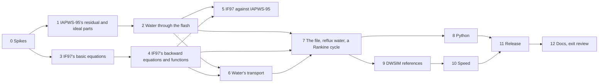

# M5a plan — water and steam

M5a gives reflux water, the fluid a chemical engineer meets in every plant:
- "Steam at 40 bar and 450 °C: its h, s, v, cp and viscosity, to IAPWS's
  digits."
- "A Rankine cycle, pump, boiler, turbine and condenser, in a flowsheet file,
  on IAPWS-95."
- "Water's vapour pressure at 120 °C, and steam's T from p and h, as fast as
  a steam table."
- "The same state by IAPWS-95 and by IF97, and how far apart they are."

It's the roadmap's M5 split in two (D1): **M5a**, water and steam, now, from
`main`, while M6 continues on its branch; **M5b**, transport properties of
mixtures, later. Of the milestones whose dependencies `main` meets (M5,
M10b, M12), M5a is the one that touches least of what M6 is changing (see
"With M6" below). It's planned like M1 to M4, M8, M9 and M10a: research
first, then exit criteria, decisions and steps. The roadmap entry is in
[roadmap.md](roadmap.md), amended by D1.

Status: **approved** on 2026-11-24, as drafted, every decision as written,
on branch `m5a-water` from `main` at v0.4.0 (`18eb317`). Step 0 is done: its
spikes ran for the draft, and D7 took its final form from them before
approval. The four bundles below, and bundle B's skipped full check, were
allowed on 2026-11-25. Bundle A, steps 1 and 2, is done (`181e456`), and
amends D7 and D8, approved on 2026-11-26. Bundle B, steps 3 to 5, is done,
and amends criterion 6, for the owner's approval; bundle C is next, when
the owner says. M5a's
version is set at its release, as the next one on `main` then: M6 finished
with v0.5.0 on its branch, and the owner has fixes on another (D17).

## Goal

- **IAPWS-95 as a `thermo.Model`** (C6): the scientific formulation, all 56
  terms of its residual part with every derivative the contract asks for,
  and its ideal part as a new ideal-gas Cp form. Pure water then goes through
  the flash on `main` unchanged: PT, PH, PS, TV, UV, bubble and dew points,
  and Psat, each answer checked as every flash's is.
- **IAPWS-IF97,** the industrial formulation, as steam-table functions:
  regions 1 to 5, the saturation line, the 2–3 boundary, the backward
  equations, and IAPWS's supplements for region 3. IF97 is a Gibbs energy in
  (T, P) in three of its regions, so it can't be a `Model`; it goes behind
  the flash once M6's phase seam is on `main` (M5b, or a step after M6).
- **Water's transport properties** (C7, for water): viscosity, thermal
  conductivity and surface tension, IAPWS's correlations, with their
  critical enhancements on IAPWS-95.
- **In a flowsheet:** `equation = "IAPWS-95"` in a file, and a Rankine cycle
  on M4's units solved, its balances checked, as a golden flowsheet.
- **On the command line:** `reflux water`, a state's properties from any two
  of T, P, h, s, a quality or a density, by either formulation.
- **Against the releases:** every verification table IAPWS publishes for
  what M5a implements, to its printed digits.
- **Against DWSIM 9:** its CoolProp package (which is IAPWS-95) and its Steam
  Tables package (IF97), state by state and on the Rankine cycle, every
  difference explained.

## What the research found

**What M5a builds on:**
- **`thermo.Model`** ([model.v](../thermo/model.v)) is F(T, V, n) = Aʳ/RT
  with its first and second derivatives, and everything else derives from it:
  the volume roots, P, ln φ, Hʳ, Sʳ, Cp, the speed of sound, PIP and Psat. Its
  comment already names "multiparameter reference equations" among the
  models it's meant for.
- **The volume solvers** (`liquid_volume`, `vapor_volume`, `stable_volume`)
  assume a model with a smallest volume, `min_volume` (a cubic's covolume),
  P(V) convex on the liquid branch and P(ρ) concave on the vapour branch.
  Each walks its own branch from its own end, stops where dP/dV changes sign,
  and `stable_volume` takes the root of lower Gibbs energy.
- **`thermo.CpForm`** ([ideal.v](../thermo/ideal.v)) is a sum type,
  `AlyLee | Correlated | Polynomial`, each with Cp and its two integrals.
  `Fluid` ([fluid.v](../thermo/fluid.v)) adds that ideal gas, on reflux's
  reference (elements at 298.15 K and 1 bar), to what the model gives, with
  reflux's R in −R ln(P/P°).
- **The flash has a pure component's paths** already: PH and PS find β from
  the energy balance inside the jump at Tsat (`flash/ph.v`), and the
  vapour-fraction flashes have their own (`flash/vf.v`).
  `thermo.saturation_pressure` is successive substitution, P ← P·φᴸ/φⱽ,
  from Edmister's start; M10a found it fails at Tc(1 − 1e-6) for n-butane.
- **A fluid is built from the database** by `components.Database.setup`,
  whose `Setup.kind` is a `thermo.CubicKind`; the file's `[model]`
  (`flowsheet/file.v`) and the C API's `reflux_fluid_new` take a cubic's
  name or code. IAPWS-95 is the first fluid that isn't a cubic.
- **Water's record** (`data/components/7732-18-5.toml`) is ChemSep's: Tc
  647.14 K (IAPWS's is 647.096), ω 0.344, M 18.0153 g/mol, ΔH°f −241.814
  kJ/mol and S° 188.724 J/(mol·K), which is CODATA's 188.835 at 1 atm
  rather than 1 bar (M9 step 4 found ChemSep's S° mixes the two). Its
  ideal-gas Cp is eq. 107.

**IAPWS-95** (IAPWS R6-95(2018), the revised release; Wagner and Pruß, J.
Phys. Chem. Ref. Data 31, 387, 2002):
- **The form:** f/RT = φ°(δ, τ) + φʳ(δ, τ), δ = ρ/ρc, τ = Tc/T, with Tc =
  647.096 K, ρc = 322 kg/m³ and R = 0.46151805 kJ/(kg·K).
  - φʳ has 56 terms: 7 polynomial, 44 exponential (δ^d τ^t e^(−δ^c)),
    3 Gaussian bells and 2 non-analytic terms for the critical region, Δ^b δ ψ
    with Δ = θ² + B[(δ − 1)²]^a and θ = (1 − τ) + A[(δ − 1)²]^(1/2β).
  - φ° = ln δ + n₁° + n₂°τ + n₃° ln τ + Σ nᵢ° ln(1 − e^(−γᵢ°τ)), five
    Planck–Einstein terms: cp°/R = 1 + n₃° + Σ nᵢ°(γᵢ°τ)² e^(γᵢ°τ)/(e^(γᵢ°τ) − 1)².
    That's Aly–Lee's sinh term exactly ((x/sinh x)² is the Einstein
    function at 2x), five times over, with closed-form integrals.
  - Its Table 5 gives every derivative of φʳ up to second order, which is all
    the `Model` contract needs: for one component, F(T, V, n) = n·φʳ(τ, δ)
    with δ = n/(Vρc) (and the gas constant's term of D4).
- **The gas constant is part of the formulation:** the release says R =
  0.46151805 kJ/(kg·K) "must be used", the coefficients having been fitted
  with it. With M = 18.015268 g/mol (IAPWS G5-01, revised 2026, VSMOW) that's
  8.314371357587 J/(mol·K), 1.1e-5 below reflux's 8.314462618 (D4).
- **Its reference state:** u = s = 0 for the saturated liquid at the triple
  point, 273.16 K, set by n₁° and n₂°. reflux's is formation from the
  elements at 298.15 K; the two differ by a constant per mole (D6).
- **Validity:** the stable fluid from the melting curve to 1273 K and 1000
  MPa; it extrapolates reasonably to 100 GPa and 5000 K, and in the gas down
  to 130 K. Its "unsatisfactory features" are confined to the immediate
  critical region: cp and κ_T between Tc and Tc + 5 K within 0.5% of ρc, and
  cv's maximum up to 2.5 mK off the saturation temperature.
- **Uncertainties** (its Figs. 1 to 4): density as low as 0.0001% in the
  liquid near ambient conditions, more elsewhere; the vapour pressure, the
  saturated densities, w and cp each with its own figure.
- **Verification:** Table 6, φ° and φʳ with their derivatives at 500 K and
  838.025 kg/m³; Table 7, p, cv, w and s at 11 (T, ρ) states; Table 8, the
  saturation properties at 275, 450 and 625 K, to nine figures. Table 7's
  footnote warns that the liquid's p at low pressure may miss the ninth
  figure, a small error in ρ moving p a lot.

**IAPWS-IF97** (IAPWS R7-97(2012); Wagner et al., J. Eng. Gas Turbines Power
122, 150, 2000):
- **Its regions:** 1 (liquid, g(p, T)), 2 (vapour, g(p, T), with a separate
  equation for the metastable vapour), 3 (near-critical, f(ρ, T)), 4 (the
  saturation line, ps(T) and its inverse Ts(p), exactly consistent with each
  other), 5 (1073.15 to 2273.15 K, up to 50 MPa, g(p, T)). B23 divides
  regions 2 and 3, a quadratic in p and T. Valid from 273.15 K to 1073.15 K up
  to 100 MPa, and to 2273.15 K up to 50 MPa.
- **Its own gas constant,** R = 0.461526 kJ/(kg·K), which isn't IAPWS-95's:
  8.3145146 J/(mol·K) with IAPWS's molar mass. Its equations are per kg.
- **Backward equations** for regions 1 and 2: T(p, h) and T(p, s), region 2
  in three subregions with the B2bc boundary. They're consistent with the
  basic equations within 25 mK in region 1 and 10 mK in region 2, not to
  rounding.
- **Supplements for region 3,** both IAPWS's:
  - SR3-03(2014): T(p, h), v(p, h), T(p, s) and v(p, s) in subregions 3a and
    3b, and the saturation pressure from h or s along region 3's part of the
    saturation line;
  - SR5-05(2016): v(p, T) in 26 subregions (20 that meet the consistency
    requirement, 0.001% in v, and 6 auxiliary ones very near the critical
    point that don't fully), so that region 3 needs no iteration.
- **Not here:** the (h, s) backward equations (SR2-01, SR4-04), and IAPWS's
  table methods for speed (TTSE, SBTL).
- **Consistency with IAPWS-95:** IF97 was fitted to values from IAPWS-95,
  and its uncertainties are IAPWS-95's widened by their differences (its
  Figs. 3 to 6). Between its own regions the release reports the actual
  inconsistencies, well within the permitted "Prague values" (Table 43, at
  the boundaries between single-phase regions: 0.05% in v, 0.2 kJ/kg in h,
  1% in cp; Table 44, at the saturation line: 0.05% in ps, 0.02% in Ts). The
  per-region tolerances to IAPWS-95 that IF97 was fitted to are in Wagner et
  al. (2000), which step 0 still has to read.
- **Verification:** Tables 5, 15, 18, 33, 35, 36 and 42 for the basic
  equations; Tables 7, 9, 24 and 29 for the backward equations; a point each
  for B23 and B2bc; and each supplement's own tables.
- **Licensing:** IAPWS allows publication of its releases in whole or in part
  with attribution, so their coefficients can be transcribed with a citation.
  The `iapws` Python package is GPL-3.0, so reflux takes nothing from its
  source, only its answers in fixtures, as M6 did (D10).

**Water's transport** (IAPWS's correlations, each with verification tables):
- **Viscosity** (R12-08; Huber et al., J. Phys. Chem. Ref. Data 38, 101,
  2009): μ = μ₀(T)·μ₁(T, ρ)·μ₂(T, ρ), μ₂ the critical enhancement through a
  correlation length that takes (∂ρ/∂p)_T at T and at 1.5·Tc from IAPWS-95.
  For industrial use μ₂ = 1 and IF97's density. Tables 4 (11 points) and 5 (6
  near-critical points).
- **Thermal conductivity** (R15-11): λ = λ₀λ₁ + λ₂, λ₂ needing cp, cv,
  (∂ρ/∂p)_T and the viscosity; an industrial form with IF97. Tables 4 and 5,
  and 7 to 9 for the industrial form, region by region.
- **Surface tension** (R1-76(2014)): σ = 235.8 mN/m · τ^1.256 (1 − 0.625τ),
  τ = 1 − T/Tc, with its table of values.
- Each is a few dozen coefficients and a page of formulas: short, as the
  brief hoped. A mixture's transport is another matter (M5b): the component
  files carry ChemSep's correlations for each liquid's and vapour's viscosity,
  conductivity and surface tension (`components/record.v`), and M9 has
  Wilke's rule for a gas's viscosity, but mixing rules and pressure
  corrections for the rest grow fast.

**What the spikes found** (step 0, run before approval; [spike/water](../spike/water)):
- **The residual part transcribes cleanly.** My float64 Table 5 reproduces
  Table 6's φʳ and derivatives to its printed digits (worst 2.9e-9 relative,
  the printing), and agrees with the `iapws` package's to 4.3e-11 at 2000
  random states once one cancellation is avoided:
  - the exponential terms' φ_δδ written with (d − cδᶜ) − 1 loses digits at
    low density (1.2e-7 at δ = 1.7e-8), and with d − 1 − cδᶜ doesn't. Step 1
    has that, and tests at δ down to 1e-8;
  - what's left is at high density and low T, where the terms cancel: both
    implementations are 1e-11 to 1e-10 from mpmath's at 40 digits there.
    Step 1 measures that conditioning and sets its tolerances from it.
- **The critical point is a removable 0/0, and one real singularity.**
  - Table 5's ∂²Δ/∂δ² divides ∂Δ/∂δ by (δ − 1), which is 0/0 at δ = 1 for
    every τ; written out, the quotient is a sum of positive powers of
    (δ − 1)², finite and 0 there. The `iapws` package special-cases δ = 1;
    CoolProp nudges δ off 1.
  - With that, float64 matches mpmath's derivatives at 40 digits to 8e-15 on
    six rays into (τ, δ) = (1, 1), from 0.1 to 1e-11 away. At 1e-12 along δ
    it's 2e-8, which I haven't yet told apart from mpmath's own differencing
    step straddling δ = 1, where the terms in |δ − 1|^(1/β) aren't smooth.
  - The only singularity is the critical point itself, where Δ = 0: there
    φʳ_ττ diverges (as |τ − 1|^(−0.3) along the critical isochore, as
    |δ − 1|^(−1) along the critical isotherm), so cv and cp are infinite and
    w is zero, as the formulation means; φʳ, its first derivatives and φʳ_δδ
    have finite limits (φʳ_δδ → 0.5411181). Evaluated naively there,
    everything but φʳ is NaN (D8).
- **The gas constant's choice** (D4), measured: with IAPWS-95's R carried in
  F, every property at (T, ρ) is the release's, and pure water's ln φ tends to
  (R₉₅/R − 1) ln δ at low density instead of 0: +1.9e-4 at 1 Pa, +1.2e-4 at 1
  kPa, 7e-5 at 1 bar, against reflux's R in F: a fugacity 0.007% to 0.02%
  high. Only water's own phases ever compare it, since the model is pure
  water, and between them it cancels: their chemical potentials are
  IAPWS-95's but for one constant, so their equilibrium is IAPWS-95's
  exactly.
- **The volume solver on IAPWS-95 works almost everywhere, and fails in three
  ways that matter** (spike `volume`: `solve_tp`'s three solvers ported line
  for line, on 33 temperatures from 251 K to 5000 K and 76 pressures from
  1 Pa to 100 GPa, each answer against a scan of 60,000 densities):
  - **IAPWS-95's isotherms inside the dome are wild.** At 251 K the τ⁵⁰ terms
    make φʳ about −1.5e19 near ρc, and P(ρ) has spurious roots there that are
    mechanically stable (dP/dρ > 0) with Gibbs energies up to 1e19 RT *below*
    the real phase's. 910 of the 2,508 states have such a root, at every T
    from 251 K to 625 K. So choosing the root of least Gibbs energy among all
    roots, the textbook rule, is wrong for IAPWS-95; only the roots on the
    two physical branches, the vapour's from ρ → 0 and the liquid's from high
    density, are candidates. reflux's solvers walk exactly those branches,
    which is why they're right at 2,438 states.
  - **A false root at `min_volume`:** IAPWS-95 has no covolume, so the spike
    put `min_volume` at δ = 5 (1610 kg/m³), where P is 4.9 to 24 GPa from 251
    K to 5000 K. Asked for a pressure above P(T, vmin), the liquid solver's
    clamped steps converge onto vmin and return it as a root (59 states at 10
    and 100 GPa, beyond the formulation's range).
  - **A wrong stable phase in compressed liquid:** the vapour solver starts
    at the ideal gas's density, p/RT. At 251 to 500 K and 42 to 75 MPa, and at
    600 K and 100 MPa, that start lies inside the dome's spurious loops, and
    Newton converges to a spurious root near ρc. `stable_volume` then takes it
    for its lower Gibbs energy: liquid water at 300 K and 42 MPa came out at
    322 kg/m³ instead of 1014.6 (11 states of the grid, a band of pressures
    wherever p/RT lands in a loop). That's a boiler feed pump's outlet.
  - **Near Tc, each solver can return the other branch's root:** the window
    of metastability narrows to nothing (0.07% of P at 646 K), and Newton's
    50% steps in density jump the spinodal gap. At 647 K and 0.99·Psat the
    liquid solver returns the vapour's root, and at 1.01·Psat the vapour
    solver the liquid's. The stable root is still right, since both solvers
    agree on it.
- **Saturation by `thermo.saturation_pressure`** (spike `sat`) reproduces
  Table 8 to its printed digits (4.3e-10, 3.9e-10 and 1.2e-9 relative at 275,
  450 and 625 K), taking 5 iterations at 273 K, 37 at 625 K and 130 at 645 K.
  From 646 K up it fails, "lost the two-phase region": its ×1.1 and ×0.9
  steps from Edmister's start overshoot the metastable window, and the
  solvers then find one root for both phases (above). That's 1.1 K below Tc,
  where M10a's n-butane failed at Tc(1 − 1e-6). The flash's own
  pure-component saturation (`flash/vf.v`) refuses a single root rather than
  converging on it, so it can't give a false answer, but it needs both
  branches right too.
- **What fixes them** ([spike/water/guard.py](../spike/water/guard.py)),
  found in two tries:
  - **First, a convexity guard:** on its own branch Newton never carries an
    iterate past p, if the vapour's P(ρ) is concave and the liquid's P(V)
    convex, so an iterate past p has jumped the gap. Near Tc it worked: on
    732 states from 600 to 647.09 K at 0.97 to 1.03·Psat, the solvers
    returned the wrong branch's root 101 times without it and never with it.
    But over the whole grid it refused real liquid roots at 251 to 260 K,
    where IAPWS-95's liquid branch isn't convex between vmin and the root.
  - **Then, the split at ρc** (D7): below Tc a vapour iterate denser than
    ρc, or a liquid iterate lighter than it, has left its branch; with the
    vapour's start bounded by the saturated vapour's density (which step 2
    found the split makes redundant, and took out) and the liquid walk that
    must reach p. On the whole grid, every one of the 2,449 states
    with a root on a branch agrees with the scan's, none disagrees, and the
    59 above P(T, vmin) are refused (against 2,438, 70 and none before).
    Near Tc, it gives the first guard's results exactly: no wrong branch's
    root on the 732 states, and with the bracket, Psat as below.
  - **The bracket:** once `saturation_pressure` has seen a pressure with no
    liquid root and one with no vapour root, it bisects in ln P between
    them instead of stepping by 1.1 and 0.9. With either guard, Psat
    converged at every temperature tried up to 647.0959 K, 0.1 mK below Tc,
    in 23 to 201 iterations, within 6e-9 of the `iapws` package's up to
    647.095 K (at 647.0959 K they differ by 6e-5, which step 2 has to
    attribute). Without the bracket it fails from 647 K, its ×1.1 and ×0.9
    steps bouncing across the window.
- **DWSIM 9.0.5's packages for water** (driven from Python, as M3's spike
  did): of its 28 packages, three: "CoolProp", "Steam Tables (IAPWS-IF97)" and
  "Seawater IAPWS-08". Its water is 18.01528 g/mol.
  - **Its CoolProp package is IAPWS-95:** h within 1e-9 kJ/kg and s within
    1e-11 of the `iapws` package's IAPWS-95 at all 14 states, regions 1 to 5,
    on IAPWS's reference. A PH flash back lands 3.7e-7 K off. 11 ms a PT
    flash and 111 ms a PH flash.
  - **Its Steam Tables package is IF97 in regions 1, 2 and parts of 3,** to
    1e-12 kJ/kg, and fails silently elsewhere:
    - at 650 K and 25.58 MPa (region 3, 500 kg/m³) it returns h = −1 kJ/kg
      and s = −1 kJ/(kg·K), with no error;
    - it has no region 5: at 1500 K and 0.5 MPa h is 5.75 kJ/kg off, at 30
      MPa it's 1292.7 kJ/kg against 5167.2, at 2000 K −46,354;
    - a PH flash back from region 3 lands at 1729 K, 1080 K off; from regions
      1 and 2, 3e-5 and 1e-4 K off;
    - 1.1 ms a PT flash and 7.0 ms a PH flash.
  - Inside the dome at 1 bar, given IF97's h at a quality of 0.5, the Steam
    Tables package finds IF97's Ts and 0.5 exactly, and the CoolProp package
    IAPWS-95's Ts within 2e-7 K and 0.4999855.
  - IF97 against IAPWS-95 at the same states: h within 0.002 to 0.095 kJ/kg
    away from the critical point, 1.45 kJ/kg at 650 K and 22.3 MPa, 7.3
    kJ/kg at 647 K and 22 MPa, where IF97's uncertainty grows.

**References for the tests:**
- **The releases' own tables,** to their printed digits (criteria 1, 4, 7).
- **mpmath** at 40 digits, for derivatives near the critical point (spike
  `critical`), and for every derivative's identity where differences aren't
  enough.
- **The `iapws` package** (1.5.4, already pinned by M6's
  `tools/gen_m6_henry.py` on `m6-activity`), for IAPWS-95, IF97 and the
  transport correlations over grids, in a uv script, into `testdata/`.
- **CoolProp 8.0.0** (pinned since M1), whose water is IAPWS-95 by its own
  implementation and which has IF97 as a separate backend: a second,
  independent implementation of each.
- **Brute force:** the roots of P(ρ) = p on the two physical branches by a
  fine scan, and the one of lower Gibbs energy, for every volume root (spike
  `volume`; not the least Gibbs energy over all roots, which IAPWS-95's
  spurious roots defeat); Maxwell's criterion solved independently for
  saturation.
- **DWSIM 9:** its CoolProp and Steam Tables packages (above).

## Exit criteria

All checked by tests in CI, as before.

1. **IAPWS-95 is the release.** Tables 6, 7 and 8 reproduced, each value
   within half a unit of its last printed figure. Table 8's h and s on
   IAPWS's reference, through the one constant between it and reflux's (D6).
   The liquid's p at low pressure (Table 7's footnote) is held to what its
   conditioning allows, with the reason in the test.
2. **The model is right everywhere it's evaluated.**
   - Every derivative F gives matches mpmath's at 40 digits within a
     tolerance justified by rounding, over a grid of the formulation's range
     and the extrapolations its release endorses (δ from 1e-8, T from 130 K
     in the gas to 5000 K), and on rays into the critical point down to
     1e-11.
   - M1's identities hold: Maxwell relations, Euler homogeneity in n, Σnᵢ
     ln φᵢ = Gʳ/RT.
   - At the critical point itself, what's finite has its limit and what
     diverges is ±∞, never NaN (D8).
3. **Water through the flash.** Every flash on `main` (PT, PH, PS, TV, UV,
   bubble and dew points, Psat) on IAPWS-95 water, over a sweep from the
   triple point to 1273 K and 1 Pa to 1000 MPa, with its extrapolations to
   2273.15 K (for IF97's region 5) and down to 251.165 K at pressure.
   - Each answer checked from scratch: the phase of lower Gibbs energy of
     the two branches' roots by brute force, saturation by Maxwell's
     criterion solved independently, and against the `iapws` package and
     CoolProp.
   - Zero unexplained failures, as M3's sweep. Iterations recorded, and
     they can't grow.
   - Psat and the saturated phases up to 0.1 mK below Tc.
   - **Nothing a cubic does changes:** D7's changes to `thermo`'s solvers
     leave every cubic answer's bits, shown by a trace of M3's sweep and of
     every flash kind before and after, and the golden reports, as M6's step
     4 showed its seam.
4. **IF97 is the release.** Every verification table of R7-97, SR3-03 and
   SR5-05, each value within half a unit of its last printed figure,
   the backward equations' values as the backward equations give them.
5. **IF97's functions are consistent.** Each answer from a backward equation
   is finished on its basic equation (D9), so that h(p, T(p, h)) = h and the
   like to rounding. Across region boundaries the inconsistencies are within
   the release's Tables 43 and 44. Every function agrees with the `iapws`
   package over a grid in every region.
6. **IF97 against IAPWS-95.** On a grid in each region, the largest and RMS
   differences in v, h, s, cp, w and ps are recorded, numbers that can't
   grow, and each lies within IF97's stated uncertainty there (the release's
   Figs. 3 to 6), the critical region reported apart.

   **Amended in step 5,** for the owner's approval: the pseudo-critical
   ridge just above Fig. 3's critical triangle, 30 to 40 MPa between its
   isochores (0.0019 and 0.0069 m³/kg), is reported apart with the critical
   region: there IF97's cp is up to 0.99% from IAPWS-95's, where Fig. 4
   states 0.5%, and that largest difference is recorded, a number that
   can't grow. Everywhere else every difference is within the figures.
7. **Water's transport.** Viscosity, thermal conductivity (each with its
   critical enhancement, and its industrial form on IF97) and surface
   tension reproduce every verification table of R12-08, R15-11 and R1-76
   within half a unit of the last printed figure.
8. **A Rankine cycle.** A file with `equation = "IAPWS-95"` and a pump,
   boiler, turbine and condenser solves, every balance closed (M4's D8), and
   joins the golden flowsheets. Its states, work and efficiency match a hand
   calculation from the `iapws` package's states within the solver's
   tolerance, and DWSIM 9's same cycle on its CoolProp package by state,
   every difference explained.
9. **`reflux water`** prints a state's properties from any two of T, P, h, s,
   x and ρ, by IAPWS-95 or IF97, as a table and as JSON; each refusal (a pair
   that doesn't fix a state, a state outside the formulation's range) says
   why, with the exit statuses of M8's D17.
10. **Speed.** An IAPWS-95 PT and PH flash, and IF97's functions, timed with
    gcc `-prod` against DWSIM's two packages, CoolProp and the `iapws`
    package, and recorded. reflux must be faster than DWSIM's own packages.
11. **Python** (if D16 is kept): `Database.fluid("IAPWS-95", ["water"])`, and
    every vectorised call on it agrees with the V API bit for bit.
12. CI is green, and the docs are updated: README, roadmap, design notes, the
    file format, the V notes. The release is made (D17).

## Decisions

| # | Decision | Choice | Why |
|---|---|---|---|
| D1 | Scope | The roadmap's M5 in two: - **M5a, now:** IAPWS-95 as a `Model`, IF97 with its region-3 supplements as steam-table functions, water's transport (viscosity, thermal conductivity, surface tension), IAPWS-95 in the file and the C API, and `reflux water`; - **M5b, later:** the transport of mixtures (ChemSep's correlations, mixing rules, pressure corrections, in the reports), and IF97 behind the flash through M6's phase seam.  The roadmap's "CoolProp behind a flag, as a reference oracle in tests" is dropped: tests never call Python or a C library for their references, and CoolProp 8.0.0 is already pinned for the fixture scripts. The roadmap is amended to say so.  A shorter M5a, if the owner wants one: drop water's transport to M5b (step 6), or region 3's supplements, taking region 3 by Newton on its f(ρ, T) from IAPWS-95's density instead (part of step 4). | Water is one fluid with IAPWS's own equations and tables, so it can be done and proven in one short milestone. A mixture's transport needs choices of method that water's doesn't, and IF97 in the flash needs M6's seam, which isn't on `main`. |
| D2 | Where it lives | - **A new module, `water`:** IAPWS-95 (`water.iapws95()`, a `thermo.Model`), IF97 (`water.if97_*`, or a submodule `water.if97` if step 3 finds that reads better), and the transport correlations, over `thermo` and `numeric`. - **`thermo`:** the ideal part's form, a new `CpForm` variant (D5). - **`components`:** an IAPWS-95 fluid's setup, from water's record, for the file and the C API. - **`flowsheet`:** `[model]`'s new equation (D12). - **`main`:** `reflux water` (D13). - **`capi` and `python/`:** the equation's code (D16).  vlib has no module named `water`. | `thermo.Model` is open, an interface, so a model needs no edit to `thermo`; only the Cp form, a sum type, does. Everything water-specific stays in one place, which M5b's IF97 phase model joins. |
| D3 | IAPWS-95 as a `Model` | One component, water, with IAPWS's constants: Tc 647.096 K, Pc 22.064 MPa, ω 0.3443, M 18.015268 g/mol. F(T, V, n) = n·(R₉₅/R)·φʳ(τ, δ) + n·(R₉₅/R − 1)·ln δ (D4), δ = n/(Vρc), ρc = 322/0.018015268 mol/m³, τ = Tc/T. Every derivative in closed form from Table 5, with the critical point's 0/0 written out (D8) and the low-density cancellation avoided. A model of more than one component, or one that isn't water, is refused when made. `volume_function` keeps what depends on T alone (the τ powers, the Gaussian and non-analytic τ factors) for the volume solver. | It's the contract's own form: a Helmholtz energy in (T, V, n). Closed forms keep every derivative exact to rounding, which Tables 6 and 7 check to nine figures. |
| D4 | The gas constant | IAPWS-95's own, R₉₅ = 8.314371357587 J/(mol·K), as the release requires, with reflux's R everywhere else. The difference is carried in F, by the n(R₉₅/R − 1) ln δ of D3, and in the ideal-gas Cp, by R − R₉₅ (D5). Then the total Helmholtz energy is IAPWS-95's but for a term linear in T, so every property at (T, ρ) is the release's and h, s, u differ from it by constants. The cost, measured: water's φ tends to ρ^(R₉₅/R − 1) at zero density, not to 1: ln φ is 1.9e-4 at 1 Pa and 7e-5 at 1 bar. Only water's own phases compare it, since the model is pure water.  The alternative, reflux's R in φʳ, moves every p, h, s and w of IAPWS-95's by the factor R/R₉₅ = 1.0000110, and the tables then match only after that factor. | The release is explicit, and its tables are the exit's proof. The ln φ cost cancels between water's own phases, the only ones a pure model compares, and is a known number for anything that ever compares it with another fluid's. |
| D5 | The ideal part | A new `CpForm` variant, `PlanckEinstein`: Cp = a + Σ cᵢ (θᵢ/T)² e^(θᵢ/T)/(e^(θᵢ/T) − 1)², with its two integrals in closed form, written to stay finite where θ/T is large. IAPWS-95's ideal part is a = R + R₉₅·n₃°, cᵢ = R₉₅·nᵢ°, θᵢ = γᵢ°·Tc (R − R₉₅ in a, by D4). The fluid's ΔH°f and S° are water's record's, so its H and S are on reflux's reference like every other fluid's. | IAPWS-95's Cp is that form exactly, and GERG-2008 and Span–Wagner's equations use it too, so it's not water's alone. A fluid's reference stays reflux's, so that M5a's water and M9's reactions can meet later. |
| D6 | Reference states | **reflux's** (formation from the elements, 298.15 K, 1 bar) in the flowsheet, the fluid and reports, as everywhere. **IAPWS's** (u = s = 0 for the triple point's liquid) in the steam-table functions and `reflux water`, which say so. The two differ by a constant h₀ and s₀ per mole, computed by IAPWS-95 at the triple point's liquid and given in design.md. IF97's reference is IAPWS's too, set in the same way: its h for the triple point's liquid is 0.611783 J/kg, IAPWS-95's 0.611782. | A flowsheet's energy balances need one reference for every fluid. A steam table's reader expects IAPWS's numbers. |
| D7 | Volume roots | `thermo`'s generic solvers stay, walking each physical branch from its own end. What IAPWS-95 needs besides comes in two kinds, neither of which moves a cubic's bits (step 2 shows it with a trace of M3's sweep and of every flash kind, and the golden reports, as M6's step 4 did): - **Through an optional interface** that a model implements if it knows its branches (its name for step 2), which only IAPWS-95 does, so a cubic's paths don't change at all:   - **the vapour solver's start,** below Tc, is no denser than the saturated vapour by Wagner and Pruß's auxiliary equation (IAPWS SR1-86), so the walk begins on the vapour's branch, never inside the dome;   - **the split between the branches:** below Tc the spinodal's vapour side lies below ρc and its liquid side above, so a vapour iterate denser than ρc, or a liquid iterate lighter than it, has left its branch, and the solver returns none, as it does at a spinodal. - **Generic, but never reached by a cubic:**   - **IAPWS-95's `min_volume`** is at δ = 5 (1610 kg/m³), and a liquid walk that never reaches p above vmin returns none, not vmin, so a pressure above P(T, vmin), 4.9 GPa or more, is refused. A cubic's P → ∞ at its covolume, so its walk always reaches p.   - **`saturation_pressure`'s start** bisects in ln P between a pressure with no liquid root and one with no vapour root, once it has both, rather than stepping by 1.1 and 0.9 past a window it can't hit. A cubic path that converges today without alternating is the same path.  Choosing the stable root among all roots by Gibbs energy is refused as a design: for IAPWS-95 it's wrong at 910 of step 0's 2,508 states. So is a guard that assumes the liquid's P(V) convex: step 0 tried it, and it refused real liquid roots at 251 to 260 K.  **Amended in step 2,** approved on 2026-11-26: - **`min_volume` is at δ = 4** (1288 kg/m³), not 5: P there is 1.16 GPa or more from 251 K, still above the release's 1 GPa, and four such volumes are 1/ρc, which `thermo.phase_label`'s rule takes for a critical volume. - **The vapour start's bound is gone,** and SR1-86's ρ'' with it: the split alone refuses every spurious root the grids found. Between the vapour's spinodal and ρc, P rises only where it's hugely negative (−1e27 to −5e8 Pa up to 600 K) or, at 625 to 640 K, at 10 to 20 MPa, whose ideal-gas start lies far below that stretch on the vapour's own branch. Planted, its removal survived every test, which is how it showed. - **`Branches` has another limit, `no_state`:** below 251.165 K, the melting curve's lowest point, IAPWS-95 has no state. Its liquid there is an extrapolation whose H falls as T rises (at 562 MPa, H at 215.7 K is above H at 273.16 K), which the PH flash's search followed down; and a vapour there, endorsed by the release only below the sublimation curve, gave a UV flash a phantom answer at 233.8 K and 522 Pa. The sublimation curve (R14-08) isn't in M5a. - **A model with `Branches` is labelled by its split,** below Tc: liquid below it, vapour above. Π calls liquid water vapour near its density maximum, −130 at 280 K and 1 bar, −7 at 300 K. - **The flash's searches step back into the range:** where the single-phase PH bracket's step, or the UV bracket's, fails at a T where the model has no state (`no_state`), it halves back towards the last T with one (`flash.at_or_closer`). Any other failure is the search's, as before, so a cubic's failing search fails as it did, as fast.  None reaches a cubic: a trace of 83,563 lines, every cubic answer's bits over 3,000 of the sweep's mixtures and 160 pure compounds (PT, stability, roots, vapour-fraction, PH, PS, TV and UV), is the same byte for byte before and after (`spike/water/trace`). | Step 0's evidence (above): the branches are what make the answer right, and each change acts only where the old path left its branch or ran past its range. Keeping IAPWS-95's knowledge of its own branches behind an optional interface, as M8's `Warm` is optional, leaves `Model` as it is and every cubic's path untouched. |
| D8 | The critical point | The non-analytic terms are evaluated with Table 5's (1/(δ − 1))·∂Δ/∂δ written out as its finite sum, so δ = 1 needs no special case. At (Tc, ρc) itself, where Δ = 0, F and its first derivatives take their limits (the Δ^b terms' are 0) and so does ∂²F/∂V²; ∂²F/∂T² is −∞ there, so cv and cp are +∞ and w is 0, the formulation's own values. Nothing is NaN. Step 1 tests each limit against mpmath along several paths.  **Amended in step 1,** approved on 2026-11-26: at (Tc, ρc) `thermo`'s `Fluid.props` gives w as NaN, its formula w² = −(V²/m)(Cp/Cv)(∂P/∂V) taking Cp/Cv as ∞/∞; Table 3's `props95` gives 0 to rounding (7.9e-5 m/s). The formula is the cubics' too, and rewriting it, as −(V²/m)[(∂P/∂V) − T(∂P/∂T)²/Cv], would move every cubic's w by its last bits, so it stays, and the NaN is recorded and tested. | It's what IAPWS-95 says at its critical point. CoolProp's nudge, δ = 1 + 10ε, gives a finite number that the formulation doesn't. |
| D9 | IF97 | All of R7-97: regions 1 to 5, the metastable vapour, region 4's ps(T) and Ts(p), B23, and the backward T(p, h) and T(p, s) of regions 1 and 2 with B2bc; SR5-05's v(p, T) and SR3-03's T and v of (p, h) and (p, s) in region 3. - **Per kg,** in SI (J/kg, J/(kg·K), m³/kg), as the release is, with its own R; molar values, where needed, by IAPWS's 18.015268 g/mol. - **The steam-table functions** take (T, p), (p, h), (p, s), (T, x) or (p, x), choose the region by the release's Fig. 1, and refuse a state outside its range with the range. - **A backward equation's answer is finished** by Newton on the basic equation (one or two steps), so that the functions' answers are consistent to rounding; each backward equation alone is also there, as published, which its table checks. - **Inside the dome,** (p, h) and (p, s) give Ts and the quality from region 4 and the saturated phases' values. | The backward equations are 10 to 25 mK from their basic equations by design. reflux returns an answer only once it's shown to be right, and one Newton step costs little next to the backward equation. |
| D10 | IF97's coefficients | Transcribed from the releases' tables, with each release cited where they're kept, never from another implementation's source. A test holds them to the `iapws` package's (a fixture), and the verification tables hold the equations. | IAPWS allows its releases' use with attribution; the `iapws` package is GPL-3.0. M6 did the same with IAPWS's Henry's constants. |
| D11 | Water's transport | R12-08's viscosity and R15-11's thermal conductivity, each with its critical enhancement on IAPWS-95, and R1-76's surface tension; for IF97, each one's industrial form (μ₂ = 1 and IF97's density; R15-11's industrial λ). Functions of (T, ρ) and of a state, in `water`, reported by `reflux water` and the V API. A stream's transport in the flowsheet's report waits for M5b, which brings mixtures, so the report changes once. Outside a correlation's validity (R12-08's Eq. (9)) a value is refused, unless the release endorses the extrapolation there (the dilute gas to 2500 K, for one). | IAPWS's own correlations, each with its tables, for the fluid M5a has. |
| D12 | The file | `[model] equation = "IAPWS-95"`, with `[components] names` exactly water, by any of its names or its CAS number. `alpha`, `kij` and `kij_overrides` are refused with it. An equation 0.4.0 doesn't know is refused by name there, so no file changes meaning: it stays format 3, unless the owner wants a new format for it, or M6's format 4 has landed first, in which case it's format 4's. | The file names its model as it does today. A file with water and another compound needs a mixture model (GERG-2008, later), and is refused saying so. |
| D13 | `reflux water` | `reflux water SPEC SPEC [--if97] [--json OUT]`, each SPEC a name and a number with its unit, `T=450degC`, `P=40bar`, `h=3000kJ/kg`, `s=6.5kJ/(kg*K)`, `x=0.9`, `rho=500kg/m3`, read by `quantity` as the file's numbers are. It prints T, P, ρ, v, h, s, u, cv, cp, w, the phase and quality (and IF97's region), μ, λ, and σ at saturation, on IAPWS's reference, per kg and per mole. Exit statuses as M8's D17: 0, 1 when no state, 2 for a wrong command. | A steam table on the command line, with units, is what a student reaches for, and `main_test.v` tests it in process. |
| D14 | Comparing with DWSIM | By state, as M4 compared: IAPWS-95 against DWSIM 9's CoolProp package, IF97 against its Steam Tables package where it works, and the Rankine cycle in both, its PH tolerance noted. Where its IF97 fails silently (region 3's h of −1, no region 5), the failure is recorded and reported upstream. | Step 0 found both drivable from a script, and its CoolProp package matching IAPWS-95 to 1e-9. |
| D15 | Fixtures | `tools/gen_m5_*.py`, uv scripts pinned to `iapws` 1.5.4, CoolProp 8.0.0 and mpmath 1.3.0, write `testdata/m5_*.json` with their provenance, and reproduce byte for byte on the same day. The releases' tables are typed into the tests with their table and row. | Tests never call Python (CLAUDE.md). Two independent implementations, besides the releases, catch a transcription that one shares. |
| D16 | Python | The C API's `reflux_fluid_new` takes a new equation code, `REFLUX_IAPWS95`, for water alone, and the package's `Database.fluid("IAPWS-95", ["water"])`; every existing vectorised flash and property call then works on it. The ABI version is unchanged: an older library refuses the code, and nothing a caller did before changes. IF97 from Python isn't in M5a. | One code and a few lines give Python users IAPWS-95 water with everything M10a built. The `iapws` package already serves IF97 in Python; reflux's case there is flowsheets (M10b). |
| D17 | Versions | M5a ends with a minor release: v0.5.0 if it merges before M6, v0.6.0 if after, and the other plan is amended (M6's plans v0.5.0 today).  **Amended on 2026-11-25,** at the owner's word, before step 1: the version is whatever minor release is next on `main` when M5a's release step comes. M6 finished with v0.5.0 on its branch, and the owner has fixes on another branch that may take a version first. | The CHANGELOG's rules: additions are a minor release. |
| D18 | Who writes what | As before, I write it all unless you claim a step. | |

## Steps

**The steps go in four bundles** (allowed on 2026-11-25), each built
together with a write-up per step, and each ending where a decision may be
the owner's. Bundle B's skipped full check is an exception to CLAUDE.md's
rule (one full tcc check at the end of a bundle that changed V source),
which the owner allowed:

| Bundle | Steps | What it touches | Ends with |
|---|---|---|---|
| A | 1 and 2: IAPWS-95, and water through the flash | `thermo` (the Cp form, D7's solvers), the new `water` | one full tcc check, since `thermo` is under everything; D7 proven not to move a cubic's bits, or amended for the owner |
| B | 3 to 5: IF97, its backward equations, and IF97 against IAPWS-95 | `water` alone, which nothing else imports yet | `water`'s own tests, `v fmt -verify` and `v vet`, no full check: no other module can see the change, and CI runs everything on the push |
| C | 6 to 8: water's transport, the file, `reflux water`, the Rankine cycle and Python | `water`, `components`, `flowsheet`, `main`, `capi`, `python/` | one full tcc check, and `tools/python.vsh test` (gcc), since the C API changed |
| D | 9 to 12: DWSIM, speed, the release and the exit review | fixture scripts, their tests, the docs | one full tcc check, the release gate's (its own run of the full check counts) |

**The checks:** three local full tcc checks in the milestone (ends of A, C
and D), none with gcc locally. CI runs both compilers, the `-prod` build and
the Python tests on Ubuntu and Windows on every push, and its run is read
after the push. Inside a bundle, the touched tests and their dependents run,
and the planted mistakes; a test is never skipped, only the whole suite's
rerun is.

### 0. Spikes — done, on 2026-11-24, before approval
- [spike/water/iapws95.py](../spike/water/iapws95.py): Table 5 transcribed
  and checked (`check`); the critical point against mpmath (`critical`);
  `thermo.solve_tp`'s three volume solvers and `saturation_pressure` ported
  line for line and run on IAPWS-95 against brute force (`volume`, `sat`);
  the gas constant's two options (`gas`).
- [spike/water/guard.py](../spike/water/guard.py): D7's branch guard and
  bracketed Psat start near Tc, and (`d7`) the volume grid again with all of
  D7's changes.
- [spike/water/dwsim.py](../spike/water/dwsim.py): DWSIM 9.0.5's water
  packages at 14 states, PH back, in the dome, and timed.
- What they found is in "What the research found". Left for step 5: Wagner
  et al. (2000)'s tolerances of IF97 to IAPWS-95, for criterion 6, which
  need the paper.
- The spikes are Python, porting `thermo`'s solvers line for line, because
  the question was the algorithm on IAPWS-95's isotherms, and the `iapws`
  package gave the residual part to check against. Step 2 runs the same
  checks on the V code.

### 1. IAPWS-95's residual and ideal parts — done, with D8 amended
- D3, D4, D5, D8: `thermo.PlanckEinstein`; `water.iapws95()`, the `Model`,
  and its fluid with water's formation values.
- Tables 6 and 7; every derivative against mpmath (criterion 2); the critical
  point's limits; the constant between the two references (D6).

**What was built** ([design.md](design.md), "IAPWS-95"):
- **[thermo/ideal.v](../thermo/ideal.v):** `PlanckEinstein`, Cp = a + Σ cᵢE(θᵢ/T),
  with its integrals in closed form by expm1 and log1p, finite from 1 K to
  1e12 K.
- **[water/](../water):** a new module. `coefficients.v`, the release's
  Tables 1 and 2;
  `iapws95.v`, the `Model` (F = n·ψ, ψ = kφʳ + (k − 1) ln δ, every
  derivative to second order by D3's table), its ideal part and `fluid`;
  `properties.v`, Table 3 on IAPWS's reference (`props95`) and D6's
  constants (`reference_offsets`).

**Tests** ([water/iapws95_test.v](../water/iapws95_test.v),
[water/derivatives_test.v](../water/derivatives_test.v),
[thermo/ideal_test.v](../thermo/ideal_test.v)):
- **Tables 6 and 7** to their printed digits, every value: Table 7 both by
  Table 3 and through the Model and `thermo`'s generic properties, s on
  IAPWS's reference by D6's constant.
- **D4 to D6:** the two references differ by constants over Table 7's
  states, h to 2.9e-14 and s to 2.4e-14, and p, cp, cv and w not at all, to
  1.4e-13 but for cp at 647 K and 358 kg/m³, 4.3e-12, where (∂p/∂ρ)_T is 0.4%
  of ρRT. The constants, with water's ΔH°f and S° from its record:
  −287,716.6 J/mol and 63.1939 J/(mol·K).
- **The ideal part:** Cp is R₉₅(1 − τ²φ°_ττ) + R − R₉₅ to 1e-14 from 130 K to
  5000 K, and ∫Cp dT is the change in R₉₅T(1 + τφ°_τ) plus (R − R₉₅)ΔT to
  1e-9; `PlanckEinstein` with one term is Aly–Lee's sinh term, Cp to its bits
  and its integrals to 2.5e-15.
- **The coefficients** equal the `iapws` package's, every number
  (`tools/gen_m5_iapws95.py`, which also checks R₉₅ to 1e-12).
- **φʳ against mpmath** at 50 digits, 291 points and six derivatives each,
  from 130 K in the gas to 5000 K, inside the dome and on six rays into the
  critical point down to 1e-10: within 18.3 ε of the sum of the terms'
  magnitudes (φʳ_δδ at 251.165 K and δ = 1.8, inside the dome, where the τ⁵⁰
  terms cancel to 1e-4 of their size), and within 1 ulp near the critical
  point.
- **F:** Euler's theorem to 1e-13 of its terms, and each first and second
  derivative against Richardson's differences of the one below, to 1e-7.
- **The critical point:** φʳ, its first derivatives, φʳ_δδ and φʳ_δτ finite,
  φʳ_ττ −∞, every δ = 1 at τ ≠ 1 finite; P is Pc to 1e-13, Cv and Cp +∞.

**D8 is amended** (above), approved on 2026-11-26: `Fluid.props`' w is NaN at (Tc, ρc), Cp/Cv being
∞/∞ in the cubics' formula, which stays.

**Found:** pdftotext's text of Table 7 has its columns out of line; the
rows were put back together by each column's order and checked by every
value passing.

**Planted mistakes:** 18, in a scratch copy, one at a time, all caught: E(u)
missing a u, ∫E dT with exp for expm1, ∫E/T dT's log sign; a digit of n₂₅,
β₅₄, the non-analytic B, n₃°; D4's ln δ term left out of ψ, IF97's R for
IAPWS-95's, D4's R − R₉₅ left out of the ideal Cp; the low-density
cancellation put back; ∂²Δ/∂δ² missing g, ∂²Δᵇ/∂δ∂τ's sign, the
Gaussians' τ factor, φʳ_ττ's sign at the critical point; F_TV missing τ,
F_nn's bracket; Table 3's cp.

### 2. Water through the flash — done, with D7 amended
- D7: IAPWS-95's `min_volume` and the liquid walk that must meet p, the
  vapour start's bound, the branch guard and `saturation_pressure`'s
  bracket; the trace that every cubic answer keeps its bits.
- The TV and UV flashes on water inside the dome (the risk below).
- Table 8 through `saturation_pressure` and the vapour-fraction flashes.
- The sweep of criterion 3, each answer checked from scratch, with the
  `iapws` package's and CoolProp's states as fixtures
  (`tools/gen_m5_iapws95.py`).

**What was built** ([design.md](design.md), "Finding the volume", "Phase
identification", "PH and PS flashes"):
- **[thermo/model.v](../thermo/model.v):** the optional `Branches`
  interface and its `BranchLimits` (`split`, `no_state`), read by `fix`;
  the liquid walk that must reach p; each solver held to its branch.
  IAPWS-95 implements it: below Tc the split at ρc, and no state below
  251.165 K.
- **[thermo/saturation.v](../thermo/saturation.v):** the bracketed start.
- **[thermo/phase.v](../thermo/phase.v):** labels by the split.
- **[flash/tv.v](../flash/tv.v), [flash/ph.v](../flash/ph.v):**
  `at_or_closer`, the step back into the range where the model says it has
  no state (`StepBack`), in the UV bracket and the single-phase PH and PS
  search.

**Tests** ([water/flash_test.v](../water/flash_test.v)), every answer
checked from scratch:
- **Table 8** to its printed digits through the flash's own saturation
  (`tvf`, Newton to 1e-12). `thermo.saturation_pressure` stops at 1e-10 in
  ln φ, 1.1e-10 in P at 625 K, which puts ρ'' a hair past the half unit of
  the table's last digit (118.2902805 against the true …280450).
- **Saturation to 0.1 mK below Tc:** at 18 temperatures from 273.16 K to
  647.095 K, and at 647.0959 K, its two roots are the scan's two branches'
  to 1e-9 and their fugacities equal to 1e-9; Psat within 5.7e-9 of the
  `iapws` package's and CoolProp's.
- **The volume roots** at 925 states, 273.16 K to 2273.15 K and 1 Pa to
  1 GPa: the scan's branches' answer to 1.2e-14, CoolProp's density to
  3.3e-12, and the `iapws` package's to 6.4e-13 where it agrees with
  CoolProp (51 states skipped: CoolProp's own refusals at 273.16 K below
  the triple point's pressure, and the package's wrong densities, below).
- **Every flash back:** at every sixth state (all of them with
  `REFLUX_WATER_SWEEP=all`), the PT flash, then PH, PS, TV and UV from its h,
  s, u and v: 620 flashes land on T to 2.4e-11 and P to 3.1e-8 (TV's P, by
  a liquid's bulk modulus), 3,343 iterations. The whole sweep, run once:
  3,700 flashes, T to 2.5e-11 and P to 3.1e-8, 20,094 iterations, no failure.
- **Inside the dome:** TV, UV, PH and PS at qualities 1e-4, 0.3 and 0.9 at 13
  temperatures, and the dew point: T to 7.3e-13, P to 5.7e-12, β to
  6.8e-11.
- **D7:** 2 GPa at 300 K refused, above P(T, vmin); liquid at 300 K and
  42 MPa is 1014.645 kg/m³, not step 0's 322; no state at 240 K at three
  pressures, and PH back to 273.16 K at 562 MPa; labels by the split at six
  states, liquid at 280 K and 300 K and 1 bar among them; ω from 0.7·Tc is
  0.3443 to 5e-5.
- **The step back** ([flash/step_back_internal_test.v](../flash/step_back_internal_test.v)):
  `StepBack.outside` either side of 251.165 K in T and in ln T, none above
  Tc, none for its zero value or a cubic. `StepBack.m` is an Option of an
  interface, and M6 found such a conversion passing `v -check` and failing
  in C, so it was built and run under tcc and gcc both.
- **Every cubic answer keeps its bits** (`spike/water/trace`): 83,563 lines
  over 3,000 of M3's sweep's mixtures (stability and PT for PR; and at one in
  five, for PR, SRK and a shifted PR, the three volume roots with their
  properties and labels, tvf and pvf at β 0, 0.4 and 1, PH, PS, TV and UV)
  and 160 pure compounds (saturation_pressure and the pure vapour-fraction
  flash at five temperatures up to 0.9999 Tc, PT either side), built with
  gcc `-prod`, the same byte for byte before D7 and after it. The cubics'
  own Psat failures at 0.9999 Tc are unchanged too: their branches have no
  split.

**D7 is amended** (above), approved on 2026-11-26: `min_volume` at δ = 4, the vapour start's bound
taken out, `no_state` below 251.165 K, labels by the split, and the
searches' step back where the model has no state.

**Found:**
- **IAPWS-95 has no usable state below 251.165 K:** its liquid's H falls as
  T rises there (at 562 MPa, H at 215.7 K is above H at 273.16 K), and a
  vapour above the sublimation curve gave UV a phantom answer at 233.8 K.
  The PH and UV searches stepped there from 273.16 K.
- **Π labels liquid water vapour** near its density maximum: −130 at 280 K
  and 1 bar, −7 at 300 K, 4.6 at 350 K. A drum would have sent it out of its
  vapour port.
- **A step back on every failure is too much:** as first written,
  `at_or_closer` halved back from any failed step, and the cubic trace's
  709 failing UV flashes (M4's cold liquids, at or below 100 K) each ran up
  to 30 more TV flashes: a quarter of the trace took 28 minutes, where the
  whole had taken 5.5 (other runs sharing the processor).
  It steps back now only where the model says it has no state
  ([flash/step_back_internal_test.v](../flash/step_back_internal_test.v)).
- **The `iapws` package's density is wrong** at 640 to 647 K and pressures up
  to a few hundred pascals: it returns a near-saturated vapour's density,
  9,840 to 15,930 mol/m³, against 2e-4 to 0.1 here and in CoolProp, which
  agree to 1e-14. To report upstream.
- **A flash of water costs about 0.06 s under tcc,** 3,700 in 3.6 minutes:
  step 10's.

**Planted mistakes:** 18, in a scratch copy, one at a time: 15 caught
(`min_volume` at δ = 5; no split; the vapour's split; the liquid's split;
the liquid walk that must reach p; the bracket removed whole; no state below
200 K instead of 251.165; a vapour where there's no state; the split's labels
swapped; labels by Π alone; one step back instead of thirty; PH's and UV's
searches without the step back; ln T taken for T in the step back; the step
back never taken) and 3 explained:
- each half of the bracket taken out alone, since the other half still
  bisects from its side;
- stepping back on every failure, not only where the model has no state:
  every failure a water search meets is outside the range, so the tests
  can't tell; a cubic's failing search can, and the trace, which holds every
  cubic refusal's message too, is what shows it.

Two more survived the first run and were deleted, with D7 amended for it:
the vapour start's bound, and its SR1-86 exponents. Planted, the bound's
removal broke nothing, and a scan of every isotherm below Tc showed why:
between the vapour's spinodal and ρc, P rises only at −1e27 to −5e8 Pa (to
600 K) or at 10 to 20 MPa (625 to 640 K), where the ideal-gas start lies far
below that stretch, on the vapour's own branch. The split had made it
redundant.

### 3. IF97's basic equations — done
- D9, D10: regions 1 to 5, the metastable vapour, region 4 and B23; the
  region from (T, p).
- Tables 5, 15, 18, 33, 35, 36 and 42, and B23's point.

**What was built** ([design.md](design.md), "IAPWS-IF97"):
- **[water/if97/](../water/if97):** a submodule, `water.if97`, as D2 allowed:
  1,555 coefficients in three files read better apart from IAPWS-95's.
  [basic.v](../water/if97/basic.v) has the basic equations of regions 1, 2
  (and the metastable vapour), 3 and 5 as published, with no range check;
  [if97.v](../water/if97/if97.v) R7-97's constants, `State` (per kg, with x
  NaN for a single phase), `If97Error` (`out_of_range`, `no_answer`),
  region 4's ps(T) and Ts(p), B23 and B2bc.
- **[tools/extract_if97.py](../tools/extract_if97.py):** D10's
  transcription. Every coefficient table of R7-97, SR3-03 and SR5-05 is read
  from the releases' PDFs, span by span with each span's size and baseline,
  so that a superscript exponent is told from its line, and the
  supplements' digits, set in the Symbol font at private-use code points
  (U+F031 for 1), are mapped back. Each table must hold exactly its
  release's number of terms, or nothing is written. The PDFs' plain text
  (pdftotext) loses the exponents, and the supplements' digits entirely.
  The tool's first readings were wrong twice, both caught: Table 30's
  dashes for n₁'s missing I and J taken for n₁'s sign (Table 33 failed),
  and Table 22's I, printed "–" and "7" 6 pt apart, taken for a positive I
  and a sign (the coefficients' test). Region 4's, B23's and every other
  table's first readings were right.

**Tests** ([verification_test.v](../water/if97/verification_test.v),
[coefficients_test.v](../water/if97/coefficients_test.v),
[iapws_test.v](../water/if97/iapws_test.v)):
- **R7-97's Tables 5, 15, 18, 33, 35, 36 and 42,** and B23's point, every
  value within half a unit of its last printed figure.
- **The coefficients** are the `iapws` package's (`tools/gen_m5_if97.py`),
  each number and exponent of the 1,555, but two kinds: B23's n₅, which the
  package has with an 8 dropped (13.9188397787 for the release's
  13.918839778870), and the metastable vapour's 15, which it doesn't have:
  Table 18 holds those.
- **The basic equations against the package's** at 831 (p, T) states over
  the range: regions 1, 2 and 5 within 7.5e-13, 3.1e-15 and 1.1e-15, region
  3 within 2.6e-12 (both by Newton on p(ρ, T) = p).

**Planted mistakes:** 14, in a scratch copy, one at a time: 13 caught (region
1's γ_π sign, its τ shift, its cv's second term; ln π left out of γ° in s,
w's π²γ_π² missing a π; the metastable vapour with Table 10's n₁°, n₂°;
region 5's τ shifted; region 3's n₁ in φ_δδ, its w's sign; psat's fourth
power, Tsat's root, T23's n₃, h2bc's units), two of them only once the tests
held a NaN to fail, and 1 explained: a digit of the metastable vapour's n₁
in its 13th figure, below Table 18's nine, which the package can't check
(it has no metastable equation). That coefficient came by the same reading
as the 1,555 the package confirms.

### 4. IF97's backward equations and steam-table functions — done
- D9: T(p, h) and T(p, s) in regions 1 and 2 with B2bc; SR3-03 and SR5-05 in
  region 3; each finished on its basic equation; (T, p), (p, h), (p, s),
  (T, x) and (p, x), the dome included.
- Tables 7, 9, 24 and 29, B2bc's point, and the supplements' tables
  (criterion 4); consistency (criterion 5), against the `iapws` package
  over grids (`tools/gen_m5_if97.py`).

**What was built** ([design.md](design.md), "IAPWS-IF97"):
- **[backward.v](../water/if97/backward.v):** the backward equations as
  published: T₁(p, h), T₁(p, s), T₂(p, h) and T₂(p, s) in their
  subregions, SR3-03's h3ab, T₃ and v₃ of (p, h) and (p, s), p3sat(h) and
  p3sat(s).
- **[region3_v.v](../water/if97/region3_v.v):** SR5-05's subregion
  boundaries, the choice of subregion by its Tables 2 and 10 (with a side,
  liquid or vapour, where they meet the saturation line), and v(p, T) in
  its 26 subregions.
- **[functions.v](../water/if97/functions.v):** `state_pt`, `state_ph`,
  `state_ps`, `state_tx` and `state_px`, and `psat` and `tsat` with their
  range. The region by R7-97's Fig. 1; each backward answer finished by
  Newton on its basic equation, in T (regions 1, 2 and 5, bracketed) or in
  (ρ, T) (region 3); region 3 at (p, T) by Newton on p(ρ, T) from SR5-05's
  v, bracketed on its side of ρc; the dome from region 4 and the saturated
  phases, region 3's to 1 µK below Tc. A value within rounding of the
  range's edge is in it.

**Tests:**
- **Criterion 4** ([verification_test.v](../water/if97/verification_test.v)):
  R7-97's Tables 7, 9, 24 and 29 and B2bc's point; SR3-03's h3ab point and
  Tables 5, 8, 12, 15, 18 and 20; SR5-05's Tables 3, 5, 11 and 13, each of
  Table 5's and 13's 52 points also put in its own subregion by Tables 2
  and 10. Every value within half a unit of its last printed figure but
  Table 13's last row (found, below).
- **The functions** ([functions_test.v](../water/if97/functions_test.v)):
  2,841 states from (p, T) back from (p, h) and (p, s), each in its region,
  T within 3.6e-15 (regions 1, 2 and 5) and 4.4e-14 (region 3), v within
  3.9e-14 and 7.6e-14; the dome from 611.3 Pa to 22.05 MPa, x back within
  4.2e-15; the saturated phases to 1 µK below Tc, each region-3 density's p
  within 1e-9 of Eq. (30)'s; the critical point; rho3's refusal 1 kPa past
  each spinodal at 647 K; a 3k vapour below Tc; a value a hair outside the
  range's edge; the gap at 1073.15 K, where region 5's h is up to 90 J/kg
  above region 2's; and 19 states outside the range, each refused as such.
- **Against the package** ([iapws_test.v](../water/if97/iapws_test.v)):
  states from (p, h) and (p, s) within its iteration (SciPy's), 2.2e-12 in
  regions 1, 2 and 5 and 6.7e-11 in region 3; saturated states from (T, x)
  and (p, x) (below); the backward equations as published within 4.6e-15,
  and v(p, T) within 2.3e-12 on a fine grid near the critical point, where
  subregion 3v's terms cancel; region 4 and the boundaries within 7.6e-15.
- **Criterion 5's consistency** ([consistency_test.v](../water/if97/consistency_test.v)):
  R7-97's Tables 43 and 44 reproduced, each maximum and RMS: Table 44's to
  their printed digits; Table 43's within half a unit but four maxima
  (found, below), over 10,001 points evenly in p along each boundary.

**Found:**
- **SR5-05's Table 13 prints v3z(22.064 MPa, 647.15 K) as 3.701940010e-3,**
  0.53 units of its last figure from its own equation: Eq. (4) with Table
  A2.6's coefficients is 3.7019400094668e-3 (mpmath, 50 digits). Its terms
  are 2.8e4 times their sum and e = 4, so rounding allows 2.5e-11; reflux
  is 1.7e-12 from the exact value, which that row is held to.
- **R7-97's Table 44 at 623.15 K** prints Δps between Maxwell's criterion
  on regions 1 and 2 and on region 3 as 0.0041%. Ours is 0.0046%, made of
  −0.00433% and +0.00028% against Eq. (30), each consistent with the
  table's own columns, which ours reproduce to their digits: a slip in that
  column, it seems. Recorded.
- **Table 43:** along B23 the release's points are evenly in p (in T, the
  RMS values are up to 13% off). Four maxima miss by more than half a unit:
  1/3's cp and w (0.19446% and 0.29840%, 0.00054 and 0.0006 under) and
  B23's cp, 0.35171% (0.0013 under, at 689 K), and w, 0.40463% (0.0016
  over, at its end, 100 MPa and 863.15 K). Recorded; the gaps are 0.4% of
  the values.
- **Region 3's saturated liquid within about 6 mK of Tc:** Newton from
  SR5-05's v alone jumped across the isotherm's loop, whose ends are within
  a pascal of Eq. (30)'s p (0.5 Pa at 647.095 K). Each phase's search keeps
  to its side of ρc, as IAPWS-95's do (D7), bracketed. Within about 10 µK of
  Tc the vapour's spinodal on Eq. (28) is up to 8e-4 Pa below Eq. (30)'s p,
  the two equations' inconsistency there, and the vapour's density is the
  spinodal's, its p within 4e-11.
- **The `iapws` package:**
  - B23's n₅ has an 8 dropped (above);
  - its two-phase mixtures above 623.15 K use SR5-05's backward densities
    unfinished, so at 22 MPa and x = 0.35 its v is 1% off the mixture of its
    own saturated phases, which agree with reflux's within 1e-10;
  - its saturated phases from (T, x) above 623.15 K come from Maxwell's
    criterion on Eq. (28), 5.0e-6 from Eq. (30)'s p (Table 44 allows
    0.0026%);
  - its fsolve fails on 8 and 9 of region 3's 33 grid states from (p, h)
    and (p, s);
  - its region-3 states from (p, T) carry p as their density gives it back,
    up to 1.0000000000007e8 Pa at 100 MPa;
  - under NumPy 2.5.5 its region-3 (p, h) raises a TypeError: the fixture
    pins NumPy 2.2.6.

  To report upstream.
- **A NaN passed the first tests:** `|got − want| > bound` is false for a
  NaN. Every bound is now written `!(… <= bound)`, or asserted as `<=`
  (two of step 3's planted mistakes found it).

**Planted mistakes:** 21, in a scratch copy, one at a time: 19 caught (2a
and 2b split at 5 MPa in (p, h); 2b and 2c at 6.1 kJ/(kg·K) in (p, s); 2a's
quarter exponents as whole ones; h3ab's n₄; 3a and 3b split 100 kJ/kg high;
p3sat(s)'s shift; Table 2's 23.5 MPa at 24; 3m's d; 3n by Eq. (4); no room
at the bracket's ends; no critical point in rho3; 3k not a vapour's; a
closed bracket's residual allowed to 1e-3; the saturated liquid as a
mixture; no edge to the range; region 5 kept above 1073.15 K; finish3's
∂h/∂T, a sign; a digit each of T₃b(p, s)'s and v₃k's coefficients), four of
them only after a test was added for each (the critical point from (p, T), a
3k vapour below Tc, a value a hair outside the edge, the gap at 1073.15 K),
and 2 explained:
- Table 10's liquid split moved from 21.93161551 MPa to 21.90096265 MPa
  (its two footnote pressures): those are where T3uv and T3wx meet the
  saturation line, so between them a liquid at T ≤ Ts is below T3uv either
  way, and the split decides nothing the T3uv test doesn't. Kept as the
  release writes it.
- Newton "settled" at a step of 4e-9 of x, not 4 ulps: its next error is
  about the square of its step, so any stop below about 1e-8 gives the same
  answers.

### 5. IF97 against IAPWS-95 — done, with criterion 6 amended
- Criterion 6: the grid, each region's differences recorded against IF97's
  uncertainties, the critical region apart.

**What was built:** [water/if97_95_test.v](../water/if97_95_test.v), IF97
against IAPWS-95 at 4,712 (p, T) states, 26 pressures from 1 kPa to 100 MPa
every 5 K to 1073 K and every 50 K to 2273 K, IAPWS-95's state by
`thermo.solve_tp` and Table 3, both on IAPWS's reference. R7-97's Figs. 3 to
5 are encoded as read (v, cp and w by region of the p-T plane), and Fig. 6
as its band; the release calls their lines approximate, so a point is held
to the largest value within 20 K and a factor of 1.5 in p. The critical
region is reported apart: Fig. 3's triangle, bordered by the isochores
0.0019 and 0.0069 m³/kg and the 30 MPa isobar (the release's definition),
where v is held as 0.2% in p and cp to 3% outside the small circle Fig. 4
draws at the critical point; and around it, 590 to 700 K from 10 to 30
MPa near ρc, where Figs. 4 and 5 give more than 3% and 2%.

**Tests:** every difference of v, cp and w at the 4,133 states outside the
critical region and its ridge is within the figures, and ps from 273.16 K to
647 K within Fig. 6's band, its largest 0.0176%. Each region's largest
differences, numbers that can't grow:

| | states | v (%) | h (kJ/kg) | s (J/(kg·K)) | cp (%) | w (%) |
|---|---|---|---|---|---|---|
| Region 1 | 1,500 | 0.00313 | 0.239 | 0.431 | 0.123 | 0.239 |
| Region 2 | 2,359 | 0.0374 | 0.411 | 0.413 | 0.485 | 0.325 |
| Region 3 | 206 | 0.115 | 0.982 | 1.480 | 0.987 | 0.485 |
| Region 5, to 1273 K | 92 | 0.0112 | 0.264 | 0.164 | 0.0965 | 0.0331 |
| Above 1273 K | 460 | 0.00655 | 0.323 | 0.211 | 0.0651 | 0.0393 |
| The critical region | 95 | 1.36 | 6.61 | 10.14 | 15.7 | 1.57 |

In the triangle (50 states), v as p is within 0.2%, and cp within 3% but
for two states inside the circle (5.0% and 15.7% at 22.5 and 23 MPa,
650 K), where Fig. 4 gives none.

**Found:** **IF97's cp exceeds its stated uncertainty on the
pseudo-critical ridge** just above the triangle: between its isochores at
30 to 40 MPa and 675 to 715 K (18 states), cp differs from IAPWS-95's by up
to 0.99% (35 MPa, 695 K), where Fig. 4 states 0.5%. Both equations are
held to their releases there (Tables 33 and 7). So criterion 6 can't be met
as written on the ridge, and is amended (above), for the owner's approval:
the ridge is reported apart with the critical region, its cp difference
recorded (0.99%, can't grow).

### 6. Water's transport
- D11: R12-08, R15-11 and R1-76, on IAPWS-95 and in their industrial forms
  on IF97; their tables (criterion 7), and the `iapws` package's values over
  a grid.

### 7. The file, `reflux water` and a Rankine cycle
- D12, D13: `[model] equation = "IAPWS-95"`, its refusals at their lines;
  `reflux water`; a Rankine cycle as a golden flowsheet (criterion 8), its
  hand calculation from the `iapws` package's states as a fixture.

### 8. Python
- D16: `REFLUX_IAPWS95`, the package's equation, and the reference program's
  points for the bit-for-bit tests (criterion 11).

### 9. DWSIM references
- D14: `tools/gen_m5_dwsim.py`, DWSIM's two packages by state and the
  Rankine cycle in DWSIM, into `testdata/m5_dwsim.json`; every difference
  explained.

### 10. Speed
- Criterion 10, into `docs/benchmarks.md`.

### 11. Release
- The CHANGELOG entry, the versions and the release gate, as for v0.4.0
  (D17).

### 12. Docs and exit review
- README, roadmap, design notes (every formula the code uses), the file
  format, testdata/README.md, the V notes, and a criterion-by-criterion
  review.

## With M6

M6 is on `m6-activity`, steps 7 and 8 uncommitted there, and this plan
touches none of it. What to expect when the second of the two merges:
- **The version:** M6 plans v0.5.0. Whichever merges first takes it, and the
  other's plan is amended (D17).
- **`thermo`:** on `m6-activity`, `Fluid.model` is a `thermo.PhaseModel`,
  and `new_fluid` puts a `Model` behind its volume roots (`thermo.by_roots`).
  IAPWS-95 is a `Model`, so it goes through `by_roots` there with no change
  to it; `Fluid`'s construction in `components` and the tests that build
  flashes on it move as M6's step 4 moved every other caller. The flash on
  M6's seam must give IAPWS-95 water the same bits it gives here, which step
  2's sweep, run again after the merge, shows.
- **Water's vapour pressure:** M6's step after 6 put Wagner and Pruß's
  vapour-pressure equation (IAPWS's SR1-86) into `thermo/gamma_phi.v` for
  Henry's constants. If `water` ever needs the release's equations, they
  should live in one place after the merge, `water`. (D7's vapour start
  took SR1-86's saturated-vapour density until step 2 found the split
  makes it redundant.)
- **The file:** M6's format 4 adds keys to `[model]` (its D11, D12), and M5a
  a value of `equation` (D12): one merge in `flowsheet/file.v`'s
  `read_model`, and the format number per D12.
- **The C API:** M6 changes `capi/flash.v` and `capi/props.v`; D16 changes
  `capi/database.v` and the header's equation codes. Little overlap.
- **The docs:** CLAUDE.md's "Where things stand", README's layout block,
  `docs/design.md`, `testdata/README.md`, `docs/v-for-go.md` and the roadmap
  all gain sections on both branches: textual conflicts, each kept whole.
- **Fixtures:** both use the `iapws` package, pinned to 1.5.4 on both.

## Risks

| Risk | Effect | Fallback |
|---|---|---|
| D7's split leaves a spurious root reachable somewhere the grids didn't sample | a wrong phase in some band of states | criterion 3's sweep checks every answer against the branch roots of a fine scan; step 2 scanned every isotherm below Tc for where P rises between the vapour's spinodal and ρc (only at −1e27 to −5e8 Pa, or 10 to 20 MPa at 625 to 640 K); a vapour start bounded by SR1-86's ρ'', which step 2 took out as redundant, can come back if a state needs it |
| The TV and UV flashes, which minimise A over the phases' volumes with no volume roots (M3's D5), wander into the dome's spurious region, where A is hugely negative | a TV or UV flash of water converging to a phantom split | step 2 tests both from the states of criterion 3, inside the dome at low T above all, each answer checked by its phases' volume roots; their Newton bounded to each phase's branch if needed |
| Successive substitution for Psat is slow near Tc even with D7's bracket (96 iterations at 645 K, up to 201 within 0.05 K of Tc) | Psat within millikelvins of Tc costly or refused | step 2 measures it; Newton on Maxwell's two conditions in the two densities (Akasaka's method) if needed, a change that would move cubics' Psat bits, so only with the owner's word |
| The critical point's infinities reach code that doesn't expect them | NaN in a flash's Cp, or a refused flash at the critical point | D8's limits tested through every property and flash at (Tc, ρc) and around it |
| A coefficient mistyped in one of IF97's dozens of tables | a wrong value in some subregion | each table's verification values, the `iapws` package's coefficients and CoolProp's answers over grids, three independent checks (D10, D15) |
| The backward equations' finishing Newton fails near a boundary or the critical point | no answer where the backward equation had one | the backward value kept as a start, Newton bracketed within the region; a failure is a typed error with how far it got |
| DWSIM's packages fail silently, as its Steam Tables package does in region 3 | a comparison against a wrong number | every DWSIM value checked against the releases first, as step 0 did; its failures recorded, not compared |
| M6 merges first and moves `Fluid` and the file | conflicts | "With M6", above; step 2's sweep run again after the merge |

## Not in M5a

- **The transport of mixtures:** M5b (D1).
- **IF97 behind the flash,** a `PhaseModel` once M6's seam is on `main`:
  M5b, or a step after M6.
- **Water in a mixture model** (GERG-2008, or IAPWS-95 with a cubic for the
  rest): later (C6).
- **IF97's (h, s) backward equations** (SR2-01, SR4-04), and IAPWS's fast
  table methods (TTSE, SBTL): if speed asks for them.
- **Ice, the melting and sublimation curves** (R14-08), supercooled water
  (G12-15), IAPWS-95's low-temperature extension below 130 K, heavy water,
  seawater (IAPWS-08), and water's dielectric constant and ionisation.
