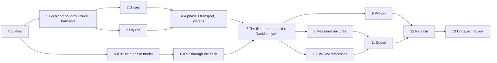

# M5b plan — transport of mixtures, and IF97 behind the flash

M5b gives every stream its transport properties, and water its industrial
formulation in a flowsheet:
- "The reactor's product at 40 bar: its gas's viscosity and thermal
  conductivity, and its liquid's, and the liquid's surface tension."
- "Natural gas at 100 bar: its viscosity, not the low-pressure value,
  which is about half the measured one."
- "Every stream in the report with μ, λ and σ, or why it has none."
- "A Rankine cycle on IF97, as the steam tables do it, region 4's
  saturation and all."

It's the second half of the roadmap's M5, split by M5a's D1 ([m5-plan.md](m5-plan.md)):
the transport of mixtures (C7), and IF97 behind the flash on M6's seam
(C6). It's planned like M1 to M10a: research first, then exit criteria,
decisions and steps. The roadmap entry is in [roadmap.md](roadmap.md).

Status: **approved** on 2026-11-27, as drafted, every decision as written
(D9's threshold 10%, file format 5 with D6's pairs, the PFR's viscosity
kept, Python's `reflux_transport`), on branch
`claude/dazzling-lehmann-3ad069` from `main` at v0.6.0 (`a1d1b91`). Step 0
is done ([spike/transport](../spike/transport)): its findings are in "What
the research found" and shape D4 to D10, D13 and D19; the plan and the
spikes are committed at `5c49cfd`. Bundle A, steps 1 to 4, is done, no
decision amended. Bundle B, steps 5 and 6, is done, and amends D14 and
criterion 7, approved on 2026-11-28. Bundle C, steps 7 and 8, and bundle
D, steps 9 to 13, are done, no decision amended: M5b is finished, its exit
review at the end. None but the plan is committed yet.

## Goal

- **Transport of every phase** (C7): each phase of a stream gets its
  viscosity and thermal conductivity, and a liquid its surface tension,
  from each compound's ChemSep correlation (the component files) by
  mixing rules, with pressure corrections for dense gases and compressed
  liquids. A value that can't be had is none, with why.
- **Chosen by measurement:** each method is the one that does best
  against measured mixtures from NIST's ThermoML archive among the
  published candidates, and the others' deviations are recorded beside it.
- **Water's own:** a stream of IAPWS-95 or IF97 water reports IAPWS's
  correlations, which M5a built (`water/transport.v`).
- **IF97 behind the flash** (C6): IF97 as a `thermo.PhaseModel`, its
  saturation region 4's, so that a flowsheet on IF97 gives the steam
  tables' answers, and a Rankine cycle on it joins the golden flowsheets.
- **In the reports:** report format 5, each phase's μ, λ and σ.
- **Against DWSIM 9:** its transport by state, each of its numbers
  reproduced from its own code, every difference explained.
- **Nothing a flash, unit or golden flowsheet gives moves.** Transport is
  reported, not solved for.

## What the research found

**What M5b builds on:**
- **The component files** carry ChemSep's correlations for each compound's
  liquid and vapour viscosity, liquid and vapour thermal conductivity,
  surface tension and liquid density (`components/record.v`), evaluated by
  `tdep`. Of the 642 compounds, 594 have all six in their files, 588
  usable (step 1); 638 have a liquid viscosity, 622 usable (15 have
  impossible ranges and one is equation 118, which `tdep` hasn't), 606 a
  vapour viscosity, 599 and 598 the two conductivities, 637 a surface
  tension and 626 a liquid density. The forms: liquid viscosity mostly
  DIPPR 101 (588) and 115 (45); vapour viscosity and conductivity 102 (590,
  586); liquid conductivity ChemSep's 16 (422) and polynomials (169);
  surface tension 16 (413), 106 (150) and 116 (68). Nearly every record
  has Tc, Pc, Vc, Zc, ω and M, 593 a dipole moment and 629 a parachor.
- **ChemSep's correlations end at or below Tc** for a liquid: 190 of its
  surface tensions go negative by Tc (data-quality.md, whose 222 failed
  correlations are 211 within 1% of Tc). A vapour's run far, smoothly.
- **M9's gas viscosity** ([reactors/viscosity.v](../reactors/viscosity.v)):
  Wilke's rule on ChemSep's equation 102, matched to `chemicals` to
  2.2e-16, with `WilkeAt` keeping what depends on T alone (M8's D11). The
  PFR takes it through an interface, `Viscosity`, for Ergun's drop, and
  ignores pressure.
- **Water's transport** ([water/transport.v](../water/transport.v)):
  R12-08's viscosity and R15-11's conductivity with their critical
  enhancements on IAPWS-95, their industrial forms on IF97, R1-76's
  surface tension, every verification table to its digits (M5a's D11).
  M5a left a stream's transport in the flowsheet's report to M5b, so that
  the report changes once.
- **IF97** ([water/if97](../water/if97)) is steam-table functions,
  `state_pt`, `state_ph`, `state_ps`, `state_tx` and `state_px`, each
  backward answer finished on its basic equation. It's a Gibbs energy in
  (T, P) in regions 1, 2 and 5 and a Helmholtz energy in (ρ, T) in region
  3, so it isn't a `thermo.Model` (M5a's D1).
- **M6's seam:** the flash takes a `thermo.PhaseModel`, a phase at (T, P,
  n) with ln φᵢ, its derivatives, a label and residual properties
  ([thermo/phases.v](../thermo/phases.v)). A PT flash of one compound
  returns the model's `.stable` phase; the PH and PS flashes of one
  compound find its saturation first by the vapour-fraction flash, which
  solves ln φᴸ = ln φⱽ by Newton (`flash/vf.v`, `Saturation.pure`). The TV
  and UV flashes need a Helmholtz `Model` (`Fluid.helmholtz()`).
- **The report** (format 4) gives each phase its fraction, composition, H,
  S and V. A file is checked key by key, every refusal at its line, so a
  new key is a new file format (the CHANGELOG's rules).

**DWSIM 9.0.5's transport of mixtures** (its source, DanWBR/dwsim's
`PropertyPackage.vb` and `Models/FluidProperties.vb`, read for this plan,
and [spike/transport/dwsim.py](../spike/transport/dwsim.py), which drives
its PR and NRTL packages at eight states and reproduces every number it
reports from its own compound constants by those formulas, to 2e-16):
- **A liquid's viscosity** is the mole-fraction mean of each compound's
  correlation (its default `LiquidViscosity_MixingRule`, MoleAverage),
  each times Lucas's (1981) compressed-liquid factor at |P − Pˢᵃᵗ| (its
  default `LiquidViscosity_CorrectExpDataForPressure`), with Henry's
  constant in place of Pˢᵃᵗ above Tc. The absolute value raises a liquid's
  viscosity below its vapour pressure too, as its Poynting term does (M6
  step 12). Its "supercritical" viscosity mode, Letsou–Stiel, is declared
  and never consulted: a compound above Tc takes its liquid correlation,
  extrapolated.
- **A gas's viscosity** is the mole-fraction mean of each compound's
  correlation, then Jossi, Stiel and Thodos' dense-gas residual on the
  mixture's mole-fraction-mean Tc, Pc, Vc and M, at every density. That
  correlation is published for 0.1 < ρr < 3, and at zero density it adds
  (1.023⁴ − 1)/ξ: +3.9% to methanol–water's vapour at 350 K and 1 atm,
  +4.7% to benzene–toluene's at 370 K (M9's spike found 0.2% to 1.3% for
  the small molecules of the reforming gas).
- **A liquid's conductivity** is Li's rule with each compound's critical
  volume where Li has its liquid molar volume; Latini's estimate where a
  compound has no correlation.
- **A gas's conductivity** is the mole-fraction mean, with no pressure
  correction (Ely–Hanley's estimate only where a compound has no
  correlation).
- **Surface tension** is the mole-fraction mean over the liquid. A
  compound above Tc is dropped and the rest renormalised term by term, in
  the loop that sums them, so the answer depends on the compounds' order
  (from the source).
- **On its activity packages a second liquid gets the first's viscosity
  and conductivity** (`AUX_LIQVISCm(T, P)` and `AUX_CONDTL(T)` called
  without the phase, which defaults to the first liquid): water–1-butanol
  at 300 K by NRTL, both liquids 1.4800e-3 Pa·s and 0.2108 W/(m·K), while
  their surface tensions are their own, 0.0527 and 0.0715 N/m.
- **The "overall liquid"** is a volume-fraction mean of the liquids'
  viscosities in which a third liquid's conductivity stands for its
  viscosity (`kl3 * phi3`, from the source); the "mixture" conductivity is
  a mole-fraction mean of the phases', and the mixture has no viscosity.
- **Water:** its Steam Tables package reports IAPS's 1985 viscosity and
  conductivity (Tc 647.226 K, ρc 317.763 kg/m³), superseded by R12-08 and
  R15-11, and −1 outside their range; its CoolProp package takes water's
  transport from ChemSep's correlations through the same functions as any
  compound, not CoolProp's IAPWS.
- **A stream's calculation** (flash included) takes 1.2 to 27 ms.

**What `thermo` 0.6.1 and `chemicals` 1.5.2 offer** (probed for this plan):
- `chemicals`: `Wilke`, `Herning_Zipperer`, `Brokaw`, `Lorentz_Bray_Clarke`
  and `Lucas` (the liquid's pressure factor) for viscosity;
  `Wassiljewa_Herning_Zipperer`, `Lindsay_Bromley`, `DIPPR9H`, `DIPPR9I`
  (Li), `Filippov`, `Missenard`, `DIPPR9G`, `Stiel_Thodos_dense`,
  `Chung_dense` and `Eli_Hanley_dense` for conductivity;
  `Winterfeld_Scriven_Davis`, `Diguilio_Teja` and `Weinaug_Katz`
  (Macleod–Sugden) for surface tension; each with its paper. None of
  Lucas's high-pressure gas method, Mason and Saxena's Aᵢⱼ, or a
  Grunberg–Nissan Gᵢⱼ.
- `thermo`'s mixtures rank, by default: the liquid's viscosity by ln μ in
  mole fractions; the gas's by Brokaw, Herning–Zipperer or Wilke; the
  liquid's conductivity by DIPPR 9H; the gas's by Lindsay–Bromley; the
  surface tension by Winterfeld, Scriven and Davis. Pressure: Lucas for a
  liquid's viscosity, DIPPR 9G or Missenard for its conductivity, and
  Ely–Hanley, Chung or Stiel–Thodos for a dense gas's conductivity; none
  for a dense gas's viscosity but CoolProp's.
- **Found:** `chemicals`' Lohrenz–Bray–Clark has 0.0093724 for the
  quartic coefficient, the paper's 0.0093324 (its source says
  "validated"); its `Lucas` takes P below Pˢᵃᵗ as no correction, where
  DWSIM takes |P − Pˢᵃᵗ|.

**What NIST's ThermoML archive holds** ([spike/transport/thermoml.py](../spike/transport/thermoml.py),
its public search API, as M6 used it): mixtures' viscosities, conductivities
and surface tensions published from 2003 to 2019, sparse for any given
pair. Usable binaries, every compound in reflux's data:
- gas viscosity: CO₂ + CH₄ to 32 MPa (119 points, 2015), CH₄ + C₃H₈ (26,
  2015) and CH₄ + C₄H₁₀ (58, 2015) to 31 MPa, and H₂ + CO₂ at 300 kPa from
  500 to 1100 K (21, 2004), the reforming gas's kind;
- gas conductivity: CO₂ + CH₄ to 12 MPa (180, 2005);
- liquid viscosity: heptane + octane to 10 MPa and 473 K (122, 2006) and
  to 5.1 MPa and 513 K (36, 2015), methanol + water (12, 2019), diethylene
  glycol + water (85, 2011), diethylethanolamine + water (85, 2007);
- liquid conductivity: 2-butoxyethanol + water to 150 MPa (152, 2010);
- surface tension: CH₄ + C₂H₆ (70, 2013), N₂ + O₂ (61, 2008),
  diethylethanolamine + water (110, 2007).

Ethanol–water's classic sets are older than the archive; the search's name
match finds "ethanol" inside other names.

**The candidates against those data** ([spike/transport/methods.py](../spike/transport/methods.py)),
each compound's own value from its component file, as M5b would take it, a
gas's density from Peng–Robinson; average absolute deviation (largest):

| Property, data | Candidates |
|---|---|
| gas μ, H₂ + CO₂, 300 kPa | **Wilke 2.5% (+6.7%)**; Herning–Zipperer 5.1%; DWSIM's mole mean 15.0% (−30%); `chemicals`' LBC 8.5% |
| gas μ, CH₄ + C₃H₈, 10–31 MPa | low-pressure Wilke 59% low; **Wilke × Lucas's factor 2.8% (+7.1%)**; Wilke + Jossi–Stiel–Thodos 12.3%; DWSIM's 12.6%; LBC 12.1% |
| gas μ, CH₄ + C₄H₁₀, 3–30 MPa | **Wilke × Lucas 2.3% (+7.8%)**; Wilke + JST 7.8% (+40%); DWSIM's 8.2%; LBC 7.9% |
| gas μ, CO₂ + CH₄, 1.4–32 MPa | **Wilke × Lucas 6.3% (+21%)**, 7 liquid-like points refused; Wilke + JST 7.9%; DWSIM's 6.1%; LBC 6.5% |
| gas λ, CO₂ + CH₄, to 12 MPa | Mason–Saxena alone 7.5%; **Mason–Saxena + Stiel–Thodos 1.6% (−5.1%)**; Lindsay–Bromley + Stiel–Thodos 1.6%; DWSIM's mole mean 5.2% (−18%) |
| gas λ, pure CO₂, to 15 MPa | without a dense residual 19.9% (−54%); **with Stiel–Thodos 3.3%** |
| liquid μ, heptane + octane, to 10 MPa and 473 K | ln μ by mole 6.3%, × Lucas's factor 6.0% (bias −5.3% → +6.0%); by mass 6.0%; DWSIM's 6.0% |
| liquid μ, methanol + water | every ideal rule 40–43% low (−61%) |
| liquid μ, diethylene glycol + water | ln μ by mole 46% (−74%); by mass 5.3%; DWSIM's 8.9% |
| liquid μ, diethylethanolamine + water | every ideal rule 62–72% low |
| liquid λ, 2-butoxyethanol + water, to 150 MPa | Li 8.0%; **Li + Missenard 3.8% (−8.2%)**; Filippov + Missenard 2.8% (binary only); DIPPR 9H 26%, 16% with Missenard; DWSIM's Li on critical volumes 7.4% |
| σ, CH₄ + C₂H₆ | **Winterfeld–Scriven–Davis 3.9%**; Diguilio–Teja 14.3%; DWSIM's mole mean 14.0% |
| σ, N₂ + O₂ | **WSD 7.3%**; Diguilio–Teja 12.4%; DWSIM's 11.7% (+62%) |
| σ, diethylethanolamine + water | **WSD 32%**; Diguilio–Teja 81%; DWSIM's 59% |

- **A dense gas needs a correction,** and Lucas's is the best of those
  tried by three to five times on the hydrocarbon gases. Jossi, Stiel and
  Thodos' residual and LBC, which is the same polynomial, overshoot.
- **No ideal rule fits an aqueous liquid's viscosity:** methanol–water
  is 41% low at best, with ChemSep's own pure values, and only a pair
  parameter (Grunberg and Nissan's Gᵢⱼ) can fix it. By the textbook values
  ethanol–water at 298 K peaks near 2.4 mPa·s where the logarithmic rule
  gives 0.93.
- **Lucas's published form doesn't tend to 1 at low pressure below
  Tr = 1:** its Z₂ there is 0.6·Tr, about 0.9% under its Z₁, and with
  Fp's polar terms the factor is 0.990 for benzene–toluene's vapour at
  370 K and 100 Pa, and 0.972 for methanol–water's at 350 K and 1 atm,
  where the true effect of pressure is nil. Taken against its own value
  at zero pressure it's 1 there, and the same on every data set above
  (D5). On the owner's reforming gas, at 1000 K and 30 bar (ρr 0.026),
  the factor is 1.0015.

**Water** ([spike/transport/water.py](../spike/transport/water.py)):
ChemSep's correlations for water against IAPWS's (R12-08 and R15-11
without their critical enhancements, R1-76) on IAPWS-95's saturated
liquid: viscosity within 1.7% from 275 to 550 K and 5.4% at 600 K;
conductivity within 2.0% to 600 K and 5.4% at 630 K; surface tension
within 0.6% to 550 K and 6.2% at 630 K. The vapour at 1 kPa: viscosity
within 1.7% and conductivity 1.3%, 300 to 1073 K.

**IF97 and the flash** ([spike/transport/if97_saturation.py](../spike/transport/if97_saturation.py),
the `iapws` package): on region 4's saturation line, region 1's liquid and
region 2's vapour don't have equal Gibbs energies. They differ by up to
5.4e-5 RT, so the T at which they're equal is up to 3.5 mK from region 4's
Ts (at 623.15 K), and the saturated liquid's h there 36 J/kg from IF97's.
IF97's own consistency, R7-97's Table 44, allows it. So IF97 behind the
flash with nothing more would give a saturation that isn't IF97's, and a
PT flash choosing the phase of lower G would disagree with region 4
within millikelvins of the line.

**The published methods** (Poling, Prausnitz and O'Connell's *The
Properties of Gases and Liquids*, 5th ed., 2001, chapters 9 and 10, collect
all but Li's and Winterfeld, Scriven and Davis', which the 5th edition
hasn't; the owner's copy confirms each formula it has, and its worked
examples are tests: "The book's worked examples", at the end):
- Wilke (1950) for a gas's viscosity, Wassiljewa's form with Mason and
  Saxena's (1958) Aᵢⱼ for its conductivity, which with ε = 1 are Wilke's
  Φᵢⱼ of the viscosities, so one `WilkeAt` serves both.
- Lucas (1980) for a gas's viscosity at pressure, in (Tr, Pr), with polar
  (Fp) and quantum (Fq, for H₂ and He) corrections and mixture rules of
  its own; Stiel and Thodos (1964) for a gas's conductivity at pressure,
  a residual in ρr, with Yorizane's pseudo-critical rules for mixtures.
- Grunberg and Nissan (1949) for a liquid's viscosity, ln μ = Σxᵢ ln μᵢ
  + ½ΣΣxᵢxⱼGᵢⱼ; Lucas (1981) for a compressed liquid's.
- Li (1976, DIPPR 9I) for a liquid's conductivity, φᵢ by the pure
  liquids' molar volumes; Missenard (1970) for a compressed liquid's.
- Winterfeld, Scriven and Davis (1978) for a liquid's surface tension.

**References for the tests:**
- `chemicals` 1.5.2 and `thermo` 0.6.1, on the same pure inputs, from the
  component files, as M9's `tools/gen_m9_viscosity.py` did.
- mpmath for what `chemicals` hasn't (Lucas's gas factor, Mason–Saxena,
  Grunberg–Nissan with Gᵢⱼ), from the published equations, with each
  source's worked example where it prints one.
- The ThermoML archive, for measured mixtures: model deviations recorded,
  not asserted.
- IAPWS's correlations (M5a's functions) for water; the `iapws` package
  and `water.if97` for IF97 through the flash.
- DWSIM 9.0.5, by state, its numbers reproduced from its own code.

## Exit criteria

All checked by tests in CI, as before.

1. **Each compound's values are its correlations'.** Every transport
   correlation of the 642 compounds, and its liquid density, evaluated as
   `chemicals`' DIPPR forms (and ChemSep's 16 by its formula) at points
   over its range, to rounding. A liquid's value is none at or above the
   compound's Tc, or where it isn't a positive finite number, with why
   (D3). data-quality.md reports the coverage and every correlation that
   fails there.
2. **The mixing rules are right.** Wilke's, Mason and Saxena's, the
   logarithmic rule with its Gᵢⱼ, Li's and Winterfeld, Scriven and Davis',
   each against `chemicals` (mpmath where it has none) on the same pure
   inputs, at seeded states of one to six compounds, to 1e-13 relative or
   what rounding allows, said in the test. A pure composition gives the
   compound's own value exactly. Wilke's keeps M9's bits.
3. **The pressure corrections are right.** Lucas's gas factor (D5),
   Stiel and Thodos' residual, Lucas's liquid factor and Missenard's, each
   against `chemicals` or mpmath, and each source's worked example where
   it prints one. Each is 1 (or 0) at zero pressure or at Pˢᵃᵗ and tends
   to it continuously, so D4's value is a gas's limit at zero pressure,
   and a liquid at its vapour pressure gets its correlation's to the bit.
4. **Every phase has its transport, or why not.** Every phase of every
   fluid kind (cubic, γ–φ, IAPWS-95, IF97) has its μ and λ, and a liquid
   its σ, or none with its reason (D9). The phases of seeded flashes from
   M3's sweep, M6's γ–φ and three-phase states and water's grid each have
   values or reasons. A stream of IAPWS-95 or IF97 water reports M5a's
   functions' bits.
5. **Measured mixtures are recorded.** Against the ThermoML archive's sets
   (step 0's and those step 9 adds), each method's average and largest
   deviation per set, numbers that can't grow, with each alternative's
   beside it; ChemSep's water against IAPWS's.
6. **Nothing moves.** Every flash, unit, sweep line and golden number
   keeps its bits, the PFR's among them (D11); the golden reports gain
   transport and change in nothing else.
7. **IF97 behind the flash.** Over IF97's range, regions 1 to 5 and both
   sides of B23:
   - a PT flash is the region map's state, to rounding;
   - PH, PS and the vapour-fraction flashes agree with `water.if97`'s
     functions within the flash's tolerance, and saturation is region 4's
     exactly, its two phases' Gibbs gap within Table 44's;
   - a state outside the range is refused with the range, and TV and UV
     refuse IF97 with why;
   - every cubic and IAPWS-95 answer keeps its bits (a trace, as M5a's
     step 2's).

   **Amended in step 6,** approved on 2026-11-28: where IF97's regions meet within
   R7-97's Table 43's inconsistency, one h (or s) is had at two T, each an
   IF97 state with the value asked: on B13 (623.15 K above 16.53 MPa) up to
   2.1 mK apart, and at 1073.15 K between regions 2 and 5 up to 58.7 mK
   (Table 43 allows their h 0.2 kJ/kg apart). There a PH or PS flash's
   answer is held to the value asked and to within 0.1 K of IF97's own
   backward function's (Table 43's 0.2 kJ/kg over steam's cp), the states
   it happens at counted (10 of 296), since from a state on the boundary
   IF97's own functions take either side by rounding. Everywhere else
   within the flash's tolerance, 3e-11·T, as M5a held IAPWS-95's.
8. **IF97 in a flowsheet.** A file with `equation = "IF97"` (D15) and
   M5a's Rankine cycle solves, every balance closed, and joins the golden
   flowsheets. It matches IF97's states through the same unit models
   within the solver's tolerance, and DWSIM 9's cycle on its Steam Tables
   package (M5a's `m5_dwsim.json`) by state, every difference explained.
9. **Against DWSIM 9.** Its PR and NRTL packages' transport by state, each
   number reproduced from its own formulas to rounding, and every
   difference from reflux's explained by method.
10. **Speed.** A phase's transport timed with gcc `-prod` against DWSIM's
    and `thermo`'s, recorded; reflux faster than DWSIM at every case.
    IF97's flashes timed against IAPWS-95's, `water.if97`'s functions and
    DWSIM's Steam Tables package, recorded.
11. **Python** (if D17 is kept): `reflux_transport`, every point bit for
    bit against the V API.
12. CI is green, and the docs are updated: README, roadmap, design notes,
    the file and report formats, data-quality.md, testdata/README.md, the
    V notes. The release is made (D21).

## Decisions

| # | Decision | Choice | Why |
|---|---|---|---|
| D1 | Scope | One milestone, the roadmap's M5b: - **each phase's viscosity and thermal conductivity, and a liquid's surface tension,** from ChemSep's correlations by mixing rules, with pressure corrections for dense gases and compressed liquids, in the report (C7); - **water's own,** IAPWS's, for an IAPWS-95 or IF97 stream; - **IF97 behind the flash** (C6), in the file, with a Rankine cycle; - **transport from Python** (D17).  Not in it: diffusivity (C7's fourth, which no unit needs before rate-based columns or mass transfer), liquid–liquid interfacial tension, transport as a spec's or study's variable, fitting Gᵢⱼ to data, electrolytes' and petroleum fractions' methods (Not in M5b).  A shorter M5b, if the owner wants one: IF97 behind the flash as a milestone of its own (steps 5 and 6, and its part of 7), since nothing in transport needs it. | The roadmap's M5b, with what makes its reports usable: a value, or why there's none. IF97 and transport share no code, but both are what a stream reports of water, and the report changes once. |
| D2 | Where it lives | - **A new module, `transport`:** each compound's values (D3), the mixing rules and corrections (D4 to D9), a phase's transport, and M9's `Wilke` and `WilkeAt`, moved from `reactors` with their bits. Over `tdep`, `thermo` (a phase and its label) and `quantity`. It knows nothing of component files: `components` builds it (`Database.transport(names)`), as it builds `activity`'s models. - **`water`:** its streams' transport through the same interface (D10), and IF97's phase model (D12). - **`thermo`:** IF97's saturation interface (D13) and ideal-gas form (D14). - **`flash`:** the pure paths ask a model's own saturation line (D13). - **`flowsheet`:** the transport built at load, report format 5, format 5's keys. - **`reactors`:** `Wilke` from `transport`, the PFR's bits kept. - **`capi` and `python/`:** `reflux_transport` (D17).  vlib has no module named `transport`. | `activity`'s pattern: functions of T, P and a composition, testable without a flowsheet, built from the data by `components`. One copy of Wilke's rule, where the rest of transport is. |
| D3 | Each compound's values | Its component file's correlations, evaluated by `tdep`, in SI: the liquid's and vapour's viscosity and conductivity, the surface tension, and the liquid density for D7's and D8's molar volumes. - **Outside a correlation's fitted range** it's used as M2's D7 allows, and the phase's notes name the compound, the property and the range. - **A liquid's three are none at or above the compound's Tc** (its correlations are the saturated liquid's, and 190 of ChemSep's surface tensions go negative by Tc), and so is any value that isn't a positive finite number. - **A compound with no such correlation** gives its phase none for that property, saying which. No estimation method stands in for data (Letsou–Stiel, Latini, Brock–Bird, as DWSIM does), so a value is always a correlation's or none. | ChemSep's correlations are fitted to data, and every reflux property comes from them. An estimate in place of a missing correlation is a plausible-looking number of another kind; a later piece can add estimates, named as such. |
| D4 | A gas at low pressure | - **Viscosity:** Wilke's rule, M9's, moved. - **Conductivity:** Wassiljewa's form λ = Σyᵢλᵢ/ΣⱼyⱼAᵢⱼ with Mason and Saxena's Aᵢⱼ at ε = 1, which is Wilke's Φᵢⱼ of the viscosities, so `WilkeAt` gives both. | Wilke's is 2.5% from H₂ + CO₂'s viscosities at 300 kPa, Herning–Zipperer's 5.1% and DWSIM's mole mean 15%. For conductivity, Mason–Saxena's and Lindsay–Bromley's average deviations from CO₂ + CH₄ are 0.4 points apart, and Mason–Saxena needs no Sutherland constants or boiling points. |
| D5 | A gas at pressure | - **Viscosity:** D4's value times Lucas's (1980) high-pressure factor Y·Fp·Fq at the phase's T and P, with Lucas's mixture rules (Tcm and Mm by mole fractions, Pcm = R·Tcm·ΣyZc/ΣyVc, Fp° and Fq° by mole fractions, Fq°'s A for hydrogen's mixtures), each compound's Fp° from its dipole moment and Fq° for H₂ and He. - **Taken against its own value at zero pressure:** below Tr = 1 Lucas's Z₂ tends to 0.6·Tr, not Z₁, so the published factor isn't 1 at zero pressure (0.972 for methanol–water's vapour at 1 atm). Y is taken as Z₂(P)/Z₂(0), which is Lucas's own above Tr = 1, where Z₂(0) = Z₁, and 1 at zero pressure everywhere. Below Tr = 1 Lucas's form holds only for a vapour below its saturation pressure; a phase there above its pseudo-critical pressure is refused, saying so. - **Conductivity:** D4's value plus Stiel and Thodos' (1964) residual at the phase's molar volume, with Yorizane's pseudo-critical rules (Vcm = ΣΣyᵢyⱼVcᵢⱼ, Vcᵢⱼ = (Vcᵢ^⅓ + Vcⱼ^⅓)³/8, Tcm = ΣΣyᵢyⱼVcᵢⱼ(TcᵢTcⱼ)^½/Vcm, Zcm = 0.291 − 0.08ωm, Pcm = Zcm·R·Tcm/Vcm), as published in three pieces (ρr < 0.5, < 2, to 2.8), beyond 2.8 refused. | Measured (step 0): Lucas's is 2.3% and 2.8% from CH₄ + C₄H₁₀ and CH₄ + C₃H₈ to 31 MPa where Jossi–Stiel–Thodos is 7.8% and 12.3%, LBC 7.9% and 12.1%, and the low-pressure value 42% and 59% low. Stiel–Thodos takes CO₂ + CH₄'s conductivity from 7.5% to 1.6%. Lucas's uses P, so it doesn't lean on the equation of state's density; Stiel–Thodos's uses the phase's own volume, which a gas's model gives well. Taking the factor against zero pressure changes no data set's result, and removes a 1% to 3% step at low pressure that the method doesn't mean. |
| D6 | A liquid's viscosity | ln μ = Σxᵢ ln μᵢ + ½ΣΣxᵢxⱼGᵢⱼ (Grunberg and Nissan), each μᵢ its correlation's times Lucas's (1981) compressed-liquid factor at P − Pᵢˢᵃᵗ by its own vapour pressure, 1 below it. - **Gᵢⱼ is 0 unless the file gives it** (D15), as an expression in T with its source, the report listing each pair's and "none listed: 0" (as M2's kᵢⱼ). - The alternative, the logarithmic rule alone, leaves aqueous mixtures 40% to 72% low with nothing a user can do. | The logarithmic rule is `thermo`'s default and Aspen's, and the published rule with its pair term. No ideal rule fits water with an alcohol, glycol or amine (step 0): only Gᵢⱼ can, and its source is the user's. On heptane + octane every ideal rule is 6% off, within ChemSep's pure values' own error there, so the rule is chosen by its form, not by that set. |
| D7 | A liquid's conductivity | Li's rule (DIPPR 9I), φᵢ = xᵢVᵢ/ΣxⱼVⱼ with each Vᵢ its liquid-density correlation's, of each λᵢ times Missenard's (1970) compressed-liquid factor. | Measured: Li with Missenard 3.8% from 2-butoxyethanol + water to 150 MPa, without 8.0%; DIPPR 9H, `thermo`'s default, 26% (DIPPR doesn't recommend it with water); Filippov 2.8% but for two compounds only. DWSIM's Li on critical volumes is 7.4%. |
| D8 | Surface tension | Winterfeld, Scriven and Davis: σ = ΣΣxᵢxⱼ(σᵢσⱼ)^½VᵢVⱼ/(ΣxₖVₖ)², each Vᵢ its liquid-density correlation's, over the liquid's composition.  Macleod–Sugden on the parachors (629 compounds have one) is the alternative: it needs the vapour in equilibrium with the liquid, which a liquid stream has no state of. | Measured: 3.9% on CH₄ + C₂H₆, 7.3% on N₂ + O₂ and 32% on an amine in water, against Diguilio–Teja's 14%, 12% and 81% and DWSIM's mole mean 14%, 12% and 59%. A pure composition gives the correlation's value. |
| D9 | Dissolved gases, and supercritical phases | - **A compound above its Tc in a liquid** has no liquid value (D3). It's left out of the liquid's mixing rules, the rest renormalised, and the phase's notes name it with the moles left out. If they're more than 10% of the liquid's, the liquid has no transport, saying why. - **A phase whose every compound is above its Tc** takes the gas methods (D4, D5), whatever its label: they're for dense gases and supercritical fluids (Lucas's to Pr = 100, Stiel–Thodos' to ρr = 2.8), and a liquid's correlations have no value there. - **Otherwise a phase takes its label's methods:** vapour the gas's, liquid and liquid2 the liquid's. | A reactor's liquid product holds hydrogen, CO and CO₂ at fractions of a percent, and refusing it would leave most real liquids without a value. Extrapolating hydrogen's liquid viscosity, fitted from 14 to 33 K, to 320 K is DWSIM's way, and gives a number of no meaning. The threshold is the owner's to set. |
| D10 | Water's own | - **A stream of IAPWS-95 water:** R12-08's viscosity and R15-11's conductivity with their critical enhancements at each phase's (T, ρ), R1-76's surface tension for its liquid, M5a's functions; **of IF97 water,** their industrial forms on IF97's density (M5a's D11). Outside their ranges, none, with their `TransportError`'s reason. - **Water in a mixture** takes its ChemSep correlations, as every compound does, so a mixture's values come from one source.  The alternative: water by IAPWS in a mixture too, μ and λ on IAPWS-95's saturated-liquid density at T. | IAPWS's are the formulations' own, to their tables. ChemSep's water is within 1.7% (μ), 2.0% (λ) and 0.6% (σ) of IAPWS's below 550 K (step 0), far inside any mixing rule's error with water. |
| D11 | When transport is computed | For the report, after the solve, and by a unit that asks for it itself. No solve computes it, so no flash, unit or golden number moves.  **The PFR keeps M9's viscosity,** Wilke's at low pressure, so its answers keep their bits; on the reforming gas Lucas's factor is 1.0015. The alternative, D5's gas viscosity in Ergun's drop, moves the reactor goldens slightly. | Transport changes no balance, so it costs a solve nothing. The PFR's choice is the owner's: its gas is dilute, and its goldens hold M9's comparisons with DWSIM. |
| D12 | IF97 as a phase model | `water.if97_phases()`, a `thermo.PhaseModel` for water: - **`.stable`** is the state R7-97's region map gives at (T, P), region 4 deciding liquid or vapour below the critical point, never the lower Gibbs energy, which disagrees within millikelvins of the line; - **`.liquid` and `.vapour`** are the other side's equation where the flash's pure paths ask for it, region 1 or 2 across the line, region 3 by its side of ρc (as M5a's D7 split), refused where the equation has no state; - **its range** is IF97's, 273.15 K to 1073.15 K to 100 MPa and to 2273.15 K to 50 MPa, refused outside with the range, and its `no_state` at the T limits lets the flash's searches step back (M5a's `at_or_closer`); - **ln φ and the residual properties** are against IF97's own ideal gas (D14), each derivative in closed form from the region's equation; - **labels:** region 1 liquid, regions 2 and 5 vapour, region 3 by ρc.  The TV and UV flashes refuse it, saying why: regions 1, 2 and 5 are Gibbs energies in (T, P), with no F(T, V). | M6's seam is a phase at (T, P, n), which is what IF97 gives in every region. Region 4 is IF97's saturation; a flowsheet on IF97 should give its steam tables' states. |
| D13 | IF97's saturation in the flash | An optional interface in `thermo`, which a pure model implements if it has a saturation line of its own: Pˢᵃᵗ(T), Tˢᵃᵗ(P) and its two phases there. The flash's paths for one compound (the vapour-fraction flashes, and PH and PS through them) take T or P from it instead of solving ln φᴸ = ln φⱽ, and check the line by its own identity, Pˢᵃᵗ(Tˢᵃᵗ(P)) = P to rounding, and its phases' Gibbs gap against Table 44's bound. Only IF97 implements it; a cubic's and IAPWS-95's paths are unchanged, which a trace shows, as M5a's step 2 showed D7. | Step 0: fugacity equality on IF97's two equations is up to 3.5 mK from region 4's line and moves the saturated liquid's h by 36 J/kg, beyond what "IF97" can mean. An optional interface, as M5a's `Branches` and M8's `Warm` are, leaves `PhaseModel` and every other model's path as they are. |
| D14 | IF97's ideal part and reference | IF97's region-2 ideal-gas part γ° (nine powers of τ = 540/T) as the fluid's ideal gas: a new `CpForm` variant, a sum of powers of 1/T with closed-form integrals, with IF97's R carried as M5a's D4 carried IAPWS-95's. The residual of every region, region 5's included, is against that ideal gas, so a stream's h and s are IF97's plus M5a's D6 constants exactly. Region 5's own γ° differs from region 2's, so its ln φ isn't 0 at zero pressure; only water's own phases compare it.  **Amended in step 5,** approved on 2026-11-28: no new variant. γ°'s Cp per mole, −R₉₇Σnᵢ°Jᵢ°(Jᵢ° − 1)(540/T)^Jᵢ°, is a sum of powers of T, 5 to 1, −2 and −3, which `thermo.Polynomial` already is, with its closed-form integrals; `water.ideal_cp_if97` builds it. | A stream's H and S must be IF97's own, to its tables' digits, and on reflux's reference like every fluid's (M5a's D6). IAPWS-95's ideal part under IF97's residual would mix two formulations. |
| D15 | The file | **Format 5:** - `[model] equation = "IF97"`, water alone by any of its names or CAS, its refusals as IAPWS-95's (M5a's D12); - `[[transport.pairs]]`, `{ a, b, G }`, G an expression in T with units (dimensionless), each pair's Grunberg–Nissan Gᵢⱼ (D6), its source in the report as "the file".  Formats 1 to 4 read as before. With neither key a file needs no new format: M5a's D12 argued that an equation an older version refuses by name changes no file's meaning, so IF97 alone could stay format 4, if the owner prefers. | The CHANGELOG's rule: a change to the file is a new format. A pair's parameter is an equation, so it's an expression (A9), as M6's pairs are. |
| D16 | Reports | **Report format 5:** each phase gains `viscosity` (Pa·s), `thermal_conductivity` (W/(m·K)) and `surface_tension` (N/m, a liquid's; null for a vapour), each a number or null, and `transport_notes`: why each null, the compounds D9 left out, the values taken beyond their correlations' ranges. `model.transport` names each method and each liquid pair's G with its source. The CSV and the printed table are unchanged: they hold a stream's own values, and a phase's are in the JSON. The water report is unchanged. Every golden report is written again, transport added, no other number moved. | The report says what was used and what wasn't there, as it says which kᵢⱼ were. μ and λ of a two-phase stream as a whole mean nothing, so none is given, unlike DWSIM's "mixture" conductivity. |
| D17 | Python and the C API | `reflux_transport(fluid, label, n, T, P, x, …)`: a phase's μ, λ and σ at many points, each with its status (`REFLUX_POINT_*`) and the first failure's reason, the phase's volume from the fluid's model at its label's root; the package's `Fluid.transport(T, P, x, phase)`. A new function, so the ABI version is unchanged. IF97 isn't in the C API (M5a's D16). | A Python user sizing a heat exchanger wants μ and λ beside the flash M10a gave. One vectorised function on the existing fluids, with the same rules as every call. |
| D18 | References and tests | - `chemicals` 1.5.2 and `thermo` 0.6.1, on the same pure inputs from the component files, in `tools/gen_m5b_transport.py`; - mpmath for Lucas's gas factor, Mason–Saxena and Grunberg–Nissan from the published equations, and each source's worked example where it prints one; - the ThermoML archive (`tools/gen_m5b_published.py`), each set's DOI, its uncertainties and its points as printed, deviations recorded and the alternatives' beside them; - M5a's IAPWS functions for water, and `water.if97` and the `iapws` package for IF97 through the flash; - planted mistakes, as every step has had. | Independent sources, as before. `chemicals` has most methods and their papers, and where it differs from a paper (LBC's coefficient) the paper decides. |
| D19 | Comparing with DWSIM | By state, as M4 to M6 compared: its PR and NRTL packages at their defaults, each phase's μ, λ and σ, every number reproduced from its own formulas (step 0's way), and each difference from reflux's put down to its method: the mole-mean liquid viscosity, Lucas's factor at \|P − Pˢᵃᵗ\|, Li on critical volumes, the mole-mean gas conductivity with no pressure correction, Jossi–Stiel–Thodos at every density, a second liquid given the first's μ and λ, the order-dependent surface tension. The IF97 Rankine cycle against its Steam Tables package's (M5a's fixture). Its water transport (IAPS 1985 in Steam Tables, ChemSep's in CoolProp) is recorded and explained, not compared. | Step 0 drove its packages and reproduced each number from the source to 2e-16. The findings go to DWSIM as reports, as M5a's and M6's did. |
| D20 | Speed | A phase's transport, each property, with gcc `-prod`, against DWSIM's `AUX_` functions and `thermo`'s mixture properties, in `docs/benchmarks.md`; reflux must be faster than DWSIM's at every case. IF97's PT and PH flashes against IAPWS-95's, `water.if97`'s functions and DWSIM's Steam Tables package, recorded. | As M5a and M6 measured. Transport is report-time, so the report's cost with it is measured too. |
| D21 | Versions | The next minor release on `main` when M5b's release step comes (0.7.0 if nothing takes it first), as M5a's D17 as amended. Report format 5 and file format 5 are additions. | The CHANGELOG's rules. |
| D22 | Who writes what | As before, I write it all unless you claim a step. | |

## Steps

**The steps go in four bundles,** each built together with a write-up per
step, each ending where a decision may be the owner's:

| Bundle | Steps | What it touches | Ends with |
|---|---|---|---|
| A | 1 to 4: transport | the new `transport`, `reactors` (Wilke moved), `components`, `water` (its transport model) | one full tcc check, since `reactors` and `components` change |
| B | 5 and 6: IF97 behind the flash | `water`, `thermo` (D13's interface, D14's Cp form), `flash` | one full tcc check, and the trace showing every cubic and IAPWS-95 answer's bits |
| C | 7 and 8: the file, the reports, Python | `flowsheet`, `main`, `capi`, `python/`, the golden reports | one full tcc check, and `tools/python.vsh test` (gcc), since the C API changes |
| D | 9 to 13: data, DWSIM, speed, the release, the exit review | fixture scripts, their tests, the docs | one full tcc check, the release gate's |

Bundles A and B share no files but `water`'s own (A's transport model, B's
phase model), so they can be built in either order, or at once in two
sessions on two branches if the owner wants.

**The checks,** as CLAUDE.md has them: a full tcc check at the end of each
bundle, none with gcc locally but `tools/python.vsh test`; CI runs both
compilers, the `-prod` build and the Python tests on every push. Inside a
bundle, the touched tests and their dependents, and the planted mistakes.

### 0. Spikes — done, before approval
- [spike/transport/dwsim.py](../spike/transport/dwsim.py): DWSIM 9.0.5's
  transport of mixtures on its PR and NRTL packages at eight states, each
  number reproduced from its source's formulas to 2e-16.
- [spike/transport/thermoml.py](../spike/transport/thermoml.py): what the
  ThermoML archive holds for 22 binaries.
- [spike/transport/methods.py](../spike/transport/methods.py): the
  candidate methods against 14 of those sets, each compound's value its
  component file's (`uv run … spike/transport/methods.py <cache dir>`).
- [spike/transport/water.py](../spike/transport/water.py): ChemSep's water
  against IAPWS's.
- [spike/transport/if97_saturation.py](../spike/transport/if97_saturation.py):
  IF97's two equations' Gibbs gap on region 4's line.
- What they found is in "What the research found". Python, because the
  questions were the methods' and DWSIM's, and `thermo`, `chemicals` and
  the `iapws` package had them to hand.

### 1. Each compound's values, and `transport` — done
- D2, D3: the module; `transport.Pure`, a compound's correlations and
  constants; `components.Database.transport(names)`; the Tc rule and the
  notes.
- `tools/gen_m5b_transport.py`, `testdata/m5b_transport.json`: every
  transport correlation of the 642 compounds at points over its range by
  `chemicals` (criterion 1).
- data-quality.md's transport coverage, and each correlation that fails
  D3's checks over its range.

**What was built** ([design.md](design.md), "Transport of mixtures"):
[transport/pure.v](../transport/pure.v), `Quantity` (the seven
correlations transport reads), `Correlated` (a correlation in SI,
components' own arithmetic, so a value is the same number either way),
`Pure` (constants in SI, NaN where the file has none, the dipole moment
in debye, Lucas's Q for He, H₂ and D₂) and `Pure.value`, a value or why
there's none: no correlation, a saturated liquid's quantity at or above
Tc, a value that isn't a positive finite number; outside the fitted range
the correlation's extrapolation, marked. [components/transport.v](../components/transport.v)
builds them (`Record.transport_pure`, `mixture`, `Database.transport`).
data-quality.md gains "Transport (M5b)" ([components/quality/transport.v](../components/quality/transport.v)):
each quantity in the files and usable, the 49 compounds with no dipole
moment, and the one with no Pure.

**Tests** ([transport/pure_test.v](../transport/pure_test.v)):
- **Criterion 1:** each of the 11,058 points, every transport correlation
  of every compound at its range's ends and middle (a saturated liquid's
  to 0.99·Tc), is `chemicals`' within 1e-15 of the size of its terms,
  which the fixture gives where rounding is relative to more than the
  value: a polynomial's terms, equation 16's A beside its exponential, an
  exponential form's exponent (DIPPR 101's reach 500 for a liquid's
  viscosity: p-cresol's at 563.72 K is 1.1e-13 of itself from `chemicals`').
  Measured: 2.8e-16 of the terms; 25 points, where `chemicals` finds no
  positive value, refused.
- **D3's refusals,** each with its reason: water's five saturated
  quantities at Tc (its density correlation runs past it); a surface
  tension that goes negative below Tc (water's, 1 K below; P-diisopropyl-
  benzene's); squalane's liquid viscosity, equation 118; a vapour's
  quantity past Tc, marked outside its range at 2000 K.
- **The coverage,** numbers that change only with the data: 641 compounds
  make a Pure; usable, 622 liquid viscosities, 606 vapour viscosities, 599
  and 598 conductivities, 637 surface tensions, 626 liquid densities, 641
  vapour pressures (Antoine where it must); 588 with all six.

**Found:** the plan's count of liquid viscosities reflux can evaluate was
637, those present less one; 15 have impossible ranges
(data/components/CHANGES.md) and one is equation 118, so 622, and 588
compounds have all six usable of the 594 with all six in their files
("What the research found" corrected; no decision moved).

### 2. Gases — done
- D4, D5: Wilke's rule moved from `reactors` (the PFR's tests and the
  reactor goldens hold its bits); Mason–Saxena on the same `WilkeAt`;
  Lucas's factor against its zero-pressure value, with its mixture rules
  and its polar and quantum terms; Stiel and Thodos' residual on
  Yorizane's rules.
- Against `chemicals` (Wilke, `Stiel_Thodos_dense`) and mpmath (Lucas,
  Mason–Saxena), each at seeded states, and each source's worked example
  (criteria 2 and 3); continuity at zero pressure, and each refusal.

**What was built:** [transport/wilke.v](../transport/wilke.v), M9's
`Wilke` and `WilkeAt` with their arithmetic (`new_wilke` from correlations
and molar masses; `components.wilke` from records, with M9's messages), and
`Wilke.conductivity`, Mason and Saxena's on the same factors;
[transport/gas.v](../transport/gas.v), `lucas_factor` (Fp°, Fq°, A, both
branches of Z₂, Y against its zero-pressure value, Fp and Fq rearranged to
be 1 to the bit at Y = 1), `lucas_dilute` (Lucas's own η°, for the test of
Fp° and Fq°), `yorizane` and `stiel_thodos`. `reactors` keeps its
`Viscosity` interface; its PFR asks `transport.Wilke`, and its maker
`components.wilke` (D11: Ergun's drop stays at low pressure).

**Tests** ([transport/gas_test.v](../transport/gas_test.v),
[transport/wilke_test.v](../transport/wilke_test.v), moved from
`reactors/viscosity_test.v`):
- **Criterion 2:** Mason–Saxena against mpmath at 50 digits on
  `chemicals`' pure values, 29 gases and states from pure ammonia to the
  reforming gas, within 1e-14 (2.2e-16); one compound alone its own λ to
  the bit. Wilke's M9 test, unchanged: 2.2e-16 of `chemicals`, kept and
  mixed the same bits.
- **Criterion 3:** Lucas's factor against mpmath's transcription, 29 states
  on both branches, polar (water, methanol, ammonia) and quantum (hydrogen,
  with carbon dioxide on A's side), within 1e-13 (4.4e-16), and exactly 1
  at zero pressure at every one; Lucas's η° against `chemicals`'
  `Lucas_gas`, which holds Fp° and Fq°, eight compounds on each branch of
  Fp° and each side of Tr = 12 for Fq°, within 1e-14 (4.4e-16); Yorizane's
  constants against mpmath and Stiel and Thodos' residual against
  `chemicals` at Peng–Robinson's volumes, within 1e-14 (1.3e-15), 0 at
  zero density.
- **The refusals,** each with why: below Tr = 1 above Pcm; Tr past 40, Pr
  past 100; a missing dipole moment; Zc of 0.292 or more for a polar
  compound; ρr past 2.8.
- **Each source's worked example** came after the exit review, from the
  owner's copy of Poling et al. ("The book's worked examples", at the
  end).

**Found:**
- **The reforming gas's 0.05 of CO₂ is exactly on Lucas's A bound**
  (0.05 < y_H): the generator's mpmath compared the double 0.05 with the
  decimal 0.05 and took it in, moving the factor by 3e-4. Bounds are
  compared as doubles, as reflux does, now in the generator too.
- **Cantera has 0.6990 where polykin and reflux have 6.990** in Lucas's Z₂
  below Tr = 1 (polykin after Reid, Prausnitz and Poling, 4th ed.). The
  5th edition's Eq. 9-6.7 settles it: 6.990, so Cantera's is the slip.
- **49 compounds have no dipole moment,** some polar (glycols, a ketone,
  alcohols): Lucas's Fp° can't be had, and D3 rules out taking it as 0, so
  a gas holding one has no viscosity, saying why.

### 3. Liquids — done
- D6, D7, D8, D9: the logarithmic rule with Gᵢⱼ, Lucas's liquid factor,
  Li with Missenard, Winterfeld–Scriven–Davis, and the dissolved-gas rule.
- Against `chemicals` (`Lucas`, `DIPPR9I`, `Missenard`,
  `Winterfeld_Scriven_Davis`) and mpmath (Gᵢⱼ), at seeded states; each
  factor 1 at Pˢᵃᵗ; each pure composition its correlation's value.

**What was built:** [transport/liquid.v](../transport/liquid.v),
`lucas_liquid` (ΔPr below 0 as 0), `missenard` (bilinear on his table,
held at its edges, as `chemicals`' spline of degree 1), `grunberg_nissan`
(Gᵢⱼ from a `Parameter`, a pair's expression in T in format 5, or a
`Constant`), `li` and `winterfeld`.

**Tests** ([transport/liquid_test.v](../transport/liquid_test.v)): Lucas's
factor against `chemicals`' on the same vapour pressure, nine compounds and
states, the same bits, 1 at and below Pˢᵃᵗ; Missenard's against
`chemicals`' at 72 (Tr, Pr) inside the table, on its lines and beyond each
edge, the same bits, 1 at zero pressure; Li's, Winterfeld–Scriven–Davis'
and Grunberg–Nissan's against `chemicals` and mpmath on given numbers with
and without Gᵢⱼ, within 1e-14 (5.6e-16).

### 4. A phase's transport, and water's — done
- D9, D10, D11: a phase's transport by its label, or the gas methods for a
  supercritical phase; values or reasons; the notes; water's model in
  `water` over M5a's functions; `components` building each fluid kind's.
- Criterion 4's seeded phases: M3's sweep, M6's γ–φ and three-phase
  states, water's grid. Criterion 6's half: the PFR's bits.

**What was built:** [transport/phase.v](../transport/phase.v), `Result` (a
value, or none and why), `PhaseTransport`, the `Model` interface, `Pair`
and `Mixture.phase`: the gas's methods for a vapour or a phase of
compounds all above their Tc, the liquid's otherwise, a compound above
its Tc left out and noted unless they're more than `dissolved_limit` (10%)
of the liquid, one compound alone its own value times its factors, the
notes without repeats; [water/phase_transport.v](../water/phase_transport.v),
`water.Transport95`; `components.Setup.transport()`, water's own for
IAPWS-95, the compounds' for any other. IF97's water has its transport
model with its phase model, in bundle B.

**Tests** ([transport/phase_test.v](../transport/phase_test.v)):
- **Whole phases** against the generator's own putting together of the
  pieces, nine of them, liquids at 1 atm and 100 bar, water with 1%
  hydrogen, natural gas at 100 bar, the reforming gas, methanol–water's
  vapour, carbon dioxide labelled liquid above its Tc: within 1e-13
  (1.4e-14).
- **D9:** the hydrogen left out and noted, water's own values to the bit;
  methanol and water with 1% hydrogen as methanol and water at 0.3 and 0.7,
  within 1e-14 (added for a planted mistake, below); 20% hydrogen, none,
  saying why; carbon dioxide above its Tc the same labelled liquid or
  vapour; a gas at 1e-300 Pa Wilke's own value, to the bit.
- **Reasons and notes:** squalane's viscosity, P-diisopropylbenzene's
  missing dipole moment, benzene's liquid below its ranges noted, wrong
  compositions and states.
- **Water (D10):** IAPWS-95 water's phases from flashes at five states,
  M5a's μ, λ and σ to the bit, σ none for a gas, none past R12-08's range;
  `Setup.transport()` water's model for IAPWS-95, a `Mixture` for PR.
- **Criterion 4:** seeded PT flashes of four PR mixtures (a natural gas,
  benzene–toluene, the methanol plant's gas, n-hexane–water), NRTL's
  water–1-butanol with its two liquids, and IAPWS-95 water: 272 phases,
  271 viscosities, 272 conductivities and 126 surface tensions, every
  other with its reason, numbers that can't fall. The missing viscosity is
  the methanol plant's dense vapour just above its pseudo-critical
  pressure below its pseudo-critical temperature, where Lucas's form
  doesn't hold; the missing surface tensions, liquids with carbon dioxide
  between 302.6 K and its Tc of 304.2 K, where its correlation is
  negative, and water labelled liquid above its Tc.
- **Criterion 6's half:** the reactors' tests and goldens pass unchanged
  with Wilke moved.

**Found:** carbon dioxide's surface-tension correlation goes negative at
302.6 K, 1.6 K below its Tc, so a liquid holding any CO₂ has no surface
tension there (D3).

**Planted mistakes** (bundle A): 41, in a scratch copy, one at a time,
each against the transport tests (and the data-quality report's), restored
and compared with `cmp`: 38 caught; one caught after a test was added for
it, and two explained.
- **Caught:** the Tc rule's inequality, a liquid's surface tension let past
  Tc, a negative value let through, every value marked in range, the SI
  scale dropped; Mason–Saxena as a mole mean and with Φ unsquared; Fp°'s
  0.075, 30.55 and Zc bound, Fq°'s sign and M in kg/mol, A's ratio at 99,
  the published Y below Tr = 1 (the normalisation undone), Cantera's 0.6990,
  Fq's 0.07, the exponent 1.3088; Yorizane's Tc by an arithmetic mean and
  Zc's 0.8; Stiel and Thodos' first break at 0.6 and their range to 3.8;
  Lucas's liquid factor with |ΔPr|, Missenard unclamped below his table
  and with Pr^0.75; Grunberg–Nissan without its ½, Li's and Winterfeld's
  means arithmetic; the dissolved limit at 0.3, a supercritical liquid on
  the liquid's methods, Lucas's factor and Stiel and Thodos' residual left
  out of a gas, one compound through the mixing rule, Missenard left out,
  every compound kept in a liquid; the dipole moment in C·m, hydrogen's Q
  0.67; water's surface tension given its vapour, its density as 1/V.
- **Caught after a test:** what's kept of a liquid not renormalised: every
  case with a compound left out kept one, whose value doesn't depend on
  its fraction. The methanol–water test above catches it.
- **Explained:** `components.wilke`'s molar-mass check removed (M9's; no
  compound reaches it with a molar mass that isn't positive); the report's
  "all six" counting the vapour pressure (every compound with the other
  six has one usable, Antoine where it must, so the count doesn't move).

**The bundle's full tcc check** passed: `v fmt -verify`, `v vet`, 142 test
files, then the build and its smoke runs. The fixture regenerates byte for
byte.

### 5. IF97 as a phase model — done, with D14 amended
- D12, D14: `water.if97_phases()`, the region map, the metastable sides,
  ln φ and the residual properties against region 2's γ°, the new
  `CpForm`, labels.
- Against `water.if97`'s functions at (T, P) in every region, to rounding;
  M1's identities on it (ln φ's T- and P-derivatives against H and V,
  Gibbs–Helmholtz); h and s on reflux's reference by D6's constants.

**What was built** ([design.md](design.md), "IF97 as a phase model"):
[water/if97_phases.v](../water/if97_phases.v), `If97Phases` (the five
PhaseModel methods; `state_at`, a phase's IF97 state from its T, P and
density; `ideal_cp_if97`; `if97_fluid`), `TransportIf97` (D10's industrial
forms); in [water/if97](../water/if97), `phases.v` (`liquid_pt`,
`vapour_pt`, `saturated_at`, `region2_ideal`, γ°'s coefficients) and a
`dvdt` on every state, (∂v/∂T)_p from each region's own derivatives;
`components.Database.if97`, and `Setup.transport()`'s IF97 case.

**Tests** ([water/if97_flash_test.v](../water/if97_flash_test.v)):
- **The phases are IF97's states:** at 148 (T, P) over every region, both
  sides of B23 and the saturation line, the critical region and the
  edges, v the bit (M·v), h and s one pair of constants from IF97's times M
  within 2e-8 J/mol and 2e-11 J/(mol·K) (1.2e-10 and 2.6e-13 measured, the
  ideal gas's polynomial integrated from 298.15 K against IF97's own γ°),
  cp, cv and w within 1e-12 (7.5e-14), each label the region's.
- **M1's identities:** ln φ's T- and P-derivatives against central
  differences of ln φ, within 1e-6 of the derivative plus the differences'
  rounding (at most 0.21 of that bound), each difference kept in its
  region, none in the critical region.
- **The volume's derivatives:** (∂V/∂T)_P from each region's `dvdt` and
  (∂P/∂V)_T against central differences of the phase's volume, within 1e-6
  plus the differences' rounding (at most 0.42 of that bound); Z is PV/nRT
  with reflux's R.
- **IF97 water's transport:** μ and λ the industrial forms' to the bit, σ
  for a liquid; `Setup.transport()` gives it for `Database.if97`, which
  refuses any compound but water.

**Found:** D14's new `CpForm` isn't needed: `thermo.Polynomial` already
takes negative powers (D14 amended, approved on 2026-11-28).

### 6. IF97 through the flash — done, with criterion 7 amended
- D13: the interface, the pure paths taking a model's own line; TV and UV
  refusing IF97.
- Criterion 7: every flash on IF97 water over a sweep of its range, each
  answer against `water.if97`'s functions and the `iapws` package, region
  4 exactly, iterations recorded; the trace for every cubic and IAPWS-95
  answer.

**What was built:** `thermo.Saturates` (a pure model's own saturation
line) and `thermo.NoState` (where a phase model has no state), both
optional, in [thermo/phases.v](../thermo/phases.v);
[flash/vf.v](../flash/vf.v)'s `own_line`, which the pure vapour-fraction
flashes, and PH and PS through them, take for a `Saturates` model, the
line checked one way by the other to 1e-12 and its phases' ln φ against
the model's bound, and `Path.own_line`; [flash/tv.v](../flash/tv.v)'s
`StepBack`, which now asks a phase model with no equation of state behind
it whether it has a state (`NoState`). The TV and UV flashes refuse IF97
through `Fluid.helmholtz()`'s `NoHelmholtzError`, as they refuse γ–φ.

**Tests** ([water/if97_flash_test.v](../water/if97_flash_test.v)):
- **Region 4:** `tvf` at eleven T from 273.16 K to 647 K and β 0, 0.5 and
  1 gives psat97(T) to the bit, `pvf` back tsat97(P) to the bit and T
  within 1e-12; each phase IF97's saturated state; the two phases' ln φ
  within 5.4e-5 of each other, inside the 5e-4 bound; at and above Tc no
  line, saying why.
- **Every flash against the steam tables** over the 148 states: a PT flash
  the region map's state, v to the bit; PH and PS back within 3e-11·T of
  IF97's own `state_ph` and `state_ps` (1.9e-8 K at worst, the flash's
  energy balance at 1e-10·RT in a gas); 10 on region boundaries across
  them, within 0.1 K (58.7 mK at worst; criterion 7 as amended); inside
  the dome at five pressures and three qualities, region 4's T to the bit
  and IF97's quality within 1e-10.
- **The range:** each state outside refused with IF97's range, `no_state`
  true there; a PH search from Tsat at 1 bar to steam at 2200 K steps past
  2273.15 K and back; TV refused, saying why.
- **`own_line`'s guards,** on a copy of IF97 with its Tˢᵃᵗ moved by 1e-9
  of itself, and one with a gap bound of 1e-6: each refused, saying why.
- **The iterations:** the PH and PS flashes over the sweep take 2,118, a
  number that can't grow.
- **Nothing else moves:** M5a's trace, now with IAPWS-95 water's every
  flash kind over a grid from the triple point to 1500 K and in the dome,
  86,408 lines of every cubic and IAPWS-95 answer's bits (3,000 of the
  sweep's mixtures, 160 pure compounds, water), gcc `-prod`, the same bytes
  before and after bundle B; `flash`, `water`, `thermo`, `transport` and
  `components`' fluid tests, 46 files, pass.

**Found** (each fixed, with a test in IF97's own,
[water/if97/functions_test.v](../water/if97/functions_test.v)):
- **IF97's `finish_t` could fail at a root within h's rounding:** at
  25 MPa, 1.3e-9 J/kg below h(273.16 K), region 1's h has about 6e-9 J/kg
  of rounding, Newton jittered across a bracket closed to rounding, and
  halving it never settled ("T not found"). A step out of a closed bracket
  now returns the state it's at; converged answers, which never bisect at
  the end, keep their bits.
- **IF97's `state_ph` and `state_ps` above 50 MPa** sent a value within
  the edge's rounding above region 2's top at 1073.15 K to region 5's
  search, which has no state above 50 MPa: 1072.9 K at 100 MPa. It's region
  2's now.
- **A flash at the edge of IF97's range** failed where Brent's tolerance
  step probed 4.8e-7 K past an answer at 1073.15 K and 100 MPa; within
  1e-9 of T past an edge a phase is the edge's own equation's.
- **Where IF97's regions meet,** one h has two temperatures (criterion 7
  as amended).
- The step's plan named the `iapws` package too; `water.if97`'s functions
  are held to it already (M5a's criterion 5), so the flash is held to them.

**Planted mistakes** (bundle B): 31, in a scratch copy, one at a time,
against the IF97 tests (and the transport phase test for `components`),
restored and compared with `cmp`: all caught, two only after a test was
added, and one planted again after its first form didn't compile.
- **Caught:** ln φ's (R − R₉₇) term's sign; the ideal Cp's exponents; the
  liquid root given the vapour's; regions 1 and 2 by ρ inverted; region
  3's vapour side above B23 dropped; ∂ln φ/∂T's sign and ∂ln φ/∂P's RT/P;
  the label's ρc inverted; Cvʳ without R; Sʳ without its R term; (∂P/∂V)_T
  missing a v; the line allowed at Tc; the gap bound at 1e-5; `no_state`'s
  top at twice 2273.15 K (planted again: `false && … || …` doesn't compile
  under `-W`); the edge's hair at 0; IF97's transport with R12-08's full
  viscosity; region 2 for the liquid side, region 3's liquid side for the
  vapour's; region 2's ideal part at τ off by 1e-4; the closed bracket's
  return and the region-5 guard taken out (IF97's regression tests); each
  region's `dvdt` wrong; the saturated phases swapped; `own_line` not
  taken; the step back for a phase model taken out; `Database.if97` for
  any compound; IF97's transport given IAPWS-95's.
- **Caught after a test:** Z with IF97's R (Z is now held to PV/nRT);
  `own_line`'s inverse check loosened to 1e-2, which IF97 never trips (the
  skewed copy, above).

**The bundle's full tcc check** passed: `v fmt -verify`, `v vet`, 143 test
files, then the build and its smoke runs.

### 7. The file, the reports and the Rankine cycle — done
- D15, D16: format 5, `equation = "IF97"` and `[[transport.pairs]]`, each
  refusal at its line; report format 5; every golden report written again
  (transport added, nothing else moved); `rankine_if97.toml` and its golden
  (criterion 8), against IF97's states through M4's unit models.

**What was built:**
- **File format 5** ([flowsheet/file.v](../flowsheet/file.v)): `equation =
  "IF97"` by `read_water`, which now reads IAPWS-95 too (each with the
  format and milestone it needs, its note, its refusals as M5a's);
  `[[transport.pairs]]`, `{ a, b, G }`, G an expression in T parsed as
  M6's pairs (`activity.plain`, dimensionless), evaluated by `PairG`, each
  pair listed once either way round. `load` builds the fluid's transport
  model beside it (`Setup.transport()`, or `components.mixture` for a γ–φ
  fluid), adds the file's pairs, and keeps it in `Loaded.transport`, an
  Option, so a `Loaded` made by hand reports none. A fits file reads
  format 5 and leaves `[transport]` to the flowsheet; `Loaded.write` keeps
  it.
- **Report format 5** ([flowsheet/report.v](../flowsheet/report.v)): each
  phase's `viscosity`, `thermal_conductivity` and `surface_tension`, a
  number or null, and `transport_notes`; `model.transport`, each method
  (`transport.Model.methods()`, new, each model's own words) and every
  pair's G with its source, "the file" or "none listed: 0". The CSV and
  the printed table are unchanged.
- **In `transport`:** `MethodUsed` and `methods()` on each model;
  `PhaseTransport.reasons`, each reason once with the properties it's for,
  which the report and the C API share; `shown`, a number in a message to
  6 significant figures by `math.round` on an exact power of ten, so that
  notes read the same from tcc's build and gcc's (and read as numbers);
  a mixing rule's value that isn't positive and finite is none (a G of
  4000 overflowed Grunberg and Nissan's exp to +∞, reported as a value).
  Water's range messages round their T and ρ the same way.
- [testdata/flowsheets/rankine_if97.toml](../testdata/flowsheets/rankine_if97.toml),
  M5a's cycle on IF97, and its golden report; `tools/golden.vsh` writes
  eight. The changed and new golden reports go in 0.7.0's CHANGELOG entry,
  by name, at the release (step 12), still carrying 0.6.0 until then.
- Docs: [report-format.md](report-format.md) (format 5, `model.transport`,
  each phase's three values), [flowsheet-format.md](flowsheet-format.md)
  (format 5, IF97, `[transport]`).

**Tests:**
- **Criterion 8** ([flowsheet/water_test.v](../flowsheet/water_test.v)):
  the IF97 cycle against IF97's own functions through the same unit
  models: the turbine's work, the exhaust's T and x and the return's H
  exact; the pump's work 4.9e-7 J/kg high (4.6e-11 of it) and the boiler's
  heat as much low, the pump outlet's PH flash met to 3.3e-12·RT; the
  condenser 9.3e-10 J/kg; the feedwater's T 1.2e-10 K; M5a's bounds. And
  DWSIM's Steam Tables cycle by state within M5a's bounds on it against
  the hand calculation, each difference that one's. Every refusal of IF97
  at its line.
- **Criterion 6:** the nine golden reports written again, and the IF97
  cycle's new tenth; with `model.transport` and each phase's four new keys
  taken out, each of the nine is its format-4 report value for value
  (compared in Python, all nine "same").
  The golden test now holds each phase's three values to 1e-9 of
  themselves, or none, and its notes as written.
- **Criterion 4** ([flowsheet/transport_test.v](../flowsheet/transport_test.v)):
  every phase of `every_unit`, `decanter`, `rankine` and `rankine_if97`
  reports its model's bits (the cubic and γ–φ fluids' by
  `components.mixture` built again, IAPWS-95's by M5a's functions at the
  phase's ρ, IF97's by its industrial forms), and each none but a vapour's
  surface tension has a reason. The reference flowsheet's liquids hold 13%
  to 29% methane, above its Tc, so they report none, saying so (D9).
- **Pairs:** a file's G is the liquid's Grunberg–Nissan G, each viscosity
  the model's with that pair bit for bit, ln μ moved by x₁x₂G(T) within
  1e-14, λ and σ unmoved; the report lists it with "the file", and without
  it "none listed: 0"; a G with no value at a stream's T, or one that
  overflows, leaves that viscosity none with why; every refusal of
  `[transport]` at its line; written back, the same report.
- `transport.shown` on ten numbers; the file, report, fits and main tests
  updated for format 5.

**Found:**
- **json2 knows a type by its short name** (V 0.5.2): once `transport` had
  a struct `Method`, decoding a report failed at `solver.method`, the
  flowsheet's enum `Method`, though no report holds the other. Renamed
  `MethodUsed`; [v-for-go.md](v-for-go.md) has the probe.
- **Spreading a smart-cast interface value straight into an interface
  variable** (`m = Mix{...base, pairs: p}`) gave a `Mix` with 3.2e9 pures;
  into a local first it's right. The reader names the fields
  ([v-for-go.md](v-for-go.md)).
- An empty array's key, `kij_overrides = []`, is placed at its table's
  first line, not its own: Section places a key by its value, and an empty
  array has no position in V's TOML tree.
- `reactors/viscosity.v`'s line in the README still described M9's Wilke
  rule, which bundle A moved: corrected.

### 8. Python — done
- D17: `reflux_transport`, the package's `Fluid.transport`, the reference
  program's points for the bit-for-bit tests (criterion 11).

**What was built:** `reflux_transport` in [capi/reflux.h](../capi/reflux.h)
and [capi/transport.v](../capi/transport.v): a fluid, a label
(`REFLUX_LIQUID` or `REFLUX_VAPOR`) and n points of (T, P, z), the phase at
the label's volume root, its three values out by property
(`REFLUX_TRANSPORT_*`), each with its own status: `REFLUX_POINT_NO_VALUE`
(9, new) where a property has none, a vapour's surface tension always;
err the first point's reasons. A new function and a new status: the ABI
version stays 1. The package's `Fluid.transport(T, P, z, phase=)` and
`Transport` ([python/reflux/points.py](../python/reflux/points.py)), its
status with a last axis of properties; `Status.NO_VALUE`;
[docs/python.md](python.md)'s section, run by its test.

**Tests:**
- **Criterion 11:** [tools/capi_reference.v](../tools/capi_reference.v)
  writes 200 transport points (five fluids, both labels, two compositions
  at nine states, one beyond every method's range and one with no volume
  root), and `test_reference.py` holds every value, status and reason bit
  for bit through the library. Values, NO_VALUE and NO_VOLUME_ROOT all
  occur.
- [capi/transport_test.v](../capi/transport_test.v): each value the V
  API's, the two roots at 300 K and 1 bar each its label's, IAPWS-95
  water M5a's functions, a bad point and a D9 liquid with their statuses
  and reasons, the call's own refusals; the fuzz test calls
  `reflux_transport` with the rest; the header test knows its codes.
- [python/tests/test_transport.py](../python/tests/test_transport.py):
  broadcasting, a vapour's surface tension, reasons, the phase argument,
  IAPWS-95 water. `tools/python.vsh test`: 94 passed.

**Planted mistakes** (bundle C): 39, in a scratch copy, one at a time,
against the flowsheet's transport, water, golden and report tests, the C
API's transport test and transport's own, restored and compared: 38
caught, one after a test was added, one explained.
- **Caught:** format 5 not read; `[transport]` allowed in format 4; a pair
  of one compound, and one listed twice reversed, let through; the file's
  pairs dropped, or kept off the model; G at T + 1; a pair on the wrong
  compound; "none listed: 0" and a pair's text changed; IF97 in format 4,
  and IAPWS-95 refused in its own; IF97's fluid by IAPWS-95; a γ–φ fluid's
  transport on its compounds reversed; a pair's or `[transport]`'s unknown
  key let through; every phase given the liquid's methods; μ given λ, σ
  given μ; a none reported as a number; the notes dropped; report format
  4; a vapour's surface tension given as a reason; reasons not merged, and
  merged with "and"; an infinite value kept; a method's phase; `shown` at
  7 figures, and by floor; a water method's words; the C API's vapour
  label at the liquid root, every status OK, its reasons dropped, its
  vapour label the liquid's; fits refusing format 5 and `[transport]`;
  the writer dropping `[transport]`.
- **Caught after a test:** the phase's molar volume not divided by the
  moles: the C API test's vapour points all had amounts summing to 1, and
  a liquid's methods don't use V. It now has 3 mol of the vapour, and of
  IAPWS-95 water, against 1 mol's.
- **Explained:** the C API handing the model unnormalised amounts:
  `transport.Mixture.phase` renormalises its composition itself, and
  water's models take only its length, so no bit moves.

**The bundle's full tcc check** ran 145 test files: 144 passed, and
`reactors/flowsheet_test.v`, which still held the report at format 4,
passed alone once it held 5; `v fmt -verify`, `v vet`, the build and the
smoke runs then passed by hand.

### 9. Measured mixtures — done
- Criterion 5: `tools/gen_m5b_published.py`, `testdata/m5b_published.json`,
  step 0's sets and any more the archive or papers' tables give (as M6's
  criterion 8 was amended), especially nonaqueous liquids; each method's
  deviations and its alternatives', numbers that can't grow.

**What was built:** [tools/gen_m5b_published.py](../tools/gen_m5b_published.py)
and [testdata/m5b_published.json](../testdata/m5b_published.json): 27 sets
from the ThermoML archive, 1,662 points as printed with their expanded
uncertainties, step 0's sets with their pure compounds' sets where they
test a pressure factor, and from a new search of 26 nonaqueous pairs the
two liquids the archive has with compounds reflux knows, ethanol +
heptane to 100 MPa (Zéberg-Mikkelsen et al., 2006) and 1-butanol +
2-methylheptane (Torín-Ollarves et al., 2012). For each set, the
alternatives' deviations by `chemicals` and `thermo` on the files' pure
values. [transport/published_test.v](../transport/published_test.v)
works out M5b's own on reflux's Peng–Robinson at each phase's label's
root, records each set's average and largest deviation and its points
with no value (89 numbers that can't grow), and prints each alternative's
beside them; and holds ChemSep's water against M5a's IAPWS functions.

**What the data say** (average absolute deviation, largest in brackets):

| Set | M5b | The best alternative, and DWSIM's |
|---|---|---|
| gas μ, H₂ + CO₂, 300 kPa | 2.5% (6.7%) | Wilke alone the same; DWSIM's 14.4% |
| gas μ, CO₂ + CH₄, to 32 MPa | 6.3% (21%), 7 dense points none | DWSIM's 6.1% (22%); LBC 6.4% |
| gas μ, CH₄ + C₃H₈, to 31 MPa | 2.8% (7.1%) | LBC 12.1%; DWSIM's 12.6% |
| gas μ, CH₄ + C₄H₁₀, to 30 MPa | 2.3% (7.8%) | Wilke + JST 7.8%; DWSIM's 8.2% |
| gas λ, CO₂, to 15 MPa | 3.3% (23%) | Lindsay–Bromley + Stiel–Thodos the same; DWSIM's 19.9% |
| gas λ, CH₄ + CO₂, to 12 MPa | 1.6% (5.1%) | Lindsay–Bromley + Stiel–Thodos 1.6%; DWSIM's 5.2% |
| liquid μ, heptane + octane, to 10 MPa | 5.9% (11%) | by mass 5.9%; DWSIM's 6.0% |
| liquid μ, heptane + octane, to 513 K | 4.7% (7.2%) | by mass 5.2%; DWSIM's 5.3% |
| liquid μ, ethanol, 20–100 MPa | 15.6% (25%) | without a pressure factor 29% |
| liquid μ, ethanol + heptane, 1 atm | 14.6% (26%) | by mass 3.8%; DWSIM's 21.6% |
| liquid μ, ethanol + heptane, to 100 MPa | 10.3% (25%) | DWSIM's 25.1% |
| liquid μ, 1-butanol + 2-methylheptane | 19.3% (44%) | by mass 7.4%; DWSIM's 45.7% |
| liquid μ, methanol + water | 40.7% (61%) | DWSIM's 39.5% |
| liquid μ, diethylene glycol + water | 45.8% (74%) | by mass 5.3%; DWSIM's 8.9% |
| liquid μ, diethylethanolamine + water | 71.8% (91%) | by mass 61.9% |
| liquid λ, 2-butoxyethanol + water, to 150 MPa | 3.8% (8.2%) | Filippov + Missenard 2.8%; DWSIM's 7.4% |
| σ, CH₄ + C₂H₆ | 12.1% (66%), 28 none | DWSIM's 14.0%, 47 none |
| σ, N₂ + O₂ | 7.3% (43%), 12 none | DWSIM's 11.7% (62%), 16 none |
| σ, diethylethanolamine + water | 32% (68%) | DWSIM's 59% |

- **The gases and dense gases** are as step 0 found, and as D4 and D5
  chose: Lucas's factor two to five times better than the alternatives on
  the hydrocarbons, Stiel–Thodos taking the conductivities from 7.5% and
  20% to 1.6% and 3.3%.
- **The liquids' viscosity:** the logarithmic rule by mole fractions with
  no G (D6's default) is beaten on four sets at 1 atm by the same rule by
  mass fractions, which needs no pair parameter: by 10 to 40 points on
  ethanol + heptane, 1-butanol + 2-methylheptane, diethylene glycol + water
  and diethylethanolamine + water; it's 2.6 points worse on methanol +
  water. D6 is the published rule and
  the owner's approved choice, a file's G fixing any one pair; the mass
  basis is for the owner to weigh (below, "For the owner"). Lucas's
  compressed-liquid factor halves ethanol's error at 20 to 100 MPa.
- **ChemSep's water against IAPWS's:** the liquid's viscosity within 2.1%
  to 550 K (5.8% to 630 K), its conductivity 2.0%, its surface tension
  0.65% to 550 K (6.9% at 630 K); the vapour's at 1 kPa within 1.8% and
  1.4%, as step 0 found.

**Found:** the archive's name search matches loosely (2-methylheptane for
iso-octane, JP-10, a tricyclodecane), and four aqueous sets in step 0's
cache have compounds reflux's data lacks (AMP, 3-dimethylamino-1-propanol,
two glycol ethers), so they're left out; the N₂ + CH₄ surface-tension set
gives no composition.

### 10. DWSIM references — done
- D19: `tools/gen_m5b_dwsim.py`, `testdata/m5b_dwsim.json`: its PR and NRTL
  packages by state, each number reproduced from its formulas, every
  difference from reflux's explained; the IF97 Rankine cycle against its
  Steam Tables package's.

**What was built:** [tools/gen_m5b_dwsim.py](../tools/gen_m5b_dwsim.py)
and [testdata/m5b_dwsim.json](../testdata/m5b_dwsim.json): DWSIM 9.0.5's
PR and NRTL packages at ten states (step 0's eight, and methane in hexane
both ways round), each phase's μ, λ and σ as it reports them, each
compound's values by DWSIM and by reflux's component files, and each
number worked out again by DWSIM's formulas on both; its two water
packages at five states. [transport/dwsim_test.v](../transport/dwsim_test.v)
holds it. The IF97 Rankine cycle against its Steam Tables package's is
step 7's ([flowsheet/water_test.v](../flowsheet/water_test.v)).

**What it shows:**
- **Every number DWSIM reports is its formulas'** to 4.7e-16, on its own
  compound values, and its formulas on the component files' values are its
  numbers to 3e-6: its ChemSep correlations are the files'. So the data
  explain none of the differences from reflux's.
- **So every difference is the methods'** (recorded, 35 numbers): a
  liquid's viscosity −0.03% to −12% (the logarithmic rule against the
  mole-fraction mean; −12% on 1-butanol's liquid), its conductivity +0.2%
  at 1 atm and +2.6% at 100 bar (Li on the liquids' volumes and
  Missenard's factor, against Li on critical volumes); a gas's viscosity
  −2.7% to −3.0% at 1 atm (Jossi–Stiel–Thodos adds 3% to 5% at zero
  density), +23% on the reforming gas (the mole-fraction mean is that much
  below Wilke's in hydrogen-rich gas, as M9 found) and −2.8% at 100 bar
  (Lucas against JST); a gas's conductivity −15% on the reforming gas
  (Mason–Saxena against the mole mean) and +32% at 100 bar (Stiel and
  Thodos' residual, which DWSIM hasn't); the surface tension −23% to −38%
  for water's mixtures (Winterfeld, Scriven and Davis against the mole
  mean).
- **A compound above its Tc:** DWSIM keeps it in a liquid's viscosity, its
  liquid correlation extrapolated, with its Henry's constant (methane's in
  water, 4.1e9 Pa, whatever the solvent) for Psat in Lucas's factor; reflux
  leaves it out (D9), +5.0% here. DWSIM drops it from the surface tension
  term by term, each later term divided by one less the moles dropped so
  far, so the answer depends on the compounds' order: methane listed first
  gives hexane's own σ, hexane first 95% of it (reflux's is hexane's
  either way).
- **A second liquid** gets the first's μ and λ (water–1-butanol: its
  aqueous liquid reported with the organic's λ, 0.21 W/(m·K), where reflux
  gives 0.59).
- **Its water:** the Steam Tables package's (IAPS 1985) within 0.31% and
  2.1% of IAPWS's here. Its CoolProp package's are not ChemSep's, as step 0
  read the source (those are 0.7% to 20% off them), but CoolProp's: the
  vapour's viscosity R12-08 at the state to 1.3e-11, the liquid's
  conductivity at 300 K R15-11 at the saturated liquid to 1e-13, its
  viscosity near the saturated liquid's times a pressure factor (1e-5 at
  300 K, 1.6% at 500 K and 10 MPa, not explained); within 2.7% of IAPWS
  at the state in all. The research section's line on it is corrected
  here.

**Found:** the two order-dependent and Henry's-constant behaviours above,
the CoolProp package's water, and a second liquid's transport, for the
reports to DWSIM. DWSIM's three-phase split moves in its last digits from
run to run (M6 found it), so the water–1-butanol case doesn't reproduce
byte for byte; every other number does.

### 11. Speed — done
- D20: `tools/bench_m5b.v`, `tools/gen_m5b_bench.py`, `testdata/m5b_bench.json`,
  `benchmarks/m5b.v`, `docs/benchmarks.md`.

**What was built:** [tools/bench_m5b.v](../tools/bench_m5b.v) (reflux,
gcc `-prod`, run before the others and after),
[tools/gen_m5b_bench.py](../tools/gen_m5b_bench.py) (DWSIM's PR
package's own transport functions on a stream it calculated, thermo's
mixture properties at their defaults, DWSIM's Steam Tables flashes),
[testdata/m5b_bench.json](../testdata/m5b_bench.json),
[benchmarks/m5b.v](../benchmarks/m5b.v) and its section of
[docs/benchmarks.md](benchmarks.md), held by
[benchmarks/m5b_test.v](../benchmarks/m5b_test.v).

**Measured** (median per call):

| | reflux | thermo | DWSIM |
|---|---|---|---|
| benzene–toluene's liquid, μ, λ and σ | 4.2 µs | 45 µs | 94 µs |
| the reforming gas at 30 bar, μ and λ | 8.7 µs | 154 µs | 29 µs |
| methane–propane at 100 bar, μ and λ | 2.8 µs | 59 µs | 38 µs |

reflux is 3.4 to 22 times faster than DWSIM's own functions at every case
(criterion 10), though its take a phase's whole transport in one call and
DWSIM's each property alone, through pythonnet. Water at M5a's three
states: IF97 behind the flash 1.3 µs a PT flash and 26 µs a PH flash,
eight and seven times faster than IAPWS-95's (10 µs, 172 µs), IF97's own
functions 0.5 µs and 3.8 µs, and DWSIM's Steam Tables package 268 µs and
1.9 ms. A report with each phase's transport: the reference flowsheet's
21 phases add 123 µs to its 142 (5.8 µs a phase, most of it the phases'
`transport.Pure` values evaluated again), the IF97 Rankine cycle's 6 add
16 µs; a solve costs nothing more (D11).

### 12. Release — done
- The CHANGELOG entry (report format 5, file format 5, the golden reports
  by name), the versions and the release gate (D21).

**What was done:** v.mod and the Python package at 0.7.0; 0.7.0's
CHANGELOG entry, undated until the tag on `main` after the merge, naming
the nine golden reports written again and the new `rankine_if97.json`;
all ten written again for the version, which alone moved (each compared
with the one before). `tools/release.vsh` refuses for the tree, the
branch and the date alone. The golden reports' names are seen by the gate
once they're committed.

### 13. Docs and exit review — done
- README, roadmap, design notes (every formula the code uses), the file and
  report formats, data-quality.md, testdata/README.md, the V notes, and a
  criterion-by-criterion review.

**What was done:** the README (M5a and M5b in its status, M5b's list, the
IF97 Rankine command, the layout), the roadmap (M5b done, C6 and C7),
design.md (transport in a flowsheet and from C, written with step 7),
testdata/README.md's rows for every new fixture, and the exit review
below; the file and report formats, data-quality.md and the V notes were
written with their steps.

**Planted mistakes** (bundle D): 10, in a scratch copy, against the
measured mixtures', DWSIM's and the benchmark's tests: all caught (the
exit review has them). Step 10's differences were held two-sided first.

**The bundle's full tcc check** passed: `v fmt -verify`, `v vet`, 148 test
files, then the build and its smoke runs.

## Risks

| Risk | Effect | Fallback |
|---|---|---|
| Lucas's method or Stiel–Thodos' isn't what the spike's transcription took it to be | a wrong correction, measured against the wrong form | the owner's Poling confirms each formula in step 2, and its worked examples are tests; step 9's data measure it again |
| D5's normalisation below Tr = 1 is a departure from Lucas's form | a reader expecting the book's numbers there gets others, by up to 3% at low pressure | recorded in design.md and the report's notes name the method; criterion 3 tests both forms' values, and the owner may prefer the published one |
| The dissolved-gas rule hides what a dissolved gas does (CO₂ thins a hydrocarbon liquid) | a liquid's μ too high where gas is dissolved | the notes say what was left out and how much; the threshold is the owner's (D9); a corresponding-states liquid method is a later piece |
| ChemSep's correlations extrapolate badly just outside their ranges | a value of no meaning, reported | D3's notes name every value taken outside its range; data-quality.md lists each correlation that fails its checks over its range |
| Aqueous liquids' viscosities 40% to 70% off with no Gᵢⱼ | reports that look right and aren't | the report lists each pair's G and "none listed: 0" (D16); step 9 records the deviations; D6's pairs let a user fix it |
| IF97's metastable sides, or region 3 near the critical point, fail where the flash's pure paths ask | a refused flash near the line or Tc | the pure paths ask the other side only across the line, where R7-97 extends regions 1 and 2; a failure is a typed error with why; criterion 7's sweep covers the critical region |
| D13's interface reaches a cubic's or IAPWS-95's path | a moved answer | the trace, as M5a's D7, byte for byte |
| The archive has few nonaqueous liquid sets | the liquid's rule chosen on few data | papers' tables, as M6's criterion 8 was amended; the rule is the published one, and its deviations are recorded, not asserted |
| DWSIM's numbers move with its settings or version | a comparison that doesn't reproduce | its packages at their defaults, its version recorded, each number reproduced from its formulas, so a difference is explained by its code, not by its output alone |

## Not in M5b

- **Diffusivity** (C7's fourth): when a rate-based column or a
  mass-transfer unit needs it. DWSIM has Fuller, Wilke–Lee and
  Wilke–Chang.
- **Liquid–liquid interfacial tension,** for a decanter's sizing.
- **Fitting Gᵢⱼ to viscosity data** on M8's fit: D6's pairs take them from
  the file; a fit is a later piece, or this milestone's if the owner wants
  it.
- **Estimates for missing data** (Letsou–Stiel, Latini, Brock–Bird,
  Chung): D3 leaves a value none rather than estimate it.
- **Petroleum fractions' and electrolytes' transport** (Twu, Pedersen's
  corresponding states, Laliberté): with the roadmap's pseudo-components
  (track D6) and electrolytes (C8).
- **Transport as a spec's, study's or optimisation's variable:** when a
  heat exchanger (G2) or a pipe needs it.
- **Water by IAPWS in a mixture** (D10's alternative), and water in a
  mixture model (GERG-2008, later).
- **IF97 from Python** (M5a's D16), and `reflux water`'s other pairs (M5a's
  carried forward).

## Exit review

Each criterion against what was built and measured, with the steps that
hold it. Steps 0 to 13 are done; criterion 7 and D14 were amended in
bundle B, approved on 2026-11-28; no other decision moved.

1. **Each compound's values are its correlations': met** (step 1). Every
   transport correlation of every compound, 11,058 points, within 1e-15 of
   its terms' size of `chemicals`' (2.8e-16 measured), each refusal with its
   reason; data-quality.md's "Transport (M5b)" has the coverage (588
   compounds with all six usable) and the 49 with no dipole moment.
2. **The mixing rules are right: met** (steps 2 and 3). Mason–Saxena
   within 2.2e-16 of mpmath, Li's, Winterfeld–Scriven–Davis' and
   Grunberg–Nissan's within 5.6e-16 of `chemicals` and mpmath; one
   compound alone its own value to the bit; Wilke's M9's bits, the PFR's
   and the reactor goldens' with it.
3. **The pressure corrections are right: met** (steps 2 and 3, and the
   book's worked examples after the review). Lucas's gas factor within
   4.4e-16 of mpmath and exactly 1 at zero pressure at every state;
   Stiel and Thodos' residual within 1.3e-15 of `chemicals`, 0 at zero
   density; Lucas's liquid factor and Missenard's `chemicals`' bits, 1 at
   Pˢᵃᵗ and at zero pressure; and each one's worked example in Poling et
   al. (5th ed.) to its printed figures, every gap the book's own rounding
   or slips, shown (Examples 9-10, 10-3, 9-15, 10-13). Lucas's Z₂
   coefficient below Tr = 1 is the book's 6.990.
4. **Every phase has its transport, or why not: met** (steps 4, 6 and 7).
   272 seeded phases of M3's sweep, M6's γ–φ and three-phase states and
   water's grid, each a value or a reason (271, 272 and 126 values of μ, λ
   and σ); every golden phase its model's bits (cubic and γ–φ by the
   compounds, IAPWS-95 by M5a's functions, IF97 by their industrial
   forms), each none but a vapour's σ with its reason.
5. **Measured mixtures are recorded: met** (step 9). 27 sets, 1,662
   points; each set's average and largest deviation and its points with no
   value recorded (89 numbers that can't grow), each alternative's beside
   them; two new nonaqueous liquids, the only ones the archive has with
   compounds reflux knows; ChemSep's water against IAPWS's.
6. **Nothing moves: met** (steps 2, 6, 7 and 12). M5a's trace of every
   cubic and IAPWS-95 flash answer, 86,408 lines, the same bytes before and
   after bundle B; the nine golden reports, with transport taken out,
   their format-4 selves value for value, and then only the version moved;
   the PFR's bits.
7. **IF97 behind the flash: met, as amended** (step 6). A PT flash the
   region map's state; PH and PS within 3e-11·T of IF97's own but on
   region boundaries (10 of 296, within 0.1 K, as amended); region 4 to the
   bit, its phases' gap within Table 44's; the range and TV and UV refused
   with why; the trace unchanged.
8. **IF97 in a flowsheet: met** (step 7). `rankine_if97.toml` solves,
   every balance closed, a golden flowsheet; within 4.9e-7 J/kg of IF97's
   functions through the same unit models, and DWSIM's Steam Tables cycle
   by state within M5a's bounds on it, each difference that one's.
9. **Against DWSIM 9: met** (step 10). Every number of its PR and NRTL
   packages at ten states its own formulas' to 4.7e-16, its data the
   files', so every difference from reflux's is the methods', each
   recorded signed (35). Its water recorded: the Steam Tables package's
   IAPS 1985 within 0.31% and 2.1% of IAPWS's; its CoolProp package's
   CoolProp's, explained but for its liquid's viscosity at 500 K and
   10 MPa (1.6% from the rule that holds at 300 K).
10. **Speed: met** (step 11). A phase's transport 3.4 to 22 times faster
    than DWSIM's own functions, 11 to 21 times thermo's; IF97 behind the
    flash, eight and seven times faster than IAPWS-95's, beside IF97's
    functions and DWSIM's Steam Tables (268 µs and 1.9 ms).
11. **Python: met** (step 8). `reflux_transport`, 200 points of five fluids
    bit for bit through the library, values, statuses and reasons;
    `tools/python.vsh test` passed.
12. **CI and the docs: the docs met; CI and the release wait for the
    push, the merge and the tag.** README, roadmap, design notes, the file
    and report formats, data-quality.md, testdata/README.md, the V notes,
    benchmarks.md and 0.7.0's entry are written; the release gate refuses
    for the tree, the branch and the date alone.

**Planted mistakes:** bundle A 41 (38 caught, 1 after a test was added, 2
explained), B 31 (all caught, 2 after a test was added), C 39 (38 caught,
1 after a test was added, 1 explained), D 10 (all caught: Lucas's gas
factor, Stiel and Thodos' residual, Lucas's liquid factor and Missenard's
each taken out; the logarithmic rule and Winterfeld–Scriven–Davis' each
skewed; D9's threshold at 30%; Mason–Saxena made the mole-fraction mean;
the benchmark section's faster run and its per-phase cost). The
Mason–Saxena one is caught only because step 10's differences were first
held two-sided, to 0.1% of themselves: a one-sided bound is blind to a
change toward DWSIM's own method.

**For the owner:**
- **A liquid's viscosity by mass fractions** beats D6's logarithmic rule
  by mole fractions on four of step 9's sets at 1 atm with no pair
  parameter (by 10 to 40 points on alcohol + alkane, glycol + water and
  amine + water), and is 2.6 points worse on methanol + water. D6 is the published rule and the approved
  one, a file's G fixing any one pair; whether the default should be by
  mass is the owner's to weigh.
- **D9's threshold** (10%) left 28 of 70 CH₄ + C₂H₆ surface tensions
  without a value, where methane passed its Tc; the threshold is the
  owner's.

**Carried forward:**
- The reports to DWSIM: a liquid's surface tension order-dependent with a
  compound above its Tc; such a compound's viscosity taken with its
  Henry's constant in water whatever the solvent; a second liquid given
  the first's viscosity and conductivity; its CoolProp package's water
  viscosity at 500 K and 10 MPa; and step 0's mole-mean and
  Jossi–Stiel–Thodos findings.
- A report's transport evaluates each compound's correlations again for
  every phase (5.8 µs a phase on the reference flowsheet): a cache by T,
  if a large flowsheet's report needs it.
- IF97 from Python and `reflux water`'s other pairs (M5a's), diffusivity,
  fitting Gᵢⱼ to viscosity data, and the rest of "Not in M5b".
- The release: CI on the push, the PR into `main` when the owner asks,
  then 0.7.0's date and its tag.

## The book's worked examples

After the exit review, from the owner's copy of Poling, Prausnitz and
O'Connell's *The Properties of Gases and Liquids* (5th ed., 2001; kept out
of the repository): criterion 3's worked examples, and those of the
mixing rules reflux takes that the book prints, in
[transport/poling_test.v](../transport/poling_test.v), each on the book's
inputs as printed and held to its printed figures. Where reflux's number
is further off than that, the book's own arithmetic is shown to account
for it, and the test holds reflux to the book at the book's rounded
inputs too.

| Example | Method | Book | reflux | Why they differ |
|---|---|---|---|---|
| 9-10, NH₃ at 420 K and 300 bar | Lucas's dense gas (D5) | 602 µP, Y·Fp = 4.775 × 0.860 | 602.6 µP; 4.1070 at the book's Tr and Pr | the book works its coefficients at Tr = 1.036 and Pr = 2.643, rounded (1.03576, 2.6425); its ξ is printed as 4.95e-3 and 4.96e-3 |
| 9-7, NH₃ + H₂ at 306.2 K | Lucas's mixture rules | Tcm 285.2 K, Pcm 89.6 bar, Fp°m 1.107, Fq°m 1.051, 116.1 µP | 285.25, 89.65, 1.1077, 1.0512, 116.27 µP | its Fp°m is truncated (its own sum is 1.10764), and its η is Z₁ rounded to 0.750 (0.7510) |
| 9-5, CH₄ + n-C₄H₁₀ at 293 K | Wilke (D4) | φ 2.268 and 0.416, 92.26 µP | 2.2681, 0.41625, 92.245 µP | its η is on its rounded φ₂₁ (92.257 on 2.268 and 0.416) |
| 10-5, benzene + Ar at 373.8 K | Mason–Saxena (D4) | A 0.459 and 2.630, 1.84e-2 W/(m·K) | 0.45907, 2.62993, 1.8386e-2 | none |
| 10-3, N₂O at 378 K and 138 bar | Stiel–Thodos (D5) | 1.81e-2 W/(m·K) | 1.8094e-2 | none |
| 10-6, CH₄ + CO₂ at 370.8 K and 174.8 bar | Yorizane's rules + Stiel–Thodos (D5) | Vcm 97.9, Tcm 215.4 K, Pcm 52.4 bar, 1.51e-2 W/(m·K) | 97.48, 215.48, 52.55, 1.49e-2; 1.515e-2 on the book's inputs as it took them | Vcm is 97.5 by its own sum and every later step; Pcm is 52.5 by its own numbers; its residual takes Zcm = 0.285, not its 0.286, and Γ rounded to 176 (175.71) |
| 9-15, methylcyclohexane at 300 K and 500 bar | Lucas's compressed liquid (D6) | 1.57, 1.07 cP | 1.5722, 1.0691 | none |
| 10-13, toluene at 304 K and 6330 bar | Missenard (D7) | Q = 0.0205, 0.219 W/(m·K) | Q = 0.0207, 0.2197 | the book reads Q from its Table 10-7 by eye; between its rows it's 0.0207. reflux's table is the book's Table 10-7 entry for entry |
| 9-21, acetic acid + acetone at 323 K | Grunberg–Nissan with a G in T (D6) | G = 0.258, 0.588 cP | 0.25818, 0.58824 | none; Isdale's G(T) written as a file's G |

**Changed:** `transport.lucas_mixture` and `LucasMixture` (Lucas's mixture
rules, out of `lucas_factor`, the same arithmetic: the gas test's 4.4e-16
of mpmath and exactly 1 at zero pressure hold), with `dilute`, the
mixture's low-pressure viscosity by Lucas's own method, for Example 9-7;
the citation of Missenard's table (§10-11, Table 10-7).

**Found:** Cantera's 0.6990 is the slip (the 5th edition's Eq. 9-6.7 has
6.990, as reflux and polykin do); the 5th edition has neither Li's rule nor
Winterfeld, Scriven and Davis', so criterion 2 holds those to `chemicals`
and mpmath alone, as it did; Example 10-6 has three slips of its own.

**Planted mistakes:** 14, in a scratch copy, against the examples' test
(and the gas test for two the examples can't reach): all caught. Lucas's
A exponent (Example 9-7's mass ratio, 8.4, is under 9, so A = 1 there) and
Fp°'s 30.55 (which moves Fp° by less than the last printed figure of
1.164) only by the gas test's mpmath; Pcm's ΣyZc, Mm, ξm's exponent,
Vcᵢⱼ's 8, Zcm's 0.291, Γ's exponent, Stiel and Thodos' 1.14e-2, Lucas's
liquid D, a Missenard entry, Grunberg–Nissan's ½, Wilke's ¼ power and
Mason–Saxena's denominator by the examples.
