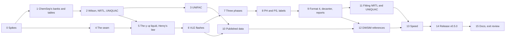

# M6 plan — activity models and liquid–liquid equilibrium

M6 gives reflux the liquids that cubic equations of state describe badly:
polar and hydrogen-bonding mixtures, and liquids that split in two.
- "Flash methanol and water with NRTL, and get the bubble point the data
  give."
- "Find ethanol and water's azeotrope."
- "Split water and 1-butanol into two liquids, with the vapour above them."
- "Take a reactor's product apart: hydrogen and carbon monoxide by Henry's
  law, over a methanol–water liquid."
- "Water and a hydrocarbon in a drum: three phases, with Peng–Robinson."

Every flowsheet the owner's course builds after a reactor needs this. The
methanol from Tutorial 2 leaves with water, and a cubic with van der Waals
mixing gets that pair's bubble points wrong. M7's columns are built on M6
(the roadmap's graph), and M9's reactors left "two phases" to it. It's
planned like M1 to M4, M9, M10a and M8: research first, then exit criteria,
decisions and steps. The roadmap entry is in [roadmap.md](roadmap.md).

Status: **approved** on 2026-11-18. Step 0 is done, and amends D7 and
criterion 8, both approved on 2026-11-18. Step 1 is next.

## Goal

- **Activity models** (C5): Wilson, NRTL, UNIQUAC and UNIFAC, the original
  (VLE), its LLE table and the Dortmund modification with its published
  parameters. Each gives ln γᵢ, Gᴱ and Hᴱ with exact derivatives in T and in
  the mole numbers, and holds Gibbs–Duhem by construction.
- **Parameters as data,** with units and sources:
  - ChemSep's DECHEMA banks for NRTL, UNIQUAC and Wilson;
  - its UNIFAC group tables;
  - a pair's parameters typed in the file as expressions in T, as M9's
    rate constants are, so that any paper's form goes in as printed.

  A pair with none is refused by name, never silently ideal.
- **γ–φ** (C5): a liquid by its activity coefficients, its vapour pressures,
  the Poynting correction and the vapour's φ at saturation; the vapour as the
  ideal gas or an equation of state. Its enthalpy and entropy come from the
  same fugacities, so that a drum's energy balance agrees with its phase
  equilibrium.
- **Henry's law** for gases above their critical temperature in a liquid:
  hydrogen, carbon monoxide and carbon dioxide in water.
- **Three phases** (E4): a PT flash that finds liquid–liquid and
  vapour–liquid–liquid equilibrium for any model. With an activity model
  that's water and butanol. With Peng–Robinson it's water and a hydrocarbon.
  Every phase is shown stable, as M3's two are. PH and PS flashes take three
  phases too.
- **A decanter,** a three-phase separator, in the flowsheet.
- **Fitting** NRTL and UNIQUAC parameters to VLE data, on M8's fit: the
  other half of the roadmap's H4, for the pairs ChemSep doesn't have.
- **Against published data:** the binaries reproduce published VLE and LLE
  data, each data set first passing a Gibbs–Duhem consistency test.
- **Against DWSIM 9:** its activity-coefficient packages and its
  three-phase flash, every difference explained.
- **Nothing a cubic does changes.** The flash's seam widens, and every
  answer M3 to M8 gave keeps its bits.

## What the research found

**What M6 builds on:**
- **The flash already works from each phase's fugacities.** `flash.pt`, its
  Newton on G and `flash.stability` use a phase's ln φᵢ,
  n·∂ln φᵢ/∂nⱼ and mass density. Beyond those they use only the
  components' critical constants, for Wilson's K-values, and a single
  phase's label. A phase comes from `thermo.solve_tp` at the volume root of
  lower Gibbs energy (`Root.stable`).
  - A γ–φ liquid is another such phase: f = xγPˢᵃᵗ…, made by a different
    model. The lower Gibbs energy chooses between it and the vapour, as it
    chooses between a cubic's two roots.
  - So the seam is at "a phase at (T, P, n)", not at F(T, V, n).
- **What doesn't carry over:**
  - The TV and UV flashes (`tv.v`) work in F(T, V, n) alone (M3's D5). A γ–φ
    liquid has no Helmholtz energy.
  - `thermo.Fluid.props` takes H and S from F's derivatives.
  - `equilibrium` takes a `thermo.Model`, and the reactors' `Source` a
    cubic's workspace (M8's `Cubic.work()`).
- **Two phases are assumed in about fifteen places:**
  - `flash.FlashResult` allows more phases ("for M6"), and a phase of a
    split found unstable is `.more_phases` today;
  - the drum's two outlets, the report's `"vapour"` and `"liquid"`, the C
    API's layout (liquid 0, vapour 1, `REFLUX_POINT_MORE_PHASES`), the
    reactors' one-phase rule (`reactor.v`, "which needs M6"), `fit/vle.v`
    and the sweep.
- **The labels:** in a two-phase split the less dense phase is the vapour
  (M3's D6, as amended in M9), because the phase identification parameter Π
  can call both phases of a near-critical split liquid-like. A liquid–liquid
  split by an equation of state (water and n-hexane by PR) is then labelled
  vapour and liquid. M6 has to fix that, and with three phases it can't
  avoid it.
- **`expr` and the tape** (M9) give any expression in T with exact
  derivatives, and M8 keeps what depends on T alone until T moves. A τᵢⱼ(T)
  is such an expression.

**What ChemSep ships** (ChemSep LITE 8.50, installed on this machine at
`%LOCALAPPDATA%\ChemSepL8v50\ipd`; reflux vendors only `pr.ipd` and
`srk.ipd` from it so far):
- **Binary banks,** each "Copyright 2008 Harry Kooijman and Ross Taylor"
  with no licence named, as with `pr.ipd`:
  - `nrtl.ipd`: 352 pairs, "DECHEMA NRTL at P=1atm", in cal/mol, each with
    its DECHEMA volume and page. Methanol–water: A₁₂ = −189.0469,
    A₂₁ = 792.8020 cal/mol, α = 0.2999 (p. 61, vol. I/1a).
  - `uniquac.ipd`: 291 pairs, DECHEMA's; `wilson.ipd`: 366 pairs, from
    Andrew Mason's compilation. Both in cal/mol.
  - None of the files states its formula. NRTL's τ = A/RT, UNIQUAC's
    τ = exp(−A/RT) and Wilson's Λ = (Vⱼ/Vᵢ)·exp(−A/RT) are DECHEMA's forms,
    which step 0 confirms against ChemSep's documentation.
  - Also `margules.ipd`, `vanlaar.ipd`, `uniquac_ext.ipd`, `uniquacp.ipd`
    and `haydeno.ipd`, Hayden and O'Connell's association parameters
    (Prausnitz et al., 1980), for vapours that dimerise.
- **`henrys_law.ipd`:** 41 gases, from the API Technical Data Book, in
  water only. Hydrogen, CO, CO₂, methane and nitrogen are among them, and
  methanol as a solvent isn't.
- **UNIFAC tables**, groups and interaction parameters:

  | Table | Main groups | Subgroups | Form of aₘₙ |
  |---|---|---|---|
  | original, VLE (`unifacvl.gct`, `unifacrq.gct`) | 51 | 110 | constant |
  | LLE (`unifacll.gct`, `llefacrq.gct`) | 32 | 57 | constant |
  | Dortmund (`modfac_a/b/c.gct`, `modfacrq.gct`) | 63 | 125 | a + bT + cT² |

  `_ext` files extend each. ChemSep numbers C=C as subgroup 9, as the 1987
  *Properties of Gases and Liquids* did, so groups others number 9 to 69 are
  10 to 70 here: a trap for any comparison by number.
- **Each compound's groups** are already imported, in its component file:
  584 of the 642 compounds have the original's, 484 the LLE table's, and 548
  Dortmund's.
- **Pure-component data for γ–φ** is in every component file already: vapour
  pressure (mostly DIPPR eq. 101), liquid density (eq. 105), ΔHvap (eq. 106)
  and liquid Cp, each with its T range. So are UNIQUAC's r, q and q′, and
  Wilson's molar volume.

**What `thermo` 0.6.1 offers,** as a reference (probed for this plan):
- **`NRTL`, `UNIQUAC`, `Wilson` and `UNIFAC`,** with T-dependent forms and
  every derivative. Its UNIFAC has the original (113 subgroups, 54 main
  groups), Dortmund's (124 subgroups, the 2016 table's 65 main groups), the
  LLE table (57 and 32), NIST's and PSRK's: an independent copy of the
  published tables.
- **`GibbsExcessLiquid`,** a γ–φ liquid with an equilibrium basis ('Psat',
  'Poynting', 'PhiSat', 'Poynting&PhiSat') and a caloric basis (the same
  four, or 'Hvap'). Its documentation calls the 'Hvap' basis "not
  thermodynamically consistent, but … often an assumption that is made".
  It has Henry's law, with a mode for mixed solvents.
- **`FlashVL` and `FlashVLN`,** the latter for more than two phases.

**What DWSIM 9.0.5 offers** (listed from the install on this machine):
- **Its 28 property packages** include NRTL, UNIQUAC, Wilson, UNIFAC,
  UNIFAC-LL, Modified UNIFAC (Dortmund) and Modified UNIFAC (NIST).
- **Its samples** include regressions of 1-propanol–water (NRTL and UNIQUAC),
  ethanol–benzene, methanol–1,2-dichloroethane and water–benzene LLE
  (UNIQUAC).
- **Not known yet,** for step 0:
  - how its activity packages take a liquid's enthalpy;
  - its vapour model and Poynting settings;
  - the form and units of its NRTL parameters;
  - whether its three-phase flash can be driven, and how well it does.

**Open experimental data:** the ThermoML archive (NIST TRC, DOI
10.18434/mds2-2422) holds the data published in five journals, the
*Journal of Chemical & Engineering Data* among them, to 2019. Each entry is
a ThermoML file and a JSON file, with an MD5 checksum. data.gov lists it
for public access under NIST's open licence, and TRC asks for a citation.
Step 0 reads the terms and picks the data sets.

**How the big simulators do γ–φ** (from their documentation as known, not
checked here):
- Aspen Plus's NRTL, UNIQUAC and UNIFAC property methods take the vapour as
  the ideal gas, with -RK and -HOC variants for Redlich–Kwong and
  Hayden–O'Connell vapours.
- HYSYS's activity models take a choice of vapour model too.
- Both let a flowsheet's blocks use different property methods. reflux has
  one model per flowsheet (Not in M6).

## Exit criteria

All checked by tests in CI, as before.

1. **Activity models are right.** For Wilson, NRTL, UNIQUAC and the three
   UNIFACs, at seeded states of two to five components:
   - ln γᵢ, Gᴱ and Hᴱ, and their derivatives in T and in each nᵢ, match
     `thermo` 0.6.1's to 1e-12 relative, and mpmath's closed forms for NRTL
     and UNIQUAC at 50 digits;
   - each holds Gibbs–Duhem, Σᵢ nᵢ ∂ln γᵢ/∂nⱼ = 0, and ln γᵢ = ∂(nGᴱ/RT)/∂nᵢ,
     checked from scratch at every state;
   - a pure component's γ is exactly 1.
2. **The data is what its sources say.**
   - ChemSep's banks and tables are vendored byte for byte, with checksums,
     and read by a strict importer that reports every repair.
   - Every UNIFAC parameter is compared with `thermo`'s independent copy,
     the renumbering accounted for. Each difference is listed in
     [data-quality.md](data-quality.md) and settled against the paper.
3. **The γ–φ liquid is consistent.**
   - Its fugacities, H, S, Cp and V match `thermo`'s `GibbsExcessLiquid` on
     the same basis to 1e-10.
   - Its calorics follow from its fugacities. A pure liquid's ΔHvap from H
     equals Clapeyron's T·ΔV·dPˢᵃᵗ/dT to rounding, and Hᴱ equals
     −RT²∂(Gᴱ/RT)/∂T.
4. **Nothing a cubic does changes.** Behind the new seam (D3), every M3 to M8
   fixture, golden report and recorded iteration count keeps its bits. The
   PT flash's time on M3's benchmark cases is recorded before and after, and
   is no slower beyond the measurement's own spread.
5. **Activity-model flashes are right.**
   - PT, bubble and dew T and P, PH and PS, on methanol–water, ethanol–water,
     acetone–methanol–water and a UNIFAC mixture.
   - Every split is verified: fugacities, mass balance, and stability by a
     TPD from scratch.
   - They match `thermo`'s `FlashVL` to 1e-8 in β and the compositions.
   - Each azeotrope the model has is found, at its T and composition.
6. **Three phases are right.** A PT flash finds up to three phases for any
   model:
   - LLE and VLLE with activity models, and water–hydrocarbon VLLE with PR;
   - every phase verified stable against every trial, and a brute-force
     tangent-plane scan around each answer finds no negative TPD;
   - each answer matches `thermo`'s `FlashVLN`;
   - a fourth phase is refused with its reason.

   PH and PS flashes take three phases.
7. **Henry's law is right.** Gases above their Tc in water and in a mixed
   solvent match `thermo`'s Henry modes. A component above its Tc with no
   Henry's-law parameters is refused, by name.
8. **Published data are reproduced.** The models with ChemSep's parameters
   against data sets from the ThermoML archive: methanol–water and
   ethanol–water VLE at 1 atm, water–1-butanol LLE and its VLLE, and a
   ternary LLE.
   - Each data set first passes the Van Ness point test for Gibbs–Duhem
     consistency; one that fails is recorded so, and not used.
   - Each deviation in T, P, y and x is recorded, and can't grow.

   **Amended in step 0,** approved on 2026-11-18. The archive holds what
   five journals published
   from 2003 to 2019, after the classic data sets, and has no methanol–water
   entry holding that binary's equilibrium alone. So each data set comes
   from the archive where it has the system, and otherwise from a paper's
   table, with its DOI and the paper's uncertainties, written into
   `testdata/` by a script that keeps the paper's numbers as printed.
9. **Fits are right.** NRTL and UNIQUAC parameters fitted to VLE data by M8's
   fit match SciPy's fit with `thermo`'s models, values and intervals, to the
   optimum's tolerance.
10. **Files and the CLI.**
    - Format 4's `[model]` takes an activity model, a vapour model,
      Poynting, Henry's-law solutes and each pair's parameters with units.
      The `decanter` unit is added.
    - Every key is checked, and every refusal is at its line.
    - `reflux solve` solves a flowsheet with NRTL and a decanter. Its report
      gives three phases and each pair's parameters with their source.
11. **Against DWSIM 9.** Its NRTL, UNIQUAC and UNIFAC flashes and a
    three-phase flash, by state, every difference explained.
12. **Speed is measured.** γ–φ PT flashes and bubble points against DWSIM's
    and `thermo`'s, and against the cubic's, recorded.
13. CI is green, and the docs are updated: README, roadmap, design notes,
    the data format, the file and report formats, data-quality.md and the V
    notes. v0.5.0 is released.

## Decisions

| # | Decision | Choice | Why |
|---|---|---|---|
| D1 | Scope | One milestone, the roadmap's M6, with four additions: - **Henry's law,** which any reactor's product over a polar liquid needs; - **γ–φ calorics,** which every energy balance needs; - **a decanter;** - **NRTL and UNIQUAC fitting,** H4's other half.  Not in it: electrolytes (C8), Gᴱ mixing rules (M12), Hayden–O'Connell vapours, models per unit, and three-phase bubble points (Not in M6). | Each addition is what makes the rest usable in a flowsheet. A γ–φ liquid without Henry's law refuses every feed with hydrogen in it. |
| D2 | Where it lives |  - **A new module, `activity`:** the Gᴱ models and UNIFAC's tables, over `numeric` and `expr`. It knows nothing of phases. - **`thermo`:** the phase seam (D3), the γ–φ liquid (D4, D5) and Henry's law (D6), importing `activity` and `tdep`. - **`components`:** the banks and tables read from ChemSep's files, and a γ–φ fluid's `Setup`. - **`flash`:** on the seam, and the three-phase PT flash. - **`flowsheet`:** format 4, the decanter and report format 4. - **`fit`:** NRTL and UNIQUAC parameters.  vlib has no module named `activity`. | Gᴱ models are functions of T and x alone, so they're usable and testable without a phase. The seam is `thermo`'s, since a phase is. |
| D3 | The seam | `flash` takes a phase model, not a `thermo.Model`. A phase model gives a phase at (T, P, n) as liquid-like, vapour-like or the one of lower G, each with: - ln φᵢ and n·∂ln φᵢ/∂nⱼ, ∂ln φᵢ/∂T and ∂ln φᵢ/∂P; - its molar volume and mass density; - its residual H, S and Cp, which `Fluid` adds to the ideal gas's.  The two kinds: - **a Helmholtz `Model`,** by its volume roots, exactly as `solve_tp` does now; - **a γ–φ fluid,** by its liquid's γ and its vapour's model, the lower G again choosing.  The TV and UV flashes stay on `thermo.Model` and refuse a γ–φ fluid, saying why. `Cubic.work()` stays the reactors' path. Step 0 prototypes the seam and measures the cubic's bits and time through it. | It's the seam the flash already has in all but name: ln φ and its derivatives (Michelsen and Mollerup). A cubic behind it computes what it computes now, so its answers can't move. |
| D4 | The γ–φ liquid | fᵢ = xᵢ γᵢ Pᵢˢᵃᵗ φᵢˢᵃᵗ exp(Vᵢᴸ (P − Pᵢˢᵃᵗ)/RT): - **Pˢᵃᵗ** by the component's own correlation, and **Vᴸ** by its liquid density, incompressible over the Poynting integral. The liquid's volume is Σ xᵢ Vᵢᴸ, with no excess volume. - **The vapour** is the ideal gas by default, or a cubic of the file's. φˢᵃᵗ is then that cubic's pure φ at Pˢᵃᵗ, and 1 for the ideal gas. - **Poynting** is on by default, and can be turned off. - **Kept until T moves:** Pˢᵃᵗ, Vᴸ, φˢᵃᵗ and each τ depend on T alone (M8's D11). - **Outside a correlation's range,** or above its Tc, a component is refused unless it's a Henry's-law solute (D6). | The textbook form, as Aspen's and `thermo`'s. Poynting costs nothing and matters at pressure. A file can match Aspen's NRTL, ideal gas and no Poynting, by saying so. |
| D5 | Calorics | The liquid's H, S and Cp come from its fugacities: h̄ᵢ − hᵢⁱᵍ = −RT²(∂ln φᵢᴸ/∂T) at constant P and x, through the same Pˢᵃᵗ, Vᴸ, φˢᵃᵗ and γ. ΔHvap is then Clapeyron's from Pˢᵃᵗ's slope, and Hᴱ is the model's. `thermo`'s 'Poynting&PhiSat' basis is the reference.  No ΔHvap correlation enters. ChemSep's ΔHvap and liquid Cp are compared with the answer, as the model's accuracy, recorded and not asserted. | A drum's energy balance then agrees with its phase equilibrium. A separate ΔHvap, `thermo`'s 'Hvap' basis, gives a flash whose duty disagrees with its own Clapeyron. |
| D6 | Henry's law | A Henry's-law solute's liquid fugacity is xᵢ γ*ᵢ Hᵢ,mix: - γ* = γ/γ∞ in the solvent, the unsymmetric convention; - Hᵢ,mix from the solvents with parameters, as `thermo`'s 'solvents_with_parameters' mode does (step 5 reads its rule).  A component is a solute when the file names it, or when it's above its Tc and has parameters. ChemSep's bank gives 41 gases in water. A file can give others, with units. | Hydrogen, CO and CO₂ over a methanol–water liquid are the owner's case. Water as the only solvent ChemSep covers is a limit to state, not hide. |
| D7 | Models and parameters | **Wilson, NRTL and UNIQUAC:** - each pair's τ (Wilson's Λ) and NRTL's α are expressions in T with units, `"-189.0469 cal/mol / (R*T)"`, so that Aspen's a + b/T + e·ln T + f·T or any paper's form goes in as printed; - the tape gives their T-derivatives exactly; - ChemSep's banks become those expressions in their own forms, A in cal/mol: NRTL's τ = A/RT, UNIQUAC's τ = exp(−A/RT), and Wilson's Λ = (Vⱼ/Vᵢ)·exp(−A/RT) on ChemSep's Wilson volumes. Step 0 confirms each form and the calorie.  **A pair with no parameters** is refused, naming it and the banks searched. `missing = "ideal"` sets such pairs' τ to 0, and the report lists them as a warning. The report gives each pair's source, as kᵢⱼ's are given: the file, a bank with its DECHEMA reference, or ideal.  **UNIFAC:** the original for VLE (Hansen et al., 1991), the LLE table (Magnussen et al., 1981) and Dortmund's published parameters (Gmehling et al.), each compound's groups from its component file.  **Amended in step 0,** approved on 2026-11-18. A bank's A is in thermochemical calories over DECHEMA's own R, 1.98721 cal/(mol·K), which it was fitted with: DWSIM's NRTL, on the same bank, is τ = A/(1.98721·T) to 4e-10 in ln γ, and the SI's R over 4.184 J is 5e-7 off ([spike-dwsim-activity.md](spike-dwsim-activity.md)). So a bank pair's τ keeps that R, its source saying why, as `reflux kinetics check` advises for a constant fitted with a typed R. | Parameters are equations too, and typing them as text in a fixed form is what A9 rules out. A silently ideal pair is the kind of answer that looks right and isn't. |
| D8 | Three phases | A PT flash finds up to three phases, for any phase model: - **stage-wise,** as Michelsen (1982) does: two phases first, then each phase tested for stability by M3's test, an unstable one's trial starting a third phase; - **the split:** successive substitution on a multiphase Rachford–Rice, by Okuno, Johns and Sepehrnoori's (2010) convex form, then Newton on G over every phase, a phase whose fraction falls to zero removed; - **an answer only once every phase is stable** against every trial, as M3 verifies a split; - **a fourth phase** is `.more_phases`, with its reason. | Stage-wise reuses M3's stability test and split, which are proven. The convex Rachford–Rice can't diverge, where the textbook form can with three phases. |
| D9 | Labels | Phases are ordered by increasing mass density, and each is labelled vapour, liquid or liquid2: - **a γ–φ phase** by the model that made it; - **an equation of state's phase** by Π, with M9's four-covolume rule; - **at most one vapour:** of phases Π calls vapour-like, the least dense; - **phases Π calls liquid-like** are liquids, the denser being liquid2.  A two-phase split Π calls all liquid-like is then a liquid–liquid split, where M3's D6 called its lighter phase the vapour. Step 7 measures how many of M3's 10,000 sweep splits change label, near critical points, for the owner to judge. | With three phases density alone can't name them, and a liquid–liquid split by PR is mislabelled today. Π is what labels a single phase already. |
| D10 | Which flashes take three phases | PT, PH and PS.  The vapour-fraction flashes (bubble and dew points) and TV and UV stay two-phase. A bubble point whose liquid would split is `.more_phases`, saying so. | PT, PH and PS are what units call. A heterogeneous bubble point is M7's, if its decanters need one. |
| D11 | Units | **A `decanter`:** an inlet and three outlets, `vapour`, `light` and `heavy`, any of them possibly empty, at a T or a duty and a P, as the drum is.  **The `flash_drum`** sends both liquids out of its liquid port, as a vessel without a boot does, and its report says that liquid has two phases.  **Reactors** stay one-phase on a Helmholtz model (M9). A γ–φ fluid is refused there, saying why. | A two-liquid feed to a drum isn't an error. A reactor on γ–φ needs liquid-phase kinetics on activities, a later piece. |
| D12 | The file | **Format 4.** `[model]` has: - `equation` for an equation-of-state fluid, as before; - or `liquid` for γ–φ: `"Wilson"`, `"NRTL"`, `"UNIQUAC"`, `"UNIFAC"`, `"UNIFAC-LLE"` or `"UNIFAC-Dortmund"`; - `vapour`: `"ideal gas"` by default, or an equation; - `poynting`: true by default; - `henry`: solutes beyond those above their Tc; - `missing`: `"refuse"` by default, or `"ideal"`.  `[[model.pairs]]`, `{ a, b, tau_ab, tau_ba, alpha }`, overrides a bank, each value an expression with units.  Formats 1 to 3 read as before. | A new model and a new unit are a new format, by the CHANGELOG's rules. |
| D13 | Reports | **Report format 4:** - a stream may have three phases, `phase` being `"vapour"`, `"liquid"` or `"liquid2"`; - `model` gives each pair's parameters with their source, and any warnings; - the decanter's outlets.  The fit report is unchanged. | The report says what was used, as it says which kᵢⱼ were. |
| D14 | The C API and Python | Unchanged in M6: cubic fluids, two phases. A three-phase point stays `REFLUX_POINT_MORE_PHASES`.  γ–φ fluids and three phases from Python come with M10b, as ABI 2. | The layout (liquid 0, vapour 1) has no room for a second liquid. Changing it is an ABI break, which belongs with M10b's other changes. |
| D15 | References and tests |  - `thermo` 0.6.1: γ and its derivatives, `GibbsExcessLiquid` on the same basis, `FlashVL` and `FlashVLN`; - mpmath: NRTL's and UNIQUAC's closed forms, and Clapeyron; - brute force: a tangent-plane scan around every three-phase answer; - the ThermoML archive and, where it has nothing, papers' tables (criterion 8, as amended): experimental data, each set's Gibbs–Duhem consistency checked; - planted mistakes, as every step has had. | Independent sources, as before. `thermo` is the one other open implementation of all of it, so a second check of each claim is from scratch. |
| D16 | Fitting | M8's `[fit.NAME]` with VLE data takes a pair's NRTL parameters (A₁₂, A₂₁, and α if asked) or UNIQUAC's. The residuals are bubble P and each y, as M8's D15, and the derivatives central differences. Against SciPy with `thermo`'s NRTL and UNIQUAC on the same data. | ChemSep has 352 NRTL pairs. The rest come from data, and DWSIM's regression fitted nothing when a script ran it (M8 step 0). |
| D17 | Comparing with DWSIM |  - NRTL and UNIQUAC VLE flashes on methanol–water; - UNIFAC's and Dortmund's γ, by state; - a three-phase flash, water–1-butanol or its water–benzene sample, if step 0 can drive it.  Each is compared by state, every difference explained. Step 0 finds its liquid enthalpy, vapour and Poynting settings, and its parameters' form. | As M3, M4, M9 and M8 compared. |
| D18 | Speed | γ–φ PT flashes and bubble points against DWSIM's and `thermo`'s, and against the cubic's, in `docs/benchmarks.md`. Recorded, with no target. | A γ–φ flash should be cheaper than a cubic's, with no volume roots in the liquid. The record shows whether it is. |
| D19 | Versions | M6 ends with v0.5.0. Format 4 and report format 4 are additions, so it's a minor release. | The CHANGELOG's rules. |
| D20 | Who writes what | As before, I write it all unless you claim a step. | |

## Steps

### 0. Spikes — done, with D7 and criterion 8 amended
- **The seam:** a prototype of D3's phase model with the cubic behind it. The
  PT flash through it on M3's fixtures, its bits against the code before,
  and its time on M3's benchmark cases.
- **DWSIM's activity packages,** by script:
  - NRTL, UNIQUAC, UNIFAC and Dortmund γ and PT flashes on methanol–water;
  - how they take a liquid's enthalpy, the vapour and Poynting;
  - the form and units of their parameters;
  - its three-phase flash, whether a script can run it and how its answers
    stand.
- **The data:**
  - ChemSep's calorie, and each file's form, read against DECHEMA's;
  - UNIFAC's renumbering;
  - ThermoML's terms, and the data sets for criterion 8.

**The seam** ([spike/seam](../spike/seam/spike.v)): `make.py` copies
`flash`'s PT flash and stability test into `seamflash`, with `thermo.Model`
replaced by an interface, `Phases`. Its four calls are a phase at (T, P, n)
by a root, its ln φ derivatives, its label and the components. `Eos` puts
a Helmholtz model behind it by its volume roots.
- **The same bits:** the flash robustness sweep's 10,000 seeded mixtures,
  each through `flash.pt` and `seamflash.pt`, gave 3,344 splits and 5,480
  single phases identical in every field and every stability trial. The
  1,176 failures failed with the same error. None differed.
- **The same time:** on M3's six PT cases, over three runs, each the least
  of 40 rounds taking turns, the seam's time was 0.85 to 1.21 times
  `flash`'s. The median of the 18 ratios is 1.01, with 10 above 1 and 8
  below, and no case is slower every time. The interface costs nothing this
  laptop's clock can see, so D3 stands as written.
- **Planted mistakes, 2,** in a scratch copy, each caught by the comparison:
  the adapter ignoring the root asked for (431 of 1,000 points differ), and
  labelling every phase vapour (353).

**DWSIM** ([spike-dwsim-activity.md](spike-dwsim-activity.md),
[spike/dwsim_activity](../spike/dwsim_activity/run.py)):
- **Its NRTL and UNIQUAC hold ChemSep's banks** to the digit.
- **NRTL's form is τ = A/(1.98721·T):** its γ, Poynting taken out on its own
  Rackett volumes, is that to 4e-10 in ln γ. The SI's R over 4.184 J is
  5e-7 off, and over 4.1868 J 1.2e-4. So the banks are thermochemical
  calories over DECHEMA's R, which **amends D7**.
- **Its defaults:** an ideal-gas vapour, Poynting on, Rackett liquid
  densities, and enthalpies by Lee–Kesler whatever the activity model.
  Methanol's H_L − H_ig at 330 K is −38.36 kJ/mol, against 37.53 by
  Clapeyron on its own Pˢᵃᵗ and 35.93 by ChemSep's ΔHvap. It's the
  inconsistency D5 rules out.
- **UNIQUAC:**
  - Water–1-butanol splits exactly as the model's own common tangent does,
    0.3808 and 0.9901 water at 298.15 K.
  - Methanol–water's γ is 0.28 to 0.31 off in ln γ from DECHEMA's form, which
    agrees with NRTL's fit of the same data. No variant tried reproduces
    it, and its flash at 350 K finds no vapour where its NRTL finds 46%.
    Unexplained, for step 12.
- **Its three-phase flash** (`NestedLoops`) misses NRTL's split of
  water–1-butanol at 298.15 K, which the model has (0.6008 and 0.9944
  water), returning one liquid. At 360 K it returns the trivial split,
  0.4998 and 0.5004.
- **Not settled here:** Wilson's form, whose parameters the script didn't
  find in DWSIM's package, and its other flash approaches. Both are for
  step 12.

**The data:**
- **The calorie** is settled by DWSIM, above. ChemSep's help names the
  models but gives no formulas. UNIQUAC's DECHEMA form agrees with NRTL
  where both have a pair, and with DWSIM on water–1-butanol.
- **UNIFAC's renumbering** is as `unifacrq.gct` says: ChemSep's subgroup 9 is
  C=C, so others' 9 to 69 are its 10 to 70. Step 1 maps it in its comparison
  with `thermo`.
- **ThermoML** ([spike/thermoml](../spike/thermoml/search.py)):
  - The archive has a public search API (Cordra, Lucene queries) as well as
    its files and a .tgz of all of them.
  - Its terms: NIST's open licence, which asks NIST to be acknowledged as
    the source; the files shared "with permission of the journal
    publishers"; each point with a 95% expanded uncertainty; and a liability
    statement asking users to check values against other sources.
  - It covers 2003 to 2019. Ethanol–water has azeotropic-region VLE
    (*Fluid Phase Equilibria*, 2011, 45 points) and isobaric VLE (2015, 60
    points). Methanol–water has no entry with that binary's equilibrium
    alone. So criterion 8 takes papers' tables where the archive has
    nothing, which **amends criterion 8**. Step 10 picks the sets, by
    InChIKey rather than the search's loose names.

**Found:** DWSIM's UNIQUAC for methanol–water, and its three-phase flash
missing a split, both above; and that its activity packages take
enthalpies from Lee–Kesler by default.

### 1. ChemSep's banks and tables
- D7: `nrtl.ipd`, `uniquac.ipd`, `wilson.ipd`, `henrys_law.ipd` and the
  three UNIFAC tables vendored byte for byte, with checksums in
  `data/vendor/chemsep/NOTICE.md` and the same licence assumption, stated.
- A strict importer in `components`: each pair or group by CAS number or
  subgroup, every repair reported.
- Every UNIFAC parameter compared with `thermo`'s, in
  [data-quality.md](data-quality.md) (criterion 2).

### 2. Wilson, NRTL and UNIQUAC
- D2, D7: the `activity` module's interface, each model's ln γ, Gᴱ and Hᴱ
  with derivatives in T and n, τ as expressions kept until T moves.
- Against `thermo` and mpmath, and Gibbs–Duhem from scratch (criterion 1).

### 3. UNIFAC
- The original, LLE and Dortmund forms on step 1's tables, each compound's
  groups from its file.
- Against `thermo`, and Gibbs–Duhem (criterion 1).

### 4. The seam
- D3: `thermo`'s phase model, the Helmholtz `Model` behind it, `Fluid` on
  it, and `flash` moved onto it.
- Every M3 to M8 fixture, golden report and iteration count is the same
  bits, and the PT flash's time is recorded (criterion 4).

### 5. The γ–φ liquid, and Henry's law
- D4, D5, D6: fugacities, volumes and calorics; Henry's law in water and in
  mixed solvents.
- Against `GibbsExcessLiquid` and Clapeyron (criteria 3 and 7).

### 6. VLE flashes with activity models
- PT, bubble and dew points, PH and PS on γ–φ fluids, each split verified.
- Against `FlashVL`; azeotropes found (criterion 5).

### 7. Three phases
- D8, D9: the stage-wise PT flash, the multiphase Rachford–Rice and Newton
  on G over every phase, on any phase model.
- LLE and VLLE with activity models, water–hydrocarbon VLLE with PR.
  Against `FlashVLN`, and by tangent-plane scans (criterion 6).
- The labels across M3's sweep, for the owner (D9).

### 8. PH and PS with three phases, and the labels
- D10: PH and PS on the three-phase PT flash; the vapour-fraction flashes
  refusing a liquid that would split.
- D9's labels wherever a phase is named.

### 9. Format 4, the decanter and report format 4
- D11, D12, D13: `[model]`'s new keys, `[[model.pairs]]`, the decanter, the
  drum's two liquids, the reactors' refusal, and report format 4.
- `reflux solve` on a flowsheet with NRTL and a decanter (criterion 10).

### 10. Published data
- The data sets from the ThermoML archive, each checked by the Van Ness
  point test, and every model's deviations recorded (criterion 8).

### 11. Fitting NRTL and UNIQUAC
- D16: M8's fit on a pair's NRTL or UNIQUAC parameters; against SciPy with
  `thermo`'s models (criterion 9).

### 12. DWSIM references
- D17: by state, every difference explained (criterion 11).

### 13. Speed
- D18: γ–φ flashes against DWSIM's, `thermo`'s and the cubic's
  (criterion 12).

### 14. Release v0.5.0
- The CHANGELOG entry, the versions and the release gate, as for v0.4.0.

### 15. Docs and exit review
- README, roadmap, design notes, the data format, the file and report
  formats, data-quality.md, the V notes, and a criterion-by-criterion
  review.

## Risks

| Risk | Effect | Fallback |
|---|---|---|
| The seam costs the cubic's flash time, an interface call where a struct was | every flash slower | step 0 measures it first; the cubic keeps a direct path inside the seam, as `Cubic.work()` does for reactors |
| A vapour-pressure correlation's slope is poor, or a T is outside its range | a wrong ΔHvap through Clapeyron, or a refused state | D5 compares the answer with ChemSep's ΔHvap and records it; a component outside its range is refused with why (D4), never extrapolated silently |
| ChemSep's UNIFAC tables differ from the papers | wrong γ for some groups | criterion 2 compares every parameter with `thermo`'s copy, and a difference is settled against the paper |
| The three-phase flash fails near a critical end point or a plait point | no answer, or a lost phase | every answer verified (D8); a failure is a typed error with how far it got; the brute-force scans find what the flash misses |
| Labels by Π change two-phase answers near critical points | a stream's phases renamed along a study | step 7 measures it on M3's sweep before D9 is settled |
| DWSIM's three-phase flash can't be driven, or isn't reliable | no comparison there | compared by state where it runs; recorded as not possible otherwise, as M8's regression was |
| The banks' licence isn't stated | the files may have to go | the same assumption as `pr.ipd`, stated in NOTICE.md; the authors asked |

## Not in M6

- **Electrolytes** (eNRTL, e-CPA): after M12 (C8). D2 keeps Gᴱ models
  behind one interface, so eNRTL can join them.
- **Gᴱ mixing rules** in a cubic (Huron–Vidal, MHV2, PSRK, Wong–Sandler):
  M12 (C3). They'd take `activity`'s models into the Helmholtz contract.
- **Hayden–O'Connell vapours,** for acids that dimerise: later. ChemSep
  ships the parameters.
- **NIST's modified UNIFAC:** Dortmund's form with other tables, easy to add
  after step 3.
- **Models per unit,** a reactor on PR feeding a separation on NRTL, as
  Aspen's property methods by block. A stream crossing models needs a rule,
  at T and P with its enthalpy's jump reported. The owner's methanol plant
  needs this by M7, so it's a decision to raise then.
- **Three-phase vapour-fraction flashes,** heterogeneous bubble points, and
  TV and UV with γ–φ: M7, if its columns need them.
- **Reactors on a γ–φ fluid,** with liquid-phase kinetics on activities.
- **γ–φ and three phases from Python:** M10b, as ABI 2 (D14).
