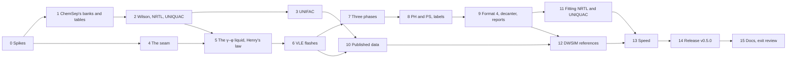

# M6 plan — activity models and liquid–liquid equilibrium

M6 gives reflux the liquids that cubic equations of state describe badly:
polar and hydrogen-bonding mixtures, and liquids that split in two.
- "Flash methanol and water with NRTL, and get the bubble point the data
  give."
- "Find ethanol and water's azeotrope."
- "Split water and 1-butanol into two liquids, with the vapour above them."
- "Take a reactor's product apart: hydrogen and carbon monoxide by Henry's
  law, over a methanol–water liquid."
- "Water and a hydrocarbon in a drum: three phases, with Peng–Robinson."

Every flowsheet the owner's course builds after a reactor needs this. The
methanol from Tutorial 2 leaves with water, and a cubic with van der Waals
mixing gets that pair's bubble points wrong. M7's columns are built on M6
(the roadmap's graph), and M9's reactors left "two phases" to it. It's
planned like M1 to M4, M9, M10a and M8: research first, then exit criteria,
decisions and steps. The roadmap entry is in [roadmap.md](roadmap.md).

Status: **approved** on 2026-11-18. Step 0 is done, and amends D7 and
criterion 8, both approved on 2026-11-18. Steps 1 to 3 are done, built
together, and step 1 amends D7 again, approved on 2026-11-20. Five defects
found in them were corrected on 2026-11-22 (below step 3), and D7's
amendment for two of those was approved that day, and `eval`'s answers
made finite or refused. Step 4, the seam, is done, and amends D3, approved
on 2026-11-23. Step 5 is next.

## Goal

- **Activity models** (C5): Wilson, NRTL, UNIQUAC and UNIFAC, the original
  (VLE), its LLE table and the Dortmund modification with its published
  parameters. Each gives ln γᵢ, Gᴱ and Hᴱ with exact derivatives in T and in
  the mole numbers, and holds Gibbs–Duhem by construction.
- **Parameters as data,** with units and sources:
  - ChemSep's DECHEMA banks for NRTL, UNIQUAC and Wilson;
  - its UNIFAC group tables;
  - a pair's parameters typed in the file as expressions in T, as M9's
    rate constants are, so that any paper's form goes in as printed.

  A pair with none is refused by name, never silently ideal.
- **γ–φ** (C5): a liquid by its activity coefficients, its vapour pressures,
  the Poynting correction and the vapour's φ at saturation; the vapour as the
  ideal gas or an equation of state. Its enthalpy and entropy come from the
  same fugacities, so that a drum's energy balance agrees with its phase
  equilibrium.
- **Henry's law** for gases above their critical temperature in a liquid:
  hydrogen, carbon monoxide and carbon dioxide in water.
- **Three phases** (E4): a PT flash that finds liquid–liquid and
  vapour–liquid–liquid equilibrium for any model. With an activity model
  that's water and butanol. With Peng–Robinson it's water and a hydrocarbon.
  Every phase is shown stable, as M3's two are. PH and PS flashes take three
  phases too.
- **A decanter,** a three-phase separator, in the flowsheet.
- **Fitting** NRTL and UNIQUAC parameters to VLE data, on M8's fit: the
  other half of the roadmap's H4, for the pairs ChemSep doesn't have.
- **Against published data:** the binaries reproduce published VLE and LLE
  data, each data set first passing a Gibbs–Duhem consistency test.
- **Against DWSIM 9:** its activity-coefficient packages and its
  three-phase flash, every difference explained.
- **Nothing a cubic does changes.** The flash's seam widens, and every
  answer M3 to M8 gave keeps its bits.

## What the research found

**What M6 builds on:**
- **The flash already works from each phase's fugacities.** `flash.pt`, its
  Newton on G and `flash.stability` use a phase's ln φᵢ,
  n·∂ln φᵢ/∂nⱼ and mass density. Beyond those they use only the
  components' critical constants, for Wilson's K-values, and a single
  phase's label. A phase comes from `thermo.solve_tp` at the volume root of
  lower Gibbs energy (`Root.stable`).
  - A γ–φ liquid is another such phase: f = xγPˢᵃᵗ…, made by a different
    model. The lower Gibbs energy chooses between it and the vapour, as it
    chooses between a cubic's two roots.
  - So the seam is at "a phase at (T, P, n)", not at F(T, V, n).
- **What doesn't carry over:**
  - The TV and UV flashes (`tv.v`) work in F(T, V, n) alone (M3's D5). A γ–φ
    liquid has no Helmholtz energy.
  - `thermo.Fluid.props` takes H and S from F's derivatives.
  - `equilibrium` takes a `thermo.Model`, and the reactors' `Source` a
    cubic's workspace (M8's `Cubic.work()`).
- **Two phases are assumed in about fifteen places:**
  - `flash.FlashResult` allows more phases ("for M6"), and a phase of a
    split found unstable is `.more_phases` today;
  - the drum's two outlets, the report's `"vapour"` and `"liquid"`, the C
    API's layout (liquid 0, vapour 1, `REFLUX_POINT_MORE_PHASES`), the
    reactors' one-phase rule (`reactor.v`, "which needs M6"), `fit/vle.v`
    and the sweep.
- **The labels:** in a two-phase split the less dense phase is the vapour
  (M3's D6, as amended in M9), because the phase identification parameter Π
  can call both phases of a near-critical split liquid-like. A liquid–liquid
  split by an equation of state (water and n-hexane by PR) is then labelled
  vapour and liquid. M6 has to fix that, and with three phases it can't
  avoid it.
- **`expr` and the tape** (M9) give any expression in T with exact
  derivatives, and M8 keeps what depends on T alone until T moves. A τᵢⱼ(T)
  is such an expression.

**What ChemSep ships** (ChemSep LITE 8.50, installed on this machine at
`%LOCALAPPDATA%\ChemSepL8v50\ipd`; reflux vendors only `pr.ipd` and
`srk.ipd` from it so far):
- **Binary banks,** each "Copyright 2008 Harry Kooijman and Ross Taylor"
  with no licence named, as with `pr.ipd`:
  - `nrtl.ipd`: 352 pairs, "DECHEMA NRTL at P=1atm", in cal/mol, each with
    its DECHEMA volume and page. Methanol–water: A₁₂ = −189.0469,
    A₂₁ = 792.8020 cal/mol, α = 0.2999 (p. 61, vol. I/1a).
  - `uniquac.ipd`: 291 pairs, DECHEMA's; `wilson.ipd`: 366 pairs, from
    Andrew Mason's compilation. Both in cal/mol.
  - None of the files states its formula. NRTL's τ = A/RT, UNIQUAC's
    τ = exp(−A/RT) and Wilson's Λ = (Vⱼ/Vᵢ)·exp(−A/RT) are DECHEMA's forms,
    which step 0 confirms against ChemSep's documentation.
  - Also `margules.ipd`, `vanlaar.ipd`, `uniquac_ext.ipd`, `uniquacp.ipd`
    and `haydeno.ipd`, Hayden and O'Connell's association parameters
    (Prausnitz et al., 1980), for vapours that dimerise.
- **`henrys_law.ipd`:** 41 gases, from the API Technical Data Book, in
  water only. Hydrogen, CO, CO₂, methane and nitrogen are among them, and
  methanol as a solvent isn't.
- **UNIFAC tables**, groups and interaction parameters:

  | Table | Main groups | Subgroups | Form of aₘₙ |
  |---|---|---|---|
  | original, VLE (`unifacvl.gct`, `unifacrq.gct`) | 51 | 110 | constant |
  | LLE (`unifacll.gct`, `llefacrq.gct`) | 32 | 57 | constant |
  | Dortmund (`modfac_a/b/c.gct`, `modfacrq.gct`) | 63 | 125 | a + bT + cT² |

  `_ext` files extend each. ChemSep numbers C=C as subgroup 9, as the 1987
  *Properties of Gases and Liquids* did, so groups others number 9 to 69 are
  10 to 70 here: a trap for any comparison by number.
- **Each compound's groups** are already imported, in its component file:
  584 of the 642 compounds have the original's, 484 the LLE table's, and 548
  Dortmund's.
- **Pure-component data for γ–φ** is in every component file already: vapour
  pressure (mostly DIPPR eq. 101), liquid density (eq. 105), ΔHvap (eq. 106)
  and liquid Cp, each with its T range. So are UNIQUAC's r, q and q′, and
  Wilson's molar volume.

**What `thermo` 0.6.1 offers,** as a reference (probed for this plan):
- **`NRTL`, `UNIQUAC`, `Wilson` and `UNIFAC`,** with T-dependent forms and
  every derivative. Its UNIFAC has the original (113 subgroups, 54 main
  groups), Dortmund's (124 subgroups, the 2016 table's 65 main groups), the
  LLE table (57 and 32), NIST's and PSRK's: an independent copy of the
  published tables.
- **`GibbsExcessLiquid`,** a γ–φ liquid with an equilibrium basis ('Psat',
  'Poynting', 'PhiSat', 'Poynting&PhiSat') and a caloric basis (the same
  four, or 'Hvap'). Its documentation calls the 'Hvap' basis "not
  thermodynamically consistent, but … often an assumption that is made".
  It has Henry's law, with a mode for mixed solvents.
- **`FlashVL` and `FlashVLN`,** the latter for more than two phases.

**What DWSIM 9.0.5 offers** (listed from the install on this machine):
- **Its 28 property packages** include NRTL, UNIQUAC, Wilson, UNIFAC,
  UNIFAC-LL, Modified UNIFAC (Dortmund) and Modified UNIFAC (NIST).
- **Its samples** include regressions of 1-propanol–water (NRTL and UNIQUAC),
  ethanol–benzene, methanol–1,2-dichloroethane and water–benzene LLE
  (UNIQUAC).
- **Not known yet,** for step 0:
  - how its activity packages take a liquid's enthalpy;
  - its vapour model and Poynting settings;
  - the form and units of its NRTL parameters;
  - whether its three-phase flash can be driven, and how well it does.

**Open experimental data:** the ThermoML archive (NIST TRC, DOI
10.18434/mds2-2422) holds the data published in five journals, the
*Journal of Chemical & Engineering Data* among them, to 2019. Each entry is
a ThermoML file and a JSON file, with an MD5 checksum. data.gov lists it
for public access under NIST's open licence, and TRC asks for a citation.
Step 0 reads the terms and picks the data sets.

**How the big simulators do γ–φ** (from their documentation as known, not
checked here):
- Aspen Plus's NRTL, UNIQUAC and UNIFAC property methods take the vapour as
  the ideal gas, with -RK and -HOC variants for Redlich–Kwong and
  Hayden–O'Connell vapours.
- HYSYS's activity models take a choice of vapour model too.
- Both let a flowsheet's blocks use different property methods. reflux has
  one model per flowsheet (Not in M6).

## Exit criteria

All checked by tests in CI, as before.

1. **Activity models are right.** For Wilson, NRTL, UNIQUAC and the three
   UNIFACs, at seeded states of two to five components:
   - ln γᵢ, Gᴱ and Hᴱ, and their derivatives in T and in each nᵢ, match
     `thermo` 0.6.1's to 1e-12 relative, and mpmath's closed forms for NRTL
     and UNIQUAC at 50 digits;
   - each holds Gibbs–Duhem, Σᵢ nᵢ ∂ln γᵢ/∂nⱼ = 0, and ln γᵢ = ∂(nGᴱ/RT)/∂nᵢ,
     checked from scratch at every state;
   - a pure component's γ is exactly 1.
2. **The data is what its sources say.**
   - ChemSep's banks and tables are vendored byte for byte, with checksums,
     and read by a strict importer that reports every repair.
   - Every UNIFAC parameter is compared with `thermo`'s independent copy,
     the renumbering accounted for. Each difference is listed in
     [data-quality.md](data-quality.md) and settled against the paper.
3. **The γ–φ liquid is consistent.**
   - Its fugacities, H, S, Cp and V match `thermo`'s `GibbsExcessLiquid` on
     the same basis to 1e-10.
   - Its calorics follow from its fugacities. A pure liquid's ΔHvap from H
     equals Clapeyron's T·ΔV·dPˢᵃᵗ/dT to rounding, and Hᴱ equals
     −RT²∂(Gᴱ/RT)/∂T.

   **Amended in step 5,** approved on 2026-11-23. On the
   'Poynting&PhiSat' basis, Cp to 1e-7: both take φˢᵃᵗ's second
   T-derivative by differences, `thermo` by its own, and reflux's is held to
   differences of its own H to 1e-9, measured at 1.7e-11 (D4 as amended).
   Everything else to 1e-10, as before.
4. **Nothing a cubic does changes.** Behind the new seam (D3), every M3 to M8
   fixture, golden report and recorded iteration count keeps its bits. The
   PT flash's time on M3's benchmark cases is recorded before and after, and
   is no slower beyond the measurement's own spread.
5. **Activity-model flashes are right.**
   - PT, bubble and dew T and P, PH and PS, on methanol–water, ethanol–water,
     acetone–methanol–water and a UNIFAC mixture.
   - Every split is verified: fugacities, mass balance, and stability by a
     TPD from scratch.
   - They match `thermo`'s `FlashVL` to 1e-8 in β and the compositions.
   - Each azeotrope the model has is found, at its T and composition.
6. **Three phases are right.** A PT flash finds up to three phases for any
   model:
   - LLE and VLLE with activity models, and water–hydrocarbon VLLE with PR;
   - every phase verified stable against every trial, and a brute-force
     tangent-plane scan around each answer finds no negative TPD;
   - each answer matches `thermo`'s `FlashVLN`;
   - a fourth phase is refused with its reason.

   PH and PS flashes take three phases.
7. **Henry's law is right.** Gases above their Tc in water and in a mixed
   solvent match `thermo`'s Henry modes. A component above its Tc with no
   Henry's-law parameters is refused, by name.
8. **Published data are reproduced.** The models with ChemSep's parameters
   against data sets from the ThermoML archive: methanol–water and
   ethanol–water VLE at 1 atm, water–1-butanol LLE and its VLLE, and a
   ternary LLE.
   - Each data set first passes the Van Ness point test for Gibbs–Duhem
     consistency; one that fails is recorded so, and not used.
   - Each deviation in T, P, y and x is recorded, and can't grow.

   **Amended in step 0,** approved on 2026-11-18. The archive holds what
   five journals published
   from 2003 to 2019, after the classic data sets, and has no methanol–water
   entry holding that binary's equilibrium alone. So each data set comes
   from the archive where it has the system, and otherwise from a paper's
   table, with its DOI and the paper's uncertainties, written into
   `testdata/` by a script that keeps the paper's numbers as printed.
9. **Fits are right.** NRTL and UNIQUAC parameters fitted to VLE data by M8's
   fit match SciPy's fit with `thermo`'s models, values and intervals, to the
   optimum's tolerance.
10. **Files and the CLI.**
    - Format 4's `[model]` takes an activity model, a vapour model,
      Poynting, Henry's-law solutes and each pair's parameters with units.
      The `decanter` unit is added.
    - Every key is checked, and every refusal is at its line.
    - `reflux solve` solves a flowsheet with NRTL and a decanter. Its report
      gives three phases and each pair's parameters with their source.
11. **Against DWSIM 9.** Its NRTL, UNIQUAC and UNIFAC flashes and a
    three-phase flash, by state, every difference explained.
12. **Speed is measured.** γ–φ PT flashes and bubble points against DWSIM's
    and `thermo`'s, and against the cubic's, recorded.
13. CI is green, and the docs are updated: README, roadmap, design notes,
    the data format, the file and report formats, data-quality.md and the V
    notes. v0.5.0 is released.

## Decisions

| # | Decision | Choice | Why |
|---|---|---|---|
| D1 | Scope | One milestone, the roadmap's M6, with four additions: - **Henry's law,** which any reactor's product over a polar liquid needs; - **γ–φ calorics,** which every energy balance needs; - **a decanter;** - **NRTL and UNIQUAC fitting,** H4's other half.  Not in it: electrolytes (C8), Gᴱ mixing rules (M12), Hayden–O'Connell vapours, models per unit, and three-phase bubble points (Not in M6). | Each addition is what makes the rest usable in a flowsheet. A γ–φ liquid without Henry's law refuses every feed with hydrogen in it. |
| D2 | Where it lives |  - **A new module, `activity`:** the Gᴱ models and UNIFAC's tables, over `numeric` and `expr`. It knows nothing of phases. - **`thermo`:** the phase seam (D3), the γ–φ liquid (D4, D5) and Henry's law (D6), importing `activity` and `tdep`. - **`components`:** the banks and tables read from ChemSep's files, and a γ–φ fluid's `Setup`. - **`flash`:** on the seam, and the three-phase PT flash. - **`flowsheet`:** format 4, the decanter and report format 4. - **`fit`:** NRTL and UNIQUAC parameters.  vlib has no module named `activity`. | Gᴱ models are functions of T and x alone, so they're usable and testable without a phase. The seam is `thermo`'s, since a phase is. |
| D3 | The seam | `flash` takes a phase model, not a `thermo.Model`. A phase model gives a phase at (T, P, n) as liquid-like, vapour-like or the one of lower G, each with: - ln φᵢ and n·∂ln φᵢ/∂nⱼ, ∂ln φᵢ/∂T and ∂ln φᵢ/∂P; - its molar volume and mass density; - its residual H, S and Cp, which `Fluid` adds to the ideal gas's.  The two kinds: - **a Helmholtz `Model`,** by its volume roots, exactly as `solve_tp` does now; - **a γ–φ fluid,** by its liquid's γ and its vapour's model, the lower G again choosing.  The TV and UV flashes stay on `thermo.Model` and refuse a γ–φ fluid, saying why. `Cubic.work()` stays the reactors' path. Step 0 prototypes the seam and measures the cubic's bits and time through it.  **Amended in step 4,** approved on 2026-11-23: - a phase's residual also has Cvʳ, (∂V/∂T)_P and (∂P/∂V)_T, which `Fluid.props` needs for the Cv, speed of sound and Joule–Thomson coefficient it already gives; - it can't fail, as `props` can't, so what a model hasn't is NaN, and PH and PS take a NaN balance as unmet; - ∂ln φ can refuse, with its reason, as an activity model does; - a phase's mass density comes from its volume and the components' molar masses, so it's no method of its own. | It's the seam the flash already has in all but name: ln φ and its derivatives (Michelsen and Mollerup). A cubic behind it computes what it computes now, so its answers can't move. |
| D4 | The γ–φ liquid | fᵢ = xᵢ γᵢ Pᵢˢᵃᵗ φᵢˢᵃᵗ exp(Vᵢᴸ (P − Pᵢˢᵃᵗ)/RT): - **Pˢᵃᵗ** by the component's own correlation, and **Vᴸ** by its liquid density, incompressible over the Poynting integral. The liquid's volume is Σ xᵢ Vᵢᴸ, with no excess volume. - **The vapour** is the ideal gas by default, or a cubic of the file's. φˢᵃᵗ is then that cubic's pure φ at Pˢᵃᵗ, and 1 for the ideal gas. - **Poynting** is on by default, and can be turned off. - **Kept until T moves:** Pˢᵃᵗ, Vᴸ, φˢᵃᵗ and each τ depend on T alone (M8's D11). - **Outside a correlation's range,** or above its Tc, a component is refused unless it's a Henry's-law solute (D6).  **Amended in step 5,** approved on 2026-11-23: - **φˢᵃᵗ is taken at the correlation's Pˢᵃᵗ:** the vapour model's pure φ there, on its vapour root, not at the vapour model's own Pˢᵃᵗ, where `thermo` takes it. Only then is a pure liquid's fugacity its vapour's at its vapour pressure; `thermo`'s choice moves ln f by up to 9.0e-4 (ethanol under PR). - **φˢᵃᵗ's second T-derivative is Richardson's extrapolation** of central differences of its exact first, since an equation of state has no third derivatives of F. The liquid's Cp with φˢᵃᵗ then agrees with differences of its own H to 1.7e-11, not to rounding (criterion 3 as amended). - **A solvent's vapour pressure and density must be in a form with exact T-derivatives,** ChemSep's 10, 16, 101, 105 or 106, which 614 of its 642 compounds have both of. Another form is refused, naming these. | The textbook form, as Aspen's and `thermo`'s. Poynting costs nothing and matters at pressure. A file can match Aspen's NRTL, ideal gas and no Poynting, by saying so. |
| D5 | Calorics | The liquid's H, S and Cp come from its fugacities: h̄ᵢ − hᵢⁱᵍ = −RT²(∂ln φᵢᴸ/∂T) at constant P and x, through the same Pˢᵃᵗ, Vᴸ, φˢᵃᵗ and γ. ΔHvap is then Clapeyron's from Pˢᵃᵗ's slope, and Hᴱ is the model's. `thermo`'s 'Poynting&PhiSat' basis is the reference.  No ΔHvap correlation enters. ChemSep's ΔHvap and liquid Cp are compared with the answer, as the model's accuracy, recorded and not asserted. | A drum's energy balance then agrees with its phase equilibrium. A separate ΔHvap, `thermo`'s 'Hvap' basis, gives a flash whose duty disagrees with its own Clapeyron. |
| D6 | Henry's law | A Henry's-law solute's liquid fugacity is xᵢ γ*ᵢ Hᵢ,mix: - γ* = γ/γ∞ in the solvent, the unsymmetric convention; - Hᵢ,mix from the solvents with parameters, as `thermo`'s 'solvents_with_parameters' mode does (step 5 reads its rule).  A component is a solute when the file names it, or when it's above its Tc and has parameters. ChemSep's bank gives 41 gases in water. A file can give others, with units.  **Amended in step 5,** approved on 2026-11-23: - **A solute's γ* is 1.** Solutes are outside the activity model, which is over the solvents alone, on their own mole fractions. No bank pairs water, the one solvent with Henry's-law constants, with any of the 41 gases, and ChemSep's UNIFAC tables have no group for hydrogen, CO, CO₂, nitrogen, oxygen or the noble gases, so for those there's no γ∞ to form γ/γ∞ with. (The banks pair a few condensable ones, butane, isoprene, 1,3-butadiene, isobutene, thiophene and CS₂, with alcohols and aromatics, and the light hydrocarbons are made of UNIFAC's own groups: their γ∞ is a later piece, not M6's, every solute's γ* being 1 until then.) A solute adds no volume and has no Poynting term, since ChemSep gives no volume at infinite dilution. `thermo` gives a solute the symmetric γ of the whole model instead, so criterion 7 compares the two on ideal solvents. - **Hᵢ,mix is `thermo`'s rule,** as read: Σⱼ xⱼ ln Hᵢⱼ / Σⱼ xⱼ over the solvents present that have constants. - **A component is a solute** when the file names it, or when it has constants in another compound present and its Tc is below the lowest T at which a compound that can only be a solvent has a vapour pressure. Wherever the liquid can be had, such a gas is above its Tc, so the roles don't change with T. A fluid in which no T has every solvent's correlations is refused when it's built, naming the solvent above its Tc there (criterion 7's refusal by name). | Hydrogen, CO and CO₂ over a methanol–water liquid are the owner's case. Water as the only solvent ChemSep covers is a limit to state, not hide. |
| D7 | Models and parameters | **Wilson, NRTL and UNIQUAC:** - each pair's τ (Wilson's Λ) and NRTL's α are expressions in T with units, `"-189.0469 cal/mol / (R*T)"`, so that Aspen's a + b/T + e·ln T + f·T or any paper's form goes in as printed; - the tape gives their T-derivatives exactly; - ChemSep's banks become those expressions in their own forms, A in cal/mol: NRTL's τ = A/RT, UNIQUAC's τ = exp(−A/RT), and Wilson's Λ = (Vⱼ/Vᵢ)·exp(−A/RT) on ChemSep's Wilson volumes. Step 0 confirms each form and the calorie.  **A pair with no parameters** is refused, naming it and the banks searched. `missing = "ideal"` sets such pairs' τ to 0, and the report lists them as a warning. The report gives each pair's source, as kᵢⱼ's are given: the file, a bank with its DECHEMA reference, or ideal.  **UNIFAC:** the original for VLE (Hansen et al., 1991), the LLE table (Magnussen et al., 1981) and Dortmund's published parameters (Gmehling et al.), each compound's groups from its component file.  **Amended in step 0,** approved on 2026-11-18. A bank's A is in thermochemical calories over DECHEMA's own R, 1.98721 cal/(mol·K), which it was fitted with: DWSIM's NRTL, on the same bank, is τ = A/(1.98721·T) to 4e-10 in ln γ, and the SI's R over 4.184 J is 5e-7 off ([spike-dwsim-activity.md](spike-dwsim-activity.md)). So a bank pair's τ keeps that R, its source saying why, as `reflux kinetics check` advises for a constant fitted with a typed R.  **Amended in step 1,** approved on 2026-11-20. UNIFAC's tables are ChemSep's, repaired where a file contradicts itself, by its own evidence (a subgroup's or a row's main group whose name is another's), and corrected where DDBST's published tables show a typo: the original's 11 values, the LLE table's 2 and Dortmund's 13 (C's Q, six ionic-liquid subgroups). Each repair and correction is reported in data-quality.md.  **Amended after step 3,** approved on 2026-11-22. `missing = "ideal"` gives a pair no energy of interaction: τ = 0 in NRTL and Λ = 1 in Wilson, an ideal pair, and τ = 1 in UNIQUAC, whose combinatorial term stays, so its source and warning say "no residual interaction", not ideal. And step 0's R is confirmed for NRTL's bank alone: for UNIQUAC's and Wilson's it's inferred, as is Wilson's form, until step 12. | Parameters are equations too, and typing them as text in a fixed form is what A9 rules out. A silently ideal pair is the kind of answer that looks right and isn't. |
| D8 | Three phases | A PT flash finds up to three phases, for any phase model: - **stage-wise,** as Michelsen (1982) does: two phases first, then each phase tested for stability by M3's test, an unstable one's trial starting a third phase; - **the split:** successive substitution on a multiphase Rachford–Rice, by Okuno, Johns and Sepehrnoori's (2010) convex form, then Newton on G over every phase, a phase whose fraction falls to zero removed; - **an answer only once every phase is stable** against every trial, as M3 verifies a split; - **a fourth phase** is `.more_phases`, with its reason. | Stage-wise reuses M3's stability test and split, which are proven. The convex Rachford–Rice can't diverge, where the textbook form can with three phases. |
| D9 | Labels | Phases are ordered by increasing mass density, and each is labelled vapour, liquid or liquid2: - **a γ–φ phase** by the model that made it; - **an equation of state's phase** by Π, with M9's four-covolume rule; - **at most one vapour:** of phases Π calls vapour-like, the least dense; - **phases Π calls liquid-like** are liquids, the denser being liquid2.  A two-phase split Π calls all liquid-like is then a liquid–liquid split, where M3's D6 called its lighter phase the vapour. Step 7 measures how many of M3's 10,000 sweep splits change label, near critical points, for the owner to judge. | With three phases density alone can't name them, and a liquid–liquid split by PR is mislabelled today. Π is what labels a single phase already. |
| D10 | Which flashes take three phases | PT, PH and PS.  The vapour-fraction flashes (bubble and dew points) and TV and UV stay two-phase. A bubble point whose liquid would split is `.more_phases`, saying so. | PT, PH and PS are what units call. A heterogeneous bubble point is M7's, if its decanters need one. |
| D11 | Units | **A `decanter`:** an inlet and three outlets, `vapour`, `light` and `heavy`, any of them possibly empty, at a T or a duty and a P, as the drum is.  **The `flash_drum`** sends both liquids out of its liquid port, as a vessel without a boot does, and its report says that liquid has two phases.  **Reactors** stay one-phase on a Helmholtz model (M9). A γ–φ fluid is refused there, saying why. | A two-liquid feed to a drum isn't an error. A reactor on γ–φ needs liquid-phase kinetics on activities, a later piece. |
| D12 | The file | **Format 4.** `[model]` has: - `equation` for an equation-of-state fluid, as before; - or `liquid` for γ–φ: `"Wilson"`, `"NRTL"`, `"UNIQUAC"`, `"UNIFAC"`, `"UNIFAC-LLE"` or `"UNIFAC-Dortmund"`; - `vapour`: `"ideal gas"` by default, or an equation; - `poynting`: true by default; - `henry`: solutes beyond those above their Tc; - `missing`: `"refuse"` by default, or `"ideal"`.  `[[model.pairs]]`, `{ a, b, tau_ab, tau_ba, alpha }`, overrides a bank, each value an expression with units.  Formats 1 to 3 read as before. | A new model and a new unit are a new format, by the CHANGELOG's rules. |
| D13 | Reports | **Report format 4:** - a stream may have three phases, `phase` being `"vapour"`, `"liquid"` or `"liquid2"`; - `model` gives each pair's parameters with their source, and any warnings; - the decanter's outlets.  The fit report is unchanged. | The report says what was used, as it says which kᵢⱼ were. |
| D14 | The C API and Python | Unchanged in M6: cubic fluids, two phases. A three-phase point stays `REFLUX_POINT_MORE_PHASES`.  γ–φ fluids and three phases from Python come with M10b, as ABI 2. | The layout (liquid 0, vapour 1) has no room for a second liquid. Changing it is an ABI break, which belongs with M10b's other changes. |
| D15 | References and tests |  - `thermo` 0.6.1: γ and its derivatives, `GibbsExcessLiquid` on the same basis, `FlashVL` and `FlashVLN`; - mpmath: NRTL's and UNIQUAC's closed forms, and Clapeyron; - brute force: a tangent-plane scan around every three-phase answer; - the ThermoML archive and, where it has nothing, papers' tables (criterion 8, as amended): experimental data, each set's Gibbs–Duhem consistency checked; - planted mistakes, as every step has had. | Independent sources, as before. `thermo` is the one other open implementation of all of it, so a second check of each claim is from scratch. |
| D16 | Fitting | M8's `[fit.NAME]` with VLE data takes a pair's NRTL parameters (A₁₂, A₂₁, and α if asked) or UNIQUAC's. The residuals are bubble P and each y, as M8's D15, and the derivatives central differences. Against SciPy with `thermo`'s NRTL and UNIQUAC on the same data. | ChemSep has 352 NRTL pairs. The rest come from data, and DWSIM's regression fitted nothing when a script ran it (M8 step 0). |
| D17 | Comparing with DWSIM |  - NRTL and UNIQUAC VLE flashes on methanol–water; - UNIFAC's and Dortmund's γ, by state; - a three-phase flash, water–1-butanol or its water–benzene sample, if step 0 can drive it.  Each is compared by state, every difference explained. Step 0 finds its liquid enthalpy, vapour and Poynting settings, and its parameters' form. | As M3, M4, M9 and M8 compared. |
| D18 | Speed | γ–φ PT flashes and bubble points against DWSIM's and `thermo`'s, and against the cubic's, in `docs/benchmarks.md`. Recorded, with no target. | A γ–φ flash should be cheaper than a cubic's, with no volume roots in the liquid. The record shows whether it is. |
| D19 | Versions | M6 ends with v0.5.0. Format 4 and report format 4 are additions, so it's a minor release. | The CHANGELOG's rules. |
| D20 | Who writes what | As before, I write it all unless you claim a step. | |

## Steps

### 0. Spikes — done, with D7 and criterion 8 amended
- **The seam:** a prototype of D3's phase model with the cubic behind it. The
  PT flash through it on M3's fixtures, its bits against the code before,
  and its time on M3's benchmark cases.
- **DWSIM's activity packages,** by script:
  - NRTL, UNIQUAC, UNIFAC and Dortmund γ and PT flashes on methanol–water;
  - how they take a liquid's enthalpy, the vapour and Poynting;
  - the form and units of their parameters;
  - its three-phase flash, whether a script can run it and how its answers
    stand.
- **The data:**
  - ChemSep's calorie, and each file's form, read against DECHEMA's;
  - UNIFAC's renumbering;
  - ThermoML's terms, and the data sets for criterion 8.

**The seam** ([spike/seam](../spike/seam/spike.v)): `make.py` copies
`flash`'s PT flash and stability test into `seamflash`, with `thermo.Model`
replaced by an interface, `Phases`. Its four calls are a phase at (T, P, n)
by a root, its ln φ derivatives, its label and the components. `Eos` puts
a Helmholtz model behind it by its volume roots.
- **The same bits:** the flash robustness sweep's 10,000 seeded mixtures,
  each through `flash.pt` and `seamflash.pt`, gave 3,344 splits and 5,480
  single phases identical in every field and every stability trial. The
  1,176 failures failed with the same error. None differed.
- **The same time:** on M3's six PT cases, over three runs, each the least
  of 40 rounds taking turns, the seam's time was 0.85 to 1.21 times
  `flash`'s. The median of the 18 ratios is 1.01, with 10 above 1 and 8
  below, and no case is slower every time. The interface costs nothing this
  laptop's clock can see, so D3 stands as written.
- **Planted mistakes, 2,** in a scratch copy, each caught by the comparison:
  the adapter ignoring the root asked for (431 of 1,000 points differ), and
  labelling every phase vapour (353).

**DWSIM** ([spike-dwsim-activity.md](spike-dwsim-activity.md),
[spike/dwsim_activity](../spike/dwsim_activity/run.py)):
- **Its NRTL and UNIQUAC hold ChemSep's banks** to the digit.
- **NRTL's form is τ = A/(1.98721·T):** its γ, Poynting taken out on its own
  Rackett volumes, is that to 4e-10 in ln γ. The SI's R over 4.184 J is
  5e-7 off, and over 4.1868 J 1.2e-4. So the banks are thermochemical
  calories over DECHEMA's R, which **amends D7**.
- **Its defaults:** an ideal-gas vapour, Poynting on, Rackett liquid
  densities, and enthalpies by Lee–Kesler whatever the activity model.
  Methanol's H_L − H_ig at 330 K is −38.36 kJ/mol, against 37.53 by
  Clapeyron on its own Pˢᵃᵗ and 35.93 by ChemSep's ΔHvap. It's the
  inconsistency D5 rules out.
- **UNIQUAC:**
  - Water–1-butanol splits exactly as the model's own common tangent does,
    0.3808 and 0.9901 water at 298.15 K.
  - Methanol–water's γ is 0.28 to 0.31 off in ln γ from DECHEMA's form, which
    agrees with NRTL's fit of the same data. No variant tried reproduces
    it, and its flash at 350 K finds no vapour where its NRTL finds 46%.
    Unexplained, for step 12.
- **Its three-phase flash** (`NestedLoops`) misses NRTL's split of
  water–1-butanol at 298.15 K, which the model has (0.6008 and 0.9944
  water), returning one liquid. At 360 K it returns the trivial split,
  0.4998 and 0.5004.
- **Not settled here:** Wilson's form, whose parameters the script didn't
  find in DWSIM's package, and its other flash approaches. Both are for
  step 12.

**The data:**
- **The calorie** is settled by DWSIM, above, for NRTL's bank, and inferred
  for the other two (corrected after step 3). ChemSep's help names the
  models but gives no formulas. UNIQUAC's DECHEMA form agrees with NRTL
  where both have a pair, and with DWSIM on water–1-butanol.
- **UNIFAC's renumbering** is as `unifacrq.gct` says: ChemSep's subgroup 9 is
  C=C, so others' 9 to 69 are its 10 to 70. Step 1 maps it in its comparison
  with `thermo`.
- **ThermoML** ([spike/thermoml](../spike/thermoml/search.py)):
  - The archive has a public search API (Cordra, Lucene queries) as well as
    its files and a .tgz of all of them.
  - Its terms: NIST's open licence, which asks NIST to be acknowledged as
    the source; the files shared "with permission of the journal
    publishers"; each point with a 95% expanded uncertainty; and a liability
    statement asking users to check values against other sources.
  - It covers 2003 to 2019. Ethanol–water has azeotropic-region VLE
    (*Fluid Phase Equilibria*, 2011, 45 points) and isobaric VLE (2015, 60
    points). Methanol–water has no entry with that binary's equilibrium
    alone. So criterion 8 takes papers' tables where the archive has
    nothing, which **amends criterion 8**. Step 10 picks the sets, by
    InChIKey rather than the search's loose names.

**Found:** DWSIM's UNIQUAC for methanol–water, and its three-phase flash
missing a split, both above; and that its activity packages take
enthalpies from Lee–Kesler by default.

### 1. ChemSep's banks and tables — done, with D7 amended
- D7: `nrtl.ipd`, `uniquac.ipd`, `wilson.ipd`, `henrys_law.ipd` and the
  three UNIFAC tables vendored byte for byte, with checksums in
  `data/vendor/chemsep/NOTICE.md` and the same licence assumption, stated.
- A strict importer in `components`: each pair or group by CAS number or
  subgroup, every repair reported.
- Every UNIFAC parameter compared with `thermo`'s, in
  [data-quality.md](data-quality.md) (criterion 2).

Steps 1 to 3 were built together, at the owner's word: the banks and
tables have nothing to be tested on without the models, and UNIFAC is
built on its tables.

**What was built:**
- **Twenty files vendored** from ChemSep LITE 8.50's `ipd/`: the three
  binary banks, `henrys_law.ipd`, and each UNIFAC table's main groups,
  parameters (a, b and c for Dortmund) and subgroups, each with its `_ext`
  extension, which compounds need (subgroups up to 142, 68 and 231). Their
  sizes and SHA-256 sums are in NOTICE.md, whose test now checks 26 files.
- **[components/activity.v](../components/activity.v):** the readers
  (`load_pair_bank`, `load_henry`, `load_unifac`), each line that can't be
  read a defect; and the builders, `Database.nrtl`, `uniquac`, `wilson`
  and `unifac`, each pair's source kept (`PairUse`).
- **[components/quality/activity.v](../components/quality/activity.v):**
  data-quality.md's new section, and each table against `thermo`'s.

**What the banks hold:**

| Bank | Lines | Pairs | Listed again | Unreadable |
|---|---|---|---|---|
| `nrtl.ipd` | 352 | 329 | 23 | 0 |
| `uniquac.ipd` | 291 | 273 | 18 | 0 |
| `wilson.ipd` | 366 | 362 | 4 | 0 |
| `henrys_law.ipd` | 41 | 41 gases, in water, ChemSep's eq. 121 | 0 | 0 |

**The UNIFAC tables contradict themselves,** and the reader repairs each
place by the file's own evidence, reporting it (design.md, "Activity
models"):
- **Furfural's LLE subgroup** points to main group 30, which is DMFA; its
  own line names Furfural, which is 12. Furfural would have taken DMFA's
  parameters.
- **AC-CN's and AC-Br's subgroups** (the original's extension) point to each
  other's main groups, 57 and 64. The list and the parameter rows agree on
  which is which, so benzonitrile would have taken AC-Br's.
- **A parameter row,** `20 COOH 61 C-OO-C`, gives 61 for C-OO-C, which is 62.
  It landed on CO-OOH's pair, as a duplicate.
- **Dortmund's extension** names a main group, cy-CHNH2, without its number,
  numbered here by its rows (230). And it names `78 cy-CH2`, 78 being
  cy-CH2's subgroup number: its main group is 42.
- **Two of Dortmund's c rows** have a name copied from the row above, `4
  ACCH2 99 SO4` for PF6's. The a and b rows pair those numbers, so the
  numbers stand, and the name is reported.
- **A molar mass printed with a decimal comma,** `57,028`, which had cost
  its subgroup.

**And where the published table shows a typo,** DDBST's public pages
(read on 2026-11-20 by an agent, verbatim) settle it, and
`unifac_corrections` sets the published value:
- **The original:** CCl's R (1.0106, not 1.006) and Furfural's Q (2.484,
  not 2.481); OH–Br, a whole pair that isn't the published one; and seven
  more parameters with a digit wrong (ACNH2–CCl4 882, not 822; Br–ACNO2
  4288, not 4228; CCOO–CCl4 54.57, not 54.47; and the rest in
  data-quality.md).
- **The LLE table:** the same two subgroups.
- **Dortmund's:** the quaternary C's Q, 0 where ChemSep has 0.4582, and six
  ionic-liquid subgroups' R and Q.

**D7 is amended** (below), approved on 2026-11-20.

**Against `thermo`'s copies** (criterion 2), every difference settled:

| Table | Subgroups same, rounded, different | Parameters same, rounded, different | ChemSep's own |
|---|---|---|---|
| UNIFAC | 103, 7, 0 | 1049, 107, 0 | 23 subgroups, 208 parameters |
| UNIFAC-LLE | 56, 0, 1: `thermo`'s typo, an R of 9183 for 0.9183 | 512, 0, 0 | 2, 4 |
| UNIFAC-Dortmund | 124, 0, 0 | 1042, 425, 3 as `thermo`'s 2006 table, 12 different: DDBST's page prints ChemSep's | 3, 46 |

*Rounded* is by the coarser number's last digit: within half its unit and
5% (8484 for 8483.5), or within a whole unit where it has three digits or
more (287.7 for 287.77). The rule is the corrected one, below step 3.

**Compounds a table can't take:** 584 of 584 for the original, 548 of 548
for Dortmund's, and 483 of 484 for the LLE table, dimethyl sulfoxide's
group being subgroup 68, which the table hasn't (its DMSO is 57).

**Tests:** [components/activity_test.v](../components/activity_test.v)
(the banks, each table's counts, repairs and corrections, the compounds
covered, and the rules on small files written for them) and
[components/quality/activity_test.v](../components/quality/activity_test.v)
(each table against `thermo`'s, every difference settled; the rounding
rule).

### 2. Wilson, NRTL and UNIQUAC — done
- D2, D7: the `activity` module's interface, each model's ln γ, Gᴱ and Hᴱ
  with derivatives in T and n, τ as expressions kept until T moves.
- Against `thermo` and mpmath, and Gibbs–Duhem from scratch (criterion 1).

**What was built:**
- **[numeric/jet.v](../numeric/jet.v):** `Jet`, a value with its first two
  derivatives along one direction, whose arithmetic carries them: forward
  differentiation, its value the f64 operation's bits.
- **[expr/jet.v](../expr/jet.v):** `Expr.jet`, the tree evaluated on jets,
  so that a parameter's τ(T) has τ′ and τ″ exactly. The tape gives first
  derivatives only, and Cpᴱ needs the second.
- **The `activity` module** ([model.v](../activity/model.v)): `Model`, a
  `Work` per thread that keeps the T-dependent parameters until T moves,
  `eval`, `excess`, and `Param`, a parameter as an expression in T. Each
  model's formula is written once, generic over f64 and `Jet`: its value
  from f64, its T-derivatives from the parameters as jets in T, and its
  composition derivatives one mole fraction at a time, projected,
  n·∂ln γᵢ/∂nⱼ = ∂ᵢⱼ − Σₖ xₖ∂ᵢₖ. No Hessian is derived by hand.
- **[nrtl.v](../activity/nrtl.v), [uniquac.v](../activity/uniquac.v),
  [wilson.v](../activity/wilson.v)**, each pair given once and a missing
  one refused by name.
- **The builders** write each bank pair's parameters as their expressions,
  `-189.0469 K / (1.98721*T)`, DECHEMA's R kept (D7 as amended in step 0).

**[tools/gen_m6_activity.py](../tools/gen_m6_activity.py)** writes
`testdata/m6_activity.json`: each model on ChemSep's banks and tables at
four seeded states of each of seven systems of two to five components, by
`thermo` and, for the binary models, by mpmath at 40 digits from the closed
forms. It reproduces its output byte for byte.

**Measured** (`activity/models_test.v`, under tcc):

| | Against mpmath | Against `thermo` |
|---|---|---|
| ln γ | 1.9e-15 | 3.1e-15 |
| ∂ln γ/∂T | 4.4e-15 | 2.6e-14 |
| ∂²ln γ/∂T² | 2.1e-15 | 1.4e-14 (UNIFAC's) |
| n·∂ln γᵢ/∂nⱼ, of its row | 4.9e-14 | 2.5e-13 |
| Gᴱ, Hᴱ, Cpᴱ | 1.5e-14 | 5.0e-14 |

And from scratch at every state: Gibbs–Duhem to 2.4e-14 of the sum's terms;
dn symmetric to 3.1e-13; ln γᵢ against central differences of nGᴱ/RT to
1.6e-9, and Sᴱ against −∂Gᴱ/∂T to 2.7e-8, each the differences' own error;
a pure component's γ exactly 1 in every model; and a `Work` used at a second
T giving a fresh one's bits. The jet pass: 6,240 first derivatives of M9's
SymPy fixture to 6.5e-16, and its second against differences of the first
to 3.9e-7.

**Found:**
- **`thermo.r_gas` is 8.314462618,** N_A·k_B rounded: 1.84e-11 below the
  exact product, 8.31446261815324, which `expr`'s `R` and the Python
  `thermo` use. Its comment calls it exact. Changing it would move the
  golden answers by about that fraction, some 1e5 units in a double's last
  place, so it's for the owner; the activity models use
  `thermo`'s value, as the γ–φ liquid will.
- **`thermo`'s UNIQUAC divides by each xᵢ,** so it can't take a component
  absent; its NRTL, UNIQUAC and Wilson have no second T-derivative. mpmath
  stands alone there.
- **Against DWSIM's γ** (step 0's spike, for step 12): its UNIFAC and
  Dortmund's match these to its Poynting factor; its UNIFAC-LLE is 4% off
  for methanol, and its Wilson 9e-4 in ln γ.

**Tests:** [activity/models_test.v](../activity/models_test.v),
[numeric/jet_test.v](../numeric/jet_test.v) and
[expr/jet_test.v](../expr/jet_test.v).

### 3. UNIFAC — done
- The original, LLE and Dortmund forms on step 1's tables, each compound's
  groups from its file.
- Against `thermo`, and Gibbs–Duhem (criterion 1).

**What was built:** [activity/unifac.v](../activity/unifac.v): `Table` and
`Unifac` in the three variants, ψ and each pure component's group terms
kept until T moves, the pure terms by the mixture's own arithmetic so that a
pure component's γ is exactly 1; and `Database.unifac(variant, cas)`.

**Measured:** 28 states of each variant against `thermo` on ChemSep's own
tables, so that the equations are tested apart from the tables'
differences, within step 2's figures: ln γ to 3.1e-15, its T-derivatives to
2.6e-14 and 1.4e-14. The generator reads the tables as shipped; none of its
systems uses a group the reader repairs or corrects.

**Planted mistakes for steps 1 to 3:** 34, in scratch copies, one at a
time, all caught:
- the jet: the product's and quotient's derivatives, the chain rule's
  second term, ln's and a power's second derivatives;
- the jet pass: a reading's offset, a negative whole power, log₁₀;
- the driver: the composition derivatives unprojected, Cpᴱ's and Sᴱ's
  formulas, the parameters kept when T moves, the second T-derivative;
- the models: NRTL's G and an index, UNIQUAC's combinatorial and residual
  terms, Wilson's index, Dortmund's ¾, ψ's sign, a group term's sign, the
  pure terms left out (planted first as `0.0 * p`, which a jet can't
  multiply, so it was planted again with the constant lifted);
- the builders: a pair's orientation, DECHEMA's R, UNIQUAC's sign, Wilson's
  volume ratio, a leading point's 0;
- the table reader: the spelling rule, the b and c rows' rule, the a rows'
  rule, a repeated row, the decimal comma;
- the comparison: ChemSep's numbering, the rounding rule's unit.

**Checks:** both full checks pass, tcc and gcc with its `-prod` build: 109
test files, five of them new.

Four tests were written before the run, where a mistake would otherwise
have slipped through: Sᴱ against −∂Gᴱ/∂T, a `Work` at a second T, the
table rules on small files (today's files reach none of the duplicate
rows), and UNIFAC's refusals.

### Corrections after step 3 — done, with D7 amended

Found on 2026-11-22 by reading steps 1 to 3 again after they were pushed,
each reproduced on a copy of `a70e0a9`, and fixed at the owner's word before
the seam's baseline is taken.

**Bugs:**
- **A refused T left its parameters in the `Work`.** `params` writes as it
  goes, and `eval` kept the last T through its error, so the next answer at
  that T came from a mixture of two Ts' parameters, with no error: NRTL's
  ln γ 0.2729 for 0.2337 in the probe, and all four models wrong in the new
  test. `eval` now keeps no T until every parameter is in.
- **The comparison's rounding rule was too lenient.** A number's trailing
  zeros cost it digits, so 300 had a unit of 100, and 342.4, or 190 for 100,
  passed as it rounded. A zero before the point is now a digit; rounding is
  within half the coarser's unit and 5%; and a whole unit (cut short, or
  the last digit) is allowed at three digits or more. No count in the
  comparison moved: the 645 parameter values and 7 subgroups it had passed
  as rounded were listed, and none was a disagreement of that kind.

**Claims:**
- **UNIQUAC's unlisted pair isn't ideal.** τ = 1 leaves the combinatorial
  term, ln γ 0.195 for water in equimolar water–hexane. Its source is now
  `PairSource.no_residual` (D7 as amended).
- **DECHEMA's R was confirmed for NRTL's bank alone,** and said of all
  three. It's now said to be inferred for UNIQUAC's and Wilson's, as is
  Wilson's form, until step 12 (D7 as amended). No number moves.
- **Stale or wrong:** NOTICE.md said Dortmund's unnumbered main group was
  skipped, where the reader numbers it 230; CLAUDE.md called steps 0 to 3
  uncommitted; and step 2's note put a change of `thermo.r_gas` in the last
  bits, where 1.84e-11 is some 1e5 of them.

**Tests:** a refused T in each of the four models, against a fresh `Work`'s
bits; the rule on the tables' hardest real pairs, on pairs it used to pass,
and on every pair of a grid that's over 5% apart; an unlisted pair in each
binary model, UNIQUAC's against the combinatorial term written in UNIFAC's
form. The first two failed on `a70e0a9`.

**Planted mistakes:** 19, in a scratch copy, one at a time, all caught.

**Checks:** both full checks pass on the corrected tree, tcc (20 min) and
gcc with its `-prod` build (29 min).

**Found, and then fixed at the owner's word** (below): `eval` didn't check
that its answer was finite. NRTL with τ = −3000 K/T at 1 K (G = exp(900), an
overflow) returned NaN with no error, and so did NRTL given mole fractions
that were all zero.

### An answer finite and right, or refused — done

The gap above was wider than found, and `eval` now answers or refuses
([design.md](design.md), "Activity models"):
- **Mole fractions not summing to 1 were answered,** wrongly and finitely:
  UNIQUAC's ln γ off by ln 2 at a sum of 2. They're refused beyond 1e-12
  from 1, all zero among them.
- **A parameter that overflowed or underflowed was used:** NRTL's G, and τ,
  Λ and ψ. At 0 or ∞ it gave NaN, and subnormal a finite ln γ short of
  digits. Each must now be a normal double with finite T-derivatives, which
  also refuses a negative τ in UNIQUAC, answered before at some
  compositions.
- **Whatever was asked for is checked finite,** whatever the model, and a
  refusal names the component.
- **`numeric.Jet`'s log squared a small number to zero,** so that
  ∂²ln γ/∂T² was infinite wherever a sum fell below about 1e-154, the true
  one being finite. It takes the other form there, and only there.

**Against `15322ac`,** in 453,460 evaluations (the first listing of every
bank pair the database has models for, 815; a pair of groups for 1,704 of
the UNIFAC tables' main-group pairs; 1,800 seeded mixtures; 4 to 3000 K,
pure, dilute and between, with and without derivatives):
- 450,320 answers keep their bits, and none moves;
- 2,690 were refused before and are now;
- of 329 NaNs and infinities returned as answers, none is left: 271 are now
  answered (the log's), and 58 refused, all at 10 K or below;
- each of the 271 is right: its ∂ln γ/∂T against Richardson's differences
  of ln γ, and its ∂²ln γ/∂T² against those of ∂ln γ/∂T, neither using the
  log's second derivative, to 1.8e-11, the differences' own error;
- 121 finite answers are now refused, each on a parameter below the normal
  doubles, all at 10 K or below. Above 10 K, nothing is newly refused.

**The cost,** gcc's `-prod`, the best of each session's rounds: ln γ of a
binary 8 to 19 ns more on about 75 (10 to 25%), with both derivatives 70 to
120 ns more on 620 to 750, and five components' UNIFAC from 11% less to
21% more, mostly the laptop's noise. Nothing is allocated (tcc's exact
count). Step 13 times it inside a flash.

**Tests** ([activity/finite_test.v](../activity/finite_test.v), and the
jet's): a parameter swept through both ends of the doubles in each model,
ln γ∞ against its closed form to 7.1e-15 and its T-derivatives to 2.5 units
of the rounding of the terms they cancel from; compositions off 1; and a
model made to give NaN and each infinity in every output. All six of the
first failed on `15322ac`, and the jet's.

**Planted mistakes:** 31 on the final code, in a scratch copy, all caught.
An earlier run's two survivors, a parameter's value and first derivative
checked for finiteness, were code that nothing could need (the second
derivative's check is theirs too), and were deleted.

**Checks:** both full checks pass on the final tree, tcc (18 min) and gcc
with its `-prod` build (33 min): 110 test files, one of them new.

### 4. The seam — done, with D3 amended
- D3: `thermo`'s phase model, the Helmholtz `Model` behind it, `Fluid` on
  it, and `flash` moved onto it.
- Every M3 to M8 fixture, golden report and iteration count is the same
  bits, and the PT flash's time is recorded (criterion 4).

**What was built** ([design.md](design.md), "The phase seam"):
- **[thermo/phases.v](../thermo/phases.v):** `PhaseModel`, a phase at
  (T, P, n) with its ln φ, their derivatives, its label and its residual
  properties; `VolumeRoots`, any `Model` behind it by its volume roots, made
  by `thermo.by_roots`; `Fluid.helmholtz()`, the `Model` behind a fluid or a
  `NoHelmholtzError` saying why there's none.
- **`Fluid` on the seam:** its `model` is a `PhaseModel`. `new_fluid` still
  takes a `Model` and puts it behind its roots; `new_phase_fluid` takes any
  phase model. `props` adds the ideal gas to what the seam gives.
- **`flash` on the seam:** the PT, stability, vapour-fraction, PH and PS
  flashes take a `PhaseModel`. TV takes a `Model` still, and UV refuses a
  fluid without one (`bad_input`, with why).
- **What needs F(T, V, n)** asks `helmholtz()`: the TV flash's callers, the
  five reactors (refused with why in `one_inlet`, D11), `equilibrium`, Psat
  in the C API and the demo, and a cubic's kᵢⱼ fit.
- **The callers:** `sweep`, `capi`, `benchmarks`, `fit`, `reactors`,
  `equilibrium`, the demo and `tools/capi_reference.v`, and 28 test files,
  where a flash takes `thermo.by_roots(m)` and each test's own checks keep
  `solve_tp` on the `Model`.

**D3 is amended** (above), approved on 2026-11-23: a phase's residual carries what `Fluid.props` already gives
beyond H, S and Cp, it can be NaN, ∂ln φ can refuse, and mass density is
the state's.

**The same bits** (criterion 4), against `1d9c560`, the code before, each
built from the same source under tcc and under gcc's `-prod`:
- **A trace of every flash:** the sweep's 10,000 seeded PR mixtures, PT and
  the whole stability test at each; at one point in five every other flash
  (the three roots and their properties, `tvf` and `pvf` at β 0, 0.4 and 1,
  PH, PS, PH from an estimate, TV and UV from the PT answer's state), on PR,
  SRK and a PR with Péneloux's shift in turn; at one in fifty the same with
  a component absent; and 160 pure compounds at four states each, below and
  above their critical points. 62,896 lines: 32,729 answers, every field's
  bits, iteration counts, paths, labels, each phase's eleven properties and
  every stability trial; 9,474 refusals by kind and message; 8,520 phases;
  12,173 stability tests. **The same, byte for byte,** under each compiler.
- **The CLI:** every flowsheet solved with both reports, the studies, the
  optimisations, the fits, `kinetics check` with and without a state, and
  the demo: 65 outputs, the same but for the 14 lines that say how long a
  run took.
- **The C API's reference** (`tools/capi_reference.v`, every point the
  Python tests hold the library to): the same, byte for byte. The Python
  package's 83 tests pass.
- **The golden reports** pass their tests in both full checks.

**The time** (criterion 4): M3's twelve cases, by gcc's `-prod`, each the
best of 15 rounds, six runs of each build taking turns. The best times
differ by 0.994 to 1.011, while one round's ratio ranges from 0.59 to 1.30;
of the 72 rounds' ratios, the median is 0.991, 29 above 1 and 43 below. Each
case allocates the same bytes under tcc, whose count is exact. So the seam
costs nothing the laptop's clock can see, as step 0 found.

| Case | Before, µs | After, µs | Ratio |
|---|---|---|---|
| methane/n-butane PT, two phases | 185.81 | 185.90 | 1.000 |
| methane/n-butane PT, one phase | 61.09 | 61.33 | 1.004 |
| methane/n-butane PH | 940.18 | 939.15 | 0.999 |
| methane/n-butane bubble T | 139.31 | 139.06 | 0.998 |
| natural gas PT, two phases | 438.67 | 440.73 | 1.005 |
| natural gas PT, one phase | 178.39 | 180.43 | 1.011 |
| natural gas PH | 2381.84 | 2371.24 | 0.996 |
| natural gas bubble T | 432.03 | 432.43 | 1.001 |
| gas condensate PT, two phases | 809.34 | 804.55 | 0.994 |
| gas condensate PT, one phase | 252.66 | 253.86 | 1.005 |
| gas condensate PH | 3658.83 | 3676.68 | 1.005 |
| gas condensate bubble T | 945.71 | 944.26 | 0.998 |

**Tests:**
- [thermo/phases_test.v](../thermo/phases_test.v): `VolumeRoots` against the
  functions on a `Model`, every field's bits, for PR, SRK and a translated
  PR at every root (972 phases, 108 states with two roots), and `Fluid`'s
  sums; refusals passed on typed; `helmholtz` both ways.
- [flash/seam_test.v](../flash/seam_test.v): Raoult's law, an ideal
  solution of incompressible liquids under an ideal gas, a phase model with
  no F at all, against closed forms: 32 splits, 170 liquids and 188 vapours
  by PT and stability (β to 1.6e-14), bubble, dew and vapour-fraction points
  (2.2e-13), PH and PS (T to 1.8e-12), a pure component's jump, the speed of
  sound and Joule–Thomson coefficient from what the seam gives, UV's
  refusal, and the model's own refusals reaching the caller typed.
- [flowsheet/seam_test.v](../flowsheet/seam_test.v): the five golden
  flowsheets with the cubic hidden behind a model that has no F(T, V, n):
  the same report, every number's shortest form.
- In [reactors/reactors_test.v](../reactors/reactors_test.v), each of the
  five reactors refuses such a fluid by name, before it calculates, and in
  [flash/ph_internal_test.v](../flash/ph_internal_test.v) PH's Newton
  residuals are zero at a PT split whose liquid has a vapour root too.

**Found:**
- **PH and PS took a NaN energy balance for a met one:** `|r| > etol` is
  false for a NaN, and Brent closes in on the edge of a NaN as on a change
  of sign. Given Raoult's law with no liquid enthalpy below 300 K, PH
  answered 299.93 K. A residual can be NaN under the seam (D3 as amended),
  so the final checks are `!(|r| ≤ etol)` now, which no finite answer
  notices. UV's has the same form; 24 probes at `1d9c560`, a cubic with
  ∂F/∂T NaN beyond an edge either side of the answer, got none through it,
  so it's left as it is, for step 8.
- **V's `as` to a type that can't be in the interface compiles, and returns
  a zero value:** where `fl.model is thermo.Cubic` was a compile error,
  `fl.model as thermo.Cubic` compiled, and two tests read a zero `Cubic`
  (one panicked on its empty arrays). And `?thermo.Model(fl.model)` passed
  `v -check` and failed in C. All three are fixed, and the V notes have it.
- **`numeric.newton` drops a system's reason at its first point** ("the
  system cannot be evaluated at x0"), so a phase model's refusal there
  reaches the caller typed but without its reason. Passing it on would
  change 27 error messages in the trace above, so it's step 6's, whose
  flashes on a γ–φ fluid will want it.

**Planted mistakes:** 41, in a scratch copy, one at a time, all caught.
Two survived the first run and got tests: PH's Newton taking a phase on the
wrong root (its Jacobian stays consistent, and Brent finishes where Newton
fails, so the answer never moved), now caught by its residuals at a split;
and the pure PH's NaN check, which Brent's last point reached from the
finite side, now held at forty edges.

**For step 5:** a γ–φ phase model keeps what depends on T alone between
calls, which the seam doesn't carry: a model is immutable and shared. An
optional interface for a per-flash workspace, as M8's `Warm` is optional,
adds that without changing the seam. And its `phase_label` and
`ln_phi_derivs` must tell its liquid from its vapour by the state alone, as
Raoult's law does here by Z.

**For 0.5.0's CHANGELOG entry** (the V API): `Fluid.model` is a
`thermo.PhaseModel`; `flash.pt`, `stability`, `tvf`, `pvf`, `bubble_*` and
`dew_*` take one, and `flash.tv` a `thermo.Model`; `thermo.by_roots`,
`new_phase_fluid`, `Fluid.helmholtz` and `NoHelmholtzError` are new; a
reactor refuses a fluid without F(T, V, n); and PH and PS refuse a NaN
energy balance.

[spike/seam](../spike/seam/spike.v) still builds, with `flash` on the seam
itself; its `make.py` copies `flash` as it was, so it's run on `1d9c560`.

**Checks:** both full checks pass, tcc (12 min) and gcc with its `-prod`
build (29 min): 113 test files, three of them new.

### 5. The γ–φ liquid, and Henry's law — done, with D4, D6 and criterion 3 amended
- D4, D5, D6: fugacities, volumes and calorics; Henry's law in water and in
  mixed solvents.
- Against `GibbsExcessLiquid` and Clapeyron (criteria 3 and 7).

Built together with step 6, at the owner's word.

**What was built** ([design.md](design.md), "The γ–φ liquid"):
- **[tdep/tdep.v](../tdep/tdep.v):** `Correlation.jet`, a correlation's
  value with its first two T-derivatives as a `numeric.Jet`, for forms 10,
  16, 101, 105 and 106 (`jet_forms`). 614 of ChemSep's 642 compounds have
  both a vapour pressure and a liquid density in those forms; 26 lack one,
  and 2 have a vapour pressure of form 200.
- **[thermo/gamma_phi.v](../thermo/gamma_phi.v):** `GammaPhi`, a
  `PhaseModel` (D3):
  - a solvent's ln φ from γ over the solvents' own mole fractions, Pˢᵃᵗ,
    φˢᵃᵗ and Poynting's term;
  - a Henry's-law solute's from ln H mixed over the solvents that have
    constants;
  - the liquid's volume, and ln φ's derivatives in T (by jets), P and n;
  - Hʳ, Sʳ and Cpʳ from the fugacities (D5), and Cv and the speed of sound
    NaN;
  - each refusal with its reason (D4).
- **The seam's workspace** (step 4's "for step 5"): `thermo.Scoped` and
  `for_one_thread` ([thermo/phases.v](../thermo/phases.v)), a copy of the
  model with a `GammaWork` that keeps what depends on T alone, which each
  flash makes for itself.
- **[components/gamma_phi.v](../components/gamma_phi.v):**
  `Database.gamma_phi(names, options)` builds:
  - the activity model (NRTL, UNIQUAC, Wilson or a UNIFAC) over the
    solvents;
  - each solvent's vapour pressure and density, from its component file;
  - the Henry's-law solutes, named or by D6's rule as amended, with their
    constants from `henrys_law.ipd`;
  - the vapour (the ideal gas, or a cubic with its bank's kᵢⱼ), Poynting's
    term, and `ideal` for an unlisted pair (D7).

  It returns the fluid with the pairs' sources and notes.
- **[tools/gen_m6_gamma_phi.py](../tools/gen_m6_gamma_phi.py)** writes
  [testdata/m6_gamma_phi.json](../testdata/m6_gamma_phi.json).

**D4, D6 and criterion 3 are amended** (above), approved on
2026-11-23:
- D4: φˢᵃᵗ at the correlation's Pˢᵃᵗ, its second derivative by differences,
  and the forms a solvent's correlations must take;
- D6: a solute's γ* = 1, outside the activity model, with no volume and no
  Poynting term, and the rule for which compounds are solutes;
- criterion 3: Cp on the φˢᵃᵗ basis to 1e-7.

**Against `thermo`** (criteria 3 and 7), each the worst over its states,
relative but for dn (to its row's floor of 1e-3):

| Basis | States | ln φ | ∂T | ∂P | dn | H, S | Cp | V |
|---|---|---|---|---|---|---|---|---|
| Psat, ideal gas | 20 (NRTL, UNIQUAC, UNIFAC) | 8.4e-15 | 6.4e-16 | exact | 1.0e-13 | 5.8e-16 | 2.1e-14 | 4.4e-16 |
| Poynting, ideal gas | 20 | 4.7e-13 | 4.0e-13 | 1.6e-12 | 9.1e-14 | 4.0e-13 | 3.6e-12 | 5.7e-16 |
| Poynting&PhiSat, PR, `thermo` moved onto reflux's φˢᵃᵗ | 8 (NRTL) | 1.6e-13 | 1.5e-13 | 3.6e-13 | 1.2e-15 | 1.4e-13 | 7.9e-9 | 3.3e-16 |
| Henry's law, gases in water | 12 | 6.9e-15 | 2.5e-14 | exact | exact | 8.5e-16 | 2.2e-14 | |
| Henry's law, CO₂ and H₂ in water and ethylene glycol | 8 | 4.8e-15 | 1.1e-15 | exact | 2.6e-11 | 1.2e-15 | 2.9e-14 | |

- With Poynting's term, V(P − Pˢᵃᵗ)/RT is on `thermo`'s R, 1.84e-11 from
  reflux's, which moves ln φ and ∂P by that share of the term.
- With φˢᵃᵗ, both take its second T-derivative by differences, which
  leaves 7.9e-9 in Cp. Held to differences of its own H instead, reflux's
  Cp is 3.1e-12 off on the Psat basis, 3.2e-12 with Poynting's term and
  1.7e-11 with φˢᵃᵗ.
- In the mixed solvent, ChemSep's bank has the gases in water alone, so
  each one's constant in the glycol is synthetic, given in the fixture, and
  no bank pairs water with the glycol, so both sides are an ideal solution.
  `thermo` has no composition derivatives: its dn is by differences of its
  ln φ, a gas's column reflux's exact 0 to its rounding, 1.3e-10.

**Its own consistency** (criterion 3): a pure liquid's ln f equals its
vapour's at Pˢᵃᵗ to 8.9e-16, by the ideal gas and by PR; its ΔHvap from H
equals Clapeyron's T·ΔV·dPˢᵃᵗ/dT to 4.4e-16; and Hᴱ from H equals the
activity model's to 2.2e-15.

**Tests:**
- [tdep/jet_test.v](../tdep/jet_test.v): each form's jet against its value
  and derivatives, on methanol's and water's coefficients and a form 10 and
  16: the value to 3.3e-16, the first derivative to 9.3e-15, the second to
  7.9e-10 against differences (the reference's own error); form 106 at and
  above Tc; every other form refused.
- [components/gamma_phi_test.v](../components/gamma_phi_test.v):
  - the table above; pure liquids and Clapeyron; Hᴱ;
  - a workspace's bits against a model without one, at three temperatures
    and back, and after a refused T;
  - each correlation in other units by its scale, vapour pressures in kPa
    and densities in mol/m³, the same liquid (ChemSep's are all in Pa and
    kmol/m³);
  - and the refusals, each by its reason: below a correlation's range, for
    the liquid and the phase of lower G but not the vapour; through the PT
    flash, as `no_volume_root`, and through the bubble point's Newton, with
    its reason (step 6); a solute beyond its constant's range; a liquid of
    solutes alone; an unlisted pair; a solute with no constant; and no T
    with a liquid of hydrogen and methanol, by name.

**Found:**
- **ChemSep's hydrogen row in `henrys_law.ipd` is wrong.** It gives
  4.22e10 Pa at 298.15 K, 5.9 times the 7.19e9 Pa of Sander's compilation
  (Hscp 7.7e-6 mol/(m³·Pa), from Wilhelm et al. 1977 and Young 1981, at
  henrys-law.org), and a slope d ln Hscp/d(1/T) of 920 K against 490 K. The
  same file's oxygen, nitrogen, CO₂ and methane agree with the same
  compilation to 4.3%, and in slope to 5%. Both the value and the slope are
  off, so it isn't one digit's typo. A liquid would hold a sixth of the
  hydrogen it should, and the owner's case has hydrogen over
  methanol–water: for the owner to decide (below).
- **`henrys_law.ipd` names CAS 78-79-5 "Isopentane":** that's isoprene's
  number (isopentane's is 78-78-4), and the NRTL bank names it isoprene, so
  which compound the row's constants are for is unknown. Recorded for step
  10's data, with hydrogen's row.
- **`thermo` takes φˢᵃᵗ at the equation of state's own Pˢᵃᵗ,** so a pure
  liquid's ln f misses its vapour's by up to 9.0e-4 (ethanol under PR, 300
  to 355 K; 3.3e-4 for methanol and water). Hence D4's amendment.
- **`thermo`'s d²Vᴸ/dT² is numerical:** with Poynting's term it moves Cp
  by up to 9.5e-7 of itself. The generator replaces it by mpmath's, keeping
  `thermo`'s own as `cp_thermo`.
- **`thermo`'s solute takes the symmetric γ of the whole model,** neither
  D6's γ* nor 1, and `GibbsExcessLiquid` has no composition derivatives. So
  the comparison is on ideal solvents, and its dn comes from the Gᴱ
  model's Hessian, or in the mixed solvent from differences of its ln φ.
- **V:** an array of Options needs every element cast, and a `mut` copy of
  a reference reaches through an immutable receiver (the V notes).

**For the owner: hydrogen's constant.** Either replace the row with a
published fit, Fernández-Prini, Alvarez and Harvey's (2003), a new form; or
correct it to the compilation's value and slope in equation 121's own form,
reported as UNIFAC's corrections are (D7 as amended). Step 10's published
data would check either. Until then a hydrogen solute is about 6 times too
insoluble.

### 6. VLE flashes with activity models — done
- PT, bubble and dew points, PH and PS on γ–φ fluids, each split verified.
- Against `FlashVL`; azeotropes found (criterion 5).

Built together with step 5.

**What was built** ([design.md](design.md), "Azeotropes" and "PH and PS
flashes"):
- **The flashes take a γ–φ fluid as they take a cubic,** behind the seam,
  each calling `for_one_thread` first: PT, stability, vapour-fraction, PH
  and PS. Nothing else in them knows a γ–φ fluid.
- **[numeric/newton.v](../numeric/newton.v) says why a system can't be
  evaluated at x0** (step 4's "found"): the system's error, or the residual
  or Jacobian entry that isn't finite.
- **PH's bracket steps back** from a T the model refuses, by halves towards
  the last, up to 40 times ([flash/ph.v](../flash/ph.v)).
- **PH and PS fall back to Newton's own state** where the PT flash at
  Newton's T misses the balance, the state checked as a PT split is: within
  0.01 K of an azeotrope, methanol–water's balance came out 1.39e-10
  against 1e-10.
- **[flash/azeotrope.v](../flash/azeotrope.v):** `azeotrope_t` and
  `azeotrope_p`, Newton on x and ln T or ln P from x0's bubble point, or
  from one 2% away where x0 is an azeotrope already. The answer is checked:
  equal fugacities, two phases and not one root twice, the liquid stable, a
  heterogeneous azeotrope refused as `.more_phases`: water and 1-butanol's
  by NRTL, at 365.86 K and 1 atm, where the one liquid's tm is −0.031.

**Against `thermo`** (criterion 5): 210 flashes on the 'Poynting' basis
with the ideal gas, on methanol–water, ethanol–water and acetone–methanol
by NRTL, acetone–methanol–water by NRTL, and methanol–water by UNIFAC.
- **PT:** 90, 30 of them splits: β to 6.7e-11, x and y to 1.0e-12.
- **Bubble and dew T and P:** 120, T to 5.7e-14, P to 8.6e-13, the
  incipient phase to 3.3e-14.
- **PH and PS,** from each PT answer's H and S back to its T: T to 1.1e-11
  and 2.5e-12, β to 6.6e-12 and 9.4e-13.
- **Each answer checked from scratch:** equal fugacities to 1e-10, the
  balance to 1e-12, each phase on its phase of lower G, and a TPD scan of
  each phase at steps of 1/40 finding nothing below its tangent plane
  (lowest 0).
- **The azeotropes:** ethanol–water's at x₁ = 0.868, 351.53 K, and
  acetone–methanol's at 0.791, 328.53 K, x to 2.0e-14 and T to 7.8e-16 of
  `thermo`'s by Brent.

The references are solved on `thermo`'s own liquid: PT splits by
substitution on its fugacities, boundaries and azeotropes by Brent on them.
At one state, acetone–methanol at 373.194 K and 415051 Pa, `FlashVL`
contradicts its own liquid, and its answer is recorded beside. Criterion 5
asks 1e-8; β's worst is a split within 0.01 K of an azeotrope, where β
moves as 1/(K − 1).

**Every cubic answer** (criterion 4), against step 4's code (`e5c8055`),
by step 4's trace, CLI and C API reference, under tcc and gcc's `-prod`:
- **The C API's reference:** the same, byte for byte.
- **The CLI's 65 outputs:** the same, but for the 7 lines under each
  compiler that say how long a run took.
- **The trace's 62,896 lines:** the same, but for 868, under each compiler.
  - 865 are refusals whose "the system cannot be evaluated at x0" now gives
    its reason, every one "T = … K, P = … Pa is out of range", the
    vapour-fraction flash's own bound on Newton's step.
  - 3 are one state's PH, PS and PH from an estimate, ten components at
    99.65 MPa and 224.48 K. They were refused, the balance off by 0.31 at
    221.55 K, and are now answered by Newton's own state: the PT split they
    start from, T within 77 ulps and β within 2. Brent had closed in on a
    jump in the unverified flashes' H(T), and Newton from its last split
    reaches the verified answer.
- **The time:** M3's twelve cases by gcc's `-prod`, six runs of each build
  taking turns, the best of 15 rounds each. The best times are 0.951 to
  1.037 of before; of the 72 rounds' ratios the median is 0.993, 33 above 1
  and 39 below, with one round's ratio from 0.63 to 1.54. Each case
  allocates the same bytes under tcc.

**Tests:**
- [components/gamma_phi_test.v](../components/gamma_phi_test.v): the
  flashes and azeotropes above; `azeotrope_t` from the azeotrope itself and
  `azeotrope_p` at its T, each giving back the other's P and x to 1e-12;
  water and 1-butanol's heterogeneous azeotrope refused; and PH stepping
  back into water's range from the ideal gas's start below it.
- [numeric/newton_test.v](../numeric/newton_test.v): a system's own error,
  a NaN residual and an infinite Jacobian entry at x0, each in the refusal.
- [flash/seam_test.v](../flash/seam_test.v): Raoult's law with no
  derivatives refused with its reason.

**Planted mistakes** (both steps): 88, in a scratch copy, one at a time.
The first run planted 80: 46 caught, 33 survived and 1 didn't build. Each
survivor then got a test, had its code deleted, or is explained here, and
a second run on a fresh copy, with 8 more for the new code, caught what
the new tests should. In all, 75 caught and 3 sites deleted; 10 survive,
explained.
- **New tests** (in the lists above): a workspace after a refused T; a
  correlation in other units, since ChemSep's vapour pressures are all in
  Pa, scale 1, so leaving the scale out changed nothing; a solute beyond
  its Henry's-law range; dn against differences, with a gas dissolved in
  non-ideal solvents and with a solvent absent; a phase of 2.5 mol; each
  phase's (∂V/∂T)_P against its volume's slope; the ideal-gas vapour's
  speed of sound and Joule–Thomson coefficient; `new_gamma_phi`'s own
  refusals; a Henry's-law bank of another data root, for three guards
  ChemSep's can't reach; a solute named that isn't a compound; the PR
  vapour with and without kᵢⱼ; Newton's two reasons beyond the system's
  own; `azeotrope_p`, a heterogeneous azeotrope and a single component; and
  Newton's iterations for each azeotrope, recorded, which can't grow.
- **Deleted:** the solutes' mix skipped an absent solvent, which weighs
  nothing anyway, and gave its dn column 0, where a little of that solvent
  does move the mix: the column is now the derivative, and the skip is
  gone. A residual's sum skipped zero amounts, whose ln φ is always finite.
  And the azeotrope's check that the liquid was on its phase of lower G
  could never fail, the two phases' G being equal there; it's now the
  check that matters, that they're two phases and not one root twice.
- **Explained, 10:**
  - `scoped` without a workspace, and `for_one_thread` not making one,
    give the same bits by design; what the workspace saves is speed. A
    liquid phase at one T takes 22.8 µs without it and 0.41 µs with it,
    for methanol–water with PR's vapour, whose φˢᵃᵗ costs five
    pure-component phases each (36.2 and 0.51 µs with acetone too; gcc's
    `-prod`).
  - From Newton's own state, its fugacities and balance checked again:
    Newton stops only with every residual within tol, and the check
    computes the same inequalities on the same phases, unless a phase has
    moved to its other root. Its verification: every fallback answer in the
    tests and the trace is stable. Its labels by molar volume rather than
    mass density: in a vapour–liquid split the two agree, as they do in
    every such state here; the rule is PT's (M3's D6 as amended).
  - The azeotrope's residual checked again: as above, Newton's own stop.
  - Two guards no public path reaches: a vapour whose volume is the
    liquid's Σ nᵢVᵢᴸ to the bit, and an azeotrope at one root twice, which
    a search can't reach from the bubble point it needs to start.
  - PH's bracket stepping back on any failure, not only a refused phase:
    a PT flash reports every refusal by the model as `no_volume_root`, so
    it differs only where a flash fails by its own doing inside the
    bracket, which none in the tests or the trace does.

**For 0.5.0's CHANGELOG entry** (the V API):
- new: `components.Database.gamma_phi` with `GammaPhiOptions` and
  `LiquidModel`, `thermo.GammaPhi` and `new_gamma_phi`, `thermo.Scoped`
  and `for_one_thread`, `tdep.Correlation.jet` and `jet_forms`, and
  `flash.azeotrope_t` and `azeotrope_p`;
- `numeric.newton`'s refusal at x0 gives the system's reason;
- PH and PS answer where Newton's own state meets the balance and a PT
  flash at its T doesn't.

**Checks:** both full checks pass, tcc (16 min) and gcc with its `-prod`
build (31 min): 115 test files, two of them new. The Python package's
tests pass (`tools/python.vsh test`, 5 min), the C API's reference being
the same bytes as step 4's.

### 7. Three phases
- D8, D9: the stage-wise PT flash, the multiphase Rachford–Rice and Newton
  on G over every phase, on any phase model.
- LLE and VLLE with activity models, water–hydrocarbon VLLE with PR.
  Against `FlashVLN`, and by tangent-plane scans (criterion 6).
- The labels across M3's sweep, for the owner (D9).

### 8. PH and PS with three phases, and the labels
- D10: PH and PS on the three-phase PT flash; the vapour-fraction flashes
  refusing a liquid that would split.
- D9's labels wherever a phase is named.

### 9. Format 4, the decanter and report format 4
- D11, D12, D13: `[model]`'s new keys, `[[model.pairs]]`, the decanter, the
  drum's two liquids, the reactors' refusal, and report format 4.
- `reflux solve` on a flowsheet with NRTL and a decanter (criterion 10).

### 10. Published data
- The data sets from the ThermoML archive, each checked by the Van Ness
  point test, and every model's deviations recorded (criterion 8).

### 11. Fitting NRTL and UNIQUAC
- D16: M8's fit on a pair's NRTL or UNIQUAC parameters; against SciPy with
  `thermo`'s models (criterion 9).

### 12. DWSIM references
- D17: by state, every difference explained (criterion 11).

### 13. Speed
- D18: γ–φ flashes against DWSIM's, `thermo`'s and the cubic's
  (criterion 12).

### 14. Release v0.5.0
- The CHANGELOG entry, the versions and the release gate, as for v0.4.0.

### 15. Docs and exit review
- README, roadmap, design notes, the data format, the file and report
  formats, data-quality.md, the V notes, and a criterion-by-criterion
  review.

## Risks

| Risk | Effect | Fallback |
|---|---|---|
| The seam costs the cubic's flash time, an interface call where a struct was | every flash slower | step 0 measures it first; the cubic keeps a direct path inside the seam, as `Cubic.work()` does for reactors |
| A vapour-pressure correlation's slope is poor, or a T is outside its range | a wrong ΔHvap through Clapeyron, or a refused state | D5 compares the answer with ChemSep's ΔHvap and records it; a component outside its range is refused with why (D4), never extrapolated silently |
| ChemSep's UNIFAC tables differ from the papers | wrong γ for some groups | criterion 2 compares every parameter with `thermo`'s copy, and a difference is settled against the paper |
| The three-phase flash fails near a critical end point or a plait point | no answer, or a lost phase | every answer verified (D8); a failure is a typed error with how far it got; the brute-force scans find what the flash misses |
| Labels by Π change two-phase answers near critical points | a stream's phases renamed along a study | step 7 measures it on M3's sweep before D9 is settled |
| DWSIM's three-phase flash can't be driven, or isn't reliable | no comparison there | compared by state where it runs; recorded as not possible otherwise, as M8's regression was |
| The banks' licence isn't stated | the files may have to go | the same assumption as `pr.ipd`, stated in NOTICE.md; the authors asked |

## Not in M6

- **Electrolytes** (eNRTL, e-CPA): after M12 (C8). D2 keeps Gᴱ models
  behind one interface, so eNRTL can join them.
- **Gᴱ mixing rules** in a cubic (Huron–Vidal, MHV2, PSRK, Wong–Sandler):
  M12 (C3). They'd take `activity`'s models into the Helmholtz contract.
- **Hayden–O'Connell vapours,** for acids that dimerise: later. ChemSep
  ships the parameters.
- **NIST's modified UNIFAC:** Dortmund's form with other tables, easy to add
  after step 3.
- **Models per unit,** a reactor on PR feeding a separation on NRTL, as
  Aspen's property methods by block. A stream crossing models needs a rule,
  at T and P with its enthalpy's jump reported. The owner's methanol plant
  needs this by M7, so it's a decision to raise then.
- **Three-phase vapour-fraction flashes,** heterogeneous bubble points, and
  TV and UV with γ–φ: M7, if its columns need them.
- **Reactors on a γ–φ fluid,** with liquid-phase kinetics on activities.
- **γ–φ and three phases from Python:** M10b, as ABI 2 (D14).
