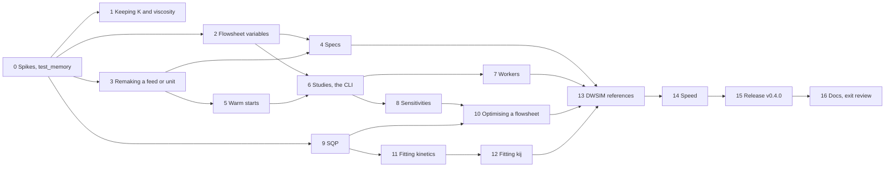

# M8 plan — specifications, sensitivity studies and optimisation

M8 makes a flowsheet answer questions, not just solve once.
- "Vary the cooler's duty until the drum's vapour is 5% methane."
- "Sweep the feed from 700 to 1000 °C and report the methane conversion."
- "Find the feed temperature and steam ratio that maximise hydrogen, with the
  outlet below 1100 K."
- "Fit these LHHW constants to my rate data, with their confidence
  intervals."

Its benchmark is the owner's. DWSIM 9 took 30 minutes in the app for a
50-point study of the reforming PFR (M9's Tutorial 1). M9 solved that study as
50 cold solves in 2.1 s. M8 adds warm starts, parallel cases, design
specifications, optimisation and fitting, and the speed the owner's other
models need, the published reforming model's K(T) above all. It's planned like
M1 to M4, M9 and M10a: research first, then exit criteria, decisions and steps.
The roadmap entry is in [roadmap.md](roadmap.md).

Status: **approved** on 2026-11-16, after a draft that split M8 in two: it's
one milestone, as the owner decided, with its optimiser written in V (D1,
D12). Step 0 is done and amended D6 and D18, and step 1 is done and amended
D11, both approved on 2026-11-17. Whether equation 16 is integrated by a
fixed rule (step 1) is still the owner's to decide. Steps 2 to 4 are done
and amend D3, D4 and D5, and steps 5 and 6 are done and amend D6, all
approved on 2026-11-17. Steps 7 and 8 are done, and step 8 amends D10,
approved on 2026-11-17. Steps 1 to 8 meet the roadmap's exit. Steps 9
and 10 are done, built together, and amend D12 and D13, approved on
2026-11-17. Steps 11 and 12 are done, built together, and amend D14 and
D15, approved on 2026-11-18. Step 13 is next.

## Goal

- **Design specifications** (F4): "vary X until Y = target", with X any number
  the file gives and Y an expression over the flowsheet's streams and units.
  Each spec is converged with its block's tears, not in a loop around the
  whole solve, and the answer is checked against the target like every
  balance.
- **Flowsheet variables in expressions:** a stream's T, P, flows and
  composition, and a unit's duty or work, by name, units checked. Specs, study
  outputs, objectives and constraints are expressions, as M9 promised (A9).
- **Sensitivity studies** (H1, H2): one or two inputs over a range, any
  expressions reported at each point.
  - Each point has its own status. A point that fails says why, and the rest
    stand.
  - A quantity with no value at a point, such as a product's conversion
    when the feed has none of it, is refused with its reason, never plotted
    as −∞ (Tutorial 2's lesson).
- **Warm starts** (F5): each point starts from its neighbour's answer, its
  tears and its units' own solvers alike, and is checked as a cold one is.
- **Parallel cases** with `spawn`. A study's answers don't depend on how many
  workers ran it.
- **Local sensitivities:** the derivative of each output with respect to each
  input at a point, with its error estimated.
- **Optimisation** (H3): an objective, minimised or maximised over chosen
  inputs within bounds, subject to constraints. The answer is returned only
  once it's shown to be an optimum, by its first-order conditions checked
  from scratch.
- **Fitting constants to data** (H4):
  - LHHW and power-law constants to rate data, on M9's kinetics with exact
    derivatives;
  - kᵢⱼ to VLE data.

  Each fit comes with its confidence intervals and its parameters'
  correlations.
- **What reactors recompute though their T hasn't moved** (M9 step 11): each
  reaction's K(T), 93% of the published reforming model's solve, and each
  compound's viscosity.
- **Against DWSIM 9:**
  - the owner's study against its sensitivity analysis;
  - a spec against its Adjust;
  - an optimisation against its optimiser;
  - a kᵢⱼ fit against its regression;

  every difference explained.

## What the research found

**What M8 builds on:**
- **`flowsheet.solve`** converges each block's tears by direct substitution,
  Wegstein or Broyden on x = (n₁ … n_c, P, h) (M4's D6, D7). Tears take first
  values from `SolveParams.estimates`. Nothing is returned unless every
  balance closes (D8).
- **A `Unit` holds nothing about a solve,** so calculating it twice gives the
  same answer. Units are therefore safe to share between threads. But a unit
  can't remember its last answer, which a warm start needs: that has to be
  passed in.
- **`Loaded.root` keeps the file's TOML tree,** so a study can replace one
  value and remake that feed or unit through its own maker. Every unit,
  including later ones, would then be variable without each writing setters.
- **`expr`'s names** are a context's variables (`T`, `P`) and family members
  (`p[CH4]`). Nothing names a stream's or a unit's variable yet. The tape
  differentiates with respect to its inputs, and a rate's constants are
  folded into it, so a fit must make them inputs.
- **`numeric.minimize`** is Newton with a Levenberg–Marquardt shift, for an
  unconstrained objective with its Hessian. `numeric` has no least squares
  and no constrained optimiser.

**Where a reactor's time goes** (M9 step 11, and checked for this plan):
- On the published model, 93% of a solve is `Kinetics.fill`. It calls
  `Reaction.standard`, which integrates each species' ideal-gas Cp from
  298.15 K at every evaluation of the rates.
- **Four of the reforming case's five species give Cp as ChemSep's eq. 16,**
  Y = A + exp(B/T + C + D·T + E·T²), which has no closed-form integral. So
  each integral is a Gauss–Kronrod quadrature at 1e-13 (`tdep`). Only water's
  eq. 107 integrates in closed form.
- **Across the database,** 521 of 640 compounds' ideal-gas Cp are eq. 16,
  116 eq. 107, 2 eq. 100 and 1 eq. 1.
- **So keeping K at the last T** fixes an isothermal reactor, whose T never
  moves. An adiabatic one moves T every step, and would need eq. 16
  integrated faster. Every PH flash integrates the same Cp, but M3 measured
  that at 0.6% of a flash.
- On DWSIM's typed rates, Wilke's viscosity is about a quarter of a solve.
  Each compound's correlation is evaluated again at every step, though T
  doesn't move.

**How DWSIM does it** (its source on GitHub, `DWSIM.FlowsheetSolver` and
`Adjust.vb`; its API reference and help):
- **An Adjust** varies one variable until another equals a target, by
  bisection or secant. Its defaults are a tolerance of 1e-4 and at most 10
  iterations.
- **Simultaneous adjusts** run Newton on every Adjust marked for it:
  - the Jacobian by central differences of ±1% of each variable;
  - each evaluation a whole flowsheet solve, so 2n + 1 solves an iteration;
  - at most 25 iterations, each adjust's own tolerance.

  Either way a spec is a loop around the flowsheet, not converged with its
  recycles.
- **Its sensitivity analysis** varies up to two variables, each over equally
  spaced points, and records dependent variables or expressions. Each point
  recalculates the flowsheet from the state the last left. That's a warm
  start of a sort, but an unchecked one: a point's answer depends on the
  order of the points.
- **Its optimiser:**
  - its methods are Brent, L-BFGS, truncated Newton, Nelder–Mead (each with
    a bounded form) and IPOPT;
  - the objective is a flowsheet variable or an expression;
  - its help describes bounds on the varied inputs and no other
    constraints;
  - it stops when the objective's change falls below its tolerance, so its
    answer isn't checked to be an optimum.
- **Its parallel mode:** the solver documents a "background parallel"
  mode. In the code read here, its parallel queue (`Parallel.ForEach`) is
  never reached, and every mode takes the serial path. Step 0 checks that in
  DWSIM 9.0.5 itself.
- **Its −∞:** the owner's Tutorial 2 swept a product's conversion,
  (in − out)/in with nothing in. DWSIM plotted −∞ at every point, with no
  message (M9 step 10).
- **Its regression:** a study's results can go to a data-regression plugin.
  Step 0 finds out whether that fits kᵢⱼ headless.

**Threads or processes,** measured for this plan:
- **The setup:** the owner's case (`reformer_dwsim.toml`), 48 feed
  temperatures, reflux built with gcc `-prod`, on the owner's laptop (Ryzen 5
  PRO 3500U, 4 cores).
- **One thread:** 1.67 to 1.78 s.
- **Threads with `spawn`,** sharing one `Loaded`: 1.11 s with 2 (1.5×) and
  0.81 s with 4 (2.1×).
- **Four processes** of 12 points each: 0.48 to 0.64 s of solving each
  (2.6×), and 1.09 s from start to finish, each process reading the file and
  the data.
- **What limits threads:** the collector's lock, which every allocation
  takes (M10a measured 1.3 to 2.3× with 8 threads), and the cores
  themselves.
- **What it suggests:** threads are worth having, and an allocation less per
  step would raise their ceiling. Processes gain a little more, at the cost
  of reading everything once each and merging reports.

**The methods** (independent of reflux):
- **Specs and tears.** In sequential-modular simulation a spec is converged
  either nested, by a 1-D method around the recycle loops, or together with
  the tears by a quasi-Newton method (Westerberg, Hutchison, Motard and
  Winter, *Process Flowsheeting*, 1979; Biegler, Grossmann and Westerberg,
  *Systematic Methods of Chemical Process Design*, 1997, ch. 4).
  - Together needs far fewer passes, since each Broyden evaluation is one
    pass, not a converged solve.
  - Nested is sturdier far from the answer. Aspen Plus offers both.
- **Warm starts along a sweep** are natural-parameter continuation. A secant
  predictor through the last two answers usually halves the corrector's
  work (Allgower and Georg, *Numerical Continuation Methods*, 1990).
- **A derivative by differences** has an error that two steps estimate:
  Richardson's extrapolation. A derivative of a solve can't be closer than
  the solve's tolerance over the step allows, so its tolerance must tighten.
- **Optimising a flowsheet:**
  - A flowsheet optimisation has few inputs, a handful to a few dozen, and
    each evaluation is a converged solve.
  - For problems of that size, sequential quadratic programming (SQP) is
    the standard: a quadratic model from a BFGS update, kept positive
    definite by Powell's damping, a QP subproblem on the linearised
    constraints, and a merit function to accept steps (Nocedal and Wright,
    *Numerical Optimization*, 2006, ch. 18).
  - Converging each evaluation fully is the "feasible path". Making the
    tears optimisation variables too, the "infeasible path", takes far fewer
    passes (Biegler and Hughes, AIChE J. 28, 1982), at the cost of the
    optimiser seeing every tear.
  - IPOPT is built for thousands of variables with sparse Jacobians: an
    equation-oriented flowsheet's (M13), not this one's.
  - Hock and Schittkowski's collection (*Test Examples for Nonlinear
    Programming Codes*, 1981) gives small constrained problems with their
    published optima.
- **Fitting:**
  - Nonlinear least squares by Gauss–Newton with a Levenberg–Marquardt
    shift.
  - Confidence intervals by linearising at the optimum, s²(JᵀJ)⁻¹, whose
    coverage is approximate for a nonlinear model (Bates and Watts,
    *Nonlinear Regression Analysis and Its Applications*, 1988).
  - Arrhenius constants centred on a reference T in the data's range, which
    removes most of A's and Eₐ's correlation ([kinetics.md](kinetics.md)).

**References for the tests:**
- **Closed forms:**
  - an isothermal first-order PFR, X = 1 − exp(−kPV/F): its volume for a
    target conversion, and dX/dT;
  - a heater's duty for an outlet T, against a PH flash;
  - series reactions A → B → C in a PFR, whose B peaks at a space time of
    ln(k₂/k₁)/(k₂ − k₁) (Levenspiel), for the optimiser.
- **mpmath,** for those derivatives and optima at high precision.
- **Hock and Schittkowski's problems,** for the SQP.
- **SciPy** (`least_squares`, with `thermo`'s PR for kᵢⱼ), fitting the same
  data in a uv script, and seeded synthetic data from known constants.
- **reflux's own cold solves,** for every warm one.
- **DWSIM 9:** its Adjust, its optimiser, its sensitivity analysis and its
  regression, as far as its API allows them headless (step 0).

## Exit criteria

All checked by tests in CI, as before.

1. **Specs are met.** A spec converges with its block's tears, and the
   solution meets its target to the solver's tolerance, checked from the
   solution itself. It holds on a block with a recycle and on one without:
   - an isothermal PFR's volume for a conversion matches its closed form;
   - a heater's duty for an outlet T matches the PH flash.

   A target outside what the varied value's bounds can reach is refused,
   with the range they reach. Every balance is still checked (M4's D8).
2. **Flowsheet variables bind.** Every name in a spec, an output, an
   objective or a constraint binds to a stream's or a unit's variable, with
   its dimension, or is refused with its line, its column and a suggestion.
   Each renders back.
3. **Studies report.** One or two inputs over values with units, and every
   output at every point, each point with its status.
   - A failed point gives its reason, and every other point stands.
   - An output with no value at a point is NaN with its reason, and
     Tutorial 2's methanol conversion is one.
4. **Warm starts are checked.** Every warm-started point agrees with its cold
   solve within the solver's tolerance, point by point. The passes and
   integrator steps each takes are recorded, and can't grow.
5. **Workers don't change answers.** A study run by 1, 2, 4 or 8 workers gives
   the same bits. The throughput is recorded, with no target.
6. **Sensitivities are honest.** Each derivative matches its closed form
   within its own error estimate. Each estimate's ratio to the true error is
   recorded, so that a loose estimate shows.
7. **The optimiser is right.** Hock and Schittkowski's problems reach their
   published optima within tolerance, from their published starts. Each
   answer's first-order conditions are checked from scratch: feasibility,
   the Lagrangian's gradient, the multipliers' signs and complementarity. A
   problem with no feasible point, or one that doesn't converge, is refused
   with its reason. Iterations are recorded, and can't grow.
8. **Flowsheet optimisation is right.** The series reactions' PFR reaches
   its closed-form optimum. One optimum sits on a bound and one on a
   constraint, and each is verified as in criterion 7. The same problem in
   DWSIM's optimiser is compared, and the difference explained.
9. **Fits are right.**
   - Rate data and VLE data fitted by reflux match SciPy's fits of the same
     data, parameters and intervals, to the optimum's tolerance.
   - Over many seeded synthetic data sets from known constants, the 95%
     intervals cover the true values about as often as they claim, within
     binomial bounds.
   - A kᵢⱼ fit is compared with DWSIM's regression, if step 0 can drive it.
10. **Nothing a reactor keeps changes an answer.** K(T) and the viscosity
    kept at the last T leave every golden report exactly as it was. The
    published model's solve is recorded before and after.
11. **The owner's study against DWSIM 9.**
    - The 50-point study is timed with gcc `-prod`, warm, cold and on
      workers, against DWSIM's own sensitivity analysis. If step 0 finds that
      can't be driven, it's timed against M9's loop of solves instead.
    - As the roadmap's exit asks, it must be faster, which M9 already shows,
      and the ratio is recorded.
    - A spec is compared with DWSIM's Adjust at a tight tolerance, every
      difference explained.
12. **Files and the CLI.**
    - `[spec.NAME]`, `[study.NAME]`, `[optimize.NAME]` and `[fit.NAME]` in
      the file, every key checked, every refusal at its line.
    - `reflux solve` converges specs. `reflux study`, `reflux optimize` and
      `reflux fit` each print a table and write JSON and CSV.
13. CI is green, and the docs are updated: README, roadmap, design notes,
    kinetics.md, the file and report formats, and the V notes. v0.4.0 is
    released.

## Decisions

| # | Decision | Choice | Why |
|---|---|---|---|
| D1 | Scope | One milestone, the roadmap's M8 (discussed on 2026-11-16): specs, warm starts, studies, workers, sensitivities, optimisation and fitting. The roadmap is amended in three places:<br>- B6: no C optimiser in M8, its own SQP (D12) instead, with IPOPT moving to M13;<br>- H1: exact sensitivities move to M13 (D10);<br>- H4: data reconciliation moves to M13. | The optimiser in V removes the C dependencies, NLopt and IPOPT, which were the case for splitting M8. A flowsheet optimisation is small and dense. Reconciliation needs measured data against the whole flowsheet's equations, M13's. |
| D2 | Where it lives | <br>- **`flowsheet`:** specs, since they change how a block converges.<br>- **A new module, `study`:** studies, workers, sensitivities and flowsheet optimisation, over `flowsheet`.<br>- **`numeric`:** the SQP and least squares, each over an interface.<br>- **A new module, `fit`:** fitting, over `kinetics`, `flash`, `thermo` and `numeric`.<br>- **`main`:** `reflux study`, `optimize` and `fit`.<br>- **`kinetics` and `reactors`:** caching K and the viscosity.<br><br>vlib has no module named `study` or `fit`. | A study and an optimisation are many solves; the solve itself stays one. Fitting is many evaluations of a model, not of a flowsheet. |
| D3 | Naming flowsheet variables | A name with one dot:<br>- for a stream, `product.T`, `product.P`, `product.F` (total molar flow), `product.n[CH4]` (a component's flow), `product.y[CH4]`, `product.h` and `product.vf` (vapour fraction);<br>- for a unit, its energy streams by their names, `reactor.duty` and `pump.work`.<br><br>The grammar's atom gains `name "." name`. A stream or unit that isn't there, or a variable it lacks, is refused with the closest names. Each variable has its dimension, so `product.T - 300` is refused as M9's sums are.<br><br>**Amended in step 2.** A stream or unit whose name isn't one word is quoted before its dot, `'let down'.T`, as a member's key is. A unit names its energy streams through an optional interface, `Energies`, so that they bind at load: an adiabatic reactor has none. | It reads like the file, where a stream is `[feed.syngas]` and a unit `[unit.reactor]`, and keeps M9's members for components. Families keyed by stream, `T[product]`, would need two keys for a composition, `y[product, CH4]`. |
| D4 | What can be varied | Any number the file gives a feed or a unit, by its key: `"feed.syngas.T"`, `"unit.cooler.duty"`, `"unit.reactor.volume"`. Each point replaces that value in the file's tree, with its unit, and remakes the feed or unit through its maker, which checks it as it checks the file. The value's dimension must be the key's.<br><br>**Amended in step 3.** A key's value and dimension are those its maker read, noted by the `Section` as it read them, not parsed again from the file: `27 degC` is 300.15 K where a temperature was read. A key no maker reads as a number is refused. A key into a nested table or a list is written as the file nests it, `unit.tube.catalyst.loading`, `unit.split.fractions[0]`. | Every unit, today's and later ones, is variable at once, with its own checks, and no unit writes setters. Remaking a unit costs microseconds against a solve's milliseconds; step 3 measures it. |
| D5 | Specs | `[spec.NAME]` has three keys:<br>- `vary`, a key, as D4;<br>- `between`, its bounds;<br>- `until`, an equation of two expressions whose sides share a dimension, `"drum_vapour.y[CH4] = 5 %"`.<br><br>In planning, a spec is an edge from the unit that makes what it measures back to what it varies (a unit, or the units its feed enters), so they land in one block. That block's unknowns are its tears and its specs' values, and Broyden converges them together (F4). The residuals are the tears' changes and each spec's two sides' difference, scaled.<br><br>A block with one spec and no tears is solved by Brent within the bounds instead. A spec that fails in a block with tears is tried once more nested, Brent around the block's tears, before it's refused.<br><br>The answer must meet each target to the solver's tolerance and stay within its bounds. A unit's value set equal to an expression of others, DWSIM's Spec block, is a spec that varies that value until it equals the expression.<br><br>**Amended in step 4.** The residual is (lhs − rhs)/max(\|lhs\|, \|rhs\|, s₀), s₀ the block's own scale for the dimension. Several specs with no tears are met by Broyden on their values, and nested so around the tears. The specs' first Jacobian is a whole pass's, J, and their unknowns v₀ + (−J⁻¹)·u, since two specs can each vary what the other reads. Broyden held at a bound three evaluations running is stopped for the nested retry. Brent's bracket is the bounds, or nine values between them. | Together is a pass an evaluation, where DWSIM's simultaneous adjusts take a whole solve. Brent can't fail inside a bracket, and a single spec is the common case. Bounds let a target out of reach be refused with what the bounds reach, rather than wandering. |
| D6 | Warm starts | A study's or an optimiser's point starts its tears from the last point's, with a secant predictor through the last two where both exist.<br><br>A unit that can use its last answer says so with an optional interface, `Warm`, whose `calculate_from(fl, inlets, last Outcome)` takes it. `Unit` is unchanged, and a unit without it starts cold:<br>- the CSTR starts Newton from its last outlet, skipping continuation;<br>- a reactor at a duty or adiabatic brackets its T around the last;<br>- a PFR starts from its last first step.<br><br>A warm answer is checked exactly as a cold one is.<br><br>**Amended in step 0, for step 5 to settle.** A tear started from its neighbour's answer, as `SolveParams.estimates` allows today, took more passes than a cold start on the reference flowsheet with Wegstein (11.0 a point against 4.0) and with Broyden (11.8 against 8.1), and fewer only with direct substitution (24 against 29). The predictor brought Broyden's to 7.8 and Wegstein's to 8.4. So a tear's value alone isn't the warm start. Step 5 first measures what is, Broyden's Jacobian carried along with the tears above all, and a block is started warm only where that takes no more passes than cold.<br><br>**Amended in step 5.** Measured ([spike/warm](../spike/warm/spike.v)): a warm start carries the units' last answers, through `Warm`, and the specs' values, each through the predictor, b + r·(b − a), r this step over the last. The tears start warm only with direct substitution or in a block with specs: with Wegstein and Broyden alone they took more passes than cold. Broyden's Jacobian and Wegstein's slopes aren't carried: they took more passes too. | `Unit`'s promise, nothing about a solve, keeps units shareable between threads, so the last answer comes in from outside. A predictor is cheap and halves the work along a smooth sweep.<br><br>Step 0 measured the tears' part by hand, and it doesn't hold as written. |
| D7 | Determinism | A study's points go in chunks of a fixed size, 8 unless the file says otherwise. Each chunk starts cold at its first point and warm-starts the rest in order. Workers take whole chunks. A grid of two inputs runs along its rows, alternating direction, so each point's neighbour is the last one solved. | The same chunks give the same bits whatever the number of workers (criterion 5). DWSIM's answers depend on the order of its points. |
| D8 | Workers | Threads, with `spawn`, sharing one loaded file. The number is the CPU count unless `--workers` says otherwise. Step 7 profiles a solve's allocations and removes those in the hot path that it can. | Measured: 2.1× with 4 threads against 2.6× with 4 processes, which would each read the file and the data and need their reports merged. One process keeps one report. |
| D9 | A point's outcome | Each point has a status (solved, failed, or solved with an output that has no value) and reasons in words, as M10a's points have. An expression that divides by zero, or takes the log of zero, at a point is NaN with its reason ("methanol's conversion: the feed has no methanol"), never ±∞. A failed point doesn't stop the study, and the next point starts cold. | Tutorial 2's −∞ is what a sweep must never do. M10a's C API already works this way, so M10b can hand it to Python unchanged. |
| D10 | Sensitivities | The derivative of each output with respect to each input, at any point, by central differences of warm-started solves.<br>- The solve's tolerance is tightened to 1e-12 for them.<br>- Each step is chosen from the input's scale.<br>- The error is estimated from steps h and h/2 by Richardson's extrapolation, and reported beside the derivative.<br><br>The same derivatives are the optimiser's gradients. Exact sensitivities, by the implicit function theorem on the converged Jacobian (H1), need each unit's Jacobian, which comes with M13's residuals (J1).<br><br>**Amended in step 8,** approved on 2026-11-17. The error's estimate adds the solves' noise, from a fifth solve at v: |D(h/2) − D(h)| + |Δ⁴|/h, Δ⁴ the fourth difference over the five. With the two differences alone a spec's derivative underestimated its error, its noise being of their size. Each step is h = 1e-4·\|v\|; an input at 0 is refused. | Differences work for every unit, and give an error estimate that a user can judge. An optimiser needs gradients good to about 1e-6, which a solve at 1e-12 gives. The PFR's rows in T and P are themselves differences (M9 step 9), so an exact path would be partial today. |
| D11 | Keeping K(T) and the viscosity | A reactor's rates keep each reaction's K, and each compound's viscosity, at the T they were last computed at. A new T computes them as now, so every answer keeps its bits. Whether eq. 16's Cp should integrate faster, for reactors whose T moves, is measured in step 1 and decided there.<br><br>**Amended in step 1.**<br>- Wilke's rule keeps each pair's two factors with each compound's viscosity: its powers and square roots, not the correlations, were most of its cost.<br>- At a T that moves, each species' two integrals are taken once and shared by the reactions it's in, each summing them as before: 10 integrals for the reforming model where its three reactions took 24, and the same bits. | Exact by construction. An isothermal reactor, the owner's case, never moves T. |
| D12 | The optimiser | `numeric.sqp`, written in V, for small dense problems: minimise f(x) subject to bounds, equalities c(x) = 0 and inequalities c(x) ≥ 0.<br>- **The method:** Han and Powell's SQP. The Hessian of the Lagrangian comes from a BFGS update with Powell's damping, and each step's QP is solved by an active-set method on the bounds and the linearised constraints. Steps are accepted by an ℓ1 merit function with a backtracking line search (Nocedal and Wright, ch. 18).<br>- **What it takes:** the problem as an interface, with gradients, exact where the caller has them and D10's differences for a flowsheet.<br>- **What it returns:** an answer only once the first-order conditions hold to their tolerances, each multiplier with it. A QP with no feasible point, a line search that can't descend, or the iteration budget spent is a typed `OptimizeError` with its reason.<br><br>**Amended in step 9,** approved on 2026-11-17:<br>- **The QP** is Goldfarb and Idnani's dual active-set method (`numeric.qp`), from the unconstrained minimum, each step's system factorised afresh: the problems are small.<br>- **A QP with no point is relaxed** first, as Powell's and Schittkowski's codes do: δ ∈ [0, 1] scales each equality and violated inequality, at a cost ½ρδ². A linearisation can have no point where the problem has, so the problem is refused as infeasible only when δ comes out 1, no step lowering the violation, or the relaxed QP fails too.<br>- **The problem** gives its values, then its gradients at the same x, so that a flowsheet differentiates from the solve it just made.<br>- **tol** is absolute on c and relative to max(1, ‖∇f‖∞) on the Lagrangian's gradient, so the caller scales its constraints. | Every flowsheet optimisation M8 meets has a handful of inputs. SQP converges superlinearly there, takes constraints directly, and needs no dependency. Checking the conditions is how the optimiser shows its answer, as every other solver here does. DWSIM's stops when its objective stops changing. |
| D13 | Optimising a flowsheet | `[optimize.NAME]` has four keys:<br>- `vary`, keys with bounds, as D4;<br>- `minimize` or `maximize`, an expression;<br>- `subject_to`, equations and inequalities over flowsheet variables, `"product.T <= 1100 K"`;<br>- `start`, optionally.<br><br>The path is feasible: each evaluation is a converged solve, specs included, warm-started from the last (D6), and the constraints are the SQP's. The equation reader of D5 takes `<=` and `>=` too. The report gives the optimum, the multipliers, which bounds and constraints are active, and each evaluation.<br><br>**Amended in step 10,** approved on 2026-11-17:<br>- **`start`** is each input's own, `{ key, between, start }`, the file's value if not given.<br>- **The problem is scaled:** each input over its bounds to [0, 1], the objective over its largest derivative at the start, each constraint over its sides' size there; the SQP's tol is 1e-6, above the gradients' noise.<br>- **The gradients** are D10's differences with a step of 1e-4 of the largest value the bounds allow, at most a quarter of the range, and one-sided where a bound is within the step: a pump's efficiency at 1 can't be stepped past. `--workers` takes the inputs at once.<br>- **The multipliers** are reported as how fast the optimum improves as each bound or constraint is relaxed, per unit of its own.<br>- **The first evaluation** is cold, and every later one starts from the last. | The feasible path keeps every evaluation a checked solve. The infeasible path's fewer passes come from giving the optimiser the tears, which M13's equation-oriented solve does anyway. |
| D14 | Fitting kinetics | `[fit.NAME]` in a reactions file has four keys:<br>- `data`, a CSV whose header gives each column with its unit (`T [K]`, `P [bar]`, `y[CH4]`, `r[reforming] [mol/(kg*s)]`);<br>- `parameters`, by name: constants and definitions such as `k1.A`, `k1.Ea` or `K_CO.dH`;<br>- `start`, if not the file's values;<br>- `weights`, each rate's absolute or relative error.<br><br>The residuals are the measured rates less the model's. The fit is least squares by Gauss–Newton with a Levenberg–Marquardt shift (`numeric.least_squares`), on ∂r/∂θ from the tape, exactly: the fitted constants become the tape's inputs. An Arrhenius or van 't Hoff constant is fitted centred on the data's mean T, and reported in the file's own form.<br><br>The report gives each value, its standard error and 95% interval by linearisation, the correlation matrix, the residuals, and the fitted section as file text. Rate data only, as from a differential reactor; outlet data from an integral reactor, a PFR solved per evaluation, comes later.<br><br>**Amended in step 11,** approved on 2026-11-18:<br>- **The file:** a fit is in a format-3 file with its reactions, a file of reactions alone now format 2 or 3; `flowsheet` reads it (`load_fits`), as it reads studies, so `fit` imports `flowsheet` (D2). A parameter is `NAME.A`, `NAME.Ea` or `NAME.dH` of a named constant, or `NAME` of a number with its unit, quoted or not; `start` is by parameter; a column with no weight is unweighted, an error of 1 in SI.<br>- **The states** are the ideal gas, p = yP, f = p, c = p/RT; a species left out has y = 0, a rate left empty wasn't measured.<br>- **The solver** is Levenberg–Marquardt as Moré gives it: QR on [J; √μD], D the columns' norms, Nielsen's damping, and a step whose fall is within Σr²'s rounding judged by the gradient test, which must reach 1e-10.<br>- **The intervals** are Student's t at 0.975 on n − p, the covariance s²(JᵀJ)⁻¹ moved to the file's form by the delta method, and the correlations there too. A parameter the data don't determine is refused by name.<br>- **The fitted section** is each constant as file text, in its own units, to 10 significant figures. | M9's exact derivatives make the fit exact to rounding in its Jacobian. Centring removes most of A's and Eₐ's correlation (kinetics.md), and the correlation matrix shows what's left. Rate data is how kinetics is measured for fitting, and needs no reactor model. |
| D15 | Fitting kᵢⱼ | `[fit.NAME]` with VLE data (T, P, x, y), the kᵢⱼ of named pairs as parameters, and residuals in bubble pressure and vapour composition, each weighted. The derivatives are by differences, and the solver and report are D14's.<br><br>**Amended in step 12,** approved on 2026-11-18: a pair is `kij[a, b]`, starting from the `[model]`'s own; the liquid needs every component but one, which makes up the rest; P's error and each measured y's must be given, since they're of different kinds; and the differences are central, kᵢⱼ ± 1e-6. | The data DWSIM's regression and thermo's users fit. kᵢⱼ is one number a pair, so differences are cheap and enough. |
| D16 | The file | Format 3 adds `[spec.NAME]`, `[study.NAME]`, `[optimize.NAME]` and `[fit.NAME]`.<br><br>A study has:<br>- `vary`, one or two, each a key with `from`, `to` and `points`, or `values`;<br>- `report`, named expressions;<br>- optionally `chunk` and `sensitivities` (which outputs, with respect to which inputs).<br><br>Formats 1 and 2 read as before. | A new section is a new format, by the CHANGELOG's rules. |
| D17 | The CLI and reports | `reflux solve FILE` converges the file's specs, and its report gains each spec's value and residual.<br><br>`reflux study FILE [NAME]`, `reflux optimize FILE [NAME]` and `reflux fit FILE [NAME]` each print a table, with `--json OUT` and `--csv OUT`, and the first two `--workers N`. The JSON gives every point or iteration, with its passes and reasons, and the CSV one row a point, NaN where an output has no value.<br><br>The exit status:<br>- 0 when the command ran, even with failed points, which the table says;<br>- 1 when it couldn't run, or found no optimum or fit;<br>- 2 for a wrong command.<br><br>Each report is a format of its own, documented beside the solve's. | A study that ran with some failed points is still a result. Each point's reason is in the report. |
| D18 | Comparing with DWSIM | <br>- The owner's 50-point study against DWSIM 9's own sensitivity analysis, if step 0 can drive it headless, else against M9 step 11's loop of solves.<br>- A spec on the reference flowsheet (M4) against its Adjust, its tolerance set to 1e-10.<br>- An optimisation within bounds against its optimiser.<br>- A kᵢⱼ fit against its regression, if step 0 can drive it.<br><br>Each is compared by state, as M4 compared.<br><br>**Amended in step 0** ([spike-dwsim-study.md](spike-dwsim-study.md)): a script can run each of its forms, unshown.<br>- The study: against its own form.<br>- The spec: the cooler's outlet T until the first drum's vapour is 60 mol/s, against a single Adjust's secant and Brent's at 1e-10, with the recycle's tolerances scaled by 1e-8. Not the simultaneous solver at that tolerance, which leaves the flowsheet 1% off its answer.<br>- The optimisation: one variable within bounds, against bounded Brent's, the only one of its 11 methods that found an optimum. The pressure between two compression stages, which step 0 ran, and criterion 8's series reactions if its PFR takes them.<br>- The kᵢⱼ fit: its regression ran and fitted nothing, so the comparison is recorded as not possible, unless the owner's run of the same nine points in the app gives the kᵢⱼ. | The comparison is of the same question asked of both, and its differences are each explained. |
| D19 | Versions | M8 ends with v0.4.0: format 3 and the new reports are additions, a minor release. | The CHANGELOG's rules. |
| D20 | Who writes what | As before, I write it all unless you claim a step. | |

## Steps



Steps 1 to 8 meet the roadmap's exit, the study faster than DWSIM's, before
the optimiser begins.

### 0. Spikes, and `test_memory.py` — done: go, with D6 and D18 amended
- **DWSIM:**
  - can its sensitivity analysis be built and run headless, and how long
    does the owner's study take in it;
  - its Adjust and simultaneous adjusts on a spec of the reference
    flowsheet: their iterations, their whole-flowsheet solves, and their
    answers at their default and tight tolerances;
  - its optimiser on a bounded problem: which methods run headless, and
    what they stop at;
  - its regression plugin: whether it fits kᵢⱼ headless;
  - what its study does with a failed point.

  Written up as `docs/spike-dwsim-study.md`.
- **Warm starts by hand:** the reference flowsheet's recycle swept by its
  estimates, to measure the passes a warm start saves, with and without a
  predictor. This sets criterion 4's expectations.
- **Workers:** each thread's answers against one thread's, bit for bit, on
  the owner's case, to show that sharing a `Loaded` is safe. Then a profile
  of a solve's allocations.
- **`test_memory.py`,** flaky on Ubuntu since M10a: compare the bytes live
  after a full collection, not the collector's heap size. `reflux_collect`
  reports what it measures, so the header, `docs/python.md` and the next
  CHANGELOG entry say so.

**What was built:**
- **[spike/dwsim_study/run.py](../spike/dwsim_study/run.py)** and its
  write-up, [spike-dwsim-study.md](spike-dwsim-study.md). None of DWSIM's
  study, single Adjust, optimiser or regression has an API: each is a form
  of the classic app, and its work is its Run button's handler. The app's
  first automation class makes its main window without showing it, so the
  script fills each form's own case and calls the handler: what ran is
  DWSIM's code.
- **[spike/study/spike.v](../spike/study/spike.v):** warm starts by hand,
  threads' bits, what a solve allocates, and a checksum of every number of
  four studies, to compare two builds of reflux by.
  [spike/study/probe/reactors_alloc.v](../spike/study/probe/reactors_alloc.v)
  is a test of `reactors` kept there, to copy in and run: where a PFR's
  solve allocates.
- **`reflux_collect`** ([capi/capi.v](../capi/capi.v)) reports
  `gc_memory_use()`, the heap less its free blocks, after its collection,
  and its parameter is `live_bytes`. `reflux.collect()` returns it, and
  `docs/python.md` has it, with an example its test runs.

**What DWSIM does** (the write-up has each number):
- **The study** ran by its own form: 50 points of the owner's case in 727 s,
  and every row the answer of a loop of solves, to the bit (639 s). So
  criterion 11 has its like-for-like comparison.
- **A failed point records the last point's numbers,** or the solve
  before the study's if it's the first, with "Run completed" and no
  message.
- **A single Adjust isn't run by the flowsheet solver,** only by its control
  panel, which also runs unshown: a secant or Brent's method around whole
  flowsheet solves, 6 to 10 of them for the spec here (the cooler's outlet
  T until the first drum's vapour is 60 mol/s: 219.7546705409 K). With the
  recycle at DWSIM's default tolerances, Brent's ends 0.051 K off and says
  it succeeded.
- **The simultaneous adjust solver** takes 19 flowsheet solves at its
  default tolerance, and at 1e-10 leaves the flowsheet at its derivative's
  last point, the varied value 1% low and the target missed by 1.3 mol/s
  in 60, with no error.
- **The optimiser:** bounded Brent's is the one method of its 11 that finds
  an optimum, inside the bounds or on one.
  - An objective that's an expression of other variables fails in the
    nine that aren't Brent's, on an index of −1 in DWSIM's objective
    function.
  - Unbounded Brent sets the variable to 0, and the L-BFGS pair stop after
    one evaluation of one variable.
  - The DotNumerics methods and IPOPT end at the same point asked to
    maximise as asked to minimise.
  - It has "constraint" variables, a barrier added to the objective, which
    the research above didn't find.
- **The regression** ran and fitted nothing: on nine exact P-x-y points
  from PR with kᵢⱼ = 0.13, none of its four methods reported 0.13. Whether
  the app does better isn't known; the owner can try the same nine points
  there.
- **"Background parallel" is serial:** three PFRs take 2.6 to 3.1 times
  one, in every mode.

**Warm starts by hand** (the reference flowsheet, its cooler swept down
from 230 K, each point cold, then with its tear started from the last
point's answer through `SolveParams.estimates`, then from 2b − a of the
last two; passes a point, and the most any point took):

| method | points | cold | warm | predicted | warm against cold |
|---|---|---|---|---|---|
| Wegstein, tol 1e-9 | 21, 1 K apart | 4.0 | 11.0 (11) | 8.4 (9) | 6.2e-11 |
| direct | 21, 1 K apart | 29.0 | 24.0 (24) | 19.2 (20) | 1.7e-9 |
| Broyden | 21, 1 K apart | 8.1 | 11.8 (13) | 7.8 (9) | 3.0e-9 |
| Wegstein | 21, 0.1 K apart | 4.0 | 9.7 (10) | 5.4 (7) | 6.7e-11 |
| Wegstein | 9, 5 K apart | 4.0 | 12.1 (15) | 10.0 (11) | 4.7e-11 |
| Broyden | 9, 5 K apart | 7.7 | 11.1 (13) | 10.4 (12) | 1.2e-9 |
| Wegstein, tol 1e-12 | 21, 1 K apart | 5.0 | 15.5 (16) | 12.5 (13) | 8.2e-14 |

- **Every warm answer is the cold one** within the solver's tolerance, as
  criterion 4 asks.
- **But a tear's value alone doesn't save passes:** it costs them with
  Wegstein and Broyden, even 0.1 K from the last answer, and saves a sixth
  with direct substitution. The predictor helps each, and only brings
  Broyden level with cold.
- My reading, not yet checked: from an empty recycle every tear variable
  follows one geometric sequence, half the liquid coming back each pass,
  for which Wegstein's secant is exact, so cold converges in one step of
  it. A neighbour's answer is close but off in several directions at once,
  which a secant per variable handles badly, and Broyden starts each solve
  with no Jacobian, however near it starts.
- **So D6 is amended:** step 5 first measures what a warm start must carry,
  Broyden's Jacobian with the tears above all, and a block is started warm
  only where that takes no more passes than cold. Criterion 4's "can't
  grow" then has a floor: never more passes than cold.
- The owner's case has no tear, so its warm start is its units' own
  (step 5).

**Workers** (the owner's study, 48 feed temperatures, gcc `-prod`, four
cores):
- **Every bit is one thread's:** 218,200 numbers (each product's flows, T,
  P and H, each duty and every profile point) from 2, 4 and 8 threads
  sharing one `Loaded`, three runs each, and one thread run three times.
- **Throughput,** over three runs after step 1: 2 threads 1.25 to 1.33
  times one, 4 threads 1.55 to 1.62, 8 threads 1.33 to 1.41. Less than the
  2.1 this plan measured for 4, and the solves are shorter now: the
  collector's lock is a larger share.
- **What a solve allocates:** 9.7 MB for either reforming case, 20.6 kB a
  step over 471 steps. All but a few bytes of it is the phase's state,
  `Source.state`: 1,025 bytes a call (the volume root's `State` and a copy
  of the flows), about 20 calls a step. The rates, their derivatives and,
  since step 1, the viscosity allocate nothing. Step 7 starts there.

**`test_memory.py`:**
- What the library holds, by `reflux.collect()`, over ten rounds of 10,000
  calls: 2,836 KiB at every round in one run, 2,844 to 2,848 in another,
  948 to 1,016 in a third. The second half's most was never above the
  first's. The test allows 256 KiB.
- The Python suite is 83 tests, in four and a half minutes here.
- **For 0.4.0's CHANGELOG entry:** `reflux_collect` and `reflux.collect()`
  report the bytes live after the collection, not the heap's size. The
  ABI's version stays 1: the function's types are the same.

**Probed in V 0.5.2:** a value held as one interface can be tested for
another with `is`, under tcc and gcc, which D6's `Warm` needs. Inside the
branch it's the second interface only ([v-for-go.md](v-for-go.md), §5).
And a struct update on a smart-cast value copied nothing again, in the
spike's own code: an adiabatic copy of a PFR was all zeros until it was
cast with `as` first.

**Planted mistakes,** in a scratch copy:
- `reflux_collect` reporting the heap's size, or its free bytes: each
  caught by `test_collect_gives_the_live_bytes`.
- `reflux_collect` without its collection survived at first. The test now
  holds the collector's bytes since its last collection under 64 KiB after
  a call, and catches it.
- A freed fluid kept in the registry, built into the library:
  `test_memory.py`'s count climbs 7 MB a round, 36 MB over its 256 KiB.

### 1. Keeping K(T) and the viscosity — done, with D11 amended
- D11, in `kinetics` and `reactors`. The golden reports are unchanged to the
  bit.
- The published model timed before and after.
- Eq. 16's integral measured: whether a faster form holds tdep's 1e-13 and
  pays for an adiabatic reactor. Decided here, with the owner.

**What was built:**
- **[kinetics/evaluate.v](../kinetics/evaluate.v):** a `Point` keeps its K
  and d ln K/dT with the T they're at, and `fill` computes them only when T
  has moved. At a new T it integrates each species' Cp once and shares the
  two integrals among the reactions it's in. A fill that fails keeps
  nothing.
- **[kinetics/standard.v](../kinetics/standard.v):** `Reaction.standard` in
  three parts, the refusal of a T, a species' H° and S°, and ΔG° and K from
  the sums, so that `fill` sums the same numbers in the same order.
- **[reactors/viscosity.v](../reactors/viscosity.v):** `WilkeAt`, what
  Wilke's rule needs at a T whatever the composition: each compound's
  viscosity and each pair's two factors. `Wilke.at` fills one unless it
  holds that T already, and `Wilke.mixed` sums it at a composition.
  `viscosity` is the two together.
- **[reactors/pfr.v](../reactors/pfr.v)** keeps a `WilkeAt` for a reactor
  whose viscosity is Wilke's. Any other viscosity is asked whole.
- **[spike/eq16/spike.v](../spike/eq16/spike.v):** what K(T) costs, and
  equation 16 by a fixed rule.

**D11 is amended, in two ways:**
- **Wilke's pair factors are kept too.** With only each compound's
  viscosity kept, the owner's case barely moved: the rule's 25 powers and
  50 square roots a call, which depend on T alone, were most of its cost.
- **Each species is integrated once at a new T.** The reforming model's
  three reactions took 24 integrals, two for each species of each, where
  its five species need 10. That's for a T that moves, which keeping can't
  help.

**Nothing moved** (criterion 10):
- **Every bit, against the code before:** the spike built from the last
  commit and from this one gives the same checksum for the owner's study
  (218,200 numbers), the published model's, and each of them adiabatic,
  where T moves at every state: four checksums, over 48 feed temperatures
  each.
- `v run tools/golden.vsh` leaves every golden report as it was.
- In the tests: a kept K against a new point's and against
  `Reaction.standard`'s, at nine states; the viscosity kept and mixed
  against the whole, 148 mixtures; and a PFR keeping Wilke's values against
  one asking the viscosity whole, isothermal and adiabatic, 472 and 432
  profile points.

**Times** (gcc `-prod`, three runs of each build, taking turns; the
laptop's clock moves between runs):

| | before | after | |
|---|---|---|---|
| the published model, a solve | 407 to 467 ms | 18 to 23 ms | 20× |
| the published model, 48 points | 24.4 to 31.4 s | 1.20 to 1.50 s | 17 to 22× |
| the owner's case, 48 points | 1.58 to 2.05 s | 1.21 to 1.47 s | 1.2 to 1.4× |
| the published model, adiabatic, 48 points | 31.9 to 39.9 s | 17.7 to 21.0 s | 1.5 to 2.0× |
| the owner's case, adiabatic, 48 points | 13.4 to 16.9 s | 14.2 to 16.7 s | none |

- M9 measured the published model at 393 ms, 93% of it K(T). It now costs
  what the owner's typed rates do.
- A solve allocates 9.7 MB, where the published model's took 78.3: the
  quadrature's panels.
- An adiabatic solve of the owner's case takes about 300 ms against an
  isothermal one's 25, with no K in it. Not profiled yet: its Jacobian's T
  rows are central differences of the whole right-hand side, the likely
  place. That's step 14's.

**Equation 16's integral** (`spike/eq16`, gcc `-prod`):
- **Now:** a fill at a new T takes 16.8 µs for the reforming model, and
  0.05 µs at an unmoved one. One reaction's standard properties take
  11.4 µs, so the three took about 34 µs before the species were shared.
- **Where it goes:** each equation-16 species' two integrals take 3.4 to
  4.1 µs, 15 to 75 evaluations of the integrand each by the adaptive
  Gauss–Kronrod, and 540 to 740 bytes of panels. Water's closed forms take
  0.27 µs.
- **A fixed Gauss–Legendre rule from 298.15 K,** both integrals in one
  pass: over the database's 521 equation-16 compounds, each to nine
  temperatures from 200 to 1500 K, against 32 nodes on each of 16 pieces:

  | nodes | compounds within 1e-13 at every T | the worst |
  |---|---|---|
  | 16 | 519 | 2.9e-7 |
  | 20 | 520 | 1.4e-10 |
  | 24 | 521 | 2.1e-14 |
  | 32 | 521 | 4.7e-15 |

  tdep's adaptive integrals are within 3.6e-15 of the same reference. The
  worst compound at every size is para-hydrogen.
- **What it would buy:** a 16-node pass takes 0.25 to 0.41 µs a species, so
  24 nodes about 0.5: a fill at a new T in about 2 µs, eight times less,
  with no allocation.
- **What it would cost:** every answer through equation 16 would move in
  its last digits, a few parts in 1e15, so the bits of every flash fixture
  and golden report would have to be looked at again, or the rule kept to
  `kinetics` alone and two integrals of one Cp kept in the code.
- **Not decided yet:** it's the owner's call. My recommendation is to leave
  it: the owner's cases are isothermal, where K is now free, and an
  adiabatic PFR spends most of its time elsewhere (above). If step 14 finds
  K(T) in an adiabatic reactor's profile, the 24-node rule is measured and
  ready.

**Tests,** five new or extended:
- `test_k_is_kept_until_t_moves` and
  `test_a_fill_integrates_each_species_once`
  ([kinetics/law_test.v](../kinetics/law_test.v)): the bits above; a K
  overwritten by hand left at an unmoved T and replaced at another; a fill
  at −1 K refused twice and nothing kept; and a fill at a new T allocating
  2,752 bytes where its reactions one by one allocate 6,048, held under
  0.6 of it, and nothing at an unmoved T.
- `test_kept_and_mixed_is_the_whole` and `test_refused`
  ([reactors/viscosity_test.v](../reactors/viscosity_test.v)): the same for
  `WilkeAt`.
- `test_the_owners_pfr_against_dwsim`
  ([reactors/dwsim_test.v](../reactors/dwsim_test.v)): the two PFRs, kept
  and whole.

**Planted mistakes:** 22, in a scratch copy, one at a time.
- **Caught, 18:** a K or a viscosity kept when T moves, or never kept (the
  overwritten value); a failed fill still marked kept; the species'
  integrals not cleared at a new T, taken at another T, or S° summed from
  H°; ln K with R typed as 8.314; the pair factors' indices or molar
  masses swapped; the PFR keeping the viscosity at its inlet's T, with no
  room for it, or a rounding off.
- **Two survived at first:** a fill integrating every species for every
  reaction again, by either of two mistakes, changes no number.
  `test_a_fill_integrates_each_species_once` is for them, and catches
  both.
- **Two survive, explained:** S° off by one part in 1e15, and Wilke's sum
  regrouped as y·(a·a). Each moves a last digit, below every reference's
  tolerance (1e-13 for the viscosity), and the code they'd be compared with
  bit for bit is the code before this step, which the spike's checksums
  were compared with once.

### 2. Flowsheet variables in expressions — done, with D3 amended
- D3: the grammar's dotted names, a context over a solution's streams and
  units, dimensions, refusals and renderings.
- Evaluating an output at a solution, with D9's NaN and reason.

Steps 2, 3 and 4 were built together, with one tcc and one gcc check, each
written up apart.

**What was built:**
- **[expr/parse.v](../expr/parse.v):** a name may have one dot,
  `product.T`, `product.n[CH4]`, `reactor.duty`, and a scope that isn't a
  word is quoted, `'let down'.T`. A context's `scopes` say what each scope
  is, for the refusals: a scope that isn't there ("no stream or unit
  prodct here", with product.T offered), a variable its scope hasn't
  ("stream product has no TT: it has T, P, F, h, vf, n[…], y[…]"), a scope
  alone, or a variable without its scope ("n is a stream's: say whose, as
  feed.n[CH4]").
- **[expr/render.v](../expr/render.v):** each writes back: plain text
  quotes a scope that isn't a word, and LaTeX writes it upright,
  `\mathrm{let\ down}.T`.
- **[expr/value.v](../expr/value.v):** `Expr.value`, D9's evaluation: eval's
  arithmetic in eval's order, refusing at the node and in words where eval
  would give ±∞ or NaN. An input that's NaN says why, if the caller knows
  ("gas has no flow"); a division by zero names its divisor; a logarithm, a
  root or a power says which argument, and what it is there.
- **[expr/equation.v](../expr/equation.v):** two expressions with `=`,
  `<=` or `>=`, each side parsed with the other blanked so that its places
  are the whole text's, and one dimension between them. `<=` and `>=` are
  for step 10; a spec refuses them.
- **[flowsheet/variables.v](../flowsheet/variables.v):** `Variables`, each
  stream's T, P, F, h, vf, n[…] and y[…] and each unit's energy streams,
  with where each slot comes from in a solution. A component renders as
  its formula where no other has it, as `kinetics.rate_context` does, and
  answers to the file's name, its compound's, CAS number and aliases.
  `Loaded.expression` and `Loaded.value`.
- **`Energies`,** an optional interface: a unit names its energy streams
  before it calculates, so that `cooler.duty` binds at load. The heater,
  drum and separator name a duty, the pump, compressor and expander their
  work, and each reactor its duty unless it's adiabatic.

**D3 is amended,** approved on 2026-11-17: a stream or unit whose name
isn't one word, as the reference flowsheet's `let down` and `flash gas`, is
quoted before its dot, `'let down'.T`, as a member's key is quoted. The
unit's names come from `Energies`, which D3 didn't say.

**Tests:**
- [expr/scoped_test.v](../expr/scoped_test.v): every dotted name binds to
  its slot with its dimension; 22 refusals, each at its column with its
  suggestion; each renders back, plain text reading back to the same tree;
  `value` is eval's bits at 1,000 seeded points of five expressions; ten
  refusals of `value`, each saying where and why, and eval giving ±∞ or
  NaN at each; equations and their 13 refusals.
- [flowsheet/spec_test.v](../flowsheet/spec_test.v): every variable of the
  reference flowsheet's every stream and unit against the solution's own
  numbers, the mole fractions summing to 1 within 4e-16; units with no
  energy refused; an emptied stream's fractions and ratios refused, saying
  why.
- [reactors/flowsheet_test.v](../reactors/flowsheet_test.v): a reactor's
  duty, and none for an adiabatic one.

### 3. Remaking a feed or unit with a value replaced — done, with D4 amended
- D4: a key into the file's tree, a value with its unit put in its place,
  and the feed or unit remade by its maker, its checks included.
- What remaking costs, measured on every unit type.

**What was built:**
- **[flowsheet/section.v](../flowsheet/section.v):** a `Section` notes
  every number its maker reads, with its key, its SI value and the
  dimension it was read as (M4's named one where there is one), in a
  `Readings` shared with the sections made from it.
- **[flowsheet/vary.v](../flowsheet/vary.v):** `Input`, a number by its
  key; `Loaded.input`, which makes the feed or unit once to read the key's
  value as its maker has it; `Loaded.with`, the file with inputs replaced,
  each touched feed or unit made again by its maker (`make_unit`, split out
  of `read_unit`); `readings_of`, the keys a feed or unit can vary; and
  `si_text`. `Loaded` keeps the file's text, its makers and what they're
  given.
- **The keys** are as the file writes them: `feed.f.T`,
  `unit.cooler.outlet_T`, `feed.f.molar_flows.methane`,
  `unit.split.fractions[0]`, `unit.tube.catalyst.loading`.
- **A value goes back** as a pure number, or with its dimension's SI unit,
  scale 1, as V's shortest decimal, which reads back to the same double, so
  the maker reads it to the bit; `with` checks that it did. Only the tables
  on the key's path are copied.

**D4 is amended,** approved on 2026-11-17: a key's value and dimension are
the ones its maker read, recorded as it read them, not parsed again from
the file's text. So `27 degC` is 300.15 K where the maker read a
temperature, and a key no maker reads as a number (`type`, `in`, a
conversion that's an expression in T) is refused with those that can be
varied.

**What remaking costs** (gcc `-prod`, 200 remakes each,
[tools/remake_bench.v](../tools/remake_bench.v)), against the unit's own
calculation on its solved inlets:

| type | key | remake | calculate |
|---|---|---|---|
| mixer | `P` | 12 µs | 2.5 ms |
| compressor | `outlet_P` | 32 µs | 5.1 ms |
| heater | `duty` | 41 µs | 2.0 ms |
| expander | `delta_P` | 19 µs | 3.6 ms |
| component separator | `fractions.methane` | 11 µs | 0.46 ms |
| valve | `delta_P` | 9 µs | 0.97 ms |
| splitter | `fractions[0]` | 14 µs | 0.3 µs |
| flash drum | `T` | 9 µs | 0.31 ms |
| pump | `delta_P` | 8 µs | 1.1 ms |
| conversion reactor | `conversions[0].conversion` | 23 µs | 0.25 ms |
| PFR | `catalyst.loading` | 54 µs | 8.3 ms |
| CSTR | `T` | 79 µs | 0.57 ms |
| equilibrium reactor | `T` | 22 µs | 0.98 ms |
| Gibbs reactor | `T` | 22 µs | 0.84 ms |
| feed | `T` or `P` | 0.34 to 0.65 ms | (a flash) |

D4's guess holds: a remake is microseconds against a solve's milliseconds,
but for a splitter, whose own calculation is less.

**Tests** ([flowsheet/spec_test.v](../flowsheet/spec_test.v),
[reactors/flowsheet_test.v](../reactors/flowsheet_test.v)):
- Every number of the reference, every-unit and no-recycle flowsheets and
  of the reactor chain, each unit remade with its own value, calculates
  its outlets again to the bit; each feed remade flashes to the same T.
- A value given is what the maker reads: the cooler at 220 K makes `cold`
  at 220 K exactly; a feed in °C is varied in K; the splitter's fractions
  together, and one alone refused by the splitter at its line; the file
  written back with the new value; the file it came from unchanged.
- Eight keys refused, each saying why.

### 4. Specs — done, with D5 amended
- D5: `[spec.NAME]` read and checked; the planning edge; Broyden over tears
  and spec values; Brent for one spec alone; the nested retry; bounds and the
  reachable range.
- Closed forms (criterion 1) and the reference flowsheet with a spec.

**What was built:**
- **Format 3** ([flowsheet/file.v](../flowsheet/file.v)) reads
  `[spec.NAME]` ([flowsheet/spec.v](../flowsheet/spec.v)): `vary`, a key
  (D4); `between`, read as the key's maker reads it; `until`, an equation
  over the flowsheet's variables. Formats 1 and 2 read as before, and
  refuse a spec.
- **Planning** ([flowsheet/sheet.v](../flowsheet/sheet.v),
  [graph.v](../flowsheet/graph.v)): each spec is a `Link` from every unit
  making what its equation reads to the unit it varies, or that its feed
  enters, added to the graph after the streams. A link inside a block is
  torn already; `Block.specs` lists the block's specs and its `cycles` its
  streams' alone. A spec none of whose links closes a loop is refused.
- **Solving** ([flowsheet/spec.v](../flowsheet/spec.v),
  [solve.v](../flowsheet/solve.v)): `Loaded.solve` solves on the plan made
  at load, in lists of its own, since a spec remakes what it varies.
  - One spec and no tears: Brent within the bounds, bracketed by the bounds
    or by nine values between them; a target no pair brackets is refused
    with the range they reached.
  - Several specs, or tears: Broyden on the tears and the specs' values
    together, each evaluation one pass, the specs' first Jacobian a pass's
    from the tears' start and their unknowns v = v₀ + m·u with m = −J⁻¹. On
    failure where there are tears, once more nested: Brent, or Broyden for
    several, around the tears converged.
  - Each spec checked again from the solution: |r| ≤ tol, within its
    bounds (`SpecResult`). A failure is `.spec_not_met` at the spec's line.
- **Report format 3** ([flowsheet/report.v](../flowsheet/report.v),
  [report-format.md](report-format.md)): `specs[]`, and each block's specs
  and their residuals. `reflux solve` prints each spec's value, and
  `--trace` each evaluation.

**D5 is amended,** approved on 2026-11-17, in what it left open:
- **The residual's scale:** r = (lhs − rhs)/max(|lhs|, |rhs|, s₀), s₀ the
  block's own scale for the dimension (F for a flow, F·RT for a power, RT
  for a molar enthalpy, 1 for a pure number), so that a target of 0 W is
  met to tol·F·RT.
- **Several specs in a block with no tears** are met by Broyden on their
  values, and nested with several, by Broyden around the tears.
- **The first Jacobian** of the specs is a pass's, all of it: two specs that
  each vary what the other reads have a zero diagonal, which a diagonal
  start couldn't meet (found here).
- **Broyden held at a bound** three evaluations running is stopped, and the
  nested retry's bracket says what the bounds reach: an unreachable target
  in the reference flowsheet's loop took 15 s, 97 passes against the bound,
  and takes 5.7 s.

**Measured** (tol 1e-9; evaluations are passes of the block, or converged
loops for the nested retry):

| case | way | evaluations | against |
|---|---|---|---|
| a heater's duty for 250 K | Brent | 8 | the flash at 250 K, within F·Cp·\|T − 250 K\| |
| a feed's flow for a 3 MW duty | Brent | 10 | Q/(h_out − h_in), to 1e-9 |
| an isothermal PFR's volume for 90% | Brent | 11 | ln(10)/2 m³, to 1.1e-11 |
| two heaters, each varying what the other reads | Broyden | 9 | both targets to 1e-9 |
| (T − 300 K)² = 400 K², bracketed inside the bounds | Brent | 13 | 280 or 320 K |
| a duty of 0 W | Brent | 3 | the feed's T, 300 K |
| the reference flowsheet, its cooler for 60 mol/s of gas | Broyden, with the tear | 27 | Brent on whole solves from outside: 219.7574877219 K against 219.7574877222 |
| the same, for 200 mol/s | refused | 15 | gas.F from 41.99 to 76.65 mol/s |

DWSIM's Adjust found 219.7546705409 K for the same spec (step 0), on its own
PR: step 13 compares them by state.

**Found and fixed:**
- **`with_history` dropped an error's line and key,** which no error in a
  solve had before a spec's. A spec's failure now keeps its place in the
  file.
- **A V bug:** an empty `[]` as an `or {}` block's value writes C that no
  compiler takes ([v-for-go.md](v-for-go.md), §8).

**Tests:**
- [flowsheet/spec_test.v](../flowsheet/spec_test.v): the cases above;
  a tolerance of 1e-18, below rounding, refused by the check from the
  solution; an equation with no value refused, saying why; 13 refusals of
  a spec in the file, each at its line; the report's specs; the solve's
  lists apart from the file's; each count of evaluations, which can't grow.
- [reactors/flowsheet_test.v](../reactors/flowsheet_test.v): the PFR's
  volume.
- [main_test.v](../main_test.v): `reflux solve` prints and writes a spec,
  and one out of reach exits 1 at its line.
- The JSON's keys against [report-format.md](report-format.md),
  [flowsheet/report_test.v](../flowsheet/report_test.v).

**Planted mistakes for steps 2 to 4:** 48, in scratch copies, one at a
time.
- **Caught, 40 at first:**
  - in `expr`: a 0/0 let through as too large; an input's NaN or its reason
    lost; log10's or a fractional power's refusal miscounted; a sum in
    `value` that isn't eval's; dotted names not read, suggested without
    their variable, a scope alone or a variable without its scope not
    explained; a quoted scope that's empty, or written back unquoted; LaTeX's
    space; an equation's relation left in its left side, its dimensions
    unchecked, a strict < taken;
  - in `flowsheet`: an empty stream's fraction given a value; F, n and y
    crossed; a unit's energy by the wrong name; a value written as an f32,
    or recorded off by 1e-7; a nested table's readings lost; a list's index
    not read; reversed or outlying bounds, or a `<=`, accepted; a stream's
    maker not linked, or a link not torn, or a spec reaching nothing
    accepted; no sampling between the bounds; no floor under a zero
    target's scale; m = +J⁻¹; the check from the solution loosened; a varied
    feed's stream not updated; Broyden's specs not remade; the bound rule
    off; the solve's lists shared with the file's; the report's value from
    the wrong side; an adiabatic reactor given a duty.
- **Four survived at first, and new tests catch each:** a scope with a dot
  in its name, a key in double quotes, a key whose unit's name is a prefix
  of another (`unit.coolerx.outlet_T`), and Brent re-evaluating the bounds,
  which the heater's evaluation count, now held at its measured 8, catches.
- **Four survive, explained:**
  - `with`'s check that the maker read the value given: it guards the
    writing, which the tests check on their own (an f32 writing is caught
    by both);
  - the re-evaluation at Brent's root where its last evaluation wasn't the
    root: without it, the check from the solution would refuse a spec it
    had met, never pass a wrong one, and no test case leaves Brent's root
    elsewhere;
  - the probe's step, 1e-4 of the bounds' width: at 1e-1 the reference
    flowsheet's spec takes no more passes, Broyden's updates correcting
    its first Jacobian;
  - a link from outside its block marking its unit as fed, which only
    changes which of equally good tears is preferred: no test flowsheet has
    such a link.

**For 0.4.0's CHANGELOG entry:** file format 3 (specs) and report format 3
(`specs`, and each block's), with the failure `spec_not_met`. Every report's
`format` is 3 now, so the golden reports are written again at the release,
no number moved: the golden test, which holds their numbers, passes
unchanged.

### 5. Warm starts — done, with D6 amended
- D6: the tears' predictor, `Warm`, and the CSTR, the reactors with an
  energy balance, and the PFR using it.
- Every warm point against its cold solve.

Steps 5 and 6 were built together, with one tcc and one gcc check, each
written up apart.

**What was built:**
- **[flowsheet/warm.v](../flowsheet/warm.v):** `Start`, where a solve
  starts from: a neighbouring point's solution, the one before it for a
  secant predictor, b + r·(b − a) with r this step over the last, and
  flags for each part, for measuring. `Loaded.solve_from(start)` solves
  from it, and checks the answer as a cold one is checked.
- **`Warm`,** an optional interface: `calculate_from(fl, inlets, last)`,
  the unit from its last answer at the neighbouring point.
  - The CSTR starts Newton from its last outlet, and from its inlet, with
    continuation, if that fails.
  - The Gibbs, equilibrium and conversion reactors at a duty or adiabatic
    bracket their T from the last one by 5 K steps, not from the inlet's
    by 50.
  - The PFR takes its last first step as its first.
- **The tears** start from the last answer, through the predictor, only
  where that was measured to pay: direct substitution, and a block with
  specs.
- **The specs** start from their last values, through the predictor. One
  spec alone looks for Brent's bracket near there first: met there
  already, or secant steps out from it, each at most four times the last,
  the first as large as the last two points' change; and the cold search
  if that finds none.

**What a warm start must carry** (D6's question,
[spike/warm/spike.v](../spike/warm/spike.v), gcc `-prod`; passes a point,
the most in brackets):

| case | cold | tears | tears, predicted | tears and the method's Jacobian or slopes |
|---|---|---|---|---|
| the reference flowsheet, Wegstein, 1 K apart | 4.0 (4) | 11.0 (11) | 8.5 (11) | 12.8 (13) |
| Wegstein, 0.1 K | 4.0 (4) | 9.7 (10) | 5.6 (10) | 11.0 (11) |
| Wegstein, 5 K | 4.0 (4) | 12.3 (15) | 10.4 (13) | 13.3 (15) |
| Broyden, 1 K | 8.2 (9) | 12.0 (14) | 8.1 (14) | 10.8 (12) |
| Broyden, 0.1 K | 9.0 (9) | 12.0 (12) | 6.8 (12) | 8.8 (11) |
| Broyden, 5 K | 7.8 (9) | 11.4 (13) | 10.8 (13) | 13.1 (15) |
| direct substitution, 1 K | 29.0 (29) | 24.0 (24) | 19.4 (24) | 24.0 (24) |

- **Carrying the method's state doesn't pay,** neither Broyden's inverse
  Jacobian nor Wegstein's slopes, from the end of a solve or from its last
  acceleration: it took more passes in every case, and was taken out.
- **A tear from its neighbour costs passes with Wegstein and Broyden,**
  even 0.1 K away, as step 0 found, and the predictor doesn't bring their
  most below cold's. With direct substitution it saves a third, and never
  takes more than cold.
- **Units and specs** (milliseconds and evaluations a point):

  | case | cold | warm |
  |---|---|---|
  | a CSTR on the owner's kinetics, 24 feed temperatures | 3.18 ms | 0.32 ms |
  | an adiabatic Gibbs reactor, the same | 7.8 ms | 3.6 to 4.3 ms |
  | the owner's PFR, 48 points | 568.3 steps | 567.7 steps |
  | a heater's spec over its feed's T, 21 points | 8.0 evaluations | 4.5 |
  | the reference flowsheet's spec over its feed's P, 11 points | 27.4 passes (29) | 11.4 (15), tears warm; 13.6 (18), tears cold |

- Every warm answer is within the solves' own tolerances of its cold one:
  2e-9 or less with tears, 1.2e-11 for the PFR, 7.4e-14 for the CSTR.

**D6 is amended,** approved on 2026-11-17: what a warm start carries is
the units' last answers, the specs' values, and the tears only with
direct substitution or with specs, each through the predictor; not the
methods' Jacobians or slopes. So criterion 4's floor holds: no warm point
takes more passes, spec evaluations or integrator steps than its cold
solve.

**What it means for the owner's study:** nothing much. Its PFR has no tear
and no spec, and an isothermal integration from the same inlet has nothing
to start from but its first step, which saves 0.1% of its steps. Its speed
is step 7's (workers) and step 14's.

**Tests:**
- [study/study_test.v](../study/study_test.v),
  `test_warm_points_against_cold`: six studies, each run warm and cold,
  point by point: the reference flowsheet by direct substitution (outputs
  within 1e-8) and by Wegstein (the same bits, nothing being warm there),
  with a spec in its loop (1e-8), the owner's PFR (1e-9), a CSTR (1e-11)
  and an adiabatic Gibbs reactor (1e-10). No warm point takes more passes,
  spec evaluations or steps than its cold one, and each study's totals are
  held at their measured values.
- [flowsheet/spec_test.v](../flowsheet/spec_test.v): a unit that can't
  start cold solves warm, and not without its units.
- An unevenly spaced study by direct substitution, its predictor's ratio
  in it (185 passes); a spec's study repeating a value, met there in one
  evaluation.

**Planted mistakes for steps 5 and 6:** 23, in scratch copies, one at a
time.
- **Caught, 18:** the `Warm` units ignored (caught by the unit that can't
  start cold and by the studies' totals, once written to build); warm tears
  in every block or in none with specs; either predictor's sign; the specs'
  warm values not set; the order not alternating; a failure not starting
  the next point cold; a no-value point called solved; the ratio taken back
  the way it came; the JSON's null, the CSV's NaN or the table's "at every
  point" written otherwise; the last value not `to`; the chunk 4; a spec's
  key varied by a study; the CSTR's warm start taken without Newton; the
  PFR's first step dropped (its steps grew).
- **Survived at first, and new tests catch them, 2:** a spec met at its
  warm value searched on regardless, and the predictor's ratio taken as 1.
- **Deleted, 1:** `last_unit`'s check for a unit with no inlets, which no
  solution reaches.
- **Survive, explained, 2:** the ratio's check that both steps moved,
  equivalent to the original, since a step of zero makes the ratio infinite,
  which is refused already; and the Gibbs, equilibrium and conversion
  reactors' warm bracket ignored, which changes only how fast their T is
  found (2× measured), and no test counts their outlets' evaluations.

### 6. Studies and the CLI — done
- D7, D9, D16 and D17: `[study.NAME]`, chunks, each point's outcome, the
  table, JSON and CSV, and `reflux study`.
- Tutorial 2's methanol conversion as a study output: NaN, with its reason.

**What was built:**
- **[flowsheet/studies.v](../flowsheet/studies.v):** format 3 reads
  `[study.NAME]`: `vary`, a list of one or two `{ key, from, to, points }`
  or `{ key, values }`, each value read as the key's maker reads it, evenly
  spaced values ending at `to` exactly; `report`, named expressions over
  the flowsheet; `chunk`, 8 by default. A key a spec varies is refused,
  and so is a study of more than a million points.
- **A new module, [study](../study/study.v):** `run` solves a study's
  points in chunks (D7), along one input, or for two along each row,
  alternating direction. A chunk's first point is cold and the rest start
  from their neighbours, the predictor along one input in one direction.
  A point is solved, solved with an output that has no value, or failed
  (D9), each output's reason and each failure's kept; the next point after
  a failure starts cold.
- **Its report** ([study/report.v](../study/report.v)), a format of its own
  (D17), documented in [report-format.md](report-format.md): every point
  in the grid's order, with its inputs, its outputs as values or `null`
  with their reasons, its specs' values, and what it took; a CSV of a row a
  point, NaN where there's no value; and a table, with each output's
  reasons said once.
- **`reflux study FILE [NAME] [--json OUT] [--csv OUT]`**
  ([study_command.v](../study_command.v)): exits 0 when the study ran,
  failed points and all; 1 when its file didn't load or has no studies; 2
  for a wrong command, a study name that isn't there included.
- **[testdata/flowsheets/methanol_study.toml](../testdata/flowsheets/methanol_study.toml):**
  Tutorial 2's reactor over four feed temperatures.

**Tutorial 2's lesson,** from the command line:

```
methanol_study.toml, study temperature: 4 points, 0 solved, 4 with an output that has no value, 0 failed; in chunks of 8, 3 from a neighbour and 1 cold.

feed.syngas.T [K]  CO_conversion  methanol_conversion       T_out
           473.15        0.49000                    —      200.00
           513.15        0.41800                    —      240.00
           553.15        0.34600                    —      280.00
           593.15        0.27400                    —      320.00

Outputs with no value:
  methanol_conversion, at every point: it divides by syngas.n[CH4O], which is zero here
```

where DWSIM plotted −∞ with no message.

**Tests:**
- [study/study_test.v](../study/study_test.v): Tutorial 2's study, CO's
  conversion the correlation's to 1e-12, its JSON's `null` and reason, its
  CSV's NaN and its table; the order and the predictor's ratio; a spec over
  a study, 108 evaluations warm against 168 cold; a failed point among the
  rest, the next starting cold; 13 refusals of a study in the file.
- [main_test.v](../main_test.v): `reflux study` prints, writes its JSON and
  CSV, and exits 0, 1 and 2 as D17 has it.
- The JSON's keys against [report-format.md](report-format.md)'s study
  section.

**For 0.4.0's CHANGELOG entry:** `reflux study`, and its report, a format
of its own (1); format 3's `[study.NAME]`.

### 7. Workers — done
- D8: chunks on threads, bit for bit for any number of workers, and the
  throughput recorded. Allocations in the hot path removed where step 0's
  profile finds them.

**What was built:**
- **[study/study.v](../study/study.v):** `run(..., workers: N)`. Threads,
  made with `spawn`, share the loaded file and take whole chunks from a
  queue (a closed channel) as they come free; each chunk starts cold, so a
  point's bits don't depend on which thread solves it, or when.
- **`reflux study --workers N`** ([study_command.v](../study_command.v)),
  the processors by default ([cpus_windows.c.v](../cpus_windows.c.v),
  [cpus_nix.c.v](../cpus_nix.c.v)): vlib's `runtime` counts them too, but
  tcc can't build it on Windows.
- **[thermo/work.v](../thermo/work.v):** `Cubic.work()`, a workspace for
  `solve_tp` at many states that allocates nothing once made: √aᵢ kept at
  the last T, Aᵢ and ln φ in its own arrays, and one volume function, boxed
  once, moved to each composition in place. It does `solve_tp`'s arithmetic
  in `solve_tp`'s order. The reactors' `Source` reads its phase through it
  for a cubic ([reactors/source.v](../reactors/source.v)), and any other
  model as before.
- [tools/study_bench.v](../tools/study_bench.v): the throughput below.

**Where the bytes went** (step 0's profile, looked into): `solve_tp`
allocated 944 bytes a call on the owner's five components, 704 of them in
`volume_function` (√aᵢ's arrays and the struct boxed as an interface) and
240 in the state (n's copy, ∂F/∂nᵢ, ln φ). A PFR reads its phase about 20
times a step, so that was 92% of a study's allocation.

**Nothing moved:** step 0's spike, built from the last commit and from this
one, gives the same four checksums: the owner's study, the published
model's, and each adiabatic, where the energy equation reads the phase's
state over the workspace's arrays (218,200 numbers each). And
[thermo/work_test.v](../thermo/work_test.v) holds the workspace to
`solve_tp`'s bits over 8,000 states of four cubics.

**What a solve allocates** (the owner's case, gcc `-prod`): 0.57 MB, 1.2 kB
a step, where step 0 measured 9.72 MB and 20.6 kB; and a study point, all
of it, 0.8 MB where it was 11.8. A solve takes 14 ms on one thread, where
it took 28.9, and step 0's 48 points 896 ms, where they took 1,814: in the
study tool below, with its remaking and warm starts, and the laptop's clock
lower in the second run, one worker is 1.3 to 1.5 times faster.

**Throughput** (the owner's 50-point study, gcc `-prod`, best of three, on
the owner's 4-core laptop; [tools/study_bench.v](../tools/study_bench.v)):

| | 1 worker | 2 | 4 | 8 |
|---|---|---|---|---|
| before the workspace, chunks of 8 | 1,818 ms | 1,487 (1.22×) | 1,290 (1.41×) | 1,141 (1.59×) |
| before, chunks of 2 | 1,740 ms | 1,282 (1.36×) | 1,267 (1.37×) | 1,413 (1.23×) |
| with it, chunks of 8 | 1,430 ms | 988 (1.45×) | 896 (1.60×) | 859 (1.66×) |
| with it, chunks of 2 | 1,182 ms | 907 (1.30×) | 711 (1.66×) | 722 (1.64×) |

- A loop that allocates nothing scaled 1.68, 2.60 and 4.03 times on 2, 4
  and 8 threads in the first run, and 1.24, 2.13 and 3.26 in the second:
  the laptop's own clock moves between runs. Before the workspace the study
  scaled well below it; now it's nearer, and the times themselves fell by
  more than the scaling rose.
- **The owner's study** takes 0.71 s on 4 workers, where M9 took 2.1 s
  serially and DWSIM's own sensitivity analysis 727 s (step 0).
- Criterion 5 asks for the throughput recorded, with no target: this is it.

**Tests:**
- [study/study_test.v](../study/study_test.v),
  `test_workers_dont_change_answers`: a CSTR's study in eight chunks and
  the reference flowsheet's by direct substitution in four, on 1, 2, 4 and
  8 workers: every point's outputs, specs' values, passes, steps, status
  and reasons the same bits.
- [thermo/work_test.v](../thermo/work_test.v): `solve_tp`'s bits over
  random states, roots and four cubics, one workspace across temperatures;
  the same refusals; nothing allocated over 1,000 calls.
- [reactors/flowsheet_test.v](../reactors/flowsheet_test.v): a PFR step
  allocates at most 1,200 bytes (1,162 measured), which shows that the
  workspace is used: it gives the same bits, so nothing else could.
- [main_test.v](../main_test.v): `--workers`, its refusals, and the
  processors' count.

**Planted mistakes:** 13, in scratch copies, one at a time.
- **Caught, 12:** the workspace's √aᵢ not moved with T, its kᵢⱼ dropped, ln φ
  with ln Z's sign turned, a liquid root asked of the vapour's iteration, a
  pressure of zero let through, n's total off by 1e-7; the reactors'
  `Source` not using the workspace (the PFR's bytes a step), or its energy
  equation's state on y rather than n; the workers' points put in the wrong
  places, or a chunk left off the queue; the processors miscounted; and
  `--workers 2x` taken as 2.
- **Survives, explained, 1:** the workspace's T not kept, so that √aᵢ is
  worked out at every call: the same bits, only slower, which no test can
  see.

**For 0.4.0's CHANGELOG entry:** `reflux study --workers N`;
`thermo.Cubic.work()`; a reactor's solve allocating 17 times less, and the
owner's study 1.3 to 2 times as fast on one thread.

### 8. Sensitivities — done, with D10 amended
- D10: central differences at a tight tolerance, Richardson's error
  estimate, and closed forms against mpmath.

**What was built:**
- **[flowsheet/studies.v](../flowsheet/studies.v):** a study's
  `sensitivities = { outputs = [...], inputs = [...] }`, every output of the
  report named with respect to every key given (D4); a key a spec varies is
  refused.
- **[study/sensitivity.v](../study/sensitivity.v):** each point's
  derivatives. Each input is moved to v ± h, v ± h/2 and v itself, h = 1e-4
  of its value, and the file solved at each from the point's solution at a
  tolerance of 1e-12, specs and all. The derivative is Richardson's
  extrapolation of the two central differences, and its error's estimate
  their gap plus the noise a fourth difference over the five solves shows,
  over h ([design.md](design.md#sensitivities)). An input at 0 has no
  scale for a step, and says so; an output with no value at the point has
  no derivative there, and says that.
- **The report:** `sensitivities[]`, and each point's `derivatives[]`, value
  and error or `null` and why; the CSV's two columns a derivative; the
  table's one ([report-format.md](report-format.md)).
- **[tools/gen_m8_sensitivities.py](../tools/gen_m8_sensitivities.py)** and
  [testdata/m8_sensitivities.json](../testdata/m8_sensitivities.json): an
  isothermal first-order PFR's X = 1 − exp(−kPV/F) and its derivatives by V
  and by T, k Arrhenius, at nine points, by mpmath at 50 digits, each
  closed form checked against mpmath's numerical derivative to 1e-30.

**D10 is amended,** approved on 2026-11-17: the error's estimate is
|D(h/2) − D(h)| + |Δ⁴|/h, the second part from a fifth solve, at v itself.
With the two differences alone, the spec's case underestimated its error,
7.3e-5 W/K against 5.1e-5: a spec met at 1e-12 of its scale leaves the duty
noise of the difference's size, and a gap between two noisy differences can
come out small by chance. A fourth difference measures the noise apart
from the truncation. Each input costs five solves a point, not four.

**Criterion 6, measured** (each derivative against its closed form, its
estimate's ratio to its true error; every derivative within 1e-6 of itself,
every estimate within 1e-5 of the derivative's scale, max(|f′|, |f/v|): a
conversion near 1 has a tiny dX/dT, beside which the solves' noise over the
step isn't small):

| case | derivatives | each estimate over the true error |
|---|---|---|
| the PFR, dX/dV and dX/dT, 9 points (rtol 1e-12) | 18 | 273 to 9.7·10⁶ under tcc, 85 to 5.0·10⁶ under gcc |
| a heater, d(duty)/d(T_out) = F·Cp and d(duty)/d(T_in) = −F·Cp, 2 points | 4 | 45 to 127 |
| the same feed with a spec holding T_out, d(duty)/d(T_in) | 2 | 3.7 |
| Tutorial 2's CO conversion, dX/dT = −0.0018 /K exactly, 4 points | 4 | estimate under 1e-9 |
| the reference flowsheet's gas by its cooler's T, through the recycle, against cold solves at 1e-13 | 1 | 0.4530271041 mol/(s·K), 3.5e-11 off, estimated 3.6e-8: 1,000 |

The largest ratios are where the extrapolation is good to rounding and the
estimate is D(h/2)'s truncation; the smallest where the spec's noise
dominates, which the fourth difference catches. Cp is `thermo`'s, from F's
analytic second derivatives: no difference in the reference.

**Found:** a warm-started solve stops where its tears move by the
tolerance, so its error is in proportion to how far it started, and so to
the step: a bias linear in the step, which cancels from both parts of the
estimate. Only the tight tolerance bounds it, to about 1e-8 of the
derivative; at a study's 1e-9 it would be 1e-5, unseen. A planted mistake
that left the tolerance as the file's survived the closed forms, which have
no tears; the recycle's derivative against cold solves catches it.

**Found by the gcc check:** the PFR's least ratio is 85 under gcc, where
tcc's is 273, the integrator's rounding being the compilers'. The test's
floor, 100 from tcc's run alone, is now 20: a derivative that skipped the
extrapolation sits near 3, and is off the closed forms by more than 1e-6.
And the table listed a derivative of an output with no value once a point,
its reason naming the first step's input; such a derivative now says the
output has no value here, without solving, and the table says "at 1 point".

**Planted mistakes:** 15, in scratch copies, one at a time.
- **Caught, 13:** no extrapolation (the PFR's derivatives off by more than
  1e-6, and the heater's ratio below its floor, again at the floor of 20);
  the noise term dropped (the spec's case underestimated); the fourth
  difference miscounted; a step off centre; an input at 0 stepped; a
  derivative's reason lost; a step of 1e-2; the derivative's unit inverted;
  the JSON's value and error crossed; a spec's key, and an output twice, let
  into sensitivities; an output with no value at the point given a step's
  reason; "at 1 points".
- **Survived at first, and the recycle's test catches it, 1:** the
  tolerance not tightened.
- **Survives, explained, 1:** the solves not skipped when no output has a
  value at the point: every derivative is then missing for the point's own
  reasons, which the solves can't change, so only the time differs.

**Tests:**
- [study/sensitivity_test.v](../study/sensitivity_test.v): the cases
  above; an input at 0; seven refusals.
- [study/study_test.v](../study/study_test.v): Tutorial 2's derivatives,
  CO's within its estimate and methanol's with no value and its reason,
  once in the table for every point; an output with no value at one point
  alone; the JSON's and the CSV's new keys and columns, against the format.

### 9. The SQP — done, with D12 amended
- D12: `numeric.sqp`, the damped BFGS update, the active-set QP, the merit
  function, and the first-order conditions checked at the answer.
- Hock and Schittkowski's problems from a uv script that writes their
  published optima and starts, with each problem written again in the test.

Steps 9 and 10 were built together, at the owner's word.

**What was built:**
- **[numeric/qp.v](../numeric/qp.v):** `qp`, a strictly convex QP by
  Goldfarb and Idnani's dual active-set method, from the unconstrained
  minimum, each step's system factorised afresh; `QpError` with its kind.
- **[numeric/sqp.v](../numeric/sqp.v):** `sqp` over the `Constrained`
  interface (its values, then its gradients at the same x), with bounds,
  equalities and inequalities: the QP at each iterate, relaxed by δ where it
  has no point; the first-order conditions checked at x with the QP's
  multipliers; backtracking on the ℓ1 merit function with Powell's weights;
  BFGS with Powell's damping, scaled at its first update. `OptimizeError`
  carries its kind, the last x and the iterates
  ([design.md](design.md#the-optimiser)).
- **[tools/gen_m8_hock_schittkowski.py](../tools/gen_m8_hock_schittkowski.py)**
  and [testdata/m8_hock_schittkowski.json](../testdata/m8_hock_schittkowski.json):
  21 problems, 1 to 100, in SymPy; each optimum solved again by mpmath at
  40 digits on the published optimum's active set, and checked within 1e-6
  of the published x* and f*, every active multiplier positive. The check
  caught HS11's x* as first quoted here, 1.23468, which mpmath put at
  1.234772825 with the published f*.

**D12 is amended,** approved on 2026-11-17: the QP is Goldfarb and
Idnani's; a QP with no point is relaxed before the problem is refused; the
problem gives its values and then its gradients; and tol is absolute on c,
so the caller scales (the table above).

**Criterion 7, measured** (`numeric/sqp_test.v`; tol 1e-8):
- Every problem from its published start reaches its optimum: f within
  1e-9 of mpmath's, x within 1e-6 (HS3's x₁, where f's curvature is 2e-5,
  within 1e-3), every multiplier within 1e-5. The first-order conditions are
  checked from the problem's own gradients, not the solver's bookkeeping.
- HS2 reaches its global optimum, (1.2244, 1.5), not the local one near
  x₁ = −1.22. HS9's optima are a family, (12k − 3, 16k − 4); from (0, 0) it
  reaches k = −3. After the first step, f's curvature along the constraint is
  near zero, so the first update's scaling makes B small and the next step
  long.
- Iterations: HS1 24, HS2 21, HS3 4, HS4 2, HS5 7, HS6 12, HS7 10, HS9 8,
  HS10 13, HS11 8, HS12 10, HS14 6, HS15 3, HS21 2, HS28 5, HS35 12, HS39 15,
  HS43 11, HS48 9, HS71 8, HS100 16: 206 in all, recorded.
- Refused, each with its kind and reason: x₁ + x₂ ≥ 3 with x₁ + x₂ ≤ 1 (it
  stops where the ℓ1 violation is stationary, 2); a disc and a half-plane
  that don't meet; Rosenbrock's in 3 iterations (the error carries its 3
  iterates); f = x₁ in 50; crossed bounds, a start that isn't finite, a tol
  of 0, bounds of the wrong length; a problem that fails at its start, and
  one whose gradients fail. A step into where the problem fails, x − ln x
  from 8, is shortened.
- The QP alone (`numeric/qp_test.v`): Nocedal and Wright's example 16.4 to
  1e-15, a box, equalities with one repeated and one inconsistent, four
  refusals, and 500 seeded random QPs, each answer's conditions checked from
  scratch, 10 steps at most.

**Found:**
- **A relaxed QP can fail.** The disc and the half-plane reach x = (2, 0)
  with B's second diagonal at 1.9e8 and the rows dependent to 1e-8, where
  the dual method finds no point though δ = 1 has one. The problem is
  refused as infeasible, with the QP's reason. A fold of the pending
  multiplier for a degenerate vertex was tried, reached by nothing, and
  taken out.
- **The tcc check found** the interface's first name, `Problem`, taken by
  structs in `numeric/newton_test.v` and `stiff_test.v`, which V builds
  each with the module alone; running the new tests alone hadn't shown it.
  It's `Constrained` now.
- **Three V lessons** (docs/v-for-go.md): that one; a `@[params]` struct's
  named form works only as the last parameter; and an `or` block's value
  must be the call's type, so a test takes an expected error in an `if`'s
  `else`.

**Planted mistakes:** 20, in scratch copies, one at a time.
- **Caught, 18:**
  - the QP: half its full step; the multipliers moved the wrong way; an
    equality never flipped to its violated side; a met equality added
    again; violations of 1e-6 let through; z taken as zero at 1e-2; the last
    violated row added rather than the most (written again to build; the
    random QPs' steps rose past 10);
  - the SQP: no damping; no first scaling; every step accepted; the merit's
    weights zero; stationarity at 10³·tol; the infeasibility test at δ > 2;
    a start left outside its bounds; the bounds' multipliers added in the
    Lagrangian's gradient; y without the constraints' part; the relaxed
    QP's δ column signed wrong; a lower bound's multiplier halved.
- **Deleted, 1:** the QP's polish, a last solve of the active system: no
  test told it apart, the dual method's answer meeting every test's
  tolerance alone.
- **Survives, explained, 1:** complementarity not checked at the answer.
  The QP's multipliers are zero off its active rows, and a row active in
  the QP but not at x has c > 0, so d is at least c/‖∇c‖ and the
  stationarity check, ‖B·d‖ small, fails first. The check stays as the
  conditions' own statement.

**Tests:** [numeric/qp_test.v](../numeric/qp_test.v) and
[numeric/sqp_test.v](../numeric/sqp_test.v), as above.

### 10. Optimising a flowsheet — done, with D13 amended
- D13: `[optimize.NAME]`, inequalities in the equation reader, the feasible
  path with warm starts, and `reflux optimize`.
- The series reactions' closed-form optimum against mpmath, an optimum on a
  bound and one on a constraint.

**What was built:**
- **[flowsheet/optimize.v](../flowsheet/optimize.v):** format 3's
  `[optimize.NAME]`, read into an `OptimizePlan`: `vary`, each `{ key,
  between, start }`; `minimize` or `maximize`; `subject_to`, equations and
  inequalities by M8 step 2's reader. Every key checked, every refusal at its
  line.
- **[study/optimize.v](../study/optimize.v):** `optimize(l, plan,
  params)`, the SQP on a `Sheet`, the flowsheet as its `Constrained` problem. The
  problem is scaled (inputs over their bounds, the objective over its
  largest derivative at the start, each constraint over its sides there).
  Every evaluation is a solve at 1e-12, specs and all, from the last
  evaluation's solution. The gradients are step 8's differences, one-sided
  where a bound is within the step, an input's five solves on a worker of
  their own with `--workers`. The `Optimum` gives the inputs, the objective,
  each constraint's sides, activity and multiplier, each bound's multiplier,
  the specs' values and the iterates in SI ([design.md](design.md#optimising-a-flowsheet)).
- **[study/sensitivity.v](../study/sensitivity.v):** `differences`, step
  8's `slopes` taken apart, about the point or to one side of it. The
  central path keeps step 8's arithmetic: every study answer is the same.
- **The report:** its own format 1 ([report-format.md](report-format.md),
  [study/optimize_report.v](../study/optimize_report.v)), and
  `reflux optimize FILE [NAME] [--json] [--csv] [--workers N]`, sharing its
  arguments with `reflux study` ([study_command.v](../study_command.v)).
  It exits 0 with an optimum and 1 without.
- **[tools/gen_m8_series.py](../tools/gen_m8_series.py)** and
  [testdata/m8_series.json](../testdata/m8_series.json): series reactions,
  n-pentane to isopentane to neopentane, in an isothermal PFR, their optima
  and multipliers at 50 digits; and
  [testdata/flowsheets/series.toml](../testdata/flowsheets/series.toml).

**D13 is amended,** approved on 2026-11-17: `start` is each input's
own; the problem is scaled; the gradients' step is from the bounds, and
one-sided at a bound; the multipliers are reported as improvements per unit
relaxed; and the first evaluation is cold (the table above).

**Criterion 8, measured** (`study/optimize_test.v`; tol 1e-6 scaled):

| optimum | against mpmath | iterations, solves |
|---|---|---|
| inside the bounds, B over V at 400 K | V* = 0.654998 m³ to 1e-5, B* = 0.490275 mol/s to 1e-11, dB/dV zero to 1e-5 of K₁B | 7, 45 |
| on a bound, B over V and T | T = 420 K exactly, V*(420 K) = 0.362617 m³ to 1e-5, the bound's multiplier ∂B/∂T = 0.0025987 mol/(s·K) to 1e-5 | 10, 112 |
| on a constraint, F_C ≤ 0.05 mol/s | V = 0.238259 m³ to 1e-5, F_C to 1e-6 of its limit, the multiplier dB/dV ÷ dC/dV = 2.42346 to 1e-5 | 8, 52 |
| on an equality, F_A = 0.5 mol/s | V = ln 2/K₁ to 1e-9, its multiplier −dC/dF_A to 1e-5, signed as relaxing it raises F_A | 6, 37 |
| a pump's work over its efficiency | η = 1 exactly, a bound it can't step past; the multiplier W_s = W to 1e-6 | 2, 13 |

Each is verified from the closed form's own derivatives, not the optimiser's.
The same optimum comes with B plus 100 mol/s, and with the constraint's
sides times 1e9 (its multiplier 1e9 times smaller). Two workers give the
same bits as one. A constraint no point meets is refused, with its
iterates in the report. `series.toml`'s optimum sits on T's bound and its
constraint at once: 8 iterations, 90 solves, 4.1 s under tcc on 2 workers.
DWSIM's optimiser on the same problem is step 13's (D18).

One-sided differences, against the PFR's closed forms from above and from
below: each estimate 3.99 to 4.09 times its true error.

**Found:**
- **R₁'s estimate had no margin.** With R₁ = 2·D(h/2) − D(h) as the
  one-sided value, 4/3·|R₁ − R₂| is exactly its truncation, and the
  estimate came out 1.01 times the true error. The value is now R₂, whose
  truncation is a quarter of that, at twice R₁'s noise.
- **An empty list has no line** in V's TOML tree, so `vary = []` is refused
  at its table's header, as a study's is.

**Planted mistakes:** 13, in scratch copies, one at a time.
- **Caught, 9:** central differences at an upper bound (the pump's
  efficiency stepped past 1, which its maker refuses); R₁ as the value; the one-sided estimate's truncation
  dropped (the first attempt, `+ 0·quarter`, changed nothing and was
  replaced); an equality's multiplier unsigned; the start's gradient taken
  again (the solves rose past their record); no constraint active; a step of
  1e-2; `reflux optimize` exiting 0 with no optimum; the bounds' names
  swapped in the report.
- **Survived at first, caught by new tests, 3:** the side at the lower
  bound (a test of `step_of`); the objective scaled by its size, not its
  derivative (B plus 100 mol/s); a constraint scaled by 1 (its sides times
  1e9).
- **Survives, explained, 1:** the optimiser's warm starts off. They change
  only the work, a PFR keeping just its first step, and an optimisation
  records its solves, not their passes or steps.

**Tests:**
- [study/optimize_test.v](../study/optimize_test.v): the five optima
  above, the scales, the step and its side, a bound exactly, no feasible
  point, workers, fifteen refusals of the file, and the JSON against the
  format.
- [study/sensitivity_test.v](../study/sensitivity_test.v): the one-sided
  differences.
- [main_test.v](../main_test.v): `reflux optimize`, its table, JSON, CSV
  and exit status, and five wrong commands.

### 11. Fitting kinetics — done, with D14 amended
- D14: `numeric.least_squares`, fitted constants as the tape's inputs, the
  centring, the data's CSV with units, `[fit.NAME]` and `reflux fit`.
- Against SciPy's fits of the same data, and the intervals' coverage over
  seeded synthetic data.

Steps 11 and 12 were built together, at the owner's word.

**What was built:**
- **[numeric/least_squares.v](../numeric/least_squares.v):** Levenberg–
  Marquardt over the `Residuals` interface, as Moré gives it: QR on
  [J; √μ·D], D the columns' norms, Nielsen's damping, and the gradient test,
  max |Jₖᵀr|/(‖Jₖ‖·‖r‖) ≤ 1e-10, before an answer; (JᵀJ)⁻¹ from J's scaled
  QR; a parameter the data don't determine refused by its index
  ([design.md](design.md#least-squares)).
- **[numeric/student_t.v](../numeric/student_t.v):** Student's t quantile,
  by bisection on its CDF through the incomplete beta function.
- **[kinetics/constants.v](../kinetics/constants.v):** a set of rates'
  named constants (k1, K_E, K1), and the rates built again with some
  replaced and more variables in the context after T and P
  (`build_with`), which is how a fit's constants become the tape's inputs.
- **[flowsheet/fits.v](../flowsheet/fits.v):** `load_fits`, a format-3
  file's components, `[model]`, reactions and `[fit.NAME]`, every parameter
  found and every key checked at its line; a reactions file may now be
  format 2 or 3.
- **The [fit](../fit/) module:** `data.v`, the CSV with each column's unit;
  `rates.v`, the residuals and their exact derivatives from the tape, an
  Arrhenius or van 't Hoff pair centred on the data's mean T; `fit.v`, the
  statistics in the file's form by the delta method; `report.v`, fit
  report format 1 and the fitted constants as file text
  ([design.md](design.md#fitting), [report-format.md](report-format.md)).
- **`reflux fit FILE [NAME] [--json] [--csv]`**
  ([fit_command.v](../fit_command.v)), which shares its arguments with
  `study` and `optimize` and exits 0 with a fit.
- **[tools/gen_m8_fits.py](../tools/gen_m8_fits.py):** rate data from known
  constants with 5% noise, seeded, SciPy's fit of them with its covariance
  from J taken again in the file's form by mpmath, and t quantiles by mpmath
  ([testdata/m8_fits.json](../testdata/m8_fits.json),
  [testdata/m8_fit/](../testdata/m8_fit/)).

**D14 is amended,** approved on 2026-11-18: the file is format 3, read by
`flowsheet`; the parameters' names; the states on the ideal gas; the
solver's details; t intervals and the delta method; and the fitted
section's figures (the table above).

**Criterion 9, measured** (`fit/fit_test.v`, `fit/coverage_test.v`):
- **Against SciPy:** seven constants, an LHHW rate's k1.A, k1.Ea, K_E.A,
  K_E.dH and K_H and a power law's k2.A and k2.Ea, to 80 rates at 40
  states. Each value is within 1e-4 of its standard error of SciPy's, each
  standard error and correlation within 1e-6, Σr² within 1e-9: s = 0.995
  on 73 degrees of freedom, in 10 iterations and 12.8 ms. The same rates in
  mol/(kg·h) give the same fit.
- **Coverage:** over 400 seeded data sets of a power law's two constants,
  the 95% intervals hold the true A 381 times and the true Eₐ 382, against
  the 380 they claim; binomially ± 4.4, the test allows 366 to 394.
- **Student's t:** within 1.2e-14 of mpmath's quantile at ν ≤ 1000, and
  3.2e-12 at 10⁶.
- **Least squares alone** (`numeric/least_squares_test.v`): a cubic against
  the normal equations, within a bound the gradient test sets; an
  exponential from exact data to 1e-12 (9 iterations); Rosenbrock's
  residuals (22); a column repeated, a column dependent to 1e-13, too few
  residuals, a gtol of 0, a start that isn't finite, a failure at the start
  and the budget spent, each refused.
- **Refused:** 19 of the file's mistakes at their lines, and 17 of the data's
  with their reasons (`fit/refusals_test.v`).

**Found:**
- **Levenberg–Marquardt stalled near a minimum.** In one coverage data set
  of 400, the residuals' fall over the last steps was below Σr²'s own
  rounding, so ρ was noise: every step was refused, μ grew until a step no
  longer moved θ, and the fit stopped at a gradient test of 1.2e-8. A step
  whose predicted fall is below 1e-10 of Σr² is now judged by the gradient
  test, which J and r give to full precision. The first version judged a
  step so where its actual fall was within 8ε of Σr²; the gcc check found
  that too narrow, gcc's rounding leaving Σr² about 20ε of noise, and a
  data set stalling again at 5.4e-9.
- **SciPy's t quantile isn't exact to 1e-12.** At ν = 1, t(0.6) is tan(π/10)
  exactly: reflux had 0.3249196962329064, SciPy 0.32491969623407446. The
  reference is mpmath's at 40 digits.
- **reflux's own quantile lost digits at ν = 10⁶,** 6e-11 of t: ln Γ(a + ½)
  − ln Γ(a) near a = 5·10⁵ is a difference of numbers near 6·10⁶. It's
  taken by Stirling's series with log1p, and 1 − x as t²/(ν + t²).
- **A quoted constant is an expression** to the reactions' reader, even
  "0.3 bar^-1", so a fit takes one that reads as a number with its unit.
- **The tcc check found** `flowsheet/reactions_test.v` still refusing a
  format-3 reactions file; it now reads the same reactions, and 1 and 4 are
  refused.
- **A V lesson** (docs/v-for-go.md): an error can carry an integer,
  `error_with_code`, which `least_squares` uses to name a parameter.

**Planted mistakes:** 34, in scratch copies, one at a time, for steps 11
and 12 together.
- **Caught, 32:**
  - least squares: no damping's fall; none's rise; D the identity; the
    gradient test eased a thousandfold; no judging within rounding (the
    coverage test's fits stalled; planted again on the final test, and
    caught again); the inverse's scaling wrong off its diagonal; the
    predicted fall miscounted;
  - Student's t: Stirling's tail dropped; log in place of log1p; the
    continued fraction on the slow side;
  - the file: rates and kij mixed; a start's unit unchecked; a percentage
    taken as a whole number; a kij not starting from the model; every start
    1;
  - the rate fit: no centring; the delta method's cross term dropped; A
    reported as k_ref; a relative weight as an absolute; the inputs off by
    1e-6; ∂r/∂P for ∂r/∂θ; mole fractions to 2 let through; T̄ taken as
    500 K;
  - the kij fit: kij not symmetric; the liquid's y; a step of 1e-2;
  - the statistics: s² over n, not n − p; t at 0.95; the correlations'
    scaling;
  - the data and the report: a column's unit's scale dropped (the new
    hourly test); the fitted section to 6 figures; the table in SI.
- **Survived at first, and a new test catches it, 1:** the undetermined
  threshold at 1e-20 (both refusals had an exact zero; a column dependent
  to 1e-13 now).
- **Code merged, 1:** a `Fixed` constant's part check, which no file can
  reach (a quoted constant is `Written`), now shares `Written`'s.

**Tests:**
- [numeric/least_squares_test.v](../numeric/least_squares_test.v),
  [fit/fit_test.v](../fit/fit_test.v),
  [fit/coverage_test.v](../fit/coverage_test.v) and
  [fit/refusals_test.v](../fit/refusals_test.v), as above.
- [main_test.v](../main_test.v): `reflux fit` on both files, its table,
  JSON and CSV, a fit that fails, and three wrong commands.

### 12. Fitting kᵢⱼ — done, with D15 amended
- D15: VLE data, bubble points as residuals, and the same report.
- Against SciPy with `thermo`'s PR on the same data.

**What was built:** [fit/vle.v](../fit/vle.v): each row's bubble point at
its T and liquid composition (`flash.bubble_p`) on the file's cubic with
the fitted kᵢⱼ, its P and each measured y less the data's over their
errors, J by central differences, and the same statistics and report. The
reference ([tools/gen_m8_fits.py](../tools/gen_m8_fits.py)): nine bubble
points of ethane and propane at 250 K by thermo's PRMIX on reflux's own
constants with kᵢⱼ = 0.012, solved to 1e-14 on thermo's ln φ, P with 0.5%
noise and y with 0.003, and SciPy's fit of kᵢⱼ on the same bubble points.

**D15 is amended,** approved on 2026-11-18: the pair's name, its start
from the model, the liquid's last component, the weights required, and the
central differences (the table above).

**Criterion 9, measured:** kᵢⱼ = 0.0115409 ± 0.00072, against SciPy's to
1.8e-7 of the standard error (the test holds 1e-3, both Jacobians being
differences), the standard error to 1e-4 and Σr² to 1e-6: s² = 1.42 on 17
degrees of freedom, 4 iterations, 140 ms. The kᵢⱼ fit against DWSIM's
regression is step 13's: step 0 found that it fitted nothing (D18).

**Tests and planted mistakes:** with step 11's, above: the fit against
SciPy, its start, four refusals of the file and four of the data, and three
planted mistakes.

### 13. DWSIM references
- D18: the study, the spec, the optimisation and, if it runs, the kᵢⱼ fit
  against DWSIM 9, every difference explained.

### 14. Speed
- The owner's study warm, cold and on workers; the published model with K
  kept; an optimisation's solves; against DWSIM, in `docs/benchmarks.md`.

### 15. Release v0.4.0
- The CHANGELOG entry, the versions, and the release gate, as for v0.3.0.

### 16. Docs and exit review
- README, roadmap (D1's amendments of B6, H1 and H4), design notes,
  kinetics.md's fitting, the file and report formats, the V notes, and a
  criterion-by-criterion review.

## Risks

| Risk | Effect | Fallback |
|---|---|---|
| A unit hides state that threads would share | wrong answers in parallel, or a crash | step 0 checks each thread's bits against one thread's on the owner's case; `Unit`'s contract already forbids it, and every unit type is checked in step 7 |
| The collector's lock caps threads near 2× | parallel studies little faster | fewer allocations in the hot path (step 7); processes, which step 0 measured at 2.6×, if threads stay far behind |
| A warm start lands on another steady state (an adiabatic CSTR has up to three) | a smooth-looking sweep with a jump in it, or the wrong branch | every chunk starts cold, so a jump shows at a chunk's edge; a point whose warm and cold answers disagree beyond tolerance is reported, not hidden |
| Broyden over tears and specs fails far from the answer | a spec that DWSIM's nested loop would meet | D5's nested retry: Brent around the block's tears, within the bounds |
| Gradients by differences are too rough for the SQP near an optimum | slow or stalled convergence | D10's tight solves give about 1e-6; the first-order conditions are checked to what the gradients allow, and a stall is reported with how far it got |
| An SQP written from scratch has bugs a library wouldn't | a wrong optimum | Hock and Schittkowski's problems, the conditions checked at every answer, and planted mistakes, as every solver here has had |
| A fit's parameters are too correlated to estimate | huge intervals, or no convergence | centred Arrhenius forms; the correlation matrix and each interval reported, so the user sees it; a singular JᵀJ refused with the parameters it can't separate |
| DWSIM's sensitivity analysis, optimiser or regression can't be driven headless | no like-for-like comparison | M9 step 11's loop of solves for the study; for the rest, the comparison is recorded as not possible, with why |

## Not in M8

- Exact sensitivities by the implicit function theorem, and the infeasible
  path: with M13's residuals (D10, D13).
- IPOPT, for large sparse problems, and data reconciliation: M13 (D1).
- Fitting to an integral reactor's outlets: later, on M8's optimiser and a
  PFR per evaluation (D14).
- Monte Carlo uncertainty propagation (H5): after M8.
- Studies, optimisation and fits from Python: M10b, over D9's per-point
  outcomes.
- Faster PH for 10 components, `flash.uv` on cold liquids, and V's code
  running slower inside the library: still carried, not M8's.
