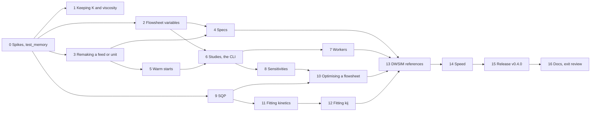

# M8 plan — specifications, sensitivity studies and optimisation

M8 makes a flowsheet answer questions, not just solve once.
- "Vary the cooler's duty until the drum's vapour is 5% methane."
- "Sweep the feed from 700 to 1000 °C and report the methane conversion."
- "Find the feed temperature and steam ratio that maximise hydrogen, with the
  outlet below 1100 K."
- "Fit these LHHW constants to my rate data, with their confidence
  intervals."

Its benchmark is the owner's. DWSIM 9 took 30 minutes in the app for a
50-point study of the reforming PFR (M9's Tutorial 1). M9 solved that study as
50 cold solves in 2.1 s. M8 adds warm starts, parallel cases, design
specifications, optimisation and fitting, and the speed the owner's other
models need, the published reforming model's K(T) above all. It's planned like
M1 to M4, M9 and M10a: research first, then exit criteria, decisions and steps.
The roadmap entry is in [roadmap.md](roadmap.md).

Status: **approved** on 2026-11-16, after a draft that split M8 in two: it's
one milestone, as the owner decided, with its optimiser written in V (D1,
D12). Step 0 is next.

## Goal

- **Design specifications** (F4): "vary X until Y = target", with X any number
  the file gives and Y an expression over the flowsheet's streams and units.
  Each spec is converged with its block's tears, not in a loop around the
  whole solve, and the answer is checked against the target like every
  balance.
- **Flowsheet variables in expressions:** a stream's T, P, flows and
  composition, and a unit's duty or work, by name, units checked. Specs, study
  outputs, objectives and constraints are expressions, as M9 promised (A9).
- **Sensitivity studies** (H1, H2): one or two inputs over a range, any
  expressions reported at each point.
  - Each point has its own status. A point that fails says why, and the rest
    stand.
  - A quantity with no value at a point, such as a product's conversion
    when the feed has none of it, is refused with its reason, never plotted
    as −∞ (Tutorial 2's lesson).
- **Warm starts** (F5): each point starts from its neighbour's answer, its
  tears and its units' own solvers alike, and is checked as a cold one is.
- **Parallel cases** with `spawn`. A study's answers don't depend on how many
  workers ran it.
- **Local sensitivities:** the derivative of each output with respect to each
  input at a point, with its error estimated.
- **Optimisation** (H3): an objective, minimised or maximised over chosen
  inputs within bounds, subject to constraints. The answer is returned only
  once it's shown to be an optimum, by its first-order conditions checked
  from scratch.
- **Fitting constants to data** (H4):
  - LHHW and power-law constants to rate data, on M9's kinetics with exact
    derivatives;
  - kᵢⱼ to VLE data.

  Each fit comes with its confidence intervals and its parameters'
  correlations.
- **What reactors recompute though their T hasn't moved** (M9 step 11): each
  reaction's K(T), 93% of the published reforming model's solve, and each
  compound's viscosity.
- **Against DWSIM 9:**
  - the owner's study against its sensitivity analysis;
  - a spec against its Adjust;
  - an optimisation against its optimiser;
  - a kᵢⱼ fit against its regression;

  every difference explained.

## What the research found

**What M8 builds on:**
- **`flowsheet.solve`** converges each block's tears by direct substitution,
  Wegstein or Broyden on x = (n₁ … n_c, P, h) (M4's D6, D7). Tears take first
  values from `SolveParams.estimates`. Nothing is returned unless every
  balance closes (D8).
- **A `Unit` holds nothing about a solve,** so calculating it twice gives the
  same answer. Units are therefore safe to share between threads. But a unit
  can't remember its last answer, which a warm start needs: that has to be
  passed in.
- **`Loaded.root` keeps the file's TOML tree,** so a study can replace one
  value and remake that feed or unit through its own maker. Every unit,
  including later ones, would then be variable without each writing setters.
- **`expr`'s names** are a context's variables (`T`, `P`) and family members
  (`p[CH4]`). Nothing names a stream's or a unit's variable yet. The tape
  differentiates with respect to its inputs, and a rate's constants are
  folded into it, so a fit must make them inputs.
- **`numeric.minimize`** is Newton with a Levenberg–Marquardt shift, for an
  unconstrained objective with its Hessian. `numeric` has no least squares
  and no constrained optimiser.

**Where a reactor's time goes** (M9 step 11, and checked for this plan):
- On the published model, 93% of a solve is `Kinetics.fill`. It calls
  `Reaction.standard`, which integrates each species' ideal-gas Cp from
  298.15 K at every evaluation of the rates.
- **Four of the reforming case's five species give Cp as ChemSep's eq. 16,**
  Y = A + exp(B/T + C + D·T + E·T²), which has no closed-form integral. So
  each integral is a Gauss–Kronrod quadrature at 1e-13 (`tdep`). Only water's
  eq. 107 integrates in closed form.
- **Across the database,** 521 of 640 compounds' ideal-gas Cp are eq. 16,
  116 eq. 107, 2 eq. 100 and 1 eq. 1.
- **So keeping K at the last T** fixes an isothermal reactor, whose T never
  moves. An adiabatic one moves T every step, and would need eq. 16
  integrated faster. Every PH flash integrates the same Cp, but M3 measured
  that at 0.6% of a flash.
- On DWSIM's typed rates, Wilke's viscosity is about a quarter of a solve.
  Each compound's correlation is evaluated again at every step, though T
  doesn't move.

**How DWSIM does it** (its source on GitHub, `DWSIM.FlowsheetSolver` and
`Adjust.vb`; its API reference and help):
- **An Adjust** varies one variable until another equals a target, by
  bisection or secant. Its defaults are a tolerance of 1e-4 and at most 10
  iterations.
- **Simultaneous adjusts** run Newton on every Adjust marked for it:
  - the Jacobian by central differences of ±1% of each variable;
  - each evaluation a whole flowsheet solve, so 2n + 1 solves an iteration;
  - at most 25 iterations, each adjust's own tolerance.

  Either way a spec is a loop around the flowsheet, not converged with its
  recycles.
- **Its sensitivity analysis** varies up to two variables, each over equally
  spaced points, and records dependent variables or expressions. Each point
  recalculates the flowsheet from the state the last left. That's a warm
  start of a sort, but an unchecked one: a point's answer depends on the
  order of the points.
- **Its optimiser:**
  - its methods are Brent, L-BFGS, truncated Newton, Nelder–Mead (each with
    a bounded form) and IPOPT;
  - the objective is a flowsheet variable or an expression;
  - its help describes bounds on the varied inputs and no other
    constraints;
  - it stops when the objective's change falls below its tolerance, so its
    answer isn't checked to be an optimum.
- **Its parallel mode:** the solver documents a "background parallel"
  mode. In the code read here, its parallel queue (`Parallel.ForEach`) is
  never reached, and every mode takes the serial path. Step 0 checks that in
  DWSIM 9.0.5 itself.
- **Its −∞:** the owner's Tutorial 2 swept a product's conversion,
  (in − out)/in with nothing in. DWSIM plotted −∞ at every point, with no
  message (M9 step 10).
- **Its regression:** a study's results can go to a data-regression plugin.
  Step 0 finds out whether that fits kᵢⱼ headless.

**Threads or processes,** measured for this plan:
- **The setup:** the owner's case (`reformer_dwsim.toml`), 48 feed
  temperatures, reflux built with gcc `-prod`, on the owner's laptop (Ryzen 5
  PRO 3500U, 4 cores).
- **One thread:** 1.67 to 1.78 s.
- **Threads with `spawn`,** sharing one `Loaded`: 1.11 s with 2 (1.5×) and
  0.81 s with 4 (2.1×).
- **Four processes** of 12 points each: 0.48 to 0.64 s of solving each
  (2.6×), and 1.09 s from start to finish, each process reading the file and
  the data.
- **What limits threads:** the collector's lock, which every allocation
  takes (M10a measured 1.3 to 2.3× with 8 threads), and the cores
  themselves.
- **What it suggests:** threads are worth having, and an allocation less per
  step would raise their ceiling. Processes gain a little more, at the cost
  of reading everything once each and merging reports.

**The methods** (independent of reflux):
- **Specs and tears.** In sequential-modular simulation a spec is converged
  either nested, by a 1-D method around the recycle loops, or together with
  the tears by a quasi-Newton method (Westerberg, Hutchison, Motard and
  Winter, *Process Flowsheeting*, 1979; Biegler, Grossmann and Westerberg,
  *Systematic Methods of Chemical Process Design*, 1997, ch. 4).
  - Together needs far fewer passes, since each Broyden evaluation is one
    pass, not a converged solve.
  - Nested is sturdier far from the answer. Aspen Plus offers both.
- **Warm starts along a sweep** are natural-parameter continuation. A secant
  predictor through the last two answers usually halves the corrector's
  work (Allgower and Georg, *Numerical Continuation Methods*, 1990).
- **A derivative by differences** has an error that two steps estimate:
  Richardson's extrapolation. A derivative of a solve can't be closer than
  the solve's tolerance over the step allows, so its tolerance must tighten.
- **Optimising a flowsheet:**
  - A flowsheet optimisation has few inputs, a handful to a few dozen, and
    each evaluation is a converged solve.
  - For problems of that size, sequential quadratic programming (SQP) is
    the standard: a quadratic model from a BFGS update, kept positive
    definite by Powell's damping, a QP subproblem on the linearised
    constraints, and a merit function to accept steps (Nocedal and Wright,
    *Numerical Optimization*, 2006, ch. 18).
  - Converging each evaluation fully is the "feasible path". Making the
    tears optimisation variables too, the "infeasible path", takes far fewer
    passes (Biegler and Hughes, AIChE J. 28, 1982), at the cost of the
    optimiser seeing every tear.
  - IPOPT is built for thousands of variables with sparse Jacobians: an
    equation-oriented flowsheet's (M13), not this one's.
  - Hock and Schittkowski's collection (*Test Examples for Nonlinear
    Programming Codes*, 1981) gives small constrained problems with their
    published optima.
- **Fitting:**
  - Nonlinear least squares by Gauss–Newton with a Levenberg–Marquardt
    shift.
  - Confidence intervals by linearising at the optimum, s²(JᵀJ)⁻¹, whose
    coverage is approximate for a nonlinear model (Bates and Watts,
    *Nonlinear Regression Analysis and Its Applications*, 1988).
  - Arrhenius constants centred on a reference T in the data's range, which
    removes most of A's and Eₐ's correlation ([kinetics.md](kinetics.md)).

**References for the tests:**
- **Closed forms:**
  - an isothermal first-order PFR, X = 1 − exp(−kPV/F): its volume for a
    target conversion, and dX/dT;
  - a heater's duty for an outlet T, against a PH flash;
  - series reactions A → B → C in a PFR, whose B peaks at a space time of
    ln(k₂/k₁)/(k₂ − k₁) (Levenspiel), for the optimiser.
- **mpmath,** for those derivatives and optima at high precision.
- **Hock and Schittkowski's problems,** for the SQP.
- **SciPy** (`least_squares`, with `thermo`'s PR for kᵢⱼ), fitting the same
  data in a uv script, and seeded synthetic data from known constants.
- **reflux's own cold solves,** for every warm one.
- **DWSIM 9:** its Adjust, its optimiser, its sensitivity analysis and its
  regression, as far as its API allows them headless (step 0).

## Exit criteria

All checked by tests in CI, as before.

1. **Specs are met.** A spec converges with its block's tears, and the
   solution meets its target to the solver's tolerance, checked from the
   solution itself. It holds on a block with a recycle and on one without:
   - an isothermal PFR's volume for a conversion matches its closed form;
   - a heater's duty for an outlet T matches the PH flash.

   A target outside what the varied value's bounds can reach is refused,
   with the range they reach. Every balance is still checked (M4's D8).
2. **Flowsheet variables bind.** Every name in a spec, an output, an
   objective or a constraint binds to a stream's or a unit's variable, with
   its dimension, or is refused with its line, its column and a suggestion.
   Each renders back.
3. **Studies report.** One or two inputs over values with units, and every
   output at every point, each point with its status.
   - A failed point gives its reason, and every other point stands.
   - An output with no value at a point is NaN with its reason, and
     Tutorial 2's methanol conversion is one.
4. **Warm starts are checked.** Every warm-started point agrees with its cold
   solve within the solver's tolerance, point by point. The passes and
   integrator steps each takes are recorded, and can't grow.
5. **Workers don't change answers.** A study run by 1, 2, 4 or 8 workers gives
   the same bits. The throughput is recorded, with no target.
6. **Sensitivities are honest.** Each derivative matches its closed form
   within its own error estimate. Each estimate's ratio to the true error is
   recorded, so that a loose estimate shows.
7. **The optimiser is right.** Hock and Schittkowski's problems reach their
   published optima within tolerance, from their published starts. Each
   answer's first-order conditions are checked from scratch: feasibility,
   the Lagrangian's gradient, the multipliers' signs and complementarity. A
   problem with no feasible point, or one that doesn't converge, is refused
   with its reason. Iterations are recorded, and can't grow.
8. **Flowsheet optimisation is right.** The series reactions' PFR reaches
   its closed-form optimum. One optimum sits on a bound and one on a
   constraint, and each is verified as in criterion 7. The same problem in
   DWSIM's optimiser is compared, and the difference explained.
9. **Fits are right.**
   - Rate data and VLE data fitted by reflux match SciPy's fits of the same
     data, parameters and intervals, to the optimum's tolerance.
   - Over many seeded synthetic data sets from known constants, the 95%
     intervals cover the true values about as often as they claim, within
     binomial bounds.
   - A kᵢⱼ fit is compared with DWSIM's regression, if step 0 can drive it.
10. **Nothing a reactor keeps changes an answer.** K(T) and the viscosity
    kept at the last T leave every golden report exactly as it was. The
    published model's solve is recorded before and after.
11. **The owner's study against DWSIM 9.**
    - The 50-point study is timed with gcc `-prod`, warm, cold and on
      workers, against DWSIM's own sensitivity analysis. If step 0 finds that
      can't be driven, it's timed against M9's loop of solves instead.
    - As the roadmap's exit asks, it must be faster, which M9 already shows,
      and the ratio is recorded.
    - A spec is compared with DWSIM's Adjust at a tight tolerance, every
      difference explained.
12. **Files and the CLI.**
    - `[spec.NAME]`, `[study.NAME]`, `[optimize.NAME]` and `[fit.NAME]` in
      the file, every key checked, every refusal at its line.
    - `reflux solve` converges specs. `reflux study`, `reflux optimize` and
      `reflux fit` each print a table and write JSON and CSV.
13. CI is green, and the docs are updated: README, roadmap, design notes,
    kinetics.md, the file and report formats, and the V notes. v0.4.0 is
    released.

## Decisions

| # | Decision | Choice | Why |
|---|---|---|---|
| D1 | Scope | One milestone, the roadmap's M8 (discussed on 2026-11-16): specs, warm starts, studies, workers, sensitivities, optimisation and fitting. The roadmap is amended in three places: - B6: no C optimiser in M8, its own SQP (D12) instead, with IPOPT moving to M13; - H1: exact sensitivities move to M13 (D10); - H4: data reconciliation moves to M13. | The optimiser in V removes the C dependencies, NLopt and IPOPT, which were the case for splitting M8. A flowsheet optimisation is small and dense. Reconciliation needs measured data against the whole flowsheet's equations, M13's. |
| D2 | Where it lives |  - **`flowsheet`:** specs, since they change how a block converges. - **A new module, `study`:** studies, workers, sensitivities and flowsheet optimisation, over `flowsheet`. - **`numeric`:** the SQP and least squares, each over an interface. - **A new module, `fit`:** fitting, over `kinetics`, `flash`, `thermo` and `numeric`. - **`main`:** `reflux study`, `optimize` and `fit`. - **`kinetics` and `reactors`:** caching K and the viscosity.  vlib has no module named `study` or `fit`. | A study and an optimisation are many solves; the solve itself stays one. Fitting is many evaluations of a model, not of a flowsheet. |
| D3 | Naming flowsheet variables | A name with one dot: - for a stream, `product.T`, `product.P`, `product.F` (total molar flow), `product.n[CH4]` (a component's flow), `product.y[CH4]`, `product.h` and `product.vf` (vapour fraction); - for a unit, its energy streams by their names, `reactor.duty` and `pump.work`.  The grammar's atom gains `name "." name`. A stream or unit that isn't there, or a variable it lacks, is refused with the closest names. Each variable has its dimension, so `product.T - 300` is refused as M9's sums are. | It reads like the file, where a stream is `[feed.syngas]` and a unit `[unit.reactor]`, and keeps M9's members for components. Families keyed by stream, `T[product]`, would need two keys for a composition, `y[product, CH4]`. |
| D4 | What can be varied | Any number the file gives a feed or a unit, by its key: `"feed.syngas.T"`, `"unit.cooler.duty"`, `"unit.reactor.volume"`. Each point replaces that value in the file's tree, with its unit, and remakes the feed or unit through its maker, which checks it as it checks the file. The value's dimension must be the key's. | Every unit, today's and later ones, is variable at once, with its own checks, and no unit writes setters. Remaking a unit costs microseconds against a solve's milliseconds; step 3 measures it. |
| D5 | Specs | `[spec.NAME]` has three keys: - `vary`, a key, as D4; - `between`, its bounds; - `until`, an equation of two expressions whose sides share a dimension, `"drum_vapour.y[CH4] = 5 %"`.  In planning, a spec is an edge from the unit that makes what it measures back to what it varies (a unit, or the units its feed enters), so they land in one block. That block's unknowns are its tears and its specs' values, and Broyden converges them together (F4). The residuals are the tears' changes and each spec's two sides' difference, scaled.  A block with one spec and no tears is solved by Brent within the bounds instead. A spec that fails in a block with tears is tried once more nested, Brent around the block's tears, before it's refused.  The answer must meet each target to the solver's tolerance and stay within its bounds. A unit's value set equal to an expression of others, DWSIM's Spec block, is a spec that varies that value until it equals the expression. | Together is a pass an evaluation, where DWSIM's simultaneous adjusts take a whole solve. Brent can't fail inside a bracket, and a single spec is the common case. Bounds let a target out of reach be refused with what the bounds reach, rather than wandering. |
| D6 | Warm starts | A study's or an optimiser's point starts its tears from the last point's, with a secant predictor through the last two where both exist.  A unit that can use its last answer says so with an optional interface, `Warm`, whose `calculate_from(fl, inlets, last Outcome)` takes it. `Unit` is unchanged, and a unit without it starts cold: - the CSTR starts Newton from its last outlet, skipping continuation; - a reactor at a duty or adiabatic brackets its T around the last; - a PFR starts from its last first step.  A warm answer is checked exactly as a cold one is. | `Unit`'s promise, nothing about a solve, keeps units shareable between threads, so the last answer comes in from outside. A predictor is cheap and halves the work along a smooth sweep. |
| D7 | Determinism | A study's points go in chunks of a fixed size, 8 unless the file says otherwise. Each chunk starts cold at its first point and warm-starts the rest in order. Workers take whole chunks. A grid of two inputs runs along its rows, alternating direction, so each point's neighbour is the last one solved. | The same chunks give the same bits whatever the number of workers (criterion 5). DWSIM's answers depend on the order of its points. |
| D8 | Workers | Threads, with `spawn`, sharing one loaded file. The number is the CPU count unless `--workers` says otherwise. Step 7 profiles a solve's allocations and removes those in the hot path that it can. | Measured: 2.1× with 4 threads against 2.6× with 4 processes, which would each read the file and the data and need their reports merged. One process keeps one report. |
| D9 | A point's outcome | Each point has a status (solved, failed, or solved with an output that has no value) and reasons in words, as M10a's points have. An expression that divides by zero, or takes the log of zero, at a point is NaN with its reason ("methanol's conversion: the feed has no methanol"), never ±∞. A failed point doesn't stop the study, and the next point starts cold. | Tutorial 2's −∞ is what a sweep must never do. M10a's C API already works this way, so M10b can hand it to Python unchanged. |
| D10 | Sensitivities | The derivative of each output with respect to each input, at any point, by central differences of warm-started solves. - The solve's tolerance is tightened to 1e-12 for them. - Each step is chosen from the input's scale. - The error is estimated from steps h and h/2 by Richardson's extrapolation, and reported beside the derivative.  The same derivatives are the optimiser's gradients. Exact sensitivities, by the implicit function theorem on the converged Jacobian (H1), need each unit's Jacobian, which comes with M13's residuals (J1). | Differences work for every unit, and give an error estimate that a user can judge. An optimiser needs gradients good to about 1e-6, which a solve at 1e-12 gives. The PFR's rows in T and P are themselves differences (M9 step 9), so an exact path would be partial today. |
| D11 | Keeping K(T) and the viscosity | A reactor's rates keep each reaction's K, and each compound's viscosity, at the T they were last computed at. A new T computes them as now, so every answer keeps its bits. Whether eq. 16's Cp should integrate faster, for reactors whose T moves, is measured in step 1 and decided there. | Exact by construction. An isothermal reactor, the owner's case, never moves T. |
| D12 | The optimiser | `numeric.sqp`, written in V, for small dense problems: minimise f(x) subject to bounds, equalities c(x) = 0 and inequalities c(x) ≥ 0. - **The method:** Han and Powell's SQP. The Hessian of the Lagrangian comes from a BFGS update with Powell's damping, and each step's QP is solved by an active-set method on the bounds and the linearised constraints. Steps are accepted by an ℓ1 merit function with a backtracking line search (Nocedal and Wright, ch. 18). - **What it takes:** the problem as an interface, with gradients, exact where the caller has them and D10's differences for a flowsheet. - **What it returns:** an answer only once the first-order conditions hold to their tolerances, each multiplier with it. A QP with no feasible point, a line search that can't descend, or the iteration budget spent is a typed `OptimizeError` with its reason. | Every flowsheet optimisation M8 meets has a handful of inputs. SQP converges superlinearly there, takes constraints directly, and needs no dependency. Checking the conditions is how the optimiser shows its answer, as every other solver here does. DWSIM's stops when its objective stops changing. |
| D13 | Optimising a flowsheet | `[optimize.NAME]` has four keys: - `vary`, keys with bounds, as D4; - `minimize` or `maximize`, an expression; - `subject_to`, equations and inequalities over flowsheet variables, `"product.T <= 1100 K"`; - `start`, optionally.  The path is feasible: each evaluation is a converged solve, specs included, warm-started from the last (D6), and the constraints are the SQP's. The equation reader of D5 takes `<=` and `>=` too. The report gives the optimum, the multipliers, which bounds and constraints are active, and each evaluation. | The feasible path keeps every evaluation a checked solve. The infeasible path's fewer passes come from giving the optimiser the tears, which M13's equation-oriented solve does anyway. |
| D14 | Fitting kinetics | `[fit.NAME]` in a reactions file has four keys: - `data`, a CSV whose header gives each column with its unit (`T [K]`, `P [bar]`, `y[CH4]`, `r[reforming] [mol/(kg*s)]`); - `parameters`, by name: constants and definitions such as `k1.A`, `k1.Ea` or `K_CO.dH`; - `start`, if not the file's values; - `weights`, each rate's absolute or relative error.  The residuals are the measured rates less the model's. The fit is least squares by Gauss–Newton with a Levenberg–Marquardt shift (`numeric.least_squares`), on ∂r/∂θ from the tape, exactly: the fitted constants become the tape's inputs. An Arrhenius or van 't Hoff constant is fitted centred on the data's mean T, and reported in the file's own form.  The report gives each value, its standard error and 95% interval by linearisation, the correlation matrix, the residuals, and the fitted section as file text. Rate data only, as from a differential reactor; outlet data from an integral reactor, a PFR solved per evaluation, comes later. | M9's exact derivatives make the fit exact to rounding in its Jacobian. Centring removes most of A's and Eₐ's correlation (kinetics.md), and the correlation matrix shows what's left. Rate data is how kinetics is measured for fitting, and needs no reactor model. |
| D15 | Fitting kᵢⱼ | `[fit.NAME]` with VLE data (T, P, x, y), the kᵢⱼ of named pairs as parameters, and residuals in bubble pressure and vapour composition, each weighted. The derivatives are by differences, and the solver and report are D14's. | The data DWSIM's regression and thermo's users fit. kᵢⱼ is one number a pair, so differences are cheap and enough. |
| D16 | The file | Format 3 adds `[spec.NAME]`, `[study.NAME]`, `[optimize.NAME]` and `[fit.NAME]`.  A study has: - `vary`, one or two, each a key with `from`, `to` and `points`, or `values`; - `report`, named expressions; - optionally `chunk` and `sensitivities` (which outputs, with respect to which inputs).  Formats 1 and 2 read as before. | A new section is a new format, by the CHANGELOG's rules. |
| D17 | The CLI and reports | `reflux solve FILE` converges the file's specs, and its report gains each spec's value and residual.  `reflux study FILE [NAME]`, `reflux optimize FILE [NAME]` and `reflux fit FILE [NAME]` each print a table, with `--json OUT` and `--csv OUT`, and the first two `--workers N`. The JSON gives every point or iteration, with its passes and reasons, and the CSV one row a point, NaN where an output has no value.  The exit status: - 0 when the command ran, even with failed points, which the table says; - 1 when it couldn't run, or found no optimum or fit; - 2 for a wrong command.  Each report is a format of its own, documented beside the solve's. | A study that ran with some failed points is still a result. Each point's reason is in the report. |
| D18 | Comparing with DWSIM |  - The owner's 50-point study against DWSIM 9's own sensitivity analysis, if step 0 can drive it headless, else against M9 step 11's loop of solves. - A spec on the reference flowsheet (M4) against its Adjust, its tolerance set to 1e-10. - An optimisation within bounds against its optimiser. - A kᵢⱼ fit against its regression, if step 0 can drive it.  Each is compared by state, as M4 compared. | The comparison is of the same question asked of both, and its differences are each explained. |
| D19 | Versions | M8 ends with v0.4.0: format 3 and the new reports are additions, a minor release. | The CHANGELOG's rules. |
| D20 | Who writes what | As before, I write it all unless you claim a step. | |

## Steps

Steps 1 to 8 meet the roadmap's exit, the study faster than DWSIM's, before
the optimiser begins.

### 0. Spikes, and `test_memory.py`
- **DWSIM:**
  - can its sensitivity analysis be built and run headless, and how long
    does the owner's study take in it;
  - its Adjust and simultaneous adjusts on a spec of the reference
    flowsheet: their iterations, their whole-flowsheet solves, and their
    answers at their default and tight tolerances;
  - its optimiser on a bounded problem: which methods run headless, and
    what they stop at;
  - its regression plugin: whether it fits kᵢⱼ headless;
  - what its study does with a failed point.

  Written up as `docs/spike-dwsim-study.md`.
- **Warm starts by hand:** the reference flowsheet's recycle swept by its
  estimates, to measure the passes a warm start saves, with and without a
  predictor. This sets criterion 4's expectations.
- **Workers:** each thread's answers against one thread's, bit for bit, on
  the owner's case, to show that sharing a `Loaded` is safe. Then a profile
  of a solve's allocations.
- **`test_memory.py`,** flaky on Ubuntu since M10a: compare the bytes live
  after a full collection, not the collector's heap size. `reflux_collect`
  reports what it measures, so the header, `docs/python.md` and the next
  CHANGELOG entry say so.

### 1. Keeping K(T) and the viscosity
- D11, in `kinetics` and `reactors`. The golden reports are unchanged to the
  bit.
- The published model timed before and after.
- Eq. 16's integral measured: whether a faster form holds tdep's 1e-13 and
  pays for an adiabatic reactor. Decided here, with the owner.

### 2. Flowsheet variables in expressions
- D3: the grammar's dotted names, a context over a solution's streams and
  units, dimensions, refusals and renderings.
- Evaluating an output at a solution, with D9's NaN and reason.

### 3. Remaking a feed or unit with a value replaced
- D4: a key into the file's tree, a value with its unit put in its place,
  and the feed or unit remade by its maker, its checks included.
- What remaking costs, measured on every unit type.

### 4. Specs
- D5: `[spec.NAME]` read and checked; the planning edge; Broyden over tears
  and spec values; Brent for one spec alone; the nested retry; bounds and the
  reachable range.
- Closed forms (criterion 1) and the reference flowsheet with a spec.

### 5. Warm starts
- D6: the tears' predictor, `Warm`, and the CSTR, the reactors with an
  energy balance, and the PFR using it.
- Every warm point against its cold solve.

### 6. Studies and the CLI
- D7, D9, D16 and D17: `[study.NAME]`, chunks, each point's outcome, the
  table, JSON and CSV, and `reflux study`.
- Tutorial 2's methanol conversion as a study output: NaN, with its reason.

### 7. Workers
- D8: chunks on threads, bit for bit for any number of workers, and the
  throughput recorded. Allocations in the hot path removed where step 0's
  profile finds them.

### 8. Sensitivities
- D10: central differences at a tight tolerance, Richardson's error
  estimate, and closed forms against mpmath.

### 9. The SQP
- D12: `numeric.sqp`, the damped BFGS update, the active-set QP, the merit
  function, and the first-order conditions checked at the answer.
- Hock and Schittkowski's problems from a uv script that writes their
  published optima and starts, with each problem written again in the test.

### 10. Optimising a flowsheet
- D13: `[optimize.NAME]`, inequalities in the equation reader, the feasible
  path with warm starts, and `reflux optimize`.
- The series reactions' closed-form optimum against mpmath, an optimum on a
  bound and one on a constraint.

### 11. Fitting kinetics
- D14: `numeric.least_squares`, fitted constants as the tape's inputs, the
  centring, the data's CSV with units, `[fit.NAME]` and `reflux fit`.
- Against SciPy's fits of the same data, and the intervals' coverage over
  seeded synthetic data.

### 12. Fitting kᵢⱼ
- D15: VLE data, bubble points as residuals, and the same report.
- Against SciPy with `thermo`'s PR on the same data.

### 13. DWSIM references
- D18: the study, the spec, the optimisation and, if it runs, the kᵢⱼ fit
  against DWSIM 9, every difference explained.

### 14. Speed
- The owner's study warm, cold and on workers; the published model with K
  kept; an optimisation's solves; against DWSIM, in `docs/benchmarks.md`.

### 15. Release v0.4.0
- The CHANGELOG entry, the versions, and the release gate, as for v0.3.0.

### 16. Docs and exit review
- README, roadmap (D1's amendments of B6, H1 and H4), design notes,
  kinetics.md's fitting, the file and report formats, the V notes, and a
  criterion-by-criterion review.

## Risks

| Risk | Effect | Fallback |
|---|---|---|
| A unit hides state that threads would share | wrong answers in parallel, or a crash | step 0 checks each thread's bits against one thread's on the owner's case; `Unit`'s contract already forbids it, and every unit type is checked in step 7 |
| The collector's lock caps threads near 2× | parallel studies little faster | fewer allocations in the hot path (step 7); processes, which step 0 measured at 2.6×, if threads stay far behind |
| A warm start lands on another steady state (an adiabatic CSTR has up to three) | a smooth-looking sweep with a jump in it, or the wrong branch | every chunk starts cold, so a jump shows at a chunk's edge; a point whose warm and cold answers disagree beyond tolerance is reported, not hidden |
| Broyden over tears and specs fails far from the answer | a spec that DWSIM's nested loop would meet | D5's nested retry: Brent around the block's tears, within the bounds |
| Gradients by differences are too rough for the SQP near an optimum | slow or stalled convergence | D10's tight solves give about 1e-6; the first-order conditions are checked to what the gradients allow, and a stall is reported with how far it got |
| An SQP written from scratch has bugs a library wouldn't | a wrong optimum | Hock and Schittkowski's problems, the conditions checked at every answer, and planted mistakes, as every solver here has had |
| A fit's parameters are too correlated to estimate | huge intervals, or no convergence | centred Arrhenius forms; the correlation matrix and each interval reported, so the user sees it; a singular JᵀJ refused with the parameters it can't separate |
| DWSIM's sensitivity analysis, optimiser or regression can't be driven headless | no like-for-like comparison | M9 step 11's loop of solves for the study; for the rest, the comparison is recorded as not possible, with why |

## Not in M8

- Exact sensitivities by the implicit function theorem, and the infeasible
  path: with M13's residuals (D10, D13).
- IPOPT, for large sparse problems, and data reconciliation: M13 (D1).
- Fitting to an integral reactor's outlets: later, on M8's optimiser and a
  PFR per evaluation (D14).
- Monte Carlo uncertainty propagation (H5): after M8.
- Studies, optimisation and fits from Python: M10b, over D9's per-point
  outcomes.
- Faster PH for 10 components, `flash.uv` on cold liquids, and V's code
  running slower inside the library: still carried, not M8's.
