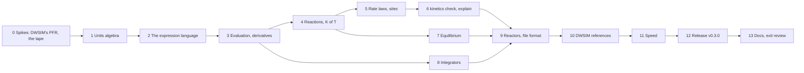

# M9 plan — equations, kinetics and reactors

M9 gives reflux reactions: rate laws, chemical equilibrium and the reactors
that use them. It's also where reflux stops taking equations as text. A
process simulator asks for an equation in many places: a rate law, an
equilibrium constant, an adsorption term, a pressure drop, and later a design
specification or an objective. DWSIM takes each as a string it evaluates, and
checks none of them. reflux parses every one into a structure it understands,
binds its names to the model, checks its units, renders it back, and
differentiates it exactly. Kinetics is the first user, and the owner's own
case, a methane steam reforming PFR that took DWSIM 30 minutes for 50 points,
is the benchmark. It's planned like M1 to M4 and M10a: research first, then
exit criteria, decisions and steps. The roadmap entry is in
[roadmap.md](roadmap.md), and the kinetics design in [kinetics.md](kinetics.md).

Status: **approved** on 2026-11-08, after a revision from discussing it:
equations users type themselves, with named definitions; built-in
constants; reaction types as properties, with restricted equilibrium; and
stoichiometry checked by counting elements. Step 0 is next.

## Goal

- **Equations as data, everywhere** (a new track item, A9, which takes in
  L7): a small expression language, parsed and never evaluated as text.
  - Every name in an expression is bound to something the model has: a
    species' partial pressure, fugacity or concentration, T, P, a stream's
    or a unit's variable. A name that isn't there is refused, with a
    suggestion.
  - Every expression has a dimension, checked when it loads, so bar against
    Pa, or a rate per catalyst mass against one per volume, is an error with
    its reason, not a wrong answer.
  - Every expression renders back as a formula (Unicode, and LaTeX for
    notebooks), so it can be held against the paper.
  - Every expression has exact derivatives, for the stiff integrator now and
    for equation-oriented solving later (M13).
  - A user's own equation is as welcome as a built-in form, with species by
    name, numbers with units, and pieces named once and reused.
  - Physical constants are built in at the SI's exact values: `R`, not a
    typed 8.314 that might be 8.341.
  - M9 uses it for rate laws, rate constants, equilibrium constants,
    adsorption terms and pressure drop. M8's design specifications,
    sensitivity outputs and objectives will use the same, and so will
    anything later that needs an equation.
- **Kinetics,** as [kinetics.md](kinetics.md) designs it (track L): catalyst
  sites whose adsorption terms every reaction on them shares; LHHW, power-law
  and Eley–Rideal rates, and free-form expressions with the same checks;
  reversibility from the Gibbs energies of formation; and `reflux kinetics
  check` and `explain`.
- **Chemical equilibrium,** by Gibbs minimisation over every species (E6), and
  over chosen reactions for restricted equilibrium: for the equilibrium
  reactors, and for checking that every reversible rate vanishes at
  equilibrium.
- **Stoichiometry checked by counting elements,** not by molar mass as DWSIM
  does: an unbalanced equation is refused with its imbalance, and balanced
  coefficients suggested.
- **An ODE integrator** (B5): a stiff one, using the exact Jacobians, and an
  explicit one for what isn't stiff.
- **Reactors** (G3): conversion, equilibrium (over reactions, or Gibbs), CSTR,
  and PFR or packed bed, isothermal or adiabatic, with Ergun's pressure drop.
- **The owner's case against DWSIM 9:** the methane steam reforming PFR, the
  same answers on DWSIM's own setup, every difference explained, and timed.

## What the research found

**What DWSIM made the owner type.** The owner's coursework case (`Tutorial 1
v2.dwxmz`, read but not copied into the repository) is methane steam
reforming over Xu and Froment's kinetics:

- **Three reactions:** steam reforming, CH₄ + H₂O ⇌ 3H₂ + CO; the water–gas
  shift, CO + H₂O ⇌ H₂ + CO₂; and the overall CH₄ + 2H₂O ⇌ 4H₂ + CO₂, as
  "heterogeneous catalytic" on partial pressures in atm, with rates in
  kmol/(kg·h).
- **Each rate is two text boxes,** a numerator and a denominator, such as
  `4.22E+15*exp(-240100/8.314/T)/P1^2.5*(R1*R2-P1^3*P2/(exp(30.42-27106/T)))`.
  Species are `R1`, `R2`, `P1` and `P2`: the reaction's reactants and
  products by their place in its equation, and the gas constant is typed as
  8.314 in every exponent. Nothing checks units, element balance, or that the
  expression is the paper's.
- **What a typed constant costs:** 8.314 is 5.6e-5 short of R, which moves a
  rate with E/RT ≈ 29 (240.1 kJ/mol at 1000 K) by −0.16%. A transposed 8.341
  moves it by +9.6%.
- **The balance check is by mass:** the overall reaction's `StoichBalance` is
  2e-5, molar masses summed, which can't tell rounding from a wrong formula.
- **The denominators differ, and they shouldn't.** In Xu and Froment all three
  reactions share one adsorption term, 1 + K_CO·p_CO + K_H₂·p_H₂ +
  K_CH₄·p_CH₄ + K_H₂O·p_H₂O/p_H₂, squared. The case's steam-reforming
  denominator has all of it. The overall reaction's lacks the CO term, and
  the shift's lacks the CH₄ term, because a DWSIM expression can only name a
  reaction's own species. That's [kinetics.md](kinetics.md)'s point, that
  the adsorption term belongs to the site, found in the owner's own file.
- **The equilibrium constants** are typed in too, exp(30.42 − 27106/T) and the
  like, though the reaction says its K comes from Gibbs energies.
- **The reactor:** an isothermal PFR, 1 m long and 1 m³, in sections of
  dV = 0.05. Catalyst loading 0.386 kg/m³, void fraction 0.4, particles of
  2 mm, and Ergun's pressure drop (4.9 kPa). The feed is 10 kmol/h each of
  CH₄ and H₂O and 0.1 kmol/h of H₂, at 1000 K and 1 atm, on Peng–Robinson.
- **The study:** the feed's T from 700 to 1000 °C in 50 points, and the
  methane conversion: 98.66% at 1000 °C. One solve takes 14.6 to 18.5 s
  headless, and the study about 30 minutes in the app (measured on
  2026-11-02).

**Where else DWSIM takes an equation as text.** The same file's reactions
have fields for a forward and a reverse rate-constant expression and an
equilibrium-constant expression, beside the rate's numerator and
denominator. DWSIM's sensitivity analysis and optimiser take expressions over
flowsheet variables, its specification block a target expression, and its
spreadsheet and script units formulas and code. Each is a string, read when
it runs.

**How DWSIM's PFR integrates.** Its API documents an ODE function giving dN/dV
for each compound, integrated section by section with a choice of an
"Oslo/RK" solver or Euler, and catalyst loading in kg per m³ of reactor
([Reactor_PFR](https://dwsim.org/api_help/html/T_DWSIM_UnitOperations_Reactors_Reactor_PFR.htm)).
How accurate that is at dV = 0.05, and exactly how the loading and void
fraction enter, is for step 0 to measure, as M3's and M4's spikes did.

**What reflux has to build on:**
- `quantity` (M4) reads numbers in a fixed set of named dimensions. It has no
  dimension algebra: nothing multiplies kmol/(kg·h) by kg/m³, or checks that
  a term is dimensionless.
- Each component file has a structural formula (`CH4`, `HOH`, `OCO`), a SMILES
  string and a molar mass, so elements can be counted and checked two ways.
  It has ΔH°f, ΔG°f and S° for the ideal gas at 298.15 K, and
  `thermo.IdealGas` integrates Cp, so ΔG°(T) and K(T) follow for any
  balanced reaction, with ΔG°f as a check at 298.15 K.
- `numeric` has dense LU, Newton, `minimize` and QAG integration, but no ODE
  integrator. The roadmap's B5 asks for an explicit Runge–Kutta method and a
  Rosenbrock method for stiff PFRs.
- V never frees a closure (CLAUDE.md), so nothing evaluated per point may
  make one. An expression's evaluation has to be a walk over data, not a
  chain of functions.
- Units plug into flowsheets through makers (M4's D1), so reactors can live
  in their own module.

**References that are independent of reflux:**
- mpmath, for rates, equilibrium constants and equilibria at high precision,
  from the papers' own formulas;
- SciPy's `solve_ivp` (Radau, at tight tolerances), and Hairer's stiff test
  problems with their published reference solutions, for the integrator;
- SymPy, for derivatives and rendering;
- `thermo` and `chemicals`, for ideal-gas Gibbs energies and K(T);
- DWSIM 9, for the owner's case and for each reactor alone.

## Exit criteria

All checked by tests in CI, as in M1 to M4.

1. **Equations are parsed, never evaluated as text.** Every expression in a
   file parses to a tree whose every name is bound, and renders back. A wrong
   name, a syntax error or a missing operand is refused with its line, its
   column and a suggestion. Fuzzed expressions never panic.
2. **Units hold.** Every expression's dimension is derived and checked against
   what its place needs. Numbers with units convert exactly, by SP 811 as in
   M4. A term that should be dimensionless and isn't, or a rate in the wrong
   basis, is refused with its reason. Built-in constants are the 2019 SI's
   exact values, and a typed number with a constant's dimension that isn't
   it, 8.341 J/(mol·K) say, is flagged.
3. **Derivatives are exact.** Each expression's derivatives with respect to its
   variables agree with SymPy's to rounding, and with central differences to
   their truncation error. Evaluating one allocates nothing, and its cost is
   measured against the same rate written in V.
4. **Kinetics is right.** Xu and Froment's reforming kinetics and Vanden
   Bussche and Froment's methanol kinetics load from TOML, render as
   published, and pass every check: element balance, units, and consistency
   with equilibrium. An unbalanced equation is refused with each element's
   imbalance, and balanced coefficients are suggested where its species
   allow. A dependent set of reactions is reported, with which combines
   which. Their rates match mpmath's from the papers' own formulas,
   to rounding. Every reversible rate is zero at the equilibrium of criterion
   5, and points towards it elsewhere.
5. **Equilibrium is right.** The Gibbs reactor's composition, and the
   equilibrium over chosen reactions, match an independent calculation in
   mpmath, for ideal gas and for PR. Elements balance to rounding. K(T) from Gibbs energies of formation is
   compared with Xu and Froment's correlations, and the differences recorded.
6. **The integrator is right.** Stiff and non-stiff test problems reach their
   reference solutions within the tolerance asked, and closed-form cases
   within it too. Its step counts are recorded, and can't grow.
7. **Each reactor is right.** Conversion, Gibbs, CSTR and PFR close their
   element and energy balances to 1e-10, and every outlet is a verified
   flash. The CSTR and an isothermal PFR match closed forms for simple
   kinetics. A long PFR approaches the Gibbs reactor's equilibrium.
8. **The owner's case matches DWSIM 9.** On DWSIM's own setup, its three
   denominators included, the outlet agrees with DWSIM's within targets that
   step 0 sets. Every difference over them is explained, as in M3 and M4. The
   published model, one shared site, is solved beside it.
9. **Speed is measured.** A solve of the owner's case, and the 50-point study
   as 50 solves, against DWSIM 9's 15 to 18 s and 30 minutes, with gcc
   `-prod`. There's no target, as in M3 and M4.
10. **Files and the CLI.** Reactions, sites and reactors in the flowsheet file,
    every field checked, and `reflux kinetics check` and `explain` on a file.
11. CI is green, and the docs are updated: README, roadmap, design notes,
    [kinetics.md](kinetics.md), the file format, and the V notes.

## Decisions

| # | Decision | Choice | Why |
|---|---|---|---|
| D1 | Where it lives | `expr`, the expression language, which imports `quantity` only. `kinetics`: reactions, stoichiometry and element balance, rate laws and sites, their checks and rendering, over `expr` and `thermo`. `equilibrium`: Gibbs minimisation, over `thermo` and `numeric`. The integrators in `numeric`. `reactors`: the unit operations, with makers for the file, as M4's D1 planned. | Each piece is tested alone, and `expr` can serve M8 without dragging in thermodynamics. |
| D2 | The language | Infix arithmetic with `+ − * / ^`, unary minus, and `exp`, `ln`, `log10`, `sqrt` and `abs`. Numbers may carry a unit, such as `240.1 kJ/mol`. Names are the context's (in a rate, `T`, `P`, and `p[CH4]`, `f[CH4]`, `c[CH4]` or `y[CH4]` by species name, formula or CAS number, quoted if it needs to be, `p['n-butane']`), a file's definitions, and built-in constants. **Definitions:** a `[definitions]` table names expressions for reuse, such as a rate constant or a site's denominator. They may use one another, and a cycle is refused. **Constants:** `R`, `N_A`, `k_B`, `h`, `F`, `c`, `g_n`, `pi` and `p_std` (1 bar), at the 2019 SI's exact values, each with its unit: R = N_A·k_B = 8.31446261815324 J/(mol·K). A definition can't take a constant's name. No assignment inside an expression, no loops, no conditionals, and nothing that runs code. | Enough for every rate and correlation this milestone meets, and a user's own equation without repeating a term in every reaction. A typed 8.314 costs 0.16% in a rate at E/RT ≈ 29, and a transposed 8.341 costs 9.6%, so the constant is built in and a typed one is flagged. A paper fitted with 8.314 can still write it, with its unit. Conditionals would break exact derivatives. |
| D3 | Units | `quantity` gains a dimension algebra: a dimension is a vector of SI base exponents (mass, length, time, temperature, amount), and a unit a scale on one. Compound units (`kmol/(kg*h)`, `bar^-2`) parse from M4's named units. M4's named dimensions become constants of the algebra, so files read as before. | One source of truth for units, now able to say why a dimension is wrong. |
| D4 | One representation | Parsed expressions and the structured forms (Arrhenius centred on T_ref, van 't Hoff, a site's monomials, LHHW) build the same tree. The structured forms keep their structure, for site sharing and their own checks, and render, evaluate and differentiate through the tree. | Every check, rendering and derivative is written once, and a structured rate and the same rate typed as an expression give the same bits. |
| D5 | Evaluation and derivatives | A tree compiles to a tape: a flat array of operations on slots, with constants folded and shared subexpressions merged. Evaluation walks the tape into a buffer the caller owns. Derivatives come from a reverse sweep over the same tape, giving the gradient with respect to every variable in one pass. No closures, no allocation per evaluation. Step 0 measures the tape against hand-written V. | A rate needs its gradient with respect to every species and T at once, and reverse mode gives that for about the cost of the rate. A tape is data, which V handles without closures. |
| D6 | Kinetics | As [kinetics.md](kinetics.md): a site's adsorption term defined once and shared by every reaction on it, with a per-reaction override marked as one; each reaction's activity basis (partial pressure, fugacity or concentration) and rate basis (per catalyst mass or per volume) stated, with units. **Reaction types are properties, not one label:** a reaction is its equation and phase. A rate law, where it has one, states its form (power law, LHHW, Eley–Rideal or an expression), its basis and its activity, and any reactor may use a reaction as far as its data go. DWSIM's "heterogeneous catalytic" is a per-mass rate on a site, the reactor giving the catalyst's loading and void fraction. Every reaction has its K(T) (D7), so one with a rate law can also be equilibrated. | The owner's case shows why the term belongs to the site: DWSIM's per-reaction denominators silently lose terms. In DWSIM a reaction's type decides which reactor can use it, so the same reaction is entered again for another reactor. |
| D7 | Equilibrium constants | By default K(T) = exp(−ΔG°(T)/RT) at a standard state of 1 bar, from each species' ideal-gas H and S along Cp. A correlation may be given instead, and `check` reports how far it is from the thermodynamic K. | Consistent with the flowsheet's own thermodynamics by construction, and honest when a paper fitted its own. |
| D8 | Integrators | Rosenbrock's RODAS4 (Hairer and Wanner), L-stable with an embedded error estimate, on the exact Jacobian from D5, for stiff problems. Dormand and Prince's 5(4) for the rest. Both take what they integrate as an interface, never a closure. A PFR's state is its molar flows, with T and P where they vary. | A Rosenbrock method needs no Newton iteration, only an LU per step, and exact Jacobians make it reliable. Near equilibrium, reforming kinetics is stiff. |
| D9 | Gibbs minimisation | One phase for now (M6 adds more), ideal gas or a cubic. Minimise G over the species amounts subject to the element balance, by Newton on the element potentials (the RAND method, White, Johnson and Dantzig, 1958), with the fugacity coefficients updated outside it for a cubic. Species that vanish are handled in log space. | The standard method. It extends to the second phase M6 brings. |
| D10 | Reactors | Conversion (a key reactant's conversion per reaction, in order); equilibrium over chosen reactions, for restricted equilibrium, by Newton on their extents with K(T), the reactions independent; Gibbs (D9); CSTR at a given T or adiabatic, solved by Newton; PFR and packed bed, isothermal, adiabatic or at a duty per length, in catalyst mass or volume, with Ergun's pressure drop or a given one. Each outlet is a flash at its state, and each reactor's balances are checked before it returns, as M4's units are. | What the owner's case and textbook problems need. A cooled PFR with a coolant stream is G2's, with the heat exchangers. |
| D11 | The file | `[[site]]`, `[[reaction]]` and the reactor units in the flowsheet file. Their equations and expressions are strings that `expr` parses; their numbers carry units as M4's do. A file that uses them is format 2. Format 1 files read exactly as before. The report gains each PFR's profile, as report format 2. | One file per process, as now. A new section is a new format by the CHANGELOG's rules, but nothing old changes meaning. |
| D12 | The CLI | `reflux kinetics check <file>` runs every check on a file's reactions. `reflux kinetics explain <file> [T P composition]` prints each rate as reflux read it, and the factor table at a state. | kinetics.md's design. |
| D13 | Comparing with DWSIM | The owner's case as a reflux file, with DWSIM's three denominators as marked overrides, compared at DWSIM's tightest useful dV, which step 0 finds. The published model, one site shared by all three, is solved beside it and reported. Each unit alone (conversion, Gibbs, CSTR, PFR) is compared with DWSIM's from the same inlet. | The comparison measures the solvers, not two different models, and the published model is the one users should run. |
| D14 | Heat exchangers | Out of M9, into a milestone of their own after it. | The roadmap put G2 in M9, but nothing in M9's exit needs it, and M9 is large. A cooled PFR wants a coolant stream, which belongs with the exchangers. |
| D15 | Versions | M9 ends with v0.3.0: format 2 is an addition, a minor release before 1.0. | The CHANGELOG's rules. |
| D16 | Who writes what | As before, I write it all unless you claim a step. | |

## Steps

### 0. Spikes: DWSIM's PFR, and the tape
- **DWSIM's PFR,** headless, as M4's step 0 drove its flowsheets:
  - the owner's case at dV from 0.05 down until the outlet stops moving, with
    each of its solvers, to find how accurate DWSIM's answer is;
  - how catalyst loading, void fraction and Ergun's ΔP enter, from the
    profiles it reports;
  - whether a failed solve is silent, as M4 found its units are;
  - the time of one solve, and of the study.
- **The tape,** in a scratch program: Xu and Froment's three rates and their
  gradients, by a tape interpreter and written out by hand in V, at many
  states. If the tape is far slower, D5 changes before any code.
- **Write-up:** `docs/spike-dwsim-pfr.md`, and the targets for criterion 8.

### 1. Units algebra
- Dimension vectors and compound units in `quantity` (D3), with M4's tests
  unchanged and SP 811's factors for every new unit.

### 2. The expression language
- Lexer and parser, every error with its line, column and a suggestion, and
  no panic on any input (fuzzed). Name binding against a context, a file's
  definitions (a cycle refused) and the built-in constants, unit checking,
  and rendering to Unicode and LaTeX, held against SymPy's. The constants'
  values checked against NIST's.

### 3. Evaluation and derivatives
- The tape, constant folding and shared subexpressions, evaluation into the
  caller's buffer, and the reverse sweep (D5). Derivatives against SymPy and
  central differences; no allocation per evaluation; the cost measured.

### 4. Reactions and equilibrium constants
- Equations parsed, with species by name, formula or CAS number.
- Balanced by counting elements, from each compound's formula, checked against
  its SMILES and molar mass, and by charge. An unbalanced equation is refused
  with each element's imbalance ("O: 2 on the left, 1 on the right"), and
  balanced coefficients suggested from the element matrix's null space where
  the species allow.
- A set's rank says whether its reactions are independent. The owner's set
  isn't, since the overall reaction is steam reforming plus the shift: fine
  for kinetics, reported for an equilibrium over reactions, with which
  combines which.
- ΔH°(T), ΔG°(T) and K(T) from the ideal gas (D7), against `thermo` and
  against ΔG°f at 298.15 K.

### 5. Rate laws and sites
- Arrhenius, van 't Hoff, monomials and sites, LHHW, power law, Eley–Rideal and
  free-form expressions, on any activity basis (D6). Xu and Froment's and
  Vanden Bussche and Froment's kinetics as fixtures from mpmath, the
  constants taken from the papers' tables and checked against a second
  source.

### 6. `reflux kinetics check` and `explain`
- Rendering, element balance, units, physical-sanity warnings and the factor
  table (D12), in the CLI and its report. A typed number with a constant's
  dimension that isn't the constant is flagged, with how far it moves the
  rate.

### 7. Equilibrium
- The RAND method for ideal gas and a cubic (D9), and the equilibrium over
  chosen reactions by their extents (D10), against mpmath. Then kinetics.md's
  consistency check: every reversible rate zero at equilibrium.

### 8. Integrators
- RODAS4 and Dormand–Prince 5(4) in `numeric` (D8), on Hairer's stiff test
  problems and closed forms, with step counts recorded.

### 9. Reactors and the file format
- The five reactors (D10), each balance checked, as units with makers in
  `reactors`. Format 2 and report format 2 (D11).

### 10. DWSIM references
- The owner's case and each reactor alone, against DWSIM 9 (D13), with every
  difference explained, and golden flowsheets with reactors.

### 11. Speed
- The owner's case and the 50-point study, timed against DWSIM 9 (criterion
  9), in `docs/benchmarks.md`.

### 12. Release v0.3.0
- The CHANGELOG entry, v.mod's version, and the release gate, as for v0.2.0.

### 13. Docs and exit review
- README, roadmap, design notes, kinetics.md, the file format, the V notes,
  and a criterion-by-criterion review.

## Risks

| Risk | Effect | Fallback |
|---|---|---|
| A tape interpreter is much slower than compiled V | a slow PFR, where every step evaluates every rate several times | measured in step 0, before any code: the structured forms get evaluators of their own, and only free-form expressions use the tape |
| DWSIM's PFR is coarse at dV = 0.05, or reads its catalyst inputs in a way the docs don't say | no clean comparison | step 0 finds the dV where it settles and compares there, and reproduces DWSIM's reading of its inputs in a fixture, as M4 did for its pump |
| The Gibbs minimisation fails with trace species or near a phase boundary | no equilibrium reactor | log variables for vanishing species; one phase only in M9, with a second phase refused rather than hidden |
| The stiff integrator struggles where rates are huge and equilibrium near, as in reforming at 1000 °C | slow or failed PFRs | exact Jacobians, step control from the embedded estimate, and Hairer's test problems first, so the integrator is proven before the reactor uses it |
| ChemSep's formulas or formation data are wrong for some compound | a wrong element balance or K(T) | each formula checked against its SMILES and molar mass, and ΔG°f against ΔH°f and S°, with failures listed in the data-quality report |

## Not in M9

- Heat exchangers, and PFRs cooled by a coolant stream: a milestone after M9
  (D14).
- Multiphase reactors, and Gibbs minimisation over more than one phase: M6.
- Fitting kinetic constants to lab data (H4): M8, using M9's exact
  derivatives.
- Design specifications, sweeps with warm starts, and parallel cases: M8,
  using M9's expressions for its targets.
- Kinetics from Python: M10b.
- Reactive distillation: after M7.
- Expressions in M4's existing units (a heater's duty as a function, say): M8,
  with the specifications.
