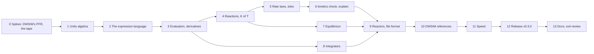

# M9 plan — equations, kinetics and reactors

M9 gives reflux reactions: rate laws, chemical equilibrium and the reactors
that use them. It's also where reflux stops taking equations as text. A
process simulator asks for an equation in many places: a rate law, an
equilibrium constant, an adsorption term, a pressure drop, and later a design
specification or an objective. DWSIM takes each as a string it evaluates, and
checks none of them. reflux parses every one into a structure it understands,
binds its names to the model, checks its units, renders it back, and
differentiates it exactly. Kinetics is the first user, and the owner's own
case, a methane steam reforming PFR that took DWSIM 30 minutes for 50 points,
is the benchmark. It's planned like M1 to M4 and M10a: research first, then
exit criteria, decisions and steps. The roadmap entry is in
[roadmap.md](roadmap.md), and the kinetics design in [kinetics.md](kinetics.md).

Status: **approved** on 2026-11-08, after a revision from discussing it:
equations users type themselves, with named definitions; built-in
constants; reaction types as properties, with restricted equilibrium; and
stoichiometry checked by counting elements. Step 0 is done, and amended D5,
D10 and D13 and set criterion 8's targets, approved on 2026-11-09. Step 1
amended D3. Step 2 is done and amended D2. Step 3 is done. Step 4 is done and
amended D1, approved on 2026-11-10. Step 5 is done and amended criterion
5, approved on 2026-11-10. Step 6 is done and amended D11,
approved on 2026-11-10. Step 7 is done and amended D1 and D10,
approved on 2026-11-11. Step 8 is done and amended criterion 6,
approved on 2026-11-12. Step 9 is done and amended D11,
approved on 2026-11-12. Before step 10 started, the owner's Tutorial 2
amended two decisions, both approved on 2026-11-12:
- D2: a value read on a unit's scale, `(T in degC)`, and a result's unit
  after a closing bracket;
- D10: a conversion in T, and a warning past equilibrium.

Step 10 is done, and amended D13, approved on 2026-11-13. Step 11 is
next.

## Goal

- **Equations as data, everywhere** (a new track item, A9, which takes in
  L7): a small expression language, parsed and never evaluated as text.
  - Every name in an expression is bound to something the model has: a
    species' partial pressure, fugacity or concentration, T, P, a stream's
    or a unit's variable. A name that isn't there is refused, with a
    suggestion.
  - Every expression has a dimension, checked when it loads, so bar against
    Pa, or a rate per catalyst mass against one per volume, is an error with
    its reason, not a wrong answer.
  - Every expression renders back as a formula (Unicode, and LaTeX for
    notebooks), so it can be held against the paper.
  - Every expression has exact derivatives, for the stiff integrator now and
    for equation-oriented solving later (M13).
  - A user's own equation is as welcome as a built-in form, with species by
    name, numbers with units, and pieces named once and reused.
  - Physical constants are built in at the SI's exact values: `R`, not a
    typed 8.314 that might be 8.341.
  - M9 uses it for rate laws, rate constants, equilibrium constants,
    adsorption terms and pressure drop. M8's design specifications,
    sensitivity outputs and objectives will use the same, and so will
    anything later that needs an equation.
- **Kinetics,** as [kinetics.md](kinetics.md) designs it (track L): catalyst
  sites whose adsorption terms every reaction on them shares; LHHW, power-law
  and Eley–Rideal rates, and free-form expressions with the same checks;
  reversibility from the Gibbs energies of formation; and `reflux kinetics
  check` and `explain`.
- **Chemical equilibrium,** by Gibbs minimisation over every species (E6), and
  over chosen reactions for restricted equilibrium: for the equilibrium
  reactors, and for checking that every reversible rate vanishes at
  equilibrium.
- **Stoichiometry checked by counting elements,** not by molar mass as DWSIM
  does: an unbalanced equation is refused with its imbalance, and balanced
  coefficients suggested.
- **An ODE integrator** (B5): a stiff one, using the exact Jacobians, and an
  explicit one for what isn't stiff.
- **Reactors** (G3): conversion, equilibrium (over reactions, or Gibbs), CSTR,
  and PFR or packed bed, isothermal or adiabatic, with Ergun's pressure drop.
- **The owner's case against DWSIM 9:** the methane steam reforming PFR, the
  same answers on DWSIM's own setup, every difference explained, and timed.

## What the research found

**What DWSIM made the owner type.** The owner's coursework case (`Tutorial 1
v2.dwxmz`, read but not copied into the repository) is methane steam
reforming over Xu and Froment's kinetics:

- **Three reactions:** steam reforming, CH₄ + H₂O ⇌ 3H₂ + CO; the water–gas
  shift, CO + H₂O ⇌ H₂ + CO₂; and the overall CH₄ + 2H₂O ⇌ 4H₂ + CO₂, as
  "heterogeneous catalytic" on partial pressures in atm, with rates in
  kmol/(kg·h).
- **Each rate is two text boxes,** a numerator and a denominator, such as
  `4.22E+15*exp(-240100/8.314/T)/P1^2.5*(R1*R2-P1^3*P2/(exp(30.42-27106/T)))`.
  Species are `R1`, `R2`, `P1` and `P2`: the reaction's reactants and
  products by their place in its equation, and the gas constant is typed as
  8.314 in every exponent. Nothing checks units, element balance, or that the
  expression is the paper's.
- **What a typed constant costs:** 8.314 is 5.6e-5 short of R, which moves a
  rate with E/RT ≈ 29 (240.1 kJ/mol at 1000 K) by −0.16%. A transposed 8.341
  moves it by +9.6%.
- **The balance check is by mass:** the overall reaction's `StoichBalance` is
  2e-5, molar masses summed, which can't tell rounding from a wrong formula.
- **The denominators differ, and they shouldn't.** In Xu and Froment all three
  reactions share one adsorption term, 1 + K_CO·p_CO + K_H₂·p_H₂ +
  K_CH₄·p_CH₄ + K_H₂O·p_H₂O/p_H₂, squared. The case's steam-reforming
  denominator has all of it. The overall reaction's lacks the CO term, and
  the shift's lacks the CH₄ term, because a DWSIM expression can only name a
  reaction's own species. That's [kinetics.md](kinetics.md)'s point, that
  the adsorption term belongs to the site, found in the owner's own file.
- **The equilibrium constants** are typed in too, exp(30.42 − 27106/T) and the
  like, though the reaction says its K comes from Gibbs energies.
- **The reactor:** an isothermal PFR, 1 m long and 1 m³, in sections of
  dV = 0.05. Catalyst loading 0.386 kg/m³, void fraction 0.4, particles of
  2 mm, and Ergun's pressure drop (4.9 kPa). The feed is 10 kmol/h each of
  CH₄ and H₂O and 0.1 kmol/h of H₂, at 1000 K and 1 atm, on Peng–Robinson.
- **The study:** the feed's T from 700 to 1000 °C in 50 points, and the
  methane conversion: 98.66% at 1000 °C. One solve takes 14.6 to 18.5 s
  headless, and the study about 30 minutes in the app (measured on
  2026-11-02).

**Where else DWSIM takes an equation as text.** The same file's reactions
have fields for a forward and a reverse rate-constant expression and an
equilibrium-constant expression, beside the rate's numerator and
denominator. DWSIM's sensitivity analysis and optimiser take expressions over
flowsheet variables, its specification block a target expression, and its
spreadsheet and script units formulas and code. Each is a string, read when
it runs.

**How DWSIM's PFR integrates.** Its API documents an ODE function giving dN/dV
for each compound, integrated section by section with a choice of an
"Oslo/RK" solver or Euler, and catalyst loading in kg per m³ of reactor
([Reactor_PFR](https://dwsim.org/api_help/html/T_DWSIM_UnitOperations_Reactors_Reactor_PFR.htm)).
How accurate that is at dV = 0.05, and exactly how the loading and void
fraction enter, is for step 0 to measure, as M3's and M4's spikes did.

**What reflux has to build on:**
- `quantity` (M4) reads numbers in a fixed set of named dimensions. It has no
  dimension algebra: nothing multiplies kmol/(kg·h) by kg/m³, or checks that
  a term is dimensionless.
- Each component file has a structural formula (`CH4`, `HOH`, `OCO`), a SMILES
  string and a molar mass, so elements can be counted and checked two ways.
  It has ΔH°f, ΔG°f and S° for the ideal gas at 298.15 K, and
  `thermo.IdealGas` integrates Cp, so ΔG°(T) and K(T) follow for any
  balanced reaction, with ΔG°f as a check at 298.15 K.
- `numeric` has dense LU, Newton, `minimize` and QAG integration, but no ODE
  integrator. The roadmap's B5 asks for an explicit Runge–Kutta method and a
  Rosenbrock method for stiff PFRs.
- V never frees a closure (CLAUDE.md), so nothing evaluated per point may
  make one. An expression's evaluation has to be a walk over data, not a
  chain of functions.
- Units plug into flowsheets through makers (M4's D1), so reactors can live
  in their own module.

**References that are independent of reflux:**
- mpmath, for rates, equilibrium constants and equilibria at high precision,
  from the papers' own formulas;
- SciPy's `solve_ivp` (Radau, at tight tolerances), and Hairer's stiff test
  problems with their published reference solutions, for the integrator;
- SymPy, for derivatives and rendering;
- `thermo` and `chemicals`, for ideal-gas Gibbs energies and K(T);
- DWSIM 9, for the owner's case and for each reactor alone.

## Exit criteria

All checked by tests in CI, as in M1 to M4.

1. **Equations are parsed, never evaluated as text.** Every expression in a
   file parses to a tree whose every name is bound, and renders back. A wrong
   name, a syntax error or a missing operand is refused with its line, its
   column and a suggestion. Fuzzed expressions never panic.
2. **Units hold.** Every expression's dimension is derived and checked against
   what its place needs. Numbers with units convert exactly, by SP 811 as in
   M4. A term that should be dimensionless and isn't, or a rate in the wrong
   basis, is refused with its reason. Built-in constants are the 2019 SI's
   exact values, and a typed number with a constant's dimension that isn't
   it, 8.341 J/(mol·K) say, is flagged.
3. **Derivatives are exact.** Each expression's derivatives with respect to its
   variables agree with SymPy's to rounding, and with central differences to
   their truncation error. Evaluating one allocates nothing, and its cost is
   measured against the same rate written in V.
4. **Kinetics is right.** Xu and Froment's reforming kinetics and Vanden
   Bussche and Froment's methanol kinetics load from TOML, render as
   published, and pass every check: element balance, units, and consistency
   with equilibrium. An unbalanced equation is refused with each element's
   imbalance, and balanced coefficients are suggested where its species
   allow. A dependent set of reactions is reported, with which combines
   which. Their rates match mpmath's from the papers' own formulas,
   to rounding. Every reversible rate is zero at the equilibrium of criterion
   5, and points towards it elsewhere.
5. **Equilibrium is right.** The Gibbs reactor's composition, and the
   equilibrium over chosen reactions, match an independent calculation in
   mpmath, for ideal gas and for PR. Elements balance to rounding. K(T) from Gibbs energies of formation is
   compared with Xu and Froment's correlations, and the differences recorded.
   **Amended in step 5:** Xu and Froment's paper names its K₁, K₂ and K₃ and
   gives their units, but no values, so K(T) is compared with the
   correlations used with their kinetics instead: the literature's, ln K₁ =
   30.114 − 26830 K/T and ln K₂ = −4.036 + 4400 K/T, and the owner's DWSIM
   case's (step 4).
6. **The integrator is right.** Stiff and non-stiff test problems reach their
   reference solutions within the tolerance asked, and closed-form cases
   within it too. Its step counts are recorded, and can't grow.
   **Amended in step 8:** an integrator holds each step's error to the
   tolerance, not the end's, so "within the tolerance asked" is read as each
   end error in units of the tolerance, |y − ref|/(atol + rtol·|ref|),
   recorded and unable to grow. Most stiff problems and closed forms end
   within a unit; a problem that carries its errors on ends above, an
   orbit's phase (Kepler's 730 to 4,400 units, Arenstorf's to 24,000) or
   the Oregonator's fronts (2.9). E5's y₂ and y₃ are beyond a Rosenbrock
   method in double precision (step 8), so E5 is held to what can be
   claimed of it: its decay and its invariant's drift.
7. **Each reactor is right.** Conversion, Gibbs, CSTR and PFR close their
   element and energy balances to 1e-10, and every outlet is a verified
   flash. The CSTR and an isothermal PFR match closed forms for simple
   kinetics. A long PFR approaches the Gibbs reactor's equilibrium.
8. **The owner's case matches DWSIM 9.** On DWSIM's own setup, its three
   denominators included, the outlet agrees with DWSIM's within targets that
   step 0 sets. Every difference over them is explained, as in M3 and M4. The
   published model, one shared site, is solved beside it. **Step 0's
   targets:** each outlet flow within 1e-8 (relative) of the exact answer of
   DWSIM's equations, isobaric and with Ergun; and within 3e-4 of DWSIM's
   own at dV = 0.001, with the methane conversion within 5e-5 and ΔP within
   1 Pa.
9. **Speed is measured.** A solve of the owner's case, and the 50-point study
   as 50 solves, against DWSIM 9's 15 to 18 s and 30 minutes, with gcc
   `-prod`. There's no target, as in M3 and M4.
10. **Files and the CLI.** Reactions, sites and reactors in the flowsheet file,
    every field checked, and `reflux kinetics check` and `explain` on a file.
11. CI is green, and the docs are updated: README, roadmap, design notes,
    [kinetics.md](kinetics.md), the file format, and the V notes.

## Decisions

| # | Decision | Choice | Why |
|---|---|---|---|
| D1 | Where it lives | `expr`, the expression language, which imports `quantity` only. `kinetics`: reactions, stoichiometry and element balance, rate laws and sites, their checks and rendering, over `expr` and `thermo`. `equilibrium`: Gibbs minimisation, over `thermo` and `numeric`. The integrators in `numeric`. `reactors`: the unit operations, with makers for the file, as M4's D1 planned. **Amended in step 4:** a further module, `chem`, holds the elements, formulas and SMILES strings. It depends on nothing, and sits below both `components`, which takes a compound's formula from its file with it, and `kinetics`, which reads a formula in an equation with it. `kinetics` doesn't import `components`: a reaction's species are plain data, which the reactors (step 9) build from component records. **Amended in step 7:** `equilibrium` imports `kinetics`, for its species, reactions, standard properties and independence check, and `flash`, for the stability test, as well as `thermo` and `numeric`. The consistency check (criterion 4) is there, needing rates and equilibrium both, which `kinetics` can't import; `reflux kinetics check` imports it. | Each piece is tested alone, and `expr` can serve M8 without dragging in thermodynamics. Step 7: an equilibrium's species and reactions are kinetics' own, so a reactor equilibrates the reactions it reacts by, and a cubic's answer is tested for a second phase before it's returned. |
| D2 | The language | Infix arithmetic with `+ − * / ^`, unary minus, and `exp`, `ln`, `log10`, `sqrt` and `abs`. Numbers may carry a unit, such as `240.1 kJ/mol`. Names are the context's (in a rate, `T`, `P`, and `p[CH4]`, `f[CH4]`, `c[CH4]` or `y[CH4]` by species name, formula or CAS number, quoted if it needs to be, `p['n-butane']`), a file's definitions, and built-in constants. **Definitions:** a `[definitions]` table names expressions for reuse, such as a rate constant or a site's denominator. They may use one another, and a cycle is refused. **Constants:** `R`, `N_A`, `k_B`, `h`, `F`, `c`, `g_n`, `pi` and `p_std` (1 bar), at the 2019 SI's exact values, each with its unit: R = N_A·k_B = 8.31446261815324 J/(mol·K). A definition can't take a constant's name. No assignment inside an expression, no loops, no conditionals, and nothing that runs code. **Amended in step 2:** a number's unit follows it after a space and runs to the next space, or to a ) or , that isn't its own, or it's in brackets, `2 [K]`; a word after a number that is also a name here is refused as ambiguous (`2 R`: two rankines, or twice the gas constant?). A unit with an offset (°C, °F, barg, psig) is refused in an expression. `log` is refused as ambiguous, with `ln` and `log10` offered. `·`, `×` and `−` are operators too. A definition can't take a variable's, a family's or a function's name either. **Amended before step 10** (approved on 2026-11-12): a value can be read on a unit's scale, `(T in degC)`. That's the number T reads in °C: 320 for 593.15 K, a dimensionless number, and the one place an offset applies. Likewise, `P in mmHg` is P over 133.322… Pa. `in` takes the name, member or bracketed expression just before it, as a unit binds to its number, so `0.0018*T in degC` is `0.0018*(T in degC)`. The unit must have the value's dimension. With an offset unit (°C, °F, barg, psig), `in` reads only the context's own T or P, which are absolute. `(T - 300 K) in degC` is refused, since a difference reads in K, and so is a definition read in °C. `in` is reserved, so no definition can take it. A reading that repeats is named once by a definition, `t = "T in degC"`. There's no declaration for a whole expression (`where T in degC`). A forgotten reading is a dimension error whose message suggests it. A unit may also follow a closing bracket, so a result's unit is written once: `(85 - 0.18*(T in degC)) [%]`. A reading renders as `(T in °C)`, and plain text reads back as written. | Enough for every rate and correlation this milestone meets, and a user's own equation without repeating a term in every reaction. A typed 8.314 costs 0.16% in a rate at E/RT ≈ 29, and a transposed 8.341 costs 9.6%, so the constant is built in and a typed one is flagged. A paper fitted with 8.314 can still write it, with its unit. Conditionals would break exact derivatives. A unit after a number is how papers write it, but a name after a number would be read silently as a unit where they collide (R, h, P), so that is refused; brackets say which. An offset in arithmetic is wrong as often as right (T − 25 °C). Before step 10: the owner's Tutorial 2 prints its correlation for T in °C and a conversion in %. The only way to write it was `0.85 - 0.0018 [1/K] * (T - 273.15 K)`: the user doing by hand the conversion the language is meant to spare them. Antoine's constants, in °C and mmHg, and many published fits are the same. A reading at each use keeps T one quantity in a file, and keeps a forgotten reading an error. A declaration for the whole expression would rebind T, as DWSIM's "T in K" does, and would let `T/300` through silently. Modelica also converts at each use (`to_degC(T)`). A result has one unit, so it goes once, at the end. |
| D3 | Units | `quantity` gains a dimension algebra: a dimension is a vector of SI base exponents (mass, length, time, temperature, amount), and a unit a scale on one. Compound units (`kmol/(kg*h)`, `bar^-2`) parse from M4's named units. M4's named dimensions become constants of the algebra, so files read as before. **Amended in step 1:** the bases include electric current, for the coulomb and so for D2's Faraday constant. The exponents are exact rationals, for bar^0.5. Compound units are built from symbols with SI prefixes rather than from M4's whole names, and each of M4's units reads through them to M4's bits. A * after a / is refused as ambiguous. | One source of truth for units, now able to say why a dimension is wrong. A rate's units hold half powers (√(K·p_H₂)), and a ratio squared must be the unit again exactly. Symbols with prefixes cover the units kinetics papers use (cm³, mol/(g·s), kJ/mol) without listing every combination. |
| D4 | One representation | Parsed expressions and the structured forms (Arrhenius centred on T_ref, van 't Hoff, a site's monomials, LHHW) build the same tree. The structured forms keep their structure, for site sharing and their own checks, and render, evaluate and differentiate through the tree. | Every check, rendering and derivative is written once, and a structured rate and the same rate typed as an expression give the same bits. |
| D5 | Evaluation and derivatives | A tree compiles to a tape: a flat array of operations on slots, with constants folded and shared subexpressions merged. Evaluation walks the tape into a buffer the caller owns. Derivatives come from a reverse sweep over the same tape, giving the gradient with respect to every variable in one pass. No closures, no allocation per evaluation. **Amended in step 0:** operations are fused where it pays, a constant operand held in the operation (x + c, c·x, c/x) and a·exp(b/T), the form of every Arrhenius and van 't Hoff term, as one operation. The constants go into the caller's buffer once, and one reverse sweep carries every output's adjoints together. | A rate needs its gradient with respect to every species and T at once, and reverse mode gives that for about the cost of the rate. A tape is data, which V handles without closures. **Step 0 measured it** on Xu and Froment's three rates, with gcc `-prod`: written out in V, 130 to 220 ns for the rates and 210 to 330 ns with their gradients, as the laptop's clock varied; the plain tape about 4.5 and 6 times that, the fused tape 3 and 4 to 5 times. That's under 2 µs for three rates and every derivative, which puts a PFR solve of the owner's case at a few milliseconds even at a thousand integrator steps, against DWSIM's 9 to 29 s. Evaluators written out for the structured forms, the risk's fallback, would win the factor back at the cost of D4: two derivative codes per form, and a rate typed as an expression no longer giving the structured form's bits. Step 11 profiles the PFR, and fuses more if the tape dominates. |
| D6 | Kinetics | As [kinetics.md](kinetics.md): a site's adsorption term defined once and shared by every reaction on it, with a per-reaction override marked as one; each reaction's activity basis (partial pressure, fugacity or concentration) and rate basis (per catalyst mass or per volume) stated, with units. **Reaction types are properties, not one label:** a reaction is its equation and phase. A rate law, where it has one, states its form (power law, LHHW, Eley–Rideal or an expression), its basis and its activity, and any reactor may use a reaction as far as its data go. DWSIM's "heterogeneous catalytic" is a per-mass rate on a site, the reactor giving the catalyst's loading and void fraction. Every reaction has its K(T) (D7), so one with a rate law can also be equilibrated. | The owner's case shows why the term belongs to the site: DWSIM's per-reaction denominators silently lose terms. In DWSIM a reaction's type decides which reactor can use it, so the same reaction is entered again for another reactor. |
| D7 | Equilibrium constants | By default K(T) = exp(−ΔG°(T)/RT) at a standard state of 1 bar, from each species' ideal-gas H and S along Cp. A correlation may be given instead, and `check` reports how far it is from the thermodynamic K. | Consistent with the flowsheet's own thermodynamics by construction, and honest when a paper fitted its own. |
| D8 | Integrators | Rosenbrock's RODAS4 (Hairer and Wanner), L-stable with an embedded error estimate, on the exact Jacobian from D5, for stiff problems. Dormand and Prince's 5(4) for the rest. Both take what they integrate as an interface, never a closure. A PFR's state is its molar flows, with T and P where they vary. | A Rosenbrock method needs no Newton iteration, only an LU per step, and exact Jacobians make it reliable. Near equilibrium, reforming kinetics is stiff. |
| D9 | Gibbs minimisation | One phase for now (M6 adds more), ideal gas or a cubic. Minimise G over the species amounts subject to the element balance, by Newton on the element potentials (the RAND method, White, Johnson and Dantzig, 1958), with the fugacity coefficients updated outside it for a cubic. Species that vanish are handled in log space. | The standard method. It extends to the second phase M6 brings. |
| D10 | Reactors | Conversion (a key reactant's conversion per reaction, in order); equilibrium over chosen reactions, for restricted equilibrium, by Newton on their extents with K(T), the reactions independent; Gibbs (D9); CSTR at a given T or adiabatic, solved by Newton; PFR and packed bed, isothermal, adiabatic or at a duty per length, in catalyst mass or volume, with Ergun's pressure drop or a given one. Each outlet is a flash at its state, and each reactor's balances are checked before it returns, as M4's units are. **Amended in step 7:** the equilibrium over chosen reactions isn't Newton on their extents but the Gibbs minimisation's own RAND method over what the reactions conserve (the null space of their coefficients), with stand-in potentials g = −νᵀ(ννᵀ)⁻¹ ln K, so that its stationary point has each Q its K. **Amended in step 0:** Ergun's viscosity is the gas mixture's at low pressure: each compound's from its component file's vapour-viscosity correlation (ChemSep's eq. 102, already imported), mixed by Wilke's rule and checked against `chemicals`. That's the first piece of M5's C7, brought forward. The PFR takes its viscosity through an interface, so a test can give it another, as step 10 gives it DWSIM's. A catalyst's loading is the bed's density, kg per m³ of reactor, and its void fraction enters Ergun alone, as in DWSIM. **Amended before step 10** (approved on 2026-11-12): a conversion may be a number or an expression in `T`, the reactor's temperature, parsed by `expr` with its units checked to be dimensionless: `"0.85 - 0.0018*(T in degC)"`, with D2's reading. It's taken at the outlet's T, which an adiabatic reactor or one at a duty finds with its energy balance. A value outside 0 to 1 at that T is a failure that names the T. A conversion reactor also warns when its outlet is past equilibrium: any reaction whose Q, from the outlet's fugacities in bar, is above its K at 1 bar from the Gibbs energies (D7), beyond rounding. A warning is not a failure, since the conversion is the user's to give. A reaction with no K, its species lacking formation data, gets a note that it went unchecked. Warnings go in the unit's report, in format 2, which is unreleased. | What the owner's case and textbook problems need. A cooled PFR with a coolant stream is G2's, with the heat exchangers. Step 0 found Ergun's drop 89% viscous in the owner's case, moving its methane conversion by 3.4e-3, and reflux had no viscosity. DWSIM's, a mole-fraction mean with Jossi, Stiel and Thodos' correction, is 30% below Wilke's in the hydrogen-rich gas. Step 7: an extent has bounds that a product the feed lacks sits on, where Newton's logarithms are infinite. In RAND's log space a vanishing species is no trouble, as in the Gibbs reactor, and one solver serves both, with the same checks. Before step 10: the owner's Tutorial 2 (step 10) types its conversion as a function of T in DWSIM. Swept over pressure, it kept 27.4% at 30 bar, where equilibrium allows 7.9%, and nothing said so. |
| D11 | The file | `[[site]]`, `[[reaction]]` and the reactor units in the flowsheet file. Their equations and expressions are strings that `expr` parses; their numbers carry units as M4's do. A file that uses them is format 2. Format 1 files read exactly as before. The report gains each PFR's profile, as report format 2. **Amended in step 6:** sites and reactions are tables by name, `[site.NAME]` and `[reaction.NAME]`, as feeds and units are, rather than arrays of tables: a name is unique by the table's key, and a failure's key reads `reaction.reforming.law`. `reflux kinetics check` reads a file's reactions without the flowsheet's other sections, so a file of reactions alone can be checked; `reflux solve` reads them with the reactors, in step 9. **Amended in step 9:** a reactor's table names the reactions it runs, `reactions = ["reforming", "shift"]`, by default every one it can (every one with a rate law for a PFR or a CSTR); a conversion reactor's `conversions` are its steps in order, each a reaction, its key reactant and its conversion. Every reactor takes `T`, `duty` or `adiabatic = true`, at most one, isothermal at its inlet's T with none. A PFR's `pressure_drop` is a drop or `"ergun"`. Format 2 reads format 1's sections as format 1 does, and a reactor in a format-1 file is refused. | One file per process, as now. A new section is a new format by the CHANGELOG's rules, but nothing old changes meaning. Step 9: one file's reactions can then serve reactors that run different ones (a reformer and a shift converter), as DWSIM's reaction sets do, without a set's table of its own; named sets can come later if a file wants the same list twice. |
| D12 | The CLI | `reflux kinetics check <file>` runs every check on a file's reactions. `reflux kinetics explain <file> [T P composition]` prints each rate as reflux read it, and the factor table at a state. | kinetics.md's design. |
| D13 | Comparing with DWSIM | The owner's case as a reflux file, with DWSIM's three denominators as marked overrides, compared at DWSIM's tightest useful dV, which step 0 finds. The published model, one site shared by all three, is solved beside it and reported. Each unit alone (conversion, Gibbs, CSTR, PFR) is compared with DWSIM's from the same inlet. **Amended in step 0:** the case is compared with three answers: DWSIM's at dV = 0.001, its tightest useful one, and at the file's 0.05; and the exact answer of DWSIM's equations without its sections, which the fixture integrates with SciPy. Isobaric first, then with Ergun, the test giving reflux's PFR DWSIM's viscosity. **Amended in step 10** (approved on 2026-11-13): DWSIM 9.0.5's CSTR reacts nothing in the vapour, catalytic or not, and says nothing, so reflux's CSTR is held to the exact answer of DWSIM's equations for a CSTR (the owner's rates as typed, by mpmath), as the PFR is. The exact answer with Ergun uses PR's density with exact constants, reflux's, and DWSIM's viscosity: DWSIM's own density takes R as 8.314, which moves the velocity by 5.6e-5 and the flows by about 1e-6, beyond criterion 8's 1e-8, and it matters only against DWSIM's answers, whose targets are 3e-4. DWSIM's Gibbs reactor is held to what its own answers are worth: its two solvers disagree by 1e-3, and its default one leaves the elements unbalanced by up to 7.3e-4. | The comparison measures the solvers, not two different models, and the published model is the one users should run. Step 10: DWSIM's CSTR can't run the case at all, and an answer from two densities measures the densities. |
| D14 | Heat exchangers | Out of M9, into a milestone of their own after it. | The roadmap put G2 in M9, but nothing in M9's exit needs it, and M9 is large. A cooled PFR wants a coolant stream, which belongs with the exchangers. |
| D15 | Versions | M9 ends with v0.3.0: format 2 is an addition, a minor release before 1.0. | The CHANGELOG's rules. |
| D16 | Who writes what | As before, I write it all unless you claim a step. | |

## Steps

### 0. Spikes: DWSIM's PFR, and the tape — done: go, with D5, D10 and D13 amended
- **DWSIM's PFR:** [spike/dwsim_pfr/run.py](../spike/dwsim_pfr/run.py) builds
  the owner's case in DWSIM 9.0.5 headless and answers this step's
  questions. [spike-dwsim-pfr.md](spike-dwsim-pfr.md) has every number and
  the conditions for step 10.
  - **Every number DWSIM's PFR gives is explained.** The case built by the
    script matches the owner's file to 7.6e-9. Its sections, reproduced in
    Python from DWSIM 9.0.5's source with DWSIM's own integrator, match
    every profile point to 4.9e-11; Ergun's drop matches each section's to
    2.9e-14; and its gas viscosity is reproduced to 2.7e-7.
  - **How accurate DWSIM's answer is.** Within a section DWSIM holds the
    gas's volumetric flow, Z and pressure at the section's start, so its
    error is first order in dV, and its integrators run at DotNumerics'
    default tolerances (1e-3 relative), which the PFR can't change. Against
    the exact answer of its own equations (SciPy's Radau at 1e-12, no
    sections), isobaric, its methane conversion is 9.0e-4 low at the file's
    dV = 0.05 (4.9e-3 in the worst flow), halving with dV to 1.6e-5
    (8.4e-5) at dV = 0.001, four minutes a solve. Extrapolated, DWSIM's own
    answers land within 2e-7 of the exact one. Its four integrators agree to
    1.6e-4, and its default, Radau, is 7 times slower than its explicit
    Runge–Kutta for the same answer.
  - **How the inputs enter.** The catalyst loading is the bed's density, kg
    per m³ of reactor, multiplying the per-mass rate; the void fraction
    enters Ergun's drop alone; and Ergun is the standard form, applied after
    each section at its outlet's state. The drop is 89% viscous, and moves
    the methane conversion by 3.4e-3. **reflux has no viscosity** (M5's C7),
    and DWSIM's, a mole-fraction mean of ChemSep's correlations with Jossi,
    Stiel and Thodos' correction, is 30% below Wilke's rule in the
    hydrogen-rich gas: D10 amended.
  - **Failures are silent,** as M4 found: the flowsheet's error list stays
    empty, and only the PFR's `Calculated` and `ErrorMessage` say why. A
    reaction whose Tmax is below the gas's T is skipped with no error at
    all, and DWSIM's expressions can't read `1E+3`.
  - **Time.** A solve took 9.4 to 29 s as the laptop's clock varied, and
    the 50-point study 12.4 minutes headless: 9.6 s a point at 700 °C,
    25.9 s at 1000 °C, where the conversion is the course's 98.66%. Nearly
    all of it is DWSIM recompiling the six rate expressions, in three new
    Flee contexts, on every call of its ODE function: about 12 ms a call,
    about 955 calls a solve. Step 11 must time both programs in one
    session, taking turns.
- **The tape:** [spike/tape/spike.v](../spike/tape/spike.v) builds Xu and
  Froment's three rates, as published with one shared adsorption term, into
  a tape (constants folded, repeats merged: 161 nodes asked for, 95 kept),
  evaluates it into a caller's buffer, and differentiates it by one reverse
  sweep for all three rates. It checks the tape against the same rates and
  gradients written out in V, and those against central differences, at
  1,000 reforming states, 0.5 to 40 bar and 800 to 1300 K.
  - **Right:** the plain tape's rates agree within 2.6e-15 and its
    gradients within 2.3e-14 of their row's largest term; the fused tape's
    within 9.2e-14 and 5.8e-14, folding exp(a)·exp(b/T) where the rates
    computed exp(a + b/T), with the driving force cancelling near
    equilibrium. The gradients written out agree with central differences
    within 1.7e-7, their truncation. None allocates: 0 bytes in 1,800,000
    calls.
  - **Speed** (gcc `-prod`, Ryzen 5 PRO 3500U, the best of nine rounds in
    which the variants take turns, three runs): written out, 131 to 146 ns
    for the rates and 209 to 220 ns with gradients, and about 1.5 times that
    in runs at a lower clock. The plain tape takes 4.5 to 4.8 and 5.8 to 6.4
    times as long. Loading its constants once brings that to 3.9 to 4.1 and
    5.6 to 5.9; fusing operations (a constant operand in the operation, and
    a·exp(b/T) as one, 52 nodes in all) to 2.8 to 3.1 and 4.0 to 4.6.
  - **Where the time goes:** 6 to 9 ns of dispatch per operation, against
    nearly nothing for the same arithmetic written out. Putting the
    commonest operations first in V's `match`, which compiles to an if-else
    chain, changed nothing.
  - **D5 amended, and kept:** fused operations, the constants loaded once,
    and one sweep for every output. At under 2 µs for three rates and their
    gradients, a RODAS4 step (one gradient and six evaluations) costs 3 to
    5 µs, so even a thousand steps is 3 to 5 ms a solve, against DWSIM's 9
    to 29 s.
    Evaluators written out for the structured forms would win the factor
    back at the cost of D4's one representation. Step 11 profiles it.
- **Targets for criterion 8** (in [spike-dwsim-pfr.md](spike-dwsim-pfr.md)):
  each outlet flow within 1e-8 of the exact answer of DWSIM's equations,
  isobaric and with Ergun; within 3e-4 of DWSIM's at dV = 0.001, its
  tightest useful dV, with the conversion within 5e-5 and ΔP within 1 Pa;
  and at the file's dV = 0.05 the difference recorded, explained by DWSIM's
  sections.
- **Amended:** D5 (fused operations), D10 (Ergun's viscosity from the
  component files by Wilke's rule, the first piece of M5's C7, with the PFR
  taking it through an interface), and D13 (the answers to compare with).
  Criterion 8 has its targets, and step 9 the viscosity.
- No simulator code changed, so no planted mistakes. Each spike's checks
  are its own: every DWSIM number reproduced from DWSIM's equations, and the
  tape held against code written out by hand and against central
  differences.

### 1. Units algebra — done
- **[quantity/quantity.v](../quantity/quantity.v)** has the dimension algebra
  (D3, amended):
  - **`Dim`** is the exponents of kg, m, s, K, mol and A, each an exact
    `Ratio` in lowest terms with |p| and q at most 10⁶, so that no sum or
    product of two in range overflows. It has `mul`, `div`, `pow`, `eq`,
    `str`, which writes base units (kg/(m·s²), kg^(1/2)/(m^(1/2)·s)), and
    `name`: one of M4's named dimensions, a common one (energy, viscosity,
    molar entropy, …), or else `str`. `Dimension.dim()` gives each of M4's
    named dimensions its own.
  - **`unit(text)`** reads a unit into `Unit{scale, dim, pre, post, gauge}`:
    41 symbols; the prefixes G, M, k, h, d, c, m, µ (or μ, or u) and n on the
    14 that take them; and compounds of them by `*`, `·`, `/`, parentheses
    and exponents (m3, m³, s⁻¹, bar^-2, bar^0.5, bar^(1/2)). Its scale is the
    numerator's product over the denominator's, in one division, and a whole
    power a repeated product, so every M4 unit reads to M4's bits.
  - **`parse(text, d)`** reads any unit of d's dimension, M4's or not, and
    keeps M4's messages; `units(d)` is still M4's lists, for messages and
    suggestions. °C, °F, barg and psig keep their offsets only standing
    alone; in a compound °C is a kelvin of difference and a gauge pressure
    is refused.
- **Every refusal is a `UnitError`** with the column, the reason and, for an
  unknown name, the closest symbols and prefixed symbols. Through `parse`
  it's a `QuantityError` saying the unit, the reason and the character. The
  reasons: empty; a * after a / (ambiguous); [ ] for grouping, as DWSIM
  writes kmol/[kg.h]; a . between units; an unclosed ( or an unopened );
  a unit missing before an operator or at the end; an exponent with nothing
  to raise, with no digits, with too many, or two in a row; a fraction that
  isn't p/q, or over zero; an exponent out of range; a number that isn't an
  exponent or the 1 of 1/s; a scale that isn't finite (km^400); a gauge
  pressure in a compound; more than 16 nested parentheses; an unknown name,
  including a prefix on a symbol that takes none (katm) and pico (ps).
  Through `parse`, a unit of another dimension says what it is a unit of:
  "kmol/(kg*h) is a unit of mol/(kg·s), not molar flow".
- **Tests in [quantity/quantity_test.v](../quantity/quantity_test.v):** M4's
  seven, unchanged, and nine new:
  - **M4's bits:** a frozen copy of M4's 75-row table, and each unit's scale,
    and each value read and written back, to the bit; `units(d)` is still
    M4's lists, in M4's order.
  - **SP 811:** [testdata/m9_units.json](../testdata/m9_units.json), written
    by hand: 101 factors, every symbol alone, one unit for each prefix, and
    compounds (kmol/(kg*h), J/(mol*K), Btu/(lb*degF), lb/ft^3, bar^0.5, …),
    the compound factors computed exactly with Python's `fractions`. Exact
    ones to 4 ulps, SP 811's 7-figure ones (gal, Btu, hp, psi, mmHg, torr)
    to their figures, and every dimension as `str` writes it. No symbol or
    prefix is left out.
  - **The algebra:** ratios exact, reduced and bounded; an energy over a
    volume is a pressure; a square root squared is exact; every base counts.
  - **Compound units:** 20 pairs written two ways read alike (J/mol/K and
    J/(mol*K), s⁻¹ and 1/s, (bar^(1/3))^3 and bar, Btu/(lb*degF) and
    kcal/(kg*K)); cm³ is three centimetres to the bit; every dimension as
    written reads back as itself with scale 1; offsets only standing alone.
  - **35 refusals,** each with its reason and its column.
  - **`parse`** with compound units, the new messages, and a value whose
    scale is finite but whose product overflows.
  - **Fuzzing:** 30,000 seeded strings of unit syntax. Each is refused with
    a `UnitError`, or has a finite scale above zero and a dimension that
    reads back as itself.
- **Found by the fuzzing:** in "Pa999999" the time exponent, −1,999,998,
  overflowed the bound inside the dimension's arithmetic, and that error
  escaped as a plain one, without a column. Each operator's errors now
  carry its column.
- **Found by probes, for V's notes:** a fixed array of structs inside
  another struct's zero value skips the element type's field defaults (so
  `Dim` has named fields), and `T{...err, …}` on a smart-cast `err` copies
  nothing, not even the fields set beside it.
- **Planted mistakes: 56,** none failing to build; 51 caught at once.
  - Three survivors got tests: `eq` ignoring the current's exponent (now a
    coulomb isn't a second), a fraction's sign lost (`bar^(-1/2)`), and
    whole powers by `math.pow`. That last showed `math.pow` an ulp nearer
    the exact value from the fourth power on (1e-8 for cm⁴), but the C
    library's, which differs between Windows and Linux. So the repeated
    product stays, for its same bits everywhere, and a test pins cm⁴ to it.
  - Two had their code deleted: a branch writing a negative superscript,
    which nothing reaches since `str` writes negative powers below the line,
    and a length check on a prefix that the empty rest already made.
- **For 0.3.0's CHANGELOG entry:** a flowsheet file's numbers read any unit
  of their dimension, prefixed or compound ("10 lbmol/min", "5 m^3/h"); a
  unit of another dimension is named by what it is, in base units where it
  has no name; and a unit that doesn't parse says why and where. Every file
  that read before reads the same numbers, to the bit.

### 2. The expression language — done
- **[expr/](../expr/)** is the expression language (D1, D2 as amended):
  - **[parse.v](../expr/parse.v):** a recursive-descent parser over the
    grammar in [design.md](design.md#expressions), building an arena of
    nodes, each operand before its use. Numbers carry units after a space
    or in brackets, converted to SI by `quantity`. Names bind to the
    context's variables, its families' members by any key (p[CH4],
    p[Methane], p['74-82-8']), definitions and the built-in constants.
  - **[check.v](../expr/check.v):** every node's dimension, in one pass in
    order: sums of one dimension, functions of pure numbers, sqrt halving,
    and a quantity with units raised only to a fixed fraction, folded from
    numbers, constants and fixed definitions and found by continued
    fractions (p/q, q ≤ 10⁶, within 1e-12). `must_be` asks for a place's
    dimension.
  - **[render.v](../expr/render.v):** plain text that reads back to the same
    tree, Unicode and LaTeX, from one walk with style-aware precedence.
  - **[expr.v](../expr/expr.v):** nodes, contexts, the nine built-in
    constants at the 2019 SI's exact values (R = N_A·k_B, F = N_A·e, the
    doubles nearest the exact products), and definitions, ordered so each
    follows what it uses, a cycle refused with its chain.
  - **[eval.v](../expr/eval.v)** walks the tree, the reference for step 3's
    tape; **[lint.v](../expr/lint.v)** flags a number within 1% of a constant
    of its dimension, as 8.314 J/(mol·K) for R (criterion 2).
- **Every refusal is an `ExprError`** with the line, the column and a
  suggestion: in the reason for syntax ("write 2*T to multiply", "put a
  space between a number and its unit"), and the closest names, keys or
  functions for a name that binds to nothing.
- **Tests,** 27 in five files:
  - **[parse_test.v](../expr/parse_test.v):** precedence and association,
    names and members, every form of number and unit, 35 syntax refusals
    and 18 name refusals with their places, and two fuzzers: 20,000 seeded
    strings of the language's pieces and stray ones, refused with a place
    and a reason or round-tripped, and 10,000 seeded well-formed expressions,
    every one read and round-tripped, node for node.
  - **[units_test.v](../expr/units_test.v):** Xu and Froment's steam
    reforming rate is a rate per mass of catalyst; every function and
    operator's dimension; every constant's unit; SI values; ten refusals of
    a wrong dimension, DWSIM's `exp(-240100/8.314/T)` among them; `must_be`;
    and the look-alikes, flagged and not.
  - **[definitions_test.v](../expr/definitions_test.v):** Xu and Froment's
    constants as definitions listed out of order, the rate through them equal
    to the rate written out, to the bit; cycles with their chains; reserved
    and duplicate names; an error inside a definition naming it; fixed
    definitions as powers.
  - **[render_test.v](../expr/render_test.v):** 38 renderings to the exact
    string, in all three styles, and Xu and Froment's rate as published.
  - **[sympy_test.v](../expr/sympy_test.v),** against
    [testdata/m9_expressions.json](../testdata/m9_expressions.json) from
    [tools/gen_m9_fixtures.py](../tools/gen_m9_fixtures.py): 258 expressions
    (52 by hand, 206 seeded) as SymPy 1.13.3 reads them, valued by mpmath at
    50 digits at four points; reflux within 1e-12 of each point's scale,
    8.3e-15 at worst. Every rendering is the one the generator decoded and
    found, by SymPy, to mean the text at every point; every plain form reads
    back to the same tree; and the constants are the doubles nearest the SI
    Brochure's exact values, checked against SciPy's CODATA 2018. The
    generator reproduces the fixture byte for byte.
- **How the renderings are held against SymPy:** SymPy's own LaTeX readers
  can't judge, since in 1.13.3 the ANTLR one reads
  `\log_{10}{\left(x\right)} \cdot y` as log(x·y) and the Lark one returns
  ambiguous trees for a function followed by an operator. So the generator
  decodes reflux's LaTeX and Unicode with readers for exactly what reflux
  writes, and SymPy values the results.
- **Bugs found:**
  - by the generator's decoding: Unicode's 2.5·10⁻¹ as a divisor,
    `x/2.5·10⁻¹`, read as (x/2.5)·10⁻¹. A number in scientific notation now
    binds as a product, or 10ⁿ as a power, in Unicode and LaTeX;
  - by the round-trip fuzzer: a·(b/c) written as a·b/c, and a + (b + c) as
    a + b + c, equal in value but other trees, which SymPy's values couldn't
    see. The right operand now keeps its parentheses;
  - writing the goldens: a unit running into the operator after it under a
    minus sign, `−240.1 kJ/mol/(R·T)`, now `−(240.1 kJ/mol)/(R·T)`.
- **Planted mistakes: 54,** none failing to build; 47 caught at once.
  - Six survivors got tests: the nesting limit (201 levels refused), a
    unit's end at a comma, a fixed power's sign (`P^-0.5`), the standard
    pressure left out of the look-alikes (1.005 bar), a number equal to its
    constant not flagged, and a two-digit subscript (k₁₂).
  - One is explained: the continued fraction's denominator check, which
    `quantity.ratio`'s own bound makes equivalent; it stays to keep the next
    step's product inside an i64. A dead second check for `log` was deleted
    before the run.
- **V's notes:** `none` is a keyword, so it can't name a variable.

### 3. Evaluation and derivatives — done
- **[expr/tape.v](../expr/tape.v)** compiles expressions onto one tape (D5,
  as amended in step 0), as [design.md](design.md#the-tape) sets out:
  - **folding** constants with eval's own arithmetic, **merging** repeats
    (+ and · with their operands in order, and each definition compiled
    once), **fusing** a constant operand into its operation (x + c, c − x,
    c·x, x/c, c/x, a^c), an Arrhenius or van 't Hoff term into c·exp(d/x)
    on a shared R·T, and an equilibrium correlation into exp(c + d/x), and
    **pruning** what no output uses. Every fusion keeps the tree's
    arithmetic, so the tape gives eval's bits;
  - **evaluation** into a `Buffer` the caller owns, its constants put in
    place once, allocating nothing;
  - **the gradient** by one reverse sweep with an adjoint per output, so
    every output's derivative with respect to every input comes at once.
- **Powers:** the tree and the tape both raise by `raise`, a whole power up
  to 16 as a repeated product (the same bits on every platform), any other
  by `math.pow`.
- **Tests in [expr/tape_test.v](../expr/tape_test.v),** nine:
  - **the tree's bits:** all 260 fixture cases at all four points, and Xu
    and Froment's three rates through their definitions, to the bit;
  - **SymPy's derivatives:** [testdata/m9_expressions.json](../testdata/m9_expressions.json)
    now carries SymPy's derivative of each case with respect to each of its
    six inputs at each point, by mpmath at 50 digits (its symbols declared
    positive, which kept two more seeded cases real: 260 now). Every one to
    1e-10 of the larger of the derivative, the scale and 1: 6.5e-16 at
    worst;
  - **central differences** on Xu and Froment's rates, with respect to T, P
    and every partial pressure, to 1e-7 of each row's largest term, with P,
    no rate's input, at 0;
  - **one tape for three rates:** 55 operations against 96 on three tapes (8
    merged, 5 folded, 40 fused); the same values to the bit, the same
    gradients to 1e-14; every Arrhenius and van 't Hoff term one operation
    (7 c·exp(d/x), 3 exp(c + d/x)), and no constant left;
  - **nothing allocated:** 0 bytes in 100,000 evaluations with gradients;
  - a fixed expression with a gradient of 0; 60 definitions each using the
    next twice, compiled into 61 operations; whole powers as products to the
    bit (0.01⁴, where `math.pow` gives 1e-8); and a scaled exponential not
    scaled again, (4·exp(d/T))·2 staying the tree's arithmetic.
- **The cost** ([tools/tape_bench.v](../tools/tape_bench.v), gcc `-prod`, the
  best of nine rounds taking turns, three runs): the same three rates
  written out in SI, agreeing with the tape to 1.2e-13 and their gradients
  to 1.3e-14, take 127 ns, and 156 ns with gradients. The tape takes 400 ns
  (3.2 times) and 1.04 µs (6.7 times). The rates' ratio is the spike's; the
  gradients' is higher because this hand-written gradient reuses its terms
  for 30 ns more, where the spike's took about 80. About 1 µs for three rates and
  every derivative, as D5 expected; step 11 profiles the PFR.
- **Planted mistakes: 34,** none failing to build, all caught: 33 by a
  failed test, and the definitions memo's loss by a timeout, the 60-deep
  chain then compiling 2⁶⁰ times. Before the run, folding's arms for the
  fused operations were deleted, since a fused operation is only ever made
  with a varying operand.
- **V's notes:** a reference parameter can't be kept in a struct without
  `unsafe` or `@[heap]`, where Go's escape analysis would move it to the
  heap.

### 4. Reactions and equilibrium constants — done, with D1 amended
- **[chem/](../chem/chem.v),** a module below both `components` and
  `kinetics` (D1, as amended here), as
  [design.md](design.md#reactions) sets out: the elements' symbols and
  CIAAW's standard atomic weights of 2021; formulas read to element counts,
  CH3(CH2)2CH3 as C4H10, and written in Hill's order; and SMILES strings
  read to their composition, with OpenSMILES' implicit hydrogens, and their
  net charge.
- **A compound's formula** ([components/formula.v](../components/formula.v))
  is the one two of its structure, its SMILES string and its molar mass
  agree on. 640 of the 642 compounds have one. The two without are mixtures,
  air and Dowtherm A. Five files disagree with themselves, and two of three
  settle each: ChemSep gives thiophenol benzothiophene's SMILES, ortho- and
  para-hydrogen SMILES that spell their names (`o[H][H]`, `p[H][H]`, read as
  water and phosphine), 2-methyl-2-pentenal its alcohol's, and dehydroabietic
  acid a structure with two hydrogens too many. Hydrogen sulfide's SMILES
  ends in a space, which the data's edge trims.
- **[kinetics/](../kinetics/species.v),** the module D1 planned, its first
  part:
  - **species** found by name or alias, ignoring case, by CAS number, or by
    formula, so CH3OH and C2H5OH are methanol and ethanol, where a name two
    species answer to, or a formula two share, is refused;
  - **equations**, `CH4 + H2O = CO + 3 H2`, with coefficients whole,
    decimal or fractional, read exactly; an arrow is refused, since whether
    a reaction runs both ways is its rate law's to say;
  - **balance** by elements and charge, exactly, with each imbalance and
    the equation balanced where the species allow just one way: `CH4 + O2 =
    CO2 + H2O doesn't balance: H: 4 on the left, 2 on the right; O: 2 on the
    left, 3 on the right; balanced, it would be CH4 + 2 O2 = CO2 + 2 H2O`. A
    species the elements leave no part for is left out, and one on the wrong
    side moved, each said; with no way, an element on one side only is
    named, and with several, how many;
  - **independence**, by exact elimination one reaction at a time, which
    finds the owner's set to be `overall = reforming + shift`;
  - **ΔH°, ΔS°, ΔG°, ln K and d ln K/dT** at 1 bar from each species'
    ideal-gas H and S along Cp, as thermo's `Fluid` takes them (D7), with
    expr's exact R.
- **ΔG°f, two ways:** a reaction's Σν ΔG°f against its ΔG° at 298.15 K from
  ΔH°f and S°, within 0.2 kJ/mol for all twelve test reactions, and each
  compound's ΔG°f against ΔH°f − T°(S° − Σ nₑS°ₑ), with CODATA's entropies
  of the elements, in [data-quality.md](data-quality.md): 142 of the 638
  compounds with all three are more than 1 kJ/mol out, triolein by
  2.5 MJ/mol.
- **What the data say:**
  - **ChemSep's standard pressure is mixed.** Its S° for H₂, H₂O, CO, CO₂,
    N₂ and NH₃ are 1-atm values, 0.10 to 0.11 J/(mol·K) below thermo's
    1-bar ones, while methane's and methanol's are at 1 bar. D7's K takes
    the files as they are, so reforming's is about 4% below what consistent
    1-bar data give.
  - **ln K against thermo's own data** (chemicals' ΔH°f and S°, thermo's
    Cp), the largest distance over 298.15 to 1500 K: the shift 0.016,
    overall reforming 0.050, steam reforming 0.065, combustion 0.083,
    SO₂ oxidation 0.10, propane dehydrogenation 0.11, ethylene hydration
    0.11, methanol 0.13 and 0.14, ammonia 0.30, ethylbenzene dehydrogenation
    0.48 (thermo estimates one species by Joback's groups) and butane
    isomerisation 0.77 (the butanes' formation data differ by 1.9 kJ/mol).
    Recorded so that they can't grow.
  - **The owner's DWSIM case types a wrong K for the overall reaction.** Its
    steam-reforming and shift constants are within 0.065 and 0.095 of
    reflux's ln K from 700 to 1300 K, but its overall one,
    exp(34.218 − 31266/T), isn't their product, exp(26.622 − 22946/T): it is
    86 times too small at 700 K and 3.4 times too large at 1300 K. The
    comparison with Xu and Froment's own correlations (criterion 5) comes
    with the paper's constants in step 5, which found that the paper gives
    none, and compared the literature's instead.
- **Tests,** 29 in six files:
  - [chem/chem_test.v](../chem/chem_test.v), five: formulas as ChemSep
    writes them and as a user types them, fourteen refused with their
    columns, the weights, 67 SMILES strings each read as RDKit reads it
    (CO's `[C+]#[O-]` as RDKit reads it unsanitized, since it won't
    sanitize it), and 31 refused or at an edge;
  - [chem/fuzz_test.v](../chem/fuzz_test.v), two: 20,000 seeded formulas
    and 20,000 SMILES strings, each refused with a place and a reason or
    read, and every formula read back from its Hill form;
  - [components/formula_test.v](../components/formula_test.v), six:
    every SMILES string RDKit's composition and charge (639, ortho- and
    para-hydrogen's apart), every formula chemicals' for the 638 compounds
    chemicals has, the five disagreements exactly, structure and SMILES
    outvoting a wrong molar mass and the mass tolerance's edges, the 84
    standard atomic weights within 2e-4 of chemicals' (sulfur's 1.6e-4 the
    most), and two compounds' formation gaps by hand;
  - [kinetics/equation_test.v](../kinetics/equation_test.v), four: reading
    (13CO the species, where there is one, not 13 CO), thirteen imbalances with their suggestions or reasons, seventeen
    refusals, and 20,000 seeded equations, each refused with a column or
    balanced and read back from its writing;
  - [kinetics/dependence_test.v](../kinetics/dependence_test.v), five: the
    owner's set in two orders, factors (2 ×, −, 1/3 ×), charge balance,
    finding species, and too few species for a set refused;
  - [kinetics/standard_test.v](../kinetics/standard_test.v), seven: twelve
    reactions at thirteen temperatures against mpmath, every property to
    1e-13 of its terms' magnitudes (tdep's QAG tolerance; 1.3e-16 at worst),
    the ΔG°f gaps, the distances from thermo's data, the owner's
    correlations, a combination's K its parts', missing data refused, and
    R expr's.
- **References** from [tools/gen_m9_reactions.py](../tools/gen_m9_reactions.py),
  which reproduces both byte for byte:
  [testdata/m9_formulas.json](../testdata/m9_formulas.json), RDKit's and
  chemicals' formulas for every compound, and
  [testdata/m9_reactions.json](../testdata/m9_reactions.json), mpmath's
  standard properties on ChemSep's data, at 50 digits, with thermo's and the
  owner's beside them.
- **Planted mistakes:** 42, one at a time in a scratch copy, each file
  compared back with the original after. 35 were caught at once. Six
  survived until a test was written for each: a negative charge written with
  digits (`[O-2]` read as +2), potassium let into SMILES' organic subset, the
  structure and SMILES no longer outvoting a wrong molar mass, the mass
  tolerance ten times wider, a ring bond's order written only where the ring
  opens, and a coefficient touching a name preferred to a species named
  like that (13CO). Each is caught now. The seventh, dividing a suggestion
  by the common factor of its whole numbers, survived because that factor
  is always 1: the null-space vector has a 1 in its free column, so scaling
  by its denominators' least common multiple leaves no common factor. The
  code is gone, and its comment says why. One planted mistake changed
  nothing and was replaced by one that did.
- **V's notes:** `v fmt` imports a module a file seems to use, by name
  alone; `.sort(a.x < b.x)` can read nothing but `a` and `b`; `index` gives
  −1 on an array and an Option on a string; and a `rune` has no `is_digit`.

### 5. Rate laws and sites — done, with criterion 5 amended
- Arrhenius, van 't Hoff, monomials and sites, LHHW, power law, Eley–Rideal and
  free-form expressions, on any activity basis (D6). Xu and Froment's and
  Vanden Bussche and Froment's kinetics as fixtures from mpmath, the
  constants taken from the papers' tables and checked against a second
  source.
- **[kinetics/law.v](../kinetics/law.v),** the forms as data, as
  [design.md](design.md#rate-laws-and-sites) sets out: constants by
  Arrhenius, van 't Hoff, fixed or written, each a number with its unit as
  the paper writes it; a site's monomials and its term θ = 1 + Σ terms; a
  rate's orders, its basis (p, f, c or y) and what it's per (catalyst mass
  or volume); its equilibrium (irreversible, K from the Gibbs energies by
  D7, or a fitted correlation); and the power law, LHHW (with a reaction's
  own terms overriding its site's, marked as such), Eley–Rideal and the
  expression.
- **[kinetics/kinetics.v](../kinetics/kinetics.v)** builds them (D4): each
  form writes the expression a user would type for it, which `expr` parses,
  so a structured rate and the same rate typed are the same tree; every
  constant is a definition; a fitted K is checked to be in its rate's
  activities to the Δn, and every rate per mass or per volume as its law
  says; and the rates go onto one tape. The two reversible forms render as
  their papers print them: Xu and Froment's as a difference,
  `k₁/p_H₂^2.5·(p_CH₄·p_H₂O − p_CO·p_H₂³/K₁)/DEN²`, Vanden Bussche and
  Froment's as an approach to equilibrium, `k1 * p[CO2] * p[H2] * (1 -
  p[CH3OH] * p[H2O] / (p[CO2] * p[H2]^3) / K1) / theta_Cu^3`.
- **A rate's context** gained each reaction's K at 1 bar from the Gibbs
  energies, `Keq[reforming]`, times p°^Δn, (p°/RT)^Δn or (p°/P)^Δn for the
  rate's basis. The first test found that the obvious name, `K`, makes
  every number in kelvins ambiguous (D2's rule refused `26830 K / T`).
- **[kinetics/evaluate.v](../kinetics/evaluate.v):** a point made once and
  filled at each state (p, f with φ, c with Z, y, and K from step 4); the
  rates into the caller's buffer, allocating nothing; and their
  derivatives with respect to T, P and each mole fraction by the chain rule
  through every family and each K's d ln K/dT.
- **Tests in [kinetics/law_test.v](../kinetics/law_test.v),** eleven:
  - **the papers:** Xu and Froment's three rates at 45 states and Vanden
    Bussche and Froment's two at 24, from the structured forms, against
    mpmath from the papers' own formulas: every rate to 1e-13 of its
    largest term (9.4e-15 at worst), every derivative with respect to T and
    each partial pressure to 1e-12 (1.1e-14);
  - each rendered as its paper prints it, and Xu and Froment's typed as a
    user would type them giving the structured forms' bits;
  - **the chain rule:** the jacobian against central differences, with K
    from the Gibbs energies, on Xu and Froment's kinetics and on one rate on
    each family (φ ≠ 1, Z ≠ 1);
  - **equilibrium:** reforming's rate (Δn = 2) zero at its equilibrium on
    every basis, and the shift's on fugacities with φ ≠ 1;
  - the power law on concentrations and on mole fractions with a centred
    constant, and Eley–Rideal, against the same rates by hand; an override
    sharing its site's constants, and one that would redefine one refused;
    nothing allocated in 100,000 evaluations; and nine refusals (a rate in
    the wrong basis, a species or site that isn't there, a fitted K in the
    wrong units, an Eley–Rideal species with no term of its own, a name
    not bound, two laws for one reaction, a reaction that isn't there, a
    name defined twice).
- **References:** [tools/gen_m9_kinetics.py](../tools/gen_m9_kinetics.py)
  writes [testdata/m9_kinetics.json](../testdata/m9_kinetics.json), and
  reproduces it byte for byte.
- **The constants against the papers,** which the owner supplied (kept out
  of the repository), read from their scans:
  - **Every rate and adsorption constant was the papers' own:** Xu and
    Froment's A from their Table 6 and E and ΔH from Table 5, Vanden Bussche
    and Froment's from their Table 2, and Graaf's equilibrium constants as
    Vanden Bussche and Froment print them. The rate equations are each
    paper's Eq. 3. The fixture's rates didn't move by a bit.
  - **Each paper gives its constants twice,** centred on reference
    temperatures (Xu and Froment's Table 5, at 648 and 823 K; Vanden Bussche
    and Froment's Table 1, at 501.57 K) and as pre-exponential factors, and
    the generator now checks one against the other and records each ratio in
    the fixture. Vanden Bussche and Froment's agree within their rounding
    (0.34% at worst, against 0.47%). **Xu and Froment's don't,** for k₁, k₂,
    k₃, K_CO and K_H₂: Table 6 puts k₁ and k₃ 1.55% and 1.72% above Table 5
    at 648 K, as if from activation energies of 240.18 and 243.99 kJ/mol
    rather than the 240.1 and 243.9 printed, and no other R reconciles them.
    The fixture keeps Table 6 and Table 5's energies, the form every user of
    these kinetics takes, the owner's DWSIM case included.
  - **Xu and Froment give no equilibrium constants,** only their units. The
    correlations quoted with their kinetics, ln K₁ = 30.114 − 26830 K/T and
    ln K₂ = −4.036 + 4400 K/T (one source prints 30.11 and −4.063), come
    from later work. Criterion 5 is amended to compare with those (above):
    from 700 to 1300 K they're within 0.083 of ln K from ChemSep's data for
    steam reforming and the shift, and 0.16 for their sum, recorded in
    [testdata/m9_reactions.json](../testdata/m9_reactions.json) and held by
    `kinetics/standard_test.v`.
  - **Two notes for users:** Xu and Froment's constants are for their
    catalyst at its reference activity, after deactivation; their text
    multiplies the rate coefficients by 2.246 for fresh catalyst. And their
    text gives A(K_H₂) as 6.13·10⁻⁹ where Table 6 has 6.12·10⁻⁹.
- **Planted mistakes:** 24, one at a time in a scratch copy, all caught.
  Seven were refused by `expr`'s units before any value was compared: a
  power on the wrong side of a fraction, a missing parenthesis in Q's
  denominator, the wrong standard state on concentrations, a backward
  term's exponents negated, K_A squared, every rate taken as per mass, and
  a site's term with its powers inverted. The dimension algebra of steps 1
  and 2 checks the structure as well as the units.
- **V's notes:** a test file's function can hide its module's constant of
  the same name, in the module's own code, where a function value fits.

### 6. `reflux kinetics check` and `explain` — done, with D11 amended
- Rendering, element balance, units, physical-sanity warnings and the factor
  table (D12), in the CLI and its report. A typed number with a constant's
  dimension that isn't the constant is flagged, with how far it moves the
  rate.
- **[flowsheet/reactions.v](../flowsheet/reactions.v)** reads a file's
  reactions, format 2, as
  [flowsheet-format.md](flowsheet-format.md#reactions-format-2) sets out:
  `[definitions]`, `[site.NAME]` and `[reaction.NAME]` beside `[components]`,
  in a whole flowsheet file (whose other sections it leaves to the
  flowsheet's reader) or a file of reactions alone. Every key is checked, as
  M4's are, and every failure is at its line: an equation that doesn't
  balance at its `equation`, with its column, and what `kinetics.build`
  refuses at its reaction's, site's or definition's line, which
  `KineticsError` now carries.
- **[kinetics/check.v](../kinetics/check.v)** runs the checks, each a note or
  a warning, as [design.md](design.md#checks-and-the-factor-table) lists
  them: reactions that combine others; a reaction's ΔG°f against its ΔH°f
  and S°; a fitted K against the Gibbs energies', at the state's T if there
  is one; a negative activation energy; an adsorption enthalpy above zero; a
  constant at or below zero; a reaction's own adsorption term, with what it
  lacks or adds; and a number typed where a built-in constant was meant,
  with, at a state, how far it moves each rate (the trees evaluated with the
  number swapped).
- **[kinetics/explain.v](../kinetics/explain.v)** is the factor table: each
  rate as reflux read it, its parts at the state (its constant; K, Q and
  Q/K; its site's term and each of its terms) and every definition it uses,
  with values in SI written over Pa, mol·Pa^0.5/(kg·s) rather than base
  units, and numbers to five figures from whole digits, the same on every
  compiler.
- **The CLI** ([kinetics_command.v](../kinetics_command.v)): `reflux kinetics
  check FILE [T P NAME=y ...]` and `reflux kinetics explain FILE T P NAME=y
  ...`, exiting 0 when the file is read, 1 when it or the state isn't, 2 for
  a wrong command; `tools/check.vsh` runs both on the built program.
- **Three files** in [testdata/kinetics/](../testdata/kinetics/xu_froment.toml):
  Xu and Froment's kinetics as their paper gives them, with K from the Gibbs
  energies; Vanden Bussche and Froment's with Graaf's K; and the owner's
  DWSIM case's rates as DWSIM has them typed, 8.314, atm, three
  denominators and its own K's. `testdata/m9_kinetics.json` gained DWSIM's
  rates, evaluated by mpmath from the spike's own expressions.
- **What the checks say of them:**
  - Xu and Froment: their overall reaction is reforming plus the shift, and
    K_H₂O rises with T, its ΔH +88.68 kJ/mol: steam's adsorption
    endothermic, which an ECN review of reforming catalysts (ECN-I--04-003,
    2004) calls unlikely.
  - Vanden Bussche and Froment: the methanol rate's lumped constant has a
    negative apparent activation energy; Graaf's K is a factor of 0.77 of
    the Gibbs energies' for methanol at 513 K, and 1.045 for the reverse
    shift.
  - The DWSIM case: seven typed 8.314s, moving reforming's rate by −0.18%
    and the overall's by −0.18% at 900 K, through their k's, and every rate
    by up to +0.09% through K_H₂O's; the shift's denominator without K_CH₄
    and the overall's without K_CO, each noted; and its overall K a factor
    of 0.20 of the Gibbs energies' at 900 K, warned of, where reforming's
    and the shift's are within 6%.
- **Tests,** sixteen in four files: [flowsheet/reactions_test.v](../flowsheet/reactions_test.v),
  eight (the three files' rates against the fixture to 1e-13 of their
  scales and against kinetics' own forms bit for bit; every law, basis and
  kind of constant from a file; the checks and the factor table; fourteen
  refusals at their lines and keys; 500 seeded files with values replaced,
  none panicking); [kinetics/check_test.v](../kinetics/check_test.v), four
  (constants below zero and at zero, ΔG°f gaps either way, a fitted K
  without data and without a state, a look-alike in a rate and an override
  with an extra term); [kinetics/sig_test.v](../kinetics/sig_test.v), one (19 numbers);
  and [main_test.v](../main_test.v), three (check, explain, and every
  failure's exit status).
- **Fixed on the way:** `expr`'s message said "a amount of substance"; it
  now picks its article.
- **Planted mistakes:** 29, one at a time in a scratch copy, 27 caught at
  once, five of them by a rate's units refusing what a misread key made of
  it. Two survived until a test was written for each, and are caught now: a
  ΔG°f gap below −1 kJ/mol going unwarned (the test had only a gap above),
  and a constant of exactly zero (only one below).
- **V's notes:** `f() or { none }` into an Option field passes V's checker
  and writes C that no compiler takes.

### 7. Equilibrium — done, with D1 and D10 amended
- The RAND method for ideal gas and a cubic (D9), and the equilibrium over
  chosen reactions by their extents (D10), against mpmath. Then kinetics.md's
  consistency check: every reversible rate zero at equilibrium.
- **[equilibrium/rand.v](../equilibrium/rand.v)** is the RAND method (D9) in
  the form NASA's CEA uses (Gordon and McBride, 1994): Newton on the
  constraints' potentials and on ln n, every species in log space, damped by
  CEA's control factor, so that no major species' ln n moves by more than 2
  and no trace rises past 1e-4 of the total in one step. A full step that
  moves no ln n by more than 1e-10 has converged, Newton's error after it
  being of the order of its square
  ([design.md](design.md#chemical-equilibrium)).
- **[equilibrium/equilibrium.v](../equilibrium/equilibrium.v)**: `gibbs`,
  over the elements of the feed's species, with inert species and those
  without a formula held at their feed; and `over_reactions`, over what the
  chosen reactions conserve, with stand-in potentials (D10 amended). What the
  feed can't make goes first. For a cubic, φ from the model's stable root is
  updated outside RAND until ln φ stops moving (1e-12), and the answer's
  phase is tested by Michelsen's test: one that would split is refused, a
  second phase being M6's. An answer is returned only once its conserved
  quantities are the feed's to 1e-12, and each species' μ/RT is its
  constraints' potentials' to 1e-9 (each reaction's ln Q its ln K, over
  reactions). What's refused is a typed `EquilibriumError`: a state or an
  amount that can't be, a species without the data, dependent reactions, no
  convergence, two phases.
- **[equilibrium/consistency.v](../equilibrium/consistency.v)** is
  kinetics.md's check 4 (criterion 4): from a state, the equilibrium over the
  kinetics' independent reactions, then each reversible rate followed along
  its own reaction to where it's zero, its reaction's ΔG/RT there being where
  it stops ([design.md](design.md#the-consistency-check)). A stop past 1e-10
  is noted, past a factor of 2 in Q/K warned of, and a rate that runs away
  from equilibrium at the state warned of. `reflux kinetics check FILE
  state` runs it in the ideal gas.
- **The fixture,** [testdata/m9_equilibrium.json](../testdata/m9_equilibrium.json)
  from [tools/gen_m9_equilibrium.py](../tools/gen_m9_equilibrium.py): 21
  equilibria at 50 digits by Newton in ln n, another method than RAND, in the
  ideal gas and in PR with every kᵢⱼ zero. Reforming with the shift from 700
  to 1100 K and 1 to 30 bar, reforming alone and with CO₂ inert, methanol (and
  from CO₂ alone), ammonia at 100 and 300 bar, and lean methane combustion in
  air at 1500 K, whose traces fall to 1e-29. `gen_m9_reactions.py` now runs
  only as a script, so that this one imports its μ°.
- **Numbers:**
  - ln y within 6.0e-13 of mpmath's in every case, traces included. At most
    36 RAND steps in all and 13 φ updates, both methanol's in PR at 80 bar,
    recorded as numbers that can't grow. A first convergence test, asking
    each species' amount to move by 1e-14 of the total, took 68 steps for
    no better an answer.
  - Xu and Froment's rates stop within ΔG/RT 2.7e-15 of equilibrium at 60
    seeded states (600 to 1200 K, 1 to 40 bar), and run towards it at every
    one. Rounding, since a consistent rate is zero where its own Q is K: the
    tolerance is 1e-10, below a constant typed to five figures.
  - In PR at 900 K and 30 bar, a reforming rate on fugacities stops at
    equilibrium; on partial pressures at ΔG/RT = Σν ln φ = 0.052, and on
    concentrations at Σν ln φ + 2 ln Z = 0.047, each to 1e-9 of the value
    from scratch.
- **What the check says of the three files,** Xu and Froment's and the DWSIM
  case's at 900 K and 15 bar, Vanden Bussche and Froment's at 513.15 K and
  50 bar:
  - Xu and Froment's three rates are zero at the equilibrium and run towards
    it.
  - Every fitted K stops where its own Q is K, ln K_fit − ln K from
    equilibrium to 1e-9: the DWSIM case's reforming at Q/K = 1.0558 and its
    shift at 0.99331, noted, and its overall at 0.20173, warned of; Graaf's
    methanol at 0.76987 and reverse shift at 1.0452, noted. A reactor on
    those rates heads for those points, not the Gibbs reactor's.
- **Found:** the equilibrium over reforming and the shift from a feed without
  carbon was a singular matrix. What the reactions conserve is a basis that
  mixes the elements, so no row of it showed carbon absent. The element
  rows, which every balanced equation conserves, are looked at too now. The
  consistency check found it, from a state of steam and hydrogen.
- **Tests,** thirteen in three files:
  [equilibrium/equilibrium_test.v](../equilibrium/equilibrium_test.v), five
  (the 21 cases against mpmath, with the step budget; CO₂ held inert as
  reforming alone; a feed without carbon; the checks refusing an answer a
  little wrong, which no solver gives them; eight refusals);
  [equilibrium/consistency_test.v](../equilibrium/consistency_test.v), seven
  (Xu and Froment's at 60 states, and the CLI's note; fitted K's stopping
  where their own Q is K; PR on fugacities, pressures and concentrations;
  six typed rates, among them mole fractions without (p°/P)^Δn, stopping at
  2 ln 15, a constant typed to five figures, stopping at 1e-5, and one with
  its sign reversed, running away; the nearer of two zeros; a fitted K's
  state between equilibrium and its stop, which isn't running away; what
  can't be judged); and [main_test.v](../main_test.v)'s `kinetics check`
  with a state.
- **Planted mistakes:** 52, one at a time in a scratch copy, 36 caught at
  once and two more once their patterns, which matched twice, were made
  unique. Of the 14 survivors:
  - five were the convergence test's three criteria, each implied by
    another. It's one now, every species' ln n moved by no more than 1e-10,
    which took the steps from 68 to 36. Planted in it, 1e-3 is caught, the
    balance check refusing the answer; 1e-6 survives, Newton's error after
    a step of 1e-6 being about 1e-12, inside the tests'. A test of ln n's
    own step survived too, the answer being the species' amounts, and is
    deleted.
  - three were the answer's checks (balance, stationarity, ln Q = ln K)
    loosened, which a right answer can't show. A test now hands each an
    answer a little wrong, and all three are caught.
  - three were the consistency check's: its tolerance (1e-2, and 1e-4),
    its probes' first step (2⁻⁵ for 2⁻⁵⁰), and a fitted K's state between
    equilibrium and its stop taken as running away. A test was written for
    each: a constant typed to five figures, two zeros a band apart, and a
    fitted K 1.5 times the Gibbs energies' at ΔG/RT = 0.2. All are caught.
  - RAND's start, every species an equal share, survived a start at the
    whole feed's amount within the first budget, 68 steps, and is caught by
    the final one, 36.
  - two are explained, and survive on the final code too. CEA's limit on a
    rising trace, 1e-4 of the total loosened to e⁻², which none of the 21
    cases needs, their traces falling; and pivoting by size in
    `independent`, whose rows are small whole numbers and simple fractions,
    so that any nonzero pivot is exact.
- **V's notes:** `clone` on an array of arrays is deep, where Go's
  `slices.Clone` isn't; and a function returns `!T` or `?T`, never both.

### 8. Integrators — done, with criterion 6 amended
- RODAS4 and Dormand–Prince 5(4) in `numeric` (D8), on Hairer's stiff test
  problems and closed forms, with step counts recorded.
- **[numeric/ode.v](../numeric/ode.v)**: what both share. `Ode`, y' =
  f(t, y), and `StiffOde`, which adds ∂f/∂y and ∂f/∂t, each with a `mut`
  receiver, so a reactor can fill buffers it keeps; `OdeParams` (rtol, atol
  or one per component, the first step, hmax, max_steps, and a profile of
  every accepted step if asked); `OdeSolution`, with the counts; `OdeError`
  and its kinds (bad input, too many steps, a step fallen to rounding, a
  singular matrix, a stiff problem). Hairer's error norm and first step
  ([design.md](design.md#the-integrators)).
- **[numeric/dopri5.v](../numeric/dopri5.v)** is Dormand and Prince's 5(4)
  pair as Hairer's DOPRI5 runs it: seven stages with the last the next
  step's first, his PI controller (β = 0.04), and his stiffness detection,
  which refuses a stiff problem for `rodas4`.
- **[numeric/rodas4.v](../numeric/rodas4.v)** is RODAS4 as Hairer's RODAS
  runs it: six stages on one LU of I/(hγ) − J, J the problem's own
  Jacobian, stiffly accurate, with Gustafsson's predictive controller.
  Each integrator's step is a method of a workspace made once (`attempt`),
  which the tests call alone. A step whose evaluation fails, or isn't
  finite, is rejected and halved, so a problem can refuse a point outside
  its domain.
- **The coefficients** are Hairer's, from his own Fortran as Assimulo
  carries it (his university's server refuses scripts). Dormand and
  Prince's agree with SciPy's exact fractions; RODAS4's with
  OrdinaryDiffEq.jl's copy, which was transcribed from Hairer's, so the
  tests check what they claim instead: each solution's order and RODAS4's
  stability.
- **The fixture,** [testdata/m9_odes.json](../testdata/m9_odes.json) from
  [tools/gen_m9_odes.py](../tools/gen_m9_odes.py): HIRES, Robertson, van der
  Pol, the Oregonator, E5 and the pollution problem as the Test Set for IVP
  Solvers of the University of Bari gives them, with its reference
  solutions, from RADAU5 at rtol 1.1e-18 in 128-bit arithmetic. Each is
  written again in the generator, its Jacobian checked, and solved by
  SciPy's Radau at rtol 1e-12, within 0.53 tolerance units of every
  reference but E5's, which SciPy can't resolve (3.4e-4 relative). The
  test writes each a third time, from the Fortran.
- **Numbers:**
  - Each solution's order, from one step at halving sizes, on a problem
    with t in f and one without: RODAS4's 4 and its embedded 3,
    Dormand–Prince's 5 and 4, within 0.14 and 0.29 of their claims.
  - RODAS4's |R(z)| at most 0.9987 over 84 points of the left half-plane,
    and R(−1e12) = 8.8e-12: L-stable.
  - Closed forms: a linear system with eigenvalues −1, −1e3 and −1e6, and
    Prothero and Robinson's problem, within 0.16 tolerance units at rtol
    1e-4 to 1e-10, `dopri5` refusing the first as stiff. Kepler's orbit
    (e = 0.5, three periods) ends 0.44 to 7.3e-8 off, Arenstorf's 0.32 to
    2.4e-6, each falling with the tolerance and recorded.
  - The test set, at rtol 1e-4, 1e-7 and 1e-10: HIRES within 0.13
    tolerance units, Robertson 0.046, van der Pol 0.095, the pollution
    problem 0.094, the Oregonator 2.9, in 28 to 31,775 steps, recorded.
    `dopri5` finds all six stiff, within 1,016 steps.
- **Found:**
  - E5's y₂ and y₃ are beyond RODAS4 in double precision: they end 51%
    from the reference under tcc and a factor of 20 under gcc, SciPy's
    Radau 3.4e-4. y₂ − y₃ − y₄ is conserved exactly,
    and a Rosenbrock method keeps a linear invariant in exact arithmetic,
    but its stages solve for their whole increments from f's values, so
    its rounding is relative to f's terms, where an implicit method's
    Newton solves for small corrections. While y₂ and y₃ are 1e-10, their
    rates' terms are 1e-7 and cancel, and the 1e-22 lost then stays when
    they have fallen to 9e-23. E5's test holds y₁'s and y₄'s decay below
    atol and the invariant's drift below 1e-20: 7.9e-23 under tcc, 1.9e-21
    under gcc, whose arithmetic differs from tcc's in the last bit, which E5
    amplifies. The gcc check found that, a first bound of 8.7e-23 failing.
    A PFR's flows don't fall a dozen orders below their rates' terms.
  - Global errors many tolerances large, in orbits, so criterion 6 is
    amended to say what's measured.
- **Tests,** thirteen in two files: [numeric/ode_test.v](../numeric/ode_test.v),
  nine (orders; the first step, against Hairer's formula by hand;
  stability; stiff and non-stiff closed forms; an evaluation that fails and
  is retried; backwards in t, the profile and the counts; hmax; thirteen
  refusals); [numeric/stiff_test.v](../numeric/stiff_test.v),
  four (each Jacobian against differences; RODAS4 against the test set;
  E5; `dopri5` refusing all six).
- **Planted mistakes:** 42, one at a time in a scratch copy, 34 caught at
  once, seven changed coefficients among them, each caught by the orders'
  test or the step budgets. Of the 8 survivors:
  - three are caught by tests written for them: the check that f is
    finite (a problem infinite at its start, and one with a NaN Jacobian,
    are refused now), HINIT's exponent (the first step against Hairer's
    formula, worked by hand), and Dormand–Prince's halving after a failed
    evaluation (the retry's rejections recorded, 3).
  - one is code deleted: `rodas4` reset its count of singular matrices
    after each good step, which nothing tested and Hairer's RODAS doesn't
    do. It counts them in all now, five at most, as RODAS's NSING does.
  - four are explained. The end-of-interval rule's slack, 1% in
    `dopri5` and 0.01% in `rodas4`, spares a sliver of a last step, and the
    integration ends right without it. Setting t to t1 exactly at the last
    step is a guarantee that rounding nearly always gives anyway: past t1/2,
    t1 − t is exact (Sterbenz's lemma) and so t + (t1 − t) is t1. And
    Dormand–Prince's rule that the step after a rejection can't grow is a
    safeguard against swinging between the two, which none of these
    problems' controllers asks for.
- **V's notes:** only arrays, maps, structs, interfaces and pointers can be
  `mut` arguments, so a reason comes back as the result; an interface can
  embed another, `mut` methods and all, and the bigger one passes where
  the smaller is asked.

### 9. Reactors and the file format — done, with D11 amended
- The five reactors (D10), each balance checked, as units with makers in
  `reactors`. Format 2 and report format 2 (D11).
- The gas viscosity Ergun needs (D10, as amended in step 0): ChemSep's
  correlations from the component files, mixed by Wilke's rule, against
  `chemicals`.
- **[reactors/](../reactors/pfr.v)**, a new module (D1): the Gibbs reactor
  (`equilibrium.gibbs`), the equilibrium reactor over chosen reactions
  (`over_reactions`, K from the Gibbs energies), the conversion reactor (its
  steps in order), the CSTR (Newton on its outlet's flows and, where it moves,
  T) and the PFR (`rodas4` or `dopri5` along its volume, with T and P where
  they move). Every reactor is isothermal, adiabatic or at a given duty; the
  first three find an adiabatic or a duty's T by Brent on the energy balance.
  Each outlet is a flash at its state, in one phase: one that would split is
  refused. [design.md](design.md#the-reactors) has every equation.
- **The PFR's energy equation** carries the real gas: each species' partial
  molar enthalpy, H°(T) − RT²·∂ln φ/∂T, and Cp·μ_JT for the pressure. An
  adiabatic outlet is a PH flash on the energy balance, and the integrated T
  must agree with its T to 100·rtol, or the PFR fails rather than answer.
  The rates' block of its Jacobian is exact, from the kinetics (D5), and the
  rows of T and P are central differences.
- **Balances on the elements.** A unit that reacts reports what it conserves
  (`Outcome.conserved`), its elements, and the flowsheet's solver checks it,
  and the whole flowsheet where one reacts, on those instead of each
  component, to M4's 1e-10. The energy balance needed nothing: H is referred
  to the elements, so heats of formation are in every stream's H.
- **The file** (D11 amended): format 2's reactions are read into a flowsheet
  file beside its units, through the reader step 6 wrote, and each unit's
  maker gets them with the file's species and their records
  (`flowsheet.Context`). `Section.measure` reads a volume, a length or a
  density with any unit, through `expr`. The command line gives `load` the
  reactors' makers. [flowsheet-format.md](flowsheet-format.md) has every key,
  and [testdata/flowsheets/reformer.toml](../testdata/flowsheets/reformer.toml)
  is a whole file.
- **Report format 2:** a unit's `profile`, a PFR's state at its inlet and at
  each accepted step; element balances where something reacts; and the
  failure `reaction_failed`. The golden reports go to format 2 with v0.3.0's
  version (step 12), their numbers unmoved.
- **The gas viscosity** ([reactors/viscosity.v](../reactors/viscosity.v)),
  Wilke's rule on ChemSep's equation 102, matches `chemicals` to 2.2e-16
  (`tools/gen_m9_viscosity.py`, 37 cases).
- **Numbers:**
  - Closed forms: an isomerisation's exp(−kPV/F) in a PFR to 2.0e-11
    (`rodas4`) and 3.2e-11 (`dopri5`) at rtol 1e-10, and 1/(1 + kPV/F) in a
    CSTR to 1e-12; a dehydrogenation's −X − 2 ln(1 − X) = kPV/F₀ to 7e-12;
    a given drop's −(k/F)(P_in·V − ΔP·V/2) to 1e-9; Ergun's ideal-gas
    P² = P₀² − 2CL within 3.3e-4 of the drop, Z's movement.
  - The Gibbs and equilibrium reactors on mpmath's eight Peng–Robinson
    equilibria to 1e-11 in ln y, each closing its elements to 1e-12 and its
    energy to 1e-10.
  - **A long PFR reaches the Gibbs reactor's equilibrium** (criterion 7):
    Xu and Froment's rates on fugacities, at 900 K and 5 bar, end within
    2.8e-14 of it in every mole fraction. On partial pressures they stop
    3.6e-4 short, Σν ln φ, as step 7 found.
  - The rates' derivatives and the CSTR's Jacobian, energy row included,
    are their central differences' to 1e-6 of each row.
  - The reformer (`reformer.toml`, your coursework case's feed, reactor
    and catalyst on Xu and Froment's kinetics with Gibbs K and Wilke's
    viscosity): methane's conversion 0.76027, the duty 468.03 kW and the
    drop 6.1 kPa, against DWSIM's 0.76035, 468.28 kW and 4.9 kPa at its
    file's dV with its own constants, K and viscosity. Step 10 compares
    like with like.
- **Found:**
  - **A hot gas was labelled liquid, and is fixed.** The reformer's
    product, at 1000 K and 0.95 bar with a gas's molar volume, came out of
    M3's PT flash as one liquid phase. At low density Π − 1 ≈
    (B − T·dB/dT)/V, above zero for any gas above its Joule–Thomson
    inversion temperature (hydrogen's 200 K, nitrogen's 620 K), so the rule
    Π > 1, `thermo`'s too, called it liquid however dilute, and a drum would
    have sent it out of its liquid port. At the owner's word, M3's D6 is
    amended, approved on 2026-11-12: a single phase more than four
    covolumes large, less dense than
    its critical density on any cubic, is vapour whatever Π says. 17 of M3's
    1,327 fixture roots, supercritical at 1.3 to 2.5 Tc with Π from 1.004 to
    1.17, now differ from `thermo`'s labels, as the test records; no golden
    flowsheet's answer moved, and the reformer's product is vapour.
    `thermo/phase_test.v` holds the 17 and hot hydrogen, nitrogen and a
    reformer's gas to vapour; three planted mistakes in the rule (four
    covolumes as 3.5 and as 4.5, and the rule off) are each caught.
  - `expr`'s dimension message said "a area"; it picks its article now.
- **Tests,** twenty-four in four files: [reactors/viscosity_test.v](../reactors/viscosity_test.v),
  two (against `chemicals`; a wrong count refused);
  [reactors/reactors_test.v](../reactors/reactors_test.v), fifteen (the
  closed forms; the equilibria; an adiabatic Gibbs reactor; a conversion
  reactor's order and its edges; adiabatic PFR and CSTR energy, and a PFR's
  with a drop and with a duty; Ergun; the derivatives; the CSTR's Jacobian;
  a given drop; the element rows; a flow below zero; refusals and an inert
  species);
  [reactors/flowsheet_test.v](../reactors/flowsheet_test.v), six (every
  reactor in a chain, on the elements; the report's profile; the long PFR;
  the file's refusals at their lines; a reaction without a rate; a reactor
  in a loop); and [main_test.v](../main_test.v)'s `reflux solve` on the
  reformer. The report and file tests follow format 2.
- **Planted mistakes:** 44, one at a time in a scratch copy, 32 caught at
  once: a wrong element count, the energy search's direction and
  tolerance, the inert list, the equilibrium reactor's independence check,
  the source's catalyst scale and chain rule, φ, Ergun's two terms and its
  cross-section, the energy equation's residual enthalpy, a given drop's
  line and its ∂f/∂V, the CSTR's Jacobian and energy row, Wilke's rule both
  ways, the makers' checks, and the flowsheet's element balance for a unit
  and the whole. Of the 12 others:
  - the isothermal duty's sign, whose pattern matched in three reactors,
    caught in each when planted alone.
  - six caught by tests written for them: the row of a component without a
    formula (air), a drop that leaves no pressure, a conversion leaving a
    reactant a millionth below zero, a negative flow read as zero in the
    rates, an adiabatic PFR with a drop (the Joule–Thomson term), and a PFR
    with a duty spread over its volume.
  - one code deleted: the conversion reactor set a converted key to
    exactly (1 − X) of what entered, which its own step already gives.
  - four explained. The key's check `ν ≥ 0` planted as `ν > 0` is the same
    test, a species in a reaction never having ν = 0. The energy search's
    doubling steps reach 10,000 K in 8, and 50 K steps reach 2,000 K in
    40, beyond any test's need. The PFR's check that its integrated T and
    its flash's agree, loosened 10,000 times, still trips on the 100 K the
    test plants, correct runs agreeing far inside it. And the whole
    flowsheet's tolerance for tears that meet reactions, widened by the
    most atoms a component has, isn't approached by the loop the tests
    solve.
- **V's notes:** an `or` block can't follow a `match` whose arms are
  Results; each call takes its own.

### 10. DWSIM references — done, with D13 amended (approved on 2026-11-13)
- The owner's case and each reactor alone, against DWSIM 9 (D13), with every
  difference explained, and golden flowsheets with reactors.
- **The conversion reactor's case is the owner's Tutorial 2,** recorded on
  2026-11-12, before the step began. It's methanol synthesis, CO + 2 H₂ =
  CH₃OH, in an isothermal conversion reactor:
  - the feed is 1500 kg/h of CO and H₂, at mole fractions 0.2 and 0.8, at
    320 °C and 70 bar;
  - the model is DWSIM's PR78;
  - CO's conversion is 85 − 0.18 (T − 273.15) %, typed as text.

  The file stays out of the repository; the generator builds the case from
  its numbers and, given `REFLUX_TUTORIAL2`, checks it against the file
  (outlet within 7.1e-16, duty to the last digit printed). What the record
  found before the step:
  - **Why its sensitivity studies gave −∞ at every point.** They plot
    methanol's conversion. DWSIM works out (in − out)/in for every compound,
    products included, and the file stores methanol's as `-Infinity`.
  - **CO's conversion in the sweeps.** It's 27.4% at 30, 50 and 70 bar,
    since a conversion reactor's conversion depends on T alone. From 200 to
    320 °C it's 49.0, 41.8, 34.6 and 27.4%, as the course's solution has
    it.
  - **27.4% at 30 or 50 bar is past equilibrium.** On PR at 320 °C, CO's
    equilibrium conversion is 7.9, 19.4 and 32.1% at 30, 50 and 70 bar.
  - **DWSIM's empty liquid outlet** has NaN flows at 240 °C and 0 at the
    other temperatures, with no message.
- **Readings in the expression language** (D2, amended before this step):
  [expr/parse.v](../expr/parse.v) reads `(T in degC)`, a value's number on
  a unit's scale, as a node of its own, and a unit in brackets after a
  group, `(85 - 0.18*(T in degC)) [%]`. The reading is (v − post)/scale −
  pre, on the tree and on the tape alike, the tape skipping only x − 0 and
  x/1. An offset reads only a context variable; a difference, a member, a
  definition or a number before `in` is refused, each with its own message,
  and a sum of a pure number and a temperature or pressure suggests the
  reading. [design.md](design.md#expressions) has the rules.
- **The conversion reactor** (D10, amended before this step): a conversion
  is a number, a fraction such as `"27.4 %"` or an expression in T with the
  file's definitions (`Section.expression`), taken at the outlet's T and
  refused outside 0 to 1 there, naming the T. Each reaction it takes past
  equilibrium is warned of with its Q/K, in `Outcome.warnings`, which run
  through the solution to the report (format 2's `units[].warnings`) and
  the table's "Warnings:". The CSV has no units, so nothing there.
- **The CSTR solves by continuation where Newton fails** (found below): in
  its volume, from a millionth up, the step in ln V doubling on success and
  halving on failure, the last solve the whole volume's to the same
  tolerance.
- **[tools/gen_m9_dwsim.py](../tools/gen_m9_dwsim.py)** writes
  [testdata/m9_dwsim.json](../testdata/m9_dwsim.json): each reactor built in
  DWSIM 9.0.5 from numbers, its `Calculated` and `ErrorMessage` checked,
  beside the exact answers of DWSIM's own equations (SciPy's Radau at
  1e-12, mpmath at 30 digits) and the parts each comparison needs to be
  taken apart. It imports step 0's spike for DWSIM's PFR, rate model and
  viscosity.
- **Golden flowsheets with reactors:** `reformer.toml` and a new
  [methanol.toml](../testdata/flowsheets/methanol.toml), the tutorial at 30
  bar, whose report carries its warning, in
  `testdata/flowsheets/golden/reactors/`; `tools/golden.vsh` takes names,
  so that M4's reports wait for v0.3.0 (step 12) as planned.
- **Numbers,** each reactor alone (reactors/dwsim_test.v):
  - **Conversion, Tutorial 2:** at all six states the flows are DWSIM's to
    2.8e-16, the conversion typed as printed. The duties differ by 3.1 to
    23.0 W (up to 4.1e-5), and each difference is taken apart to 3.2e-13 of
    the duty: DWSIM's departures less thermo's PR (which reflux's are),
    8.8 W at the base case, of which PR78's α for methanol and DWSIM's
    rounded constants are 5.8 W and DWSIM's own PR78 departures 3.0 W, not
    traced; and DWSIM's ideal-gas enthalpies less an exact quadrature of
    reflux's Cp, −0.8 W (its copy of the coefficients' extra digits and its
    approximate integral). At 30 and 50 bar reflux warns, Q/K = 4.56 and
    1.60; at 70 bar it doesn't.
  - **Adiabatic conversion:** DWSIM evaluates its expression at the
    inlet's T, 27.4% at an outlet of 783.30 K, where the correlation gives
    −6.8%; reflux takes it at the outlet's, as D10 has it, and finds 677.25
    K at 12.3%, consistent. Given DWSIM's fixed 27.4%, reflux lands 0.004 K
    from DWSIM's outlet, and warns: Q/K = 125.
  - **Equilibrium:** reflux's reactor is the 1-bar equilibrium, computed
    independently, to 6.1e-13; DWSIM's at 1e-10 is the equilibrium of
    fugacities over 1 atm against the same K, to 2.9e-6. So the whole
    difference, CO's conversion 7.932 against 7.745% at 30 bar, 19.354
    against 18.958 at 50 and 32.050 against 31.501 at 70, is DWSIM's
    standard state, 1.01325² on Q. At its default tolerances (0.01 and
    1e-3) DWSIM's answers move by up to 2.8e-2.
  - **Gibbs:** reflux's reactor is the 1-bar equilibrium to 6.6e-14 at
    1000 K and 1 atm and 3.8e-13 at 900 K and 10 bar. DWSIM's are 7.5e-3 to
    9.1e-3 away, and good only to about 1e-3: its default IPOPT leaves
    carbon and oxygen unbalanced by 7.3e-4 at 1000 K (7.7e-5 at 900 K), its
    other method balances them to 3e-6, the two disagree by 1e-3, and each
    is 1e-3 to 4e-3 in ln(Q/K) from even the 1-atm equilibrium. Its first
    solve from a feed with no CO or CO₂ refuses with "invalid initial
    estimates", and a second runs.
  - **CSTR:** DWSIM 9.0.5's CSTR reacts nothing in the vapour, kinetic or
    catalytic, at any volume or headspace, and reports success (the feed
    moved by 9e-16 mol/s); with the reaction in the liquid it fails. reflux's
    CSTR on the owner's rates, 0.386 kg of catalyst in 1 m³ at 1000 K and 1
    atm, is the exact answer of DWSIM's equations to 1.7e-16, methane's
    conversion 0.6077.
  - **The owner's PFR** (criterion 8, step 0's targets): within 2.2e-10 of
    the exact answer of DWSIM's equations isobaric and 2.3e-10 with Ergun
    (target 1e-8), the drop within 3.1e-7 Pa; against DWSIM at dV = 0.001,
    8.4e-5 and 1.0e-4 in the worst flow (3e-4), 1.6e-5 and 2.5e-5 in
    methane's conversion (5e-5), 0.24 Pa in the drop (1 Pa). At the file's
    dV = 0.05, 4.9e-3 and 5.8e-3, 9.0e-4 and 1.3e-3 in the conversion and
    18.6 Pa, DWSIM's sections (step 0). X is 0.7577996970 isobaric and
    0.7616774826 with Ergun's 4896.874 Pa; on reflux's own viscosity,
    Wilke's rule, 0.7626196838 and 6143.09 Pa. The duty is 151 to 156 W
    below DWSIM's at dV = 0.001: reflux's enthalpies of DWSIM's own outlet
    give DWSIM's duty but for 167 W, which is each compound's ideal-gas
    enthalpy, DWSIM's copy of ChemSep giving water's Cp as eq. 16 with
    other constants where reflux's file has eq. 107 (72 J/mol apart at
    1000 K), to 0.29 W; the 10 to 16 W left is DWSIM's outlet being a little
    further along.
  - **The published model** beside it, Xu and Froment's one shared site
    with K from the Gibbs energies and Wilke's viscosity
    (`reformer.toml`, now golden): 0.76027.
- **Found:**
  - **reflux's CSTR failed on the owner's case.** Newton from the inlet
    couldn't take a step (|F| = 1237): the rates near equilibrium make the
    balances steep. Fixed by the continuation above; the generator's mpmath
    solve needed the same.
  - In DWSIM: the CSTR's silent failure in the vapour; the Gibbs reactor's
    unbalanced default answer; the equilibrium reactor's fugacities over
    1 atm against a 1-bar K; the adiabatic conversion reactor's expression
    at the inlet's T; water's ideal-gas Cp; and its PR78's departures,
    3e-5 from thermo's PR78 with its constants even where PR78 is PR. All
    for the reports to DWSIM.
  - The equilibrium reactor at DWSIM's default tolerances is off by up to
    2.8e-2: a user would need to tighten them.
  - A PFR's profile is where its integrator stepped, and rounding moves
    that: under gcc the reformer's points sit within 1.1e-9 of tcc's, which
    wrote its golden report, so the golden test holds a profile's points to
    1e-6 and the outlet, in the streams, to 1e-9.
- **Tests,** in four new files and two changed: [expr/reading_test.v](../expr/reading_test.v),
  seven (the scales' known points; `in`'s binding; the tutorial's forms;
  every refusal; a forgotten reading's message; the tape and its
  derivatives; renderings that read back); `expr/sympy_test.v`'s readings
  against SymPy (1.5e-15 at worst); [reactors/dwsim_test.v](../reactors/dwsim_test.v),
  six (conversion, adiabatic conversion, equilibrium, Gibbs, CSTR, PFR);
  [reactors/golden_test.v](../reactors/golden_test.v); and
  `reactors/flowsheet_test.v`'s tutorial as a file (its warning in the JSON
  and table, a definition, the percentage, and each refusal at its line).
- **Planted mistakes:** 41, one at a time in a scratch copy, 35 caught at
  once: the reading's arithmetic on the tree and on the tape, each of the
  parser's refusals and its binding of `in`, the dimensions, the forgotten
  reading's hint, the keyword, the renderings, the group's unit, the
  conversion's range and T, the past-equilibrium check's sign, pressure, φ
  and tolerance, the warnings' way through the solution to the report, the
  maker's fixed conversion and its check for T alone, and the CSTR's
  continuation in V and where it starts. Of the 6 others:
  - three caught by tests written for them: a definition that uses P,
    which `beyond_t` must follow, and the constructor's two checks of an
    expression, which the file's reader makes first, so only code reaches
    them (a test of the constructor's refusals).
  - two first counted as caught only because the scratch copy lacked
    `docs/`, which `flowsheet/report_test.v` reads; run again with it, the
    table's warnings and `Section.expression`'s dimension check are caught.
  - one explained: the continuation's step doubling. Without it the CSTR
    still converges, in quarter-decade steps; it's there for speed.
- **V's notes:** a positional literal needs every field, an Option one
  included, so a struct that may grow is written with names; and `json2`
  ignores keys a struct lacks, so a test declares only what it reads.

### 11. Speed
- The owner's case and the 50-point study, timed against DWSIM 9 (criterion
  9), in `docs/benchmarks.md`. Both programs in one session, taking turns:
  in step 0 the laptop's clock moved DWSIM's solve between 9.4 and 29 s.

### 12. Release v0.3.0
- The CHANGELOG entry, v.mod's version, and the release gate, as for v0.2.0.

### 13. Docs and exit review
- README, roadmap, design notes, kinetics.md, the file format, the V notes,
  and a criterion-by-criterion review.

## Risks

| Risk | Effect | Fallback |
|---|---|---|
| A tape interpreter is much slower than compiled V | a slow PFR, where every step evaluates every rate several times | measured in step 0, before any code: the structured forms get evaluators of their own, and only free-form expressions use the tape. **Step 0:** 3 to 5 times slower once fused, but under 2 µs for three rates and their gradients, so the tape stays (D5) and step 11 profiles it |
| DWSIM's PFR is coarse at dV = 0.05, or reads its catalyst inputs in a way the docs don't say | no clean comparison | step 0 finds the dV where it settles and compares there, and reproduces DWSIM's reading of its inputs in a fixture, as M4 did for its pump. **Step 0:** coarse, first order in dV with no floor down to 0.001; its inputs read as its source says, and every number reproduced; the comparison is against the exact answer of its equations as well as its own (D13) |
| The Gibbs minimisation fails with trace species or near a phase boundary | no equilibrium reactor | log variables for vanishing species; one phase only in M9, with a second phase refused rather than hidden. **Step 7:** combustion's traces at 1e-29 match mpmath's, and a mixture that would split is refused |
| The stiff integrator struggles where rates are huge and equilibrium near, as in reforming at 1000 °C | slow or failed PFRs | exact Jacobians, step control from the embedded estimate, and Hairer's test problems first, so the integrator is proven before the reactor uses it |
| ChemSep's formulas or formation data are wrong for some compound | a wrong element balance or K(T) | each formula checked against its SMILES and molar mass, and ΔG°f against ΔH°f and S°, with failures listed in the data-quality report |

## Not in M9

- Heat exchangers, and PFRs cooled by a coolant stream: a milestone after M9
  (D14).
- Multiphase reactors, and Gibbs minimisation over more than one phase: M6.
- Fitting kinetic constants to lab data (H4): M8, using M9's exact
  derivatives.
- Design specifications, sweeps with warm starts, and parallel cases: M8,
  using M9's expressions for its targets.
- Kinetics from Python: M10b.
- Reactive distillation: after M7.
- Expressions in M4's existing units (a heater's duty as a function, say): M8,
  with the specifications.
