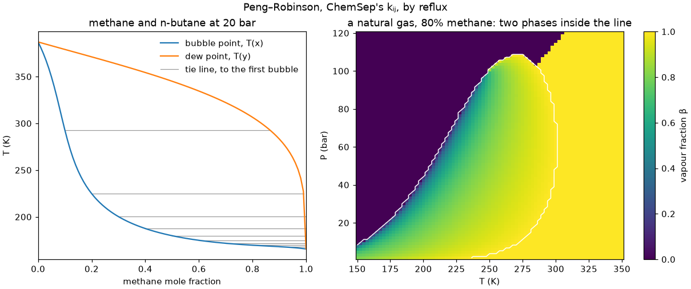

# reflux from Python

reflux's thermodynamics and flashes can be called from Python, with NumPy
arrays in and out. One call evaluates or flashes a whole array of states, and
every point gets its own status, so one point that fails doesn't cost you the
rest. The package is `ctypes` over reflux's C API, `capi/reflux.h`, which any
other language can load too. Flowsheets from Python come next (M10b).

It covers the component database and fluids built from it, a phase's
properties, vapour pressures, the stability test, and every flash reflux has:
PT, PH, PS, TV, UV and the vapour-fraction flashes, with bubble and dew points.
Units are SI throughout: K, Pa, mol, J, m³.

Every example on this page runs in CI, in order, as one session
([python/tests/test_docs.py](../python/tests/test_docs.py)), and the block
under each one is exactly what it prints.

## Installing

You need V at the commit in `.v-version`, gcc (on Windows, MSYS2's UCRT64),
and Python 3.11 or later with NumPy 2. From the source tree, build the library
into the package, then install the package:

```bash
v run tools/python.vsh build
```

```bash
uv pip install -e python
```

Plain `pip install -e python` works too, and so does an install that isn't
editable: the library travels with the package as package data. Only gcc can
build it, since tcc's Windows DLLs export nothing.

The library finds its data in the source tree it was built from, wherever the
package is installed: the compound files in `data/components/`, and ChemSep's
kᵢⱼ banks and Mathias–Copeman constants in `data/vendor/chemsep/`. To use
another data root, set `REFLUX_DATA`, or pass one to `reflux.Database`.

## A first flash

```python
import numpy as np
import reflux

db = reflux.Database()
fluid = db.fluid("PR", ["methane", "n-butane"])
print(fluid)
r = fluid.flash_pt(300.0, 20e5, [0.5, 0.5])
print(r)
print(f"vapour fraction {r.beta:.4f}, {r.vapor.x.round(4)} in the vapour")
```

```text
Fluid('PR', ['Methane', 'N-butane'])
FlashResult(PT, (), 1 of 1 ok, 1 split)
vapour fraction 0.5491, [0.8335 0.1665] in the vapour
```

`db.fluid` takes an equation (`"PR"`, `"SRK"`, `"RK"` or `"vdW"`) and the
compounds, each by name, CAS number, alias or InChIKey. The PT flash takes T,
P and the feed's amounts, which needn't add up to 1. Its answer is a
`FlashResult`.

## Many points at once

Every input can be an array, and they broadcast together by NumPy's rules. A
composition's last axis is the compounds', so one composition serves every
point, or each point can have its own. Here T runs down and P across:

```python
T = np.array([250.0, 300.0, 350.0])
P = np.array([5e5, 20e5, 50e5])
r = fluid.flash_pt(T[:, None], P, [0.5, 0.5])
print(r.status.shape)
print(r.beta.round(4))
print(r.phases)
```

```text
(3, 3)
[[0.5291 0.4276 0.237 ]
 [1.     0.5491 0.3894]
 [1.     1.     0.619 ]]
[[2 2 2]
 [1 2 2]
 [1 1 2]]
```

And a composition for each point:

```python
z = np.array([[0.9, 0.1], [0.5, 0.5], [0.1, 0.9]])
r = fluid.flash_pt(300.0, 20e5, z)
print(r.beta.round(4), r.phases)
```

```text
[1.     0.5491 0.0084] [1 2 2]
```

Arrays that are already C-contiguous `float64` of the points' shape go to the
library as they are, without a copy. Results are arrays of the points' shape,
which the library writes into directly.

## What a flash gives

A `FlashResult` has, for every point:

| Field | What it is |
|---|---|
| `beta` | the vapour fraction: in a split, the fraction of the less dense phase; for one phase, 1 if it's labelled vapour and 0 if liquid |
| `t`, `p` | T (K) and P (Pa), given or found |
| `h`, `s`, `v` | the whole's enthalpy (J/mol), entropy (J/(mol·K)) and volume (m³/mol), per mole of feed |
| `phases` | how many phases: 1 or 2, or 0 without an answer |
| `liquid`, `vapor` | each phase, as a `PhaseView` |
| `fraction`, `x` | both phases at once, along an axis indexed by `reflux.Phase`: `LIQUID` (0) then `VAPOR` (1) |
| `status`, `ok` | each point's `Status`, and where it's `OK` |

A `PhaseView` has `fraction`, its share of the feed's moles; `x`, its mole
fractions; `v`, `h` and `s` per mole of the phase; and `present`. A phase that
isn't there is NaN. A single phase sits in its label's place, so a vapour's
composition is always `r.vapor.x`, and a supercritical fluid is labelled by
its phase identification parameter.

```python
r = fluid.flash_pt([300.0, 450.0], 20e5, [0.5, 0.5])
print(r.phases, r.vapor.present, r.liquid.present)
print(r.vapor.x.round(4))
print(r.liquid.x.round(4))
```

```text
[2 1] [ True  True] [ True False]
[[0.8335 0.1665]
 [0.5    0.5   ]]
[[0.0938 0.9062]
 [   nan    nan]]
```

## Properties

`props` gives a phase's properties at (T, P, z): `z`, the compressibility
factor; `v`, the molar volume; `h`, `s`, `g`, `u` and `a`; `cp` and `cv`; `w`,
the speed of sound (m/s); `mu_jt`, the Joule–Thomson coefficient (K/Pa); and
`ln_phi`, with a last axis of compounds. `root` picks the volume root: the
smallest (`"liquid"`), the largest (`"vapor"`) or the one of lower Gibbs
energy (`"stable"`, the default). Where there's one root, it's that one, and
`phase` says what it's labelled.

```python
pr = fluid.props(300.0, [1e5, 20e5, 50e5], [0.5, 0.5], root="vapor")
print(pr.z.round(4))
print(pr.phase)
print(pr.cp.round(2), pr.w.round(1))
```

```text
[0.9889 0.7376 0.1862]
[1 1 0]
[ 69.19  86.06 136.02] [274.2 218.5 405.5]
```

These are one phase's, at the feed's composition: a state that would split
still has its properties, which is what a flash needs to find its split. H, S,
G, U and A are on the ideal gas's formation basis when every compound has its
ΔH°f and S° (`fluid.absolute`); otherwise only differences at one composition
mean anything.

## Vapour pressure

```python
sat = fluid.psat([180.0, 250.0, 300.0])
for name, p in zip(fluid.names, (sat.p / 1e5).T):
    print(name, p.round(4), "bar")
print(sat.status)
print(sat.reason((1, 0)))
```

```text
Methane [33.0941     nan     nan] bar
N-butane [0.0037 0.3963 2.5773] bar
[[0 0]
 [7 0]
 [7 0]]
Methane: T = 250.0 K is at or above its Tc, 190.56 K, so it has no vapour pressure
```

It's each compound alone, with the fluid's equation and α, along a last axis
of compounds; `fluid.psat(T, "n-butane")` gives one. At or above a compound's
Tc there's none.

## Stability

```python
st = fluid.stability(300.0, [5e5, 50e5, 150e5], [0.5, 0.5])
print(st.stable, st.tm.round(4))
print(st.w[1].round(4))
```

```text
[ True False  True] [ 0.0734 -0.3561  0.    ]
[0.9471 0.0529]
```

`tm` is the lowest tangent-plane distance any trial reached away from the
feed, negative where the feed is unstable, and `w` that trial's composition:
where the feed is unstable, the phase that would appear. If every trial came
back to the feed, as at 150 bar here, `tm` is 0 and `w` the feed.

## The other flashes

| Method | Given | It finds |
|---|---|---|
| `flash_pt(T, P, z)` | T, P | the split |
| `flash_ph(P, H, z)` | P, molar H | T |
| `flash_ps(P, S, z)` | P, molar S | T |
| `flash_tv(T, V, z)` | T, molar V | P |
| `flash_uv(U, V, z)` | molar U, molar V | T and P |
| `flash_tvf(T, beta, z)` | T, vapour fraction | P |
| `flash_pvf(P, beta, z)` | P, vapour fraction | T |
| `bubble_p(T, z)`, `dew_p(T, z)` | T | P, at β = 0 or 1 |
| `bubble_t(P, z)`, `dew_t(P, z)` | P | T, at β = 0 or 1 |

H, S, U and V are per mole of feed, as a flash gives them, so a flash's answer
can be handed to another:

```python
pt = fluid.flash_pt(300.0, 20e5, [0.5, 0.5])
ph = fluid.flash_ph(20e5, pt.h, [0.5, 0.5])
uv = fluid.flash_uv(pt.h - pt.p * pt.v, pt.v, [0.5, 0.5])
print(f"{ph.t:.6f} K, {uv.t:.6f} K and {uv.p / 1e5:.6f} bar")
```

```text
300.000000 K, 300.000000 K and 20.000000 bar
```

A vapour-fraction flash gives both phases even at β = 0 or 1, where one has no
moles: its composition is the incipient phase's. So a bubble point's vapour is
the first bubble.

```python
b = fluid.bubble_p(250.0, [0.5, 0.5])
print(f"{b.p / 1e5:.3f} bar, the first bubble {b.vapor.x.round(4)}")
```

```text
74.057 bar, the first bubble [0.972 0.028]
```

## Statuses

A point without an answer has NaN for every value and a status that says why,
one of `reflux.Status`:

| Status | Why |
|---|---|
| `OK` (0) | it has an answer |
| `BAD_INPUT` (1) | a value it can't use: not finite, T or P ≤ 0, an amount below 0, or none at all |
| `NO_CONVERGENCE` (2) | an iteration ran out of steps |
| `NO_VOLUME_ROOT` (3) | no volume root at a state it needed |
| `MORE_PHASES` (4) | a phase of the split is itself unstable: a third phase |
| `PHASES_SWAPPED` (5) | a vapour-fraction flash's phases swapped |
| `OUTSIDE_ENVELOPE` (6) | there's no such point on the phase envelope |
| `SUPERCRITICAL` (7) | at or above Tc, where there's no vapour pressure |
| `NOT_FINITE` (8) | an answer that isn't finite: beyond the model |

`reason(index)` gives a point's reason in words, by running that point again
alone:

```python
r = fluid.flash_pt([300.0, -5.0, 300.0], [20e5, 20e5, np.nan], [0.5, 0.5])
print(r.ok, r.beta.round(4))
print([reflux.Status(s).name for s in r.status])
print(r.reason(1))
```

```text
[ True False False] [0.5491    nan    nan]
['OK', 'BAD_INPUT', 'BAD_INPUT']
T = -5.0 K: a temperature must be finite and above 0
```

A failure of the whole call is an exception instead: `reflux.NotFound` for a
compound that isn't there, `BadArgument` for an argument the call can't take,
`BadHandle` for a fluid or database that's closed, and `DataError` for data
the database can't use. All are `reflux.RefluxError`s, with the library's
reason.

```python
try:
    db.fluid("PR", ["methane", "butan"])
except reflux.NotFound as e:
    print(e)
```

```text
no compound `butan` in the database. Did you mean Butanal (123-72-8), N-butane (106-97-8), 1-Butanol (71-36-3), 2-Butanol (78-92-2), Isobutane (75-28-5)?
```

## Fluids

```python
mc = db.fluid("PR", ["methane", "n-butane"], alpha="mathias_copeman",
              overrides={("methane", "n-butane"): 0.02})
print(mc.kij)
print([c["alpha"] for c in mc.setup["components"]])
print(mc.setup["pairs"][0]["source"])
```

```text
[[0.   0.02]
 [0.02 0.  ]]
['Mathias–Copeman, mc-PR.lib line 41', 'Mathias–Copeman, mc-PR.lib line 99']
override
```

- `alpha` is `"equation"`, the equation's own α (Soave's for PR and SRK), or
  `"mathias_copeman"`, ChemSep's constants for PR. A compound without them
  keeps the equation's own, and `setup` says so.
- `kij=True` takes ChemSep's kᵢⱼ for PR and SRK, a pair's first listing;
  `kij=False` takes none. `overrides` sets pairs by hand.
- `setup` records how the fluid was built: each compound's constants and α,
  and where each kᵢⱼ came from, as a dict (its TOML is
  `reflux_fluid_setup`'s). `tc`, `pc`, `omega`, `molar_mass` and `kij` are
  read-only arrays in SI.

`db.compound(name)` gives a compound's component file as a dict, and
`db.compounds()` lists them all. `reflux.Database(root, extra=[directory])`
opens another data root, and reads compound files of your own after it: one
with a CAS number the root has replaces the root's.

```python
water = db.compound("water")
print(water["name"], water["ids"]["cas"], water["constants"]["tc"])
```

```text
Water 7732-18-5 647.14
```

## Closing

A fluid or database holds a handle into the library. It's freed when the
object is garbage, or at once by `close()` or a `with` block:

```python
with db.fluid("SRK", ["nitrogen"]) as n2:
    print(f"{n2.psat(77.0, 'nitrogen').p / 1e5:.4f} bar")
print(n2)
```

```text
0.9603 bar
Fluid('SRK', ['Nitrogen'], closed)
```

A result keeps its fluid open while it lives, for `reason`. A closed fluid's
handle is never given out again, so using it is a `BadHandle` error, never a
crash.

## Threads

Calls from many Python threads at once are safe, and give the same answers as
one thread, bit for bit. The package makes the library's first call when it's
imported, which is the one that mustn't race.

```python
from concurrent.futures import ThreadPoolExecutor

T = np.linspace(200.0, 400.0, 2000)
serial = fluid.flash_pt(T, 20e5, [0.5, 0.5])
with ThreadPoolExecutor(4) as pool:
    parts = pool.map(lambda t: fluid.flash_pt(t, 20e5, [0.5, 0.5]), np.array_split(T, 4))
    threaded = np.concatenate([p.beta for p in parts])
print(np.array_equal(threaded, serial.beta))
```

```text
True
```

They don't run much faster, though: with 8 threads, 1.3 to 2.3 times one
thread's rate. Every point allocates, and the collector's lock is shared.

## Speed

A call costs about 0.1 to 0.2 ms more than V's own loop over the same points,
the package's NumPy setup and its result objects, so pass arrays, not one
point at a time. Per point, the C API adds a few µs to properties and nothing
measurable to a flash. But V's code runs 1.3 to 1.8 times slower inside the
library, in a Python process, than in a V program of its own, for a reason
not yet known, so a PT flash takes that much longer from Python.
[benchmarks.md](benchmarks.md), "From Python", has the numbers.

## From other languages

`capi/reflux.h` is the whole API: plain functions that take `int32_t`,
`int64_t`, `double` and pointers, and return 0 or a negative code with the
reason in a buffer you pass. Handles are `int64_t` ids, never reused.
Many-point functions take each input with a count of 1 or n, and write
property-major outputs, `out[k*n + i]`, with a status for each point. Make one
call from one thread before any other, since that's where V's runtime starts.
The header documents every function and every number.

## The exit script

[python/examples/phase_diagrams.py](../python/examples/phase_diagrams.py)
draws two phase diagrams with matplotlib: a T–x–y of methane and n-butane at
20 bar, from 101 bubble and 101 dew points, and a vapour-fraction map of a
natural gas from 6,480 PT flashes. With matplotlib installed:

```bash
python python/examples/phase_diagrams.py docs/images/phase-diagrams.png
```



Outside the envelope the gas is one phase, with β = 1 where it's labelled
vapour and 0 where it's labelled liquid. Above the cricondenbar, about 108
bar, that label is the phase identification parameter's, so the colour changes
where the fluid is neither, at about 275 to 305 K.

Its tests check that its numbers are the V API's bit for bit, that the T–x–y's
ends are each compound's saturation and its tie lines close, and that the map
splits exactly where the feed is unstable.
