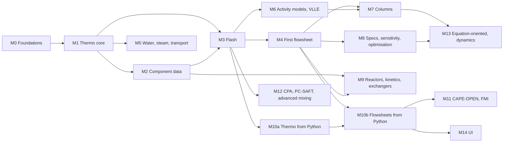

# reflux roadmap

This is a dependency map, not a schedule: it says what has to exist before
what, and how we'll know each piece is done. There are no dates.

It has three parts:

1. **[Milestones](#milestones):** the critical path, each with exit criteria.
2. **[Tracks](#tracks):** the full scope, grouped by area. Each item is
   tagged with the milestone that first needs it.
3. **Cross-cutting policies:** [headless testing](#testing-headless),
   [C numeric libraries and replacing them](#c-numeric-libraries),
   and [interoperability](#interoperability) (CAPE-OPEN, FMI and the rest).

## Principles

- **Headless core first.** Everything is reachable from the V API, the CLI
  and plain-text files before any UI exists. The UI comes last and only
  calls the public API.
- **Every milestone ends in tests that run in CI.** "Done" means a test
  proves it, not that a demo looked right.
- **Pure V by default, C by choice.** The default build has no C
  dependencies and builds with tcc. C libraries plug in behind compile-time
  flags and are replaced only when a pure-V version passes the same tests
  at acceptable speed.
- **Standards are adapters.** CAPE-OPEN, FMI and Python bindings sit on top
  of the core in their own modules. The core never imports them.
- **Your analysis tools, not ours.** Being able to work on results in
  Python with NumPy, pandas and Jupyter is a first-class requirement, not an
  afterthought. Thermo becomes scriptable right after the first flash
  (M10a), long before any UI.

---

## Where to start

1. **M0 foundations.** Put the repo under git, add CI, and install a real C
   compiler. Everything after this point needs regressions caught
   automatically, and every C library needs gcc or MSVC.
2. **M1 thermo core.** Add second derivatives of F, residual and ideal-gas
   caloric properties, and a small dense LU. Every flash and unit operation
   needs H and S, and Newton flash needs ∂²F/∂nᵢ∂nⱼ.
3. Then follow the critical path **M2 → M3 → M4** to the first flowsheet
   that solves end to end and can be compared with DWSIM 9.
4. As soon as M3 lands, do **M10a** (thermo and flash from Python), in
   parallel with M4. A small spike calling a V shared library from Python
   with a NumPy array is worth doing earlier still, during M1, to flush out
   surprises in V's shared-library support.

---

## Milestones



### M0 — Foundations
**Done.** CI is green on both OSes with both compilers, and a deliberately
failing test turned all four jobs red.

- git repository, GitHub, licence decision (MIT in `v.mod` for now).
- CI on Windows and Linux. Jobs: `v fmt -verify .`, `v vet .`,
  `v -W test .`, each with tcc and with gcc.
- A real C compiler on your machine: MSYS2 UCRT64 gcc (or the MSVC Build
  Tools). This is needed for `-prod` builds and every C library below.
- `testdata/` for fixtures (borrowed from Go's convention) and `tools/` for
  the scripts that generate them.

**Exit:** CI is green on both OSes with both compilers; a deliberately
broken test turns it red.

### M1 — Thermo core
**Done.** The detailed plan and the criterion-by-criterion exit review are
in [m1-plan.md](m1-plan.md). The plan refined the exit criteria below. In
particular, n-butane was checked against CoolProp's reference equation
rather than NIST WebBook spot values: it's the same reference equation
(Bücker & Wagner) without the copying by hand.

- Second derivatives in the `Model` contract: F_TT, F_TV, F_Vnᵢ, F_Tnᵢ,
  F_nᵢnⱼ (Track C1).
- Residual Hʳ, Sʳ, Gʳ, Cpʳ, Cvʳ; speed of sound; Joule–Thomson coefficient.
- Ideal-gas Cp (DIPPR 107 / Aly–Lee and polynomials), so that total H, S
  and Cp are available.
- Pure-V dense LU with partial pivoting (Track B1).
- Cubic family: Twu and Mathias–Copeman α, Péneloux volume translation.

**Exit:** all derivatives pass finite-difference and Maxwell-relation tests;
H and S of n-butane match NIST WebBook spot values within the model's
expected error; ∂ln φᵢ/∂T at constant P equals −H̄ʳᵢ/RT².

### M2 — Component data
Detailed plan, including what the ChemSep files contain and their
licence: [m2-plan.md](m2-plan.md).

- Component record with identifiers (name, CAS, formula, InChIKey) and
  **provenance on every value** (Track D1).
- ChemSep XML importer that writes reflux's own text data format (D2).
- Temperature-dependent correlations: DIPPR equations, Antoine, Wagner (D3).
- kᵢⱼ banks for PR and SRK, with provenance (D4).

**Exit:** every ChemSep compound loads; PR Psat for a fixed set of 20
compounds is checked against the database's own vapour-pressure
correlations.

### M3 — Flash
- Michelsen tangent-plane stability analysis (E1).
- Two-phase PT flash: Rachford–Rice, successive substitution with
  acceleration, then second-order Newton (E2).
- PH, PS, TV and vapour-fraction flashes; bubble and dew points (E3).
- Pure-V Newton with line search or trust region (B2).

**Exit:** a robustness sweep of 10,000 random (T, P, z) points for PR with
2 to 10 components has zero unexplained failures. Results agree with
`thermo` and DWSIM 9 on a reference set. Fugacities are equal at every
converged split.

### M4 — First flowsheet (vertical slice)
- Streams, ports, the unit-operation interface and the flowsheet graph (F1).
- TOML flowsheet files with a format version (F2).
- Sequential-modular solver: strongly connected components, tear streams,
  direct substitution, Wegstein and Broyden, with convergence reports at
  each iteration (F3).
- Units: mixer, splitter, valve, heater/cooler, pump, flash drum (G1).
- CLI: `reflux solve plant.toml --json results.json`.

**Exit:** a reference flowsheet with one recycle solves headless in CI and
matches DWSIM 9. Overall mass and energy balances close to solver
tolerance.

### M5 — Water, steam and transport properties
- IAPWS-IF97 natively. IAPWS-95 is itself a Helmholtz equation, so it fits
  the `Model` contract directly (C6).
- Viscosity, thermal conductivity, surface tension (C7).
- CoolProp behind a flag, as a reference oracle in tests (B-table).

**Exit:** IF97 passes the verification tables published with the standard;
the transport properties pass reference checks.

### M6 — Activity models and liquid–liquid equilibrium
- Wilson, NRTL, UNIQUAC, UNIFAC (original, and the published Dortmund
  parameters); γ–φ with Poynting correction (C5).
- Three-phase VLLE flash with stability (E4).

**Exit:** Gibbs–Duhem consistency tests pass; the binaries reproduce
published VLE and LLE data sets.

### M7 — Columns
- Shortcut column (Fenske–Underwood–Gilliland).
- Rigorous equilibrium-stage column, inside-out first, then
  Naphtali–Sandholm Newton; absorbers and strippers (G4).
- Sparse linear algebra once columns get large (B3).

**Exit:** textbook column examples are reproduced, and results match DWSIM 9
on a reference column. Robustness is reported across a set of specs.

### M8 — Specifications, sensitivity analysis and optimisation
- Design specs ("vary reflux ratio until purity is 99.5%"), converged
  together with the tear streams (F4).
- Warm starts and state caching (F5).
- Sensitivity sweeps with warm starts along the sweep, parallel cases via
  `spawn`, and exact local sensitivities from the converged Jacobian (H1).
- Optimisation: NLopt for small problems, IPOPT for large ones (B6, H3).

**Exit:** the same sensitivity analysis runs faster than DWSIM 9 on the same
machine, measured with `-prod` builds.

### M9 — Reactors, kinetics and heat exchangers
- **Kinetics as structured data** (Track L, design in
  [kinetics.md](kinetics.md)). This responds to DWSIM's text-box LHHW input.
  Rate laws are power law, LHHW, Eley–Rideal or a parsed expression.
  Adsorption terms are defined once per catalyst site and shared by every
  reaction on it. Reversibility comes from ΔG°f by default.
- `reflux kinetics check` and `explain`: render each rate back as a
  formula; check element balance, units and consistency with equilibrium;
  print a factor table at any state. The kinetics core needs only M2, so it
  can be built before the reactors.
- Conversion and yield reactors; Gibbs-minimisation equilibrium reactor (E6);
  CSTR; PFR and packed bed (which need an ODE integrator, B5).
- Two-stream exchangers specified by duty, outlet T, UA or approach (G2).

**Exit:** the Vanden Bussche–Froment methanol kinetics loads from TOML,
renders back as the published equations, passes every check, and
reproduces published rate values. A packed-bed PFR with that kinetics
closes its element balances and approaches equilibrium. Textbook reactor
cases are reproduced.

### M10 — Python and the C ABI

This responds directly to DWSIM's scripting: you should be able to use
NumPy, pandas and Jupyter on reflux results the way you use them on
anything else.

**M10a — thermo and flash from Python (after M3)**
- A C API built with `v -shared`. Its functions are exported with V's
  `@[export: 'reflux_…']` attribute and take plain pointer-and-length `f64`
  arrays, so NumPy arrays pass in and out **without copying** (I1).
- **Vectorised calls:** one call flashes a whole array of (T, P, z) states,
  so a 10,000-point study doesn't cost 10,000 Python→C round trips. Each
  point gets its own status code, so a failure at one point doesn't throw
  away the other 9,999.
- A `reflux` Python package over the C API using `ctypes`, so there's no
  compile step for users. Wheels that bundle the shared library come later
  (I2).
- **Retired in M1 by a spike** ([spike-python-ffi.md](spike-python-ffi.md)):
  V's runtime starts and collects correctly inside Python. The spike also
  set the design rules:
  - explicit integer widths at the boundary (V's `int` is 64-bit);
  - gcc or clang only (tcc can't build loadable shared libraries on Windows
    or Linux), with `-static-libgcc` on Windows;
  - handles pinned in a V-side registry (the GC frees anything only Python
    holds);
  - the calling thread registered with the GC at every entry point (Python
    threads abort a Linux collection otherwise);
  - no panics reachable from the API.
- Still to test: concurrent calls from several Python threads, since
  `ctypes` releases the GIL.

**Exit:** a script computes a T–x–y diagram and a phase-fraction map into
NumPy arrays and plots them with matplotlib, and that script runs in CI.
Results match the V API bit for bit.

**M10b — flowsheets from Python (after M4)**
- Build, modify and solve flowsheets as Python objects. Stream tables come
  back as dicts of NumPy arrays, ready for `pandas.DataFrame`.
- Sensitivity sweeps driven from Python keep warm starts on the reflux
  side, so a Python loop isn't slower than a built-in case study.

**Exit:** a notebook-style script builds the M4 reference flowsheet in
Python, sweeps one parameter, and gets the same numbers as the CLI.

### M11 — CAPE-OPEN and FMI
- reflux as a CAPE-OPEN 1.1 property package, tested inside COCO and
  DWSIM (I3).
- FMI 3.0 co-simulation export of a flowsheet or unit operation (I4).

**Exit:** COCO and DWSIM each run a flowsheet that uses reflux's thermo; an
exported FMU passes an FMU validator (for example FMPy's) and runs in a
third-party FMI host.

### M12 — Advanced thermodynamics
- CPA (the proof that the `Model` contract is general), PC-SAFT, and CPC or
  PRBS if needed (C4).
- Huron–Vidal, MHV2, PSRK and Wong–Sandler mixing rules (C3).
- Phase envelopes and critical points (E5).

**Exit:** CPA reproduces published water–alcohol–hydrocarbon results; phase
envelopes trace through the critical point.

### M13 — Equation-oriented solving and dynamics
- Every unit operation exposes residuals and Jacobian contributions (J1).
  This is why G1 units should be designed with residuals in mind from the
  start.
- Equation-oriented Newton with a sparse LU (KLU), initialised from a
  sequential-modular solution (J2).
- Dynamics: holdups, DAEs, IDA, PID controllers (J3); FMI model-exchange
  export (J4).

**Exit:** equation-oriented and sequential-modular solutions agree on every
golden flowsheet; a dynamic flash drum step test matches a reference.

### M14 — UI
- A headless service (JSON over stdio or HTTP via `veb`) as the only thing
  the UI talks to (I6).
- Flowsheet editor, stream tables, plots (T–x–y, phase envelopes).

**Exit:** everything the UI can do can also be done from a script.

---

## Tracks

### A — Foundations and tooling (cross-cutting)
| Item | Needed by |
|---|---|
| A1 Repo, CI matrix (Windows/Linux × tcc/gcc), fmt and vet gates | M0 |
| A2 Units at the boundary: parse `25 degC`, `1 atm`, `kmol/h`; SI inside | M4 |
| A3 Structured diagnostics: every solver returns *why* it stopped | M3 |
| A4 Iteration tracing (opt-in) for convergence debugging | M3 |
| A5 Benchmark harness (`benchmark` module) with tracked results | M3 |
| A6 Flowsheet and data file formats, versioned, with migrations | M4 |
| A7 Docs: `v doc`; every example compiled and run in CI | M0 |
| A8 Releases: semver, changelog, golden suite gates every release | M4 |

### B — Numerics
| Item | Pure V | C backend | Needed by |
|---|---|---|---|
| B1 Dense linear solve | LU with partial pivoting | LAPACK (OpenBLAS), or `vsl` with `-d vsl_lapack_lapacke` | M1 |
| B2 Nonlinear systems | Newton + line search / dogleg trust region; Brent in 1-D | KINSOL (SUNDIALS) for large systems | M3 |
| B3 Sparse matrices | CSR/CSC, finite-difference Jacobians with column colouring | KLU (+ AMD/COLAMD, BTF) | M7 |
| B4 Graphs | Tarjan SCC, tear selection, block-triangular ordering | none needed | M4 |
| B5 ODE / DAE | RK45, Rosenbrock for stiff PFRs | CVODE, IDA | M9, M13 |
| B6 Optimisation | none planned | NLopt (small), IPOPT (large NLP) | M8 |
| B7 Continuation / homotopy | arc-length continuation | none needed | M12 |

### C — Thermodynamics and properties
- C1 `Model` contract: second derivatives; caloric properties; ideal-gas
  part. **M1**
- C2 Cubic family: Twu, Mathias–Copeman, Boston–Mathias extrapolation above
  Tc, Péneloux, PR78. **M1**
- C3 Mixing rules: vdW1 (done) → Huron–Vidal, MHV1/2, PSRK, Wong–Sandler. **M12**
- C4 Association and SAFT: CPA, PC-SAFT, CPC, PRBS. **M12**
- C5 Activity models: Wilson, NRTL, UNIQUAC, UNIFAC; γ–φ. **M6**
- C6 Reference equations: IAPWS-IF97/95 natively; GERG-2008 through CoolProp
  first, natively later. **M5**
- C7 Transport: viscosity, thermal conductivity, diffusivity, surface tension. **M5**
- C8 Electrolytes (eNRTL, e-CPA). **after M12**
- C9 Property packages: phase models + transport + data, chosen per
  flowsheet. This is what CAPE-OPEN exposes. **M4**

### D — Component data
- D1 Component records with identifiers and per-value provenance. **M2**
- D2 ChemSep XML importer (`encoding.xml`) → reflux text format. **M2**
- D3 DIPPR, Antoine and Wagner correlations. **M2**
- D4 Interaction-parameter banks (kᵢⱼ, NRTL, UNIQUAC) with provenance. **M2, M6**
- D5 UNIFAC group tables; Joback / Constantinou–Gani estimation. **M6**
- D6 Pseudo-components for petroleum fractions. **after M7**
- D7 Cross-check fixtures from `thermo`, CoolProp and NIST, generated by
  `tools/` and stored in `testdata/`. **M1 onwards**

### E — Phase equilibrium
- E1 Stability analysis (tangent-plane distance). **M3**
- E2 PT flash: Rachford–Rice, accelerated successive substitution, Newton. **M3**
- E3 PH, PS, TV, UV and vapour-fraction flashes; bubble and dew points. **M3**
- E4 Three-phase and multiphase flash; free-water handling. **M6**
- E5 Phase envelopes, critical points, azeotrope search. **M12**
- E6 Chemical equilibrium by Gibbs minimisation. **M9**

### F — Flowsheet core
- F1 Streams, ports, unit-operation interface, flowsheet graph. **M4**
- F2 TOML flowsheet format, versioned; CLI. **M4**
- F3 Sequential-modular solver: SCC, tears, Wegstein/Broyden, diagnostics. **M4**
- F4 Design specs converged together with the tears. **M8**
- F5 Warm starts and state caching. **M8**
- F6 Reports: JSON, CSV, stream tables, convergence history. **M4**

### G — Unit operations
- G1 Mixer, splitter, valve, heater/cooler, pump, compressor/expander,
  flash drum, component separator. **M4**
- G2 Heat exchangers. **M9**
- G3 Reactors: conversion, yield, Gibbs, CSTR, PFR, packed bed (using Track L
  kinetics). **M9**
- G4 Columns: shortcut, inside-out, Naphtali–Sandholm; absorbers and
  strippers; three-phase and rate-based later. **M7**
- G5 Extractors and other separators. **after M7**
- G6 User unit operations through the V interface, CAPE-OPEN or FMI. **M11**

### H — Analysis
- H1 Sensitivity analysis: warm starts, parallel cases, exact sensitivities. **M8**
- H2 Case studies and scenario files. **M8**
- H3 Optimisation over flowsheet variables. **M8**
- H4 Parameter estimation (fit kᵢⱼ or NRTL to VLE data; fit LHHW constants
  to lab rate data, with confidence intervals); data reconciliation. **M8, M9**
- H5 Monte Carlo uncertainty propagation. **after M8**

### I — Interoperability
- I1 C ABI shared library: zero-copy arrays, vectorised calls. **M10a**
- I2 Python package (`ctypes` first, wheels later); flowsheet objects. **M10a, M10b**
- I3 CAPE-OPEN 1.1 property package; then unit operations; then reflux
  as a host for other vendors' CAPE-OPEN components. **M11**
- I4 FMI 3.0 export (co-simulation first, model exchange after M13). **M11**
- I5 Data exchange: ThermoML import; AMPL `.nl` export of
  equation-oriented models; CSV stream tables. **M8 onwards**
- I6 Service mode (JSON over stdio or HTTP). **M14**
- I7 OPC UA for plant connectivity and digital twins. **later**

### J — Equation-oriented solving and dynamics
- J1 Residual form for every unit operation. **designed in M4, used in M13**
- J2 Equation-oriented solve with sparse Newton. **M13**
- J3 Dynamics: DAEs, IDA, index reduction, controllers. **M13**
- J4 FMI model-exchange export. **M13**

### K — UI
- K1 Service API (I6), K2 flowsheet editor, K3 plots. **M14**

### L — Reaction kinetics
- L1 Rate-law building blocks: Arrhenius (centred on T_ref) and van 't Hoff
  temperature functions, monomials, catalyst sites with shared adsorption
  terms. **M9**
- L2 Rate laws: power law, LHHW, Eley–Rideal; activity basis per reaction
  (partial pressure, fugacity, concentration). **M9**
- L3 TOML input with equation parsing and element-balance checks. **M9**
- L4 `reflux kinetics check` / `explain`: rendering (Unicode, LaTeX), units,
  physical-sanity warnings, factor tables. **M9**
- L5 Thermodynamic reversibility from ΔG°f; equilibrium consistency check. **M9**
- L6 Analytic ∂r/∂aⱼ and ∂r/∂T, checked against finite differences. **M9**
- L7 Free-form expression rate laws (parsed, unit-checked, differentiated). **after M9**

---

## Testing headless

Every layer is tested from the command line, and none of it needs a GUI.
Running `v run tools/check.vsh` locally runs exactly what CI runs.

| Layer | What it proves | How |
|---|---|---|
| Unit tests | each function does what it says | `v -W test .`, per module |
| Identities | the thermodynamics is self-consistent | finite-difference derivatives, Euler homogeneity, Maxwell relations, Gibbs–Duhem, Σnᵢ ln φᵢ = Gʳ/RT |
| Flash invariants | a converged flash is really an equilibrium | equal fugacities, TPD ≥ 0 for the stable phase set, mass balance, Σx = Σy = 1 |
| Reference values | numbers match the outside world | textbook examples, NIST, published data, `thermo` and CoolProp fixtures in `testdata/` with their provenance |
| Robustness sweeps | solvers converge across the whole space, not only at test points | thousands of random states per model; failure rate and iteration counts tracked over time |
| Backend differential tests | C and pure-V backends agree | the same test suite run with and without each `-d reflux_<lib>` flag |
| Golden flowsheets | whole-plant results don't drift between versions | TOML flowsheets with expected JSON results and tolerances; compared with DWSIM 9 where DWSIM is right |
| Balance closure | no unit leaks mass or energy | every flowsheet test checks overall component, element and energy balances |
| Benchmarks | speed claims are real | `-prod` builds with gcc or clang only; results kept so regressions show |
| Docs examples | the docs aren't stale | every example in `docs/` is a file that CI compiles and runs |
| Python API | the bindings give the same answers as V | from M10a: a CI job builds the shared library and runs the Python scripts with NumPy against the same fixtures |
| Fuzzing | parsers don't crash on bad input | random and mutated TOML and XML inputs |

The fixture workflow keeps the V tests pure V. Python appears only in
fixture generation and, from M10a, in the separate Python API job:

```
tools/gen_fixtures.py   (run by hand, uses thermo / CoolProp)
      ↓ writes
testdata/*.json         (checked in, with source and version of every value)
      ↓ read by
*_test.v                (pure V, runs everywhere)
```

CI runs two kinds of jobs. The **pure** job uses tcc with no C libraries and
must always pass. The **backends** job uses gcc with MSYS2 or apt packages
and runs the same tests with each backend flag.

---

## C numeric libraries

### How a backend plugs in

Each numerical service is a small V interface in `numeric/`, with a pure-V
implementation that is always present. A C implementation is compiled in
only when its flag is given:

```v
pub interface LinearSolver {
	solve(a []f64, b []f64, n int) ![]f64
}

$if reflux_lapack ? {
	#flag -lopenblas
	// C.dgesv_ declaration and a LapackLu struct implementing LinearSolver
}

pub fn default_linear_solver() LinearSolver {
	$if reflux_lapack ? {
		return LapackLu{}
	} $else {
		return PureLu{}
	}
}
```

This is the same pattern `vsl` uses (`-d vsl_lapack_lapacke`). Build with
`v -d reflux_lapack .` to switch. Callers never change.

### The libraries

| Library | Purpose | Licence | Windows | First needed | Replace with pure V? |
|---|---|---|---|---|---|
| OpenBLAS + LAPACK | dense linear algebra | BSD-3 | MSYS2 | M1 (optional) | **Yes, for small n.** Thermo-sized systems (nc ≤ ~50) are pure V from day one; C only when profiles show large dense systems. |
| SUNDIALS KINSOL | large nonlinear systems | BSD-3 | MSYS2 | M7/M13 | **Probably.** reflux needs its own Newton anyway; KINSOL stays for large sparse cases until ours matches it. |
| SuiteSparse KLU (+AMD, COLAMD, BTF) | sparse LU for flowsheet and column Jacobians | KLU/BTF LGPL-2.1+, AMD/COLAMD BSD-3 | MSYS2 | M7/M13 | **Later, maybe.** A left-looking (Gilbert–Peierls) sparse LU in V is feasible once the Jacobians are well understood. |
| SUNDIALS CVODE / IDA | stiff ODEs (PFR), DAEs (dynamics) | BSD-3 | MSYS2 | M9/M13 | **Unlikely.** Simple PFRs can use a pure-V Rosenbrock method; IDA stays for dynamics. |
| IPOPT | large nonlinear optimisation | EPL-2.0 | official MSVC binaries (3.14.20); has a C interface | M8 | **No.** Decades of work; keep it. |
| NLopt | small and derivative-free optimisation | mostly MIT, some algorithms LGPL | MSYS2 | M8 | **Maybe**, for the few algorithms actually used. |
| CoolProp | reference fluids, test oracle | MIT | build from source or use its DLL | M5 | **Partly.** IF97 and selected fluids go native; CoolProp stays as the test reference. |

Licence policy: the core stays MIT. LGPL libraries (KLU) are fine when
linked dynamically. GPL libraries (UMFPACK, GSL) stay out of the default
build.

### Replacement policy

A C backend is replaced only when the pure-V version

1. passes the same test suite, including the robustness sweeps, and
2. is within about 1.5× on the benchmark problems reflux actually solves.

The C version then stays available behind its flag for one release so the
two can be compared.

### Toolchain

- tcc builds the pure job but can't link these libraries reliably. Use
  MSYS2 UCRT64 gcc on Windows (`pacman` has OpenBLAS, LAPACK, SuiteSparse,
  SUNDIALS, NLopt, SuperLU and MUMPS), or WSL2 with apt.
- IPOPT's Windows binaries are built with MSVC. Because IPOPT exposes a C
  interface, its DLL can still be called from a gcc build; or use
  `v -cc msvc`.
- C++-only libraries (Eigen, CppAD, CasADi's C++ API) can't be called from V
  directly. Each would need a small C shim, so C APIs are preferred.

---

## Interoperability

### CAPE-OPEN

CAPE-OPEN is still *the* standard that commercial and open simulators use
to share thermodynamics and unit operations. Aspen, PRO/II, DWSIM and COCO
all speak it. Two parts matter for reflux:

1. **reflux as a property package.** reflux's thermo becomes usable inside
   COCO, DWSIM and Aspen. It's the fastest route to real users, and to
   validation against other people's flowsheets. Start here (M11).
2. **reflux as a host for others' components.** Other vendors' CAPE-OPEN
   thermo or unit operations run inside reflux flowsheets. Later.

The transport is **COM**, so this is Windows-only. COM objects are C-level
virtual tables, so the plan is a thin C or C++ COM shim over reflux's C ABI
(M10), registered as a COM server. The CAPE-OPEN types for arrays and
variants (SAFEARRAY, VARIANT) are handled in the shim, never in reflux
itself. COCO (free) is the test host.

**COBIA** is CO-LaN's successor middleware for CAPE-OPEN (latest release
1.2.1.0). Its SDK is C++ and Windows-only; cross-platform support is the
goal of its third phase, which hasn't shipped as far as I can find. COM is
the target for reach today, with COBIA tracked for when it goes
cross-platform.

### Modern alternatives, and where each fits

There is no modern replacement for CAPE-OPEN's thermo interface. COBIA is
the official successor. Other standards cover other needs:

| Standard | Use in reflux |
|---|---|
| **FMI 3.0** (Modelica Association; 3.0.2 is current) | Export flowsheets and unit operations as FMUs for Modelica, Simulink and digital-twin tools. It's a C API, cross-platform, so it suits V well. Co-simulation first (M11), model exchange once dynamics exist (M13). |
| **C ABI + Python** | The de-facto scripting interface: NumPy, pandas, Jupyter, automation, side-by-side comparison with `thermo`, and IDAES/Pyomo users (M10a, M10b). |
| **AMPL `.nl` files** | Hand equation-oriented models to external optimisers (IPOPT, Knitro) (M13). |
| **ThermoML** (IUPAC/NIST XML) | Import experimental data for parameter fitting and validation (M8). |
| **JSON over stdio/HTTP** | The service API for the UI and for other programs (M14). |
| **OPC UA** | Live plant data for digital twins (later). |

---

## Not planned

- A GUI before M14.
- GPL dependencies in the default build.
- Copying zfactor or DWSIM designs. Both are references for checking
  results, not templates.
