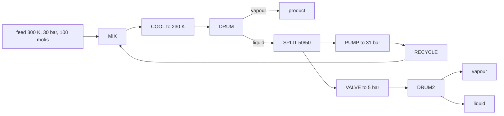

# Spike: DWSIM 9's flowsheets, headless (M4 step 0)

**Verdict: go**, with the conditions under "What step 8 must do". DWSIM
9.0.5 builds and solves a flowsheet with a recycle from a Python script,
and its recycle converges as tightly as the comparison needs. The open-loop
fallback of D12 works too, and sharply. M3's spike
([spike-dwsim.md](spike-dwsim.md)) covers loading DWSIM and its flashes;
this one starts where that stopped.

What it found that the plan didn't expect:
- **A failed unit is silent.** DWSIM's flowsheet solver reports no error
  when a unit fails; the message is only in that unit's `ErrorMessage`.
- **DWSIM's default recycle tolerances leave the balances 0.2% (mass) and
  1.4% (energy) open.** Tightened, they close to 1e-13 in total flow, but
  each component and the energy stop at 9e-8 and 6e-7.
- **DWSIM's acceleration does nothing here.** Wegstein and the
  dominant-eigenvalue method take the same iterations as none, to the same
  numbers, and Broyden fails without iterating.
- **Its pump uses a liquid density that isn't the equation of state's,**
  so its work comes out a third below what PR's own volume gives.
- **Its flash drum is wrong with two inlets**, in both of the modes tried.

The spike is one script, [spike/dwsim_flowsheet/run.py](../spike/dwsim_flowsheet/run.py),
a uv script like the fixture generators, run from the repository root:

```bash
uv run --python 3.13 spike/dwsim_flowsheet/run.py
```

It takes the sections to run (1 to 4, all by default), since section 2
spends most of its few minutes on Broyden failing. It prints every number
below.

## The reference flowsheet

Five light hydrocarbons, PR with DWSIM's own constants and kᵢⱼ, and its
flash tolerances at 1e-8 as in M3:



The feed is 70% methane, 10% ethane, 8% propane, 7% n-butane and 5%
n-pentane.

## Results (Windows 11, DWSIM 9.0.5.0, Python 3.13.17, pythonnet 3.0.5)

| Check | Result |
|---|---|
| Builds and solves headless | yes. The first solve takes 1.7–2.2 s while .NET compiles it, a solve of a new flowsheet 0.6–4.5 s, and a warm re-solve 75–150 ms. |
| At DWSIM's default recycle tolerances | 5 iterations; the overall balances miss by 1.75e-3 in total flow, 5e-4 in the worst component and 1.4e-2 in energy, of the feed's |
| Its tolerances scaled by 1e-2, 1e-4, … 1e-10 | 12, 18, 25, 32, 38 iterations. Total flow closes to 1.3e-5, 2.1e-7, 1.6e-9, 1.3e-11, 2.0e-13, but the worst component stops at 9.3e-8 and energy at 5.6e-7 from 1e-6 on. |
| Wegstein and dominant-eigenvalue acceleration | the same iterations and the same numbers as none, in either recycle mode (`LegacyMode` on or off) |
| Broyden (`GlobalBroyden`) | 0 iterations, not converged, after 41–49 s, in either mode |
| The open loop: the cut loop fed DWSIM's converged recycle stream | hands it back within 8e-14 in flows, 0 K and 0 Pa, in 0.1 s |
| Pump work | v·ΔP/η to 1.5e-5, with v from DWSIM's reported density |
| Compressor and expander | ΔH = ΔH_s/η and η·ΔH_s exactly, ΔH_s from its own PS flash: "adiabatic efficiency" is the isentropic efficiency |
| Valve | isenthalpic, exactly |
| Cooler | its duty is H in − H out, exactly |
| Mixer | the lowest inlet pressure, and H in = H out exactly at the tight reference (to 4e-7 at the defaults) |
| Flash drum, two inlets at 300 K and 30 bar, and 220 K and 25 bar | "Legacy": 260.000 K, the mean of the inlet temperatures, where an energy balance gives 260.187 K, and 363 W lost. "Adiabatic": 290.615 K, and 62.7 kW created. Mass balances in both. |
| DWSIM's PS and PH flashes from a state's own S or H | back to it within 2e-7 K and 0.0000 J/mol |

## What we learned

1. **Building a flowsheet.**
   - `sim.AddObject(ObjectType.X, x, y, name)` makes each object, and
     `sim.ConnectObjects(a.GraphicObject, b.GraphicObject, i, j)` joins an
     outlet port to an inlet port (−1 for the first free one). A flash
     drum's port 0 is its vapour and port 1 its liquid; a mixer takes its
     inlets on ports 0, 1, ….
   - A heater, cooler, pump or compressor needs an energy stream
     connected.
   - Each unit's specification is a mode and a value: `CalcMode =
     OutletTemperature` and `OutletTemperature = 230.0` for the cooler,
     `Pout` for the pump, `OutletPressure` for the valve, `POut` for the
     compressor.
   - **A splitter wants a ratio for each of its three ports,** the unused
     third included. With two it fails "Index was out of range".
   - **The torn stream needs a first estimate.** Without one, the mixer
     took the stream's default 1 atm as the lowest pressure.
2. **Failures are silent.** `CalculateFlowsheet2` returned an empty error
   list while the splitter had failed and every unit after it was left
   uncalculated. Each unit has `Calculated` and `ErrorMessage`, and each
   stream's properties are `None` when it wasn't calculated. A script has
   to look at all of them.
3. **The recycle's tolerances** are fields of `Recycle.ConvergenceParameters`
   with Portuguese names, all absolute: `Temperatura` 0.1, `Pressao` 0.1,
   `VazaoMassica` (mass flow) 0.01, `FracaoVapor` 0.01, `Entalpia` 1,
   `Entropia` 0.01, `Composicao` 0.001. A mass-flow tolerance of 0.01 kg/s
   on a loop carrying about 1.4 kg/s is what leaves the defaults 0.2% open.
   `MaximumIterations` is 50.
4. **Where DWSIM's balances stop.** Scaling every tolerance down closes the
   total flow to round-off, but not each component (9.3e-8) or the energy
   (5.6e-7). That's DWSIM's floor for this comparison. It's far below
   criterion 2's targets (1e-4 in β and compositions, 0.01% in duties), so
   it doesn't limit the comparison.
5. **DWSIM's acceleration isn't reached through automation.** Wegstein
   (every 4th iteration, q in [−20, 0] by default) and the dominant
   eigenvalue gave results identical to none, so in effect DWSIM's recycle
   is direct substitution here. `GlobalBroyden` fails after 41 s without an
   iteration. So the speed comparison (step 9) is against DWSIM as a user
   would run it, and its iteration count against reflux's Wegstein says
   nothing about methods.
6. **DWSIM's pump uses a liquid density that isn't PR's.** For the pump's
   inlet, a saturated liquid at 230 K and 30 bar, three volumes disagree:
   - **48.63 cm³/mol** from DWSIM's reported density, 829.67 kg/m³, which
     is what its pump uses;
   - **73.61 cm³/mol** from the phase's own compressibility factor,
     Z = 0.115477, which is PR's volume;
   - **69.11 cm³/mol** implied by DWSIM's H and S: at constant T,
     dH − T dS = v dP exactly, and between 31 and 32 bar DWSIM's ΔH − TΔS
     is 6.911 J/mol.
   - So DWSIM's pump work, F·v·ΔP/η with the first, is a third below what
     reflux's pump gives with PR's own volume. D4's model is the same; its
     v isn't.
   - The third volume means DWSIM's liquid S is slightly inconsistent with
     its H and Z: by about 0.002 J/(mol·K) per bar. That's inside the
     0.02 J/(mol·K) M3 found DWSIM's S to be good to.
7. **The compressor and expander are textbook,** with "adiabatic
   efficiency" the isentropic efficiency. DWSIM's PS flash comes back to
   its own states, so its isentropic outlets are DWSIM's own model to
   round-off. A compressor's work can then differ from reflux's only by
   DWSIM's S, which item 6 bounds.
8. **The flash drum with two inlets is wrong.** "Legacy" mode flashes the
   mixture at the mean of the inlet temperatures, not at its enthalpy.
   "Adiabatic" mode lands 30 K too hot and creates 62.7 kW. Both keep
   mass. With one inlet, both modes give the inlet's own state, which is
   right, and the reference flowsheet has only single-inlet drums.
9. **DWSIM's splitter re-flashes its outlets.** The liquid split off at
   its bubble point comes out 7.6e-5 K cooler, with a vapour fraction of
   1.5e-6. reflux's splitter copies the inlet's state (D4), so expect
   differences at that level there.

## What step 8 must do

- **Check every unit and stream:** `Calculated`, `ErrorMessage`, and no
  `None` property, before using any number.
- **Give the splitter a ratio per port,** and the torn stream a first
  estimate.
- **Scale DWSIM's recycle tolerances by 1e-8,** past which nothing
  improves, with `MaximumIterations` at 500, and record the balances it
  closes to with each case.
- **Leave acceleration off.** It changes nothing, and Broyden fails.
- **Use a mixer before any drum** that would take two inlets.
- **Explain the pump** by DWSIM's own density: the fixture reproduces
  DWSIM's work as F·v·ΔP/η with the v it reports, as M3's criterion 6
  allows. Its effect on the loop is small (the pump heats its stream by
  0.037 K), but a third of it is 0.012 K, above criterion 2's 0.01 K.
- **Run the open loop as well as the closed one.** Fed reflux's converged
  recycle stream, DWSIM must hand it back to the level it hands back its
  own: 8e-14 here.
