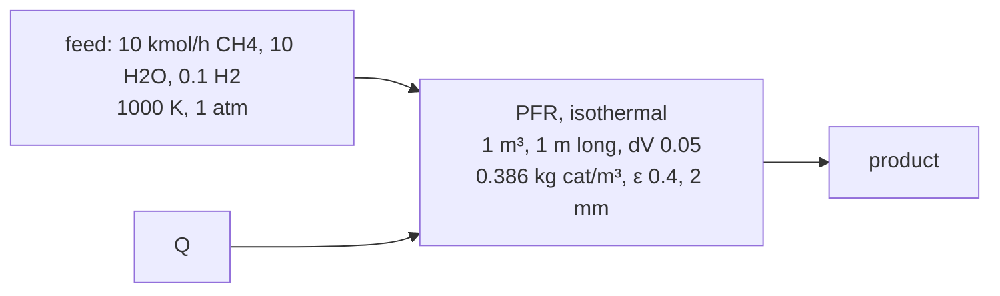

# Spike: DWSIM 9's plug-flow reactor, headless (M9 step 0)

**Verdict: go**, with the conditions under "What step 10 must do". DWSIM
9.0.5's PFR runs from a Python script, the owner's case built there gives
the owner's file's answer to 7.6e-9, and every number DWSIM's PFR reports
is reproduced from its source's equations: each section's flows to 5e-11,
each section's pressure drop to 3e-14, and its gas viscosity to 3e-7. So
every difference reflux will have from DWSIM can be explained. M3's spike
([spike-dwsim.md](spike-dwsim.md)) covers loading DWSIM, and M4's
([spike-dwsim-flowsheet.md](spike-dwsim-flowsheet.md)) its flowsheets.

What it found that the plan didn't expect:
- **DWSIM's PFR holds each section's state fixed.** Within a section of dV,
  its rates use the volumetric flow, Z and pressure of the section's
  start, so its error is first order in dV. At the file's dV = 0.05, its
  methane conversion is 9.0e-4 below the exact answer of its own
  equations. Halving dV halves the error all the way down to dV = 0.001,
  1.6e-5 in the conversion at four minutes a solve, and DWSIM's own answers,
  extrapolated, land within 2e-7 of the exact one.
- **Its integrators run at DotNumerics' default tolerances,** 1e-3
  relative and 1e-6 mol/s absolute, which nothing in the PFR can change.
  The four of them agree to 1.6e-4 in the conversion, and **its default,
  Radau, is the slowest:** explicit Runge–Kutta 4(5) gives the same answer
  7 times faster.
- **Ergun's pressure drop needs the gas viscosity, which reflux doesn't
  have** (M5's C7). The 4.9 kPa moves the methane conversion by 3.4e-3,
  so the viscosity matters. DWSIM's is the mole-fraction mean of ChemSep's
  correlations with Jossi, Stiel and Thodos' dense-gas correction, and
  Wilke's mixing rule gives 30% more in the hydrogen-rich gas.
- **Nearly all of a solve's time is DWSIM's expression parser.** Each call
  of the PFR's ODE function makes three new Flee contexts and compiles six
  expressions, about 12 ms, and a solve makes about 955 calls.
- **Failures are silent,** as M4 found for its other units: the flowsheet
  solver's error list stays empty. A reaction whose Tmax is below the feed's
  T gives no reaction and no error at all.
- **DWSIM's expressions can't read `1E+3`.** A number needs a decimal point
  before its exponent, `1.0E+3`.

The spike is one script, [spike/dwsim_pfr/run.py](../spike/dwsim_pfr/run.py),
a uv script like the fixture generators, run from the repository root:

```bash
uv run --python 3.13 spike/dwsim_pfr/run.py
```

It takes the sections to run, 1 to 6: all but 6 by default, since 6 is the
50-point study, and section 3 takes about half an hour. If `REFLUX_TUTORIAL`
names the owner's DWSIM file, section 1 loads and solves it too, and checks
that the script builds the same case; the file isn't in the repository. It
prints every number below.

## The case

The owner's coursework case, built in the script from the numbers in the
file:



Peng–Robinson, with DWSIM's default flash tolerances, as the file has
them: the gas is one phase, and only the stability test runs. Three
"heterogeneous catalytic" reactions on partial pressures in atm, with rates
in kmol/(kg·h), each a numerator and a denominator typed as text:

| Reaction | Equation | Its denominator's terms |
|---|---|---|
| Overall Reaction | CH₄ + 2H₂O ⇌ 4H₂ + CO₂ | CH₄, H₂O/H₂, H₂: no CO |
| Steam Reforming | CH₄ + H₂O ⇌ 3H₂ + CO | CO, CH₄, H₂O/H₂, H₂ |
| Water Gas Shift | H₂O + CO ⇌ H₂ + CO₂ | H₂O/H₂, H₂, CO: no CH₄ |

## Results (Windows 11, DWSIM 9.0.5.0, Python 3.13.17, pythonnet 3.0.5)

| Check | Result |
|---|---|
| The case built by the script, against the owner's file | the same reactions, strings and all, and the same reactor; outlets within 7.6e-9 (relative), ΔP within 1.5e-3 Pa |
| The outlet at dV = 0.05 | X(CH₄) 0.76034558, ΔP 4915.49 Pa, 468.28 kW; mol/s CH₄ 0.66571, H₂ 6.58561, H₂O 0.44408, CO₂ 0.22162, CO 1.89045 |
| DWSIM's sections reproduced in Python, with DWSIM's own integrator (DotNumerics' Radau, called from Python) | every profile point's flows within 4.9e-11 |
| The same sections integrated exactly (SciPy's Radau at 1e-12) | within 1.8e-4 at the profile's points and 6.0e-6 at the outlet: what DWSIM's tolerances cost |
| Ergun's ΔP, section by section | each section's drop within 2.9e-14 of DWSIM's, from the state after the section with L = dV·length |
| The void fraction, with no pressure drop | 0.3, 0.4 and 0.6 give identical outlets: it enters Ergun alone |
| The pressure drop's effect | isobaric, X(CH₄) 0.75690439; with Ergun's 4.9 kPa, 0.76034558: +3.4e-3, and the flows move by up to 1.9% |
| DWSIM's gas viscosity | the mole-fraction mean of ChemSep's eq. 102 corrected by Jossi–Stiel–Thodos, reproduced within 1.6e-7 at the feed, mid-reactor and the outlet, and within 2.7e-7 for each pure gas. Wilke's rule gives 1.8% less at the feed and 30% more mid-reactor. |
| The exact answer of DWSIM's equations, isobaric (SciPy's Radau at 1e-12, no sections) | X(CH₄) 0.7577996970; mol/s CH₄ 0.67277862, H₂ 6.56407797, H₂O 0.45147590, CO₂ 0.22130272, CO 1.88369644 |
| dV and DWSIM's four solvers | first order in dV down to 0.001: see "How accurate DWSIM is" |
| Failures | silent in every case tried: see "What we learned" |
| Time of one solve | 18.5 to 20 s re-solved in one run and 9.4 to 9.9 s in another, on the same laptop as its clock varied; 22 to 29 s for a new flowsheet's first solve |
| The owner's study, 50 solves | 742 s (12.4 min) headless: 9.6 s a point at 700 °C, rising to 25.9 s at 1000 °C, where X(CH₄) is 0.986559, the course's 98.66% |

## How accurate DWSIM is

Methane conversion with DWSIM's default integrator (Radau), isobaric and
with Ergun's pressure drop. "Off" is the distance from the exact answer of
DWSIM's equations, isobaric, X(CH₄) 0.7577996970: the worst outlet flow's,
relative, and the conversion's. "Its sections, exactly" is DWSIM's sections
integrated by SciPy at 1e-12 from DWSIM's own section starts: how far
DWSIM's integrator leaves them. Times are with Ergun, and moved by up to 2×
with the laptop's clock.

| dV | isobaric X | off: worst flow | off: X | its sections, exactly | with Ergun X | ΔP, Pa | a solve |
|---|---|---|---|---|---|---|---|
| 0.05 | 0.75690439 | 4.89e-3 | −8.95e-4 | 5.9e-6 | 0.76034558 | 4915.49 | 21 s |
| 0.02 | 0.75745130 | 1.89e-3 | −3.48e-4 | 9.4e-5 | 0.76115348 | 4905.14 | 37 s |
| 0.01 | 0.75763764 | 8.69e-4 | −1.62e-4 | 3.1e-6 | 0.76142824 | 4901.12 | 100 s |
| 0.005 | 0.75771997 | 4.29e-4 | −7.97e-5 | 5.7e-6 | 0.76155412 | 4898.95 | 132 s |
| 0.002 | 0.75776826 | 1.69e-4 | −3.14e-5 | | 0.76162850 | 4897.59 | 204 s |
| 0.001 | 0.75778408 | 8.39e-5 | −1.56e-5 | | 0.76165301 | 4897.11 | 268 s |
| extrapolated: 2·(0.001) − (0.002) | 0.75779990 | | +2.0e-7 | | 0.76167752 | 4896.64 | |

- **First order throughout:** each halving of dV halves the error, and
  nothing levels off by dV = 0.001. DWSIM's integrator stays below 1e-4
  of its sections' exact answer.
- **The exact answer is DWSIM's limit.** Richardson's extrapolation of
  DWSIM's two finest answers lands 2.0e-7 from it in the conversion, which
  checks the Python reproduction from DWSIM's side. With Ergun, the same
  extrapolation puts DWSIM's own error at dV = 0.001 at 2.5e-5 in the
  conversion and 0.47 Pa in ΔP: a little larger than isobaric, since the
  pressure lags a section too.

The four integrators, isobaric, X's distance from the exact answer and the
time a solve:

| `InternalSolver` | dV = 0.05 | dV = 0.01 |
|---|---|---|
| 0, Radau (the default) | −8.95e-4, 22.1 s | −1.62e-4, 121.8 s |
| 1, explicit Runge–Kutta 4(5) | −8.97e-4, 2.9 s | −1.62e-4, 10.2 s |
| 2, Adams–Moulton | −7.79e-4, 3.2 s | −1.23e-4, 10.8 s |
| 3, Gear's BDF | −7.36e-4, 4.7 s | −1.79e-4, 16.3 s |

The sections' error dominates. The integrators differ by up to 1.6e-4 at
dV = 0.05, their 1e-3 tolerance; Adams–Moulton's and BDF's errors happen to
partly cancel the sections'. Explicit Runge–Kutta needs far fewer calls per
section than Radau, which estimates its Jacobian by differences.

## What we learned

1. **Building a PFR.**
   - `sim.CreateHetCatReaction(name, description, compounds, base,
     "Vapor", "Partial Pressure", "atm", "kmol/[kg.h]", numerator,
     denominator)` makes a reaction, with `compounds` a
     `Dictionary[String, Double]` of stoichiometric coefficients. Then
     `sim.AddReaction(r)` and `sim.AddReactionToSet(r.ID, "DefaultSet",
     True, 0)`. Its T range defaults to 0 to 2000 K.
   - The PFR is `ObjectType.RCT_PFR`. Its inlet is port 0, and an energy
     stream must be connected to port 1, or it refuses to run. Its
     specification: `ReactorOperationMode = Isothermic`,
     `ReactorSizingType = Length`, `Volume`, `Length`, `dV`,
     `CatalystLoading`, `CatalystVoidFraction`, `CatalystParticleDiameter`,
     `ReactionSetID` and `InternalSolver`.
   - Its profile is `Profile`, a list of (position, T, P, compounds), one
     row for the inlet and one after each section.
2. **DWSIM names a reaction's species by their place in its compound
   list:** its reactants R1, R2, … and its products P1, P2, …. A rate can
   name nothing else, which is why the file's denominators differ.
3. **How the PFR integrates** (`Reactor_PFR.Calculate_Internal` and
   `ODEFunc` in DWSIM 9.0.5's source, checked here by reproducing its
   numbers):
   - The volume is cut into sections of dV × V. Each section is integrated
     from its start by one of four DotNumerics integrators, `InternalSolver`
     0 to 3: an implicit Runge–Kutta of order 5 (Radau), an explicit
     Runge–Kutta 4(5), Adams–Moulton and Gear's BDF. Each starts at a step
     of a hundredth of the section and runs at the library's default
     tolerances, 1e-3 relative and 1e-6 mol/s absolute.
   - Within a section, **everything but the flows is held at the section's
     start**: the gas's volumetric flow Qf, its Z and T. Each species'
     partial pressure is p_i = (N_i/Qf)·Z·8.314·T, in atm. DWSIM's density
     uses R = 8.314 too, so at a section's start p_i is exactly y_i·P, but
     as the moles grow along the section (two become four in reforming)
     the frozen Qf overstates every p_i.
   - **The pressure lags too.** After a section, the stream is flashed at
     its pressure, Ergun's drop is subtracted, and the new pressure is
     stored without a new flash. So each section's rates use the pressure
     before the previous section's drop: the first two sections both run
     at the inlet's.
   - A zero inlet flow starts at 1e-10 mol/s, and a negative flow inside a
     section is read as zero.
   - The rate in kmol/(kg·h) becomes mol/(kg·s) (× 1000/3600) and is
     multiplied by the catalyst loading: **dN_i/dV = W Σ_j r_j ν_ij/|ν_bj|,
     with W in kg of catalyst per m³ of reactor** and each rate per mole of
     its base reactant. The void fraction isn't in it.
   - The isothermal duty is the change in the stream's enthalpy plus the
     ideal-gas heats of formation of what reacted.
4. **Ergun, as DWSIM applies it.** After each section, ΔP = 150 μ L
   (1−ε)² u/(ε³ dp²) + 1.75 ρ L (1−ε) u²/(ε³ dp), with L = dV × length,
   u the superficial velocity (the gas's volumetric flow over the
   reactor's cross-section), and ρ and μ the gas's, all at the state
   after the section. That's the standard form. In the first section the
   viscous term is 181 Pa and the inertial 23 Pa: **89% of the drop is
   viscous, so μ sets it.**
5. **DWSIM's gas viscosity** (`AUX_VAPVISCm`): each compound's from its
   ChemSep correlation (eq. 102), their mole-fraction mean, and then Jossi,
   Stiel and Thodos' dense-gas correction, with the mixture's Tc, Pc, Vc and
   M as mole-fraction means. The correction isn't zero at zero density:
   its 1.023⁴ − 1 adds 0.2% (H₂) to 1.3% (H₂O) to each pure gas here at
   1 atm. Wilke's rule, the standard one at low pressure, gives 1.8% less
   than DWSIM at the feed and 30% more mid-reactor, where the gas is mostly
   hydrogen: a mole-fraction mean misses how a little heavy gas raises
   hydrogen's viscosity. reflux has no viscosity yet: see "What step 10
   must do".
6. **Failures are silent.** `CalculateFlowsheet2` returned an empty list
   every time. The PFR's `Calculated` and `ErrorMessage` said why:
   - an unknown name in a rate: "Could not find a field/property/variable
     with the name 'R3'";
   - a syntax error, and a number written `1E+3`: Flee's "SyntaxError";
   - a pressure drop above the pressure: "The pressure drop inside the PFR
     is too high";
   - a rate scaled by 1e300: "MATRIX IS REPEATEDLY SINGULAR", from Radau;
   - a zero denominator: "PFR ODE solver failed to find a solution".
   - **A reaction whose Tmax is below the gas's T is silently skipped:**
     the PFR reports success, and the outlet is the inlet.
   In each failure the product stream keeps whatever it had, so a script
   must check `Calculated` on the PFR and the product, as M4 found.
7. **Where the time goes: nearly all of it is Flee.** On every call,
   `ODEFunc` makes a new expression context for each reaction, imports
   `System.Math` into it, and compiles the rate's numerator and denominator,
   to evaluate each once. Timed from Python, that's 12.3 ms a call (5.0 ms
   with one context kept). DotNumerics' Radau, called from Python on
   DWSIM's own equations, makes 935 calls over the 20 sections, and
   `ODEFunc` runs once more after each: about 11.8 s, against re-solves of
   9.4 to 9.9 s in the same run. That's an upper bound, since pythonnet
   adds its cost to each of the 60-odd .NET calls the emulation makes. A stream's
   flash and properties take 2.5 ms, so the 21 flashes are 0.05 s.
   - The time grows with the rates' stiffness: 9.6 s a solve at 700 °C and
     25.9 s at 1000 °C, across the study.
   - Explicit Runge–Kutta 4(5) gets the same answer in a seventh of the
     time, with fewer calls.
   - **The laptop's clock moved every time by up to 2× between runs,** so
     step 11 must time DWSIM and reflux in one session, taking turns.

## Targets for criterion 8

DWSIM's answer converges at first order in dV, and its integrator leaves
its sections' exact answer by under 1e-4. So:

1. **Against the exact answer of DWSIM's equations** (its three
   expressions as typed, 8.314 and all, without sections, integrated in the
   fixture by SciPy's Radau at 1e-12): each of reflux's outlet flows within
   **1e-8**, relative. Isobaric first. With Ergun, the same, the fixture and
   the test both using DWSIM's viscosity and density.
2. **Against DWSIM at dV = 0.001,** its tightest useful dV, at about four
   minutes a solve: each outlet flow within **3e-4**, relative, the methane
   conversion within **5e-5**, and ΔP within **1 Pa**. DWSIM's own distance
   from the exact answer there is 8.4e-5 and 1.6e-5 isobaric, and with
   Ergun, by extrapolation, 2.5e-5 in the conversion and 0.5 Pa.
3. **Against DWSIM at the file's dV = 0.05,** no target. The difference,
   4.9e-3 in the worst flow and 9e-4 in the conversion, is DWSIM's sections,
   which the fixture reproduces to 5e-11 and records.
4. **The published model,** one site shared by all three reactions, solved
   beside it and reported, with no target.

## What step 10 must do

- **Build the case in the script,** as this spike does, and check it
  against the owner's file when `REFLUX_TUTORIAL` names it.
- **Check `Calculated` and `ErrorMessage` on the PFR and the product,**
  before using any number.
- **Record three answers, as M3 did:** DWSIM's, at the file's dV = 0.05 and
  at its tightest useful dV; DWSIM's sections reproduced exactly (they
  explain its error); and the exact answer of DWSIM's equations without
  sections, by SciPy's Radau at 1e-12, which reflux must reproduce to its
  own integrator's tolerance.
- **Compare isobaric first,** with `UseUserDefinedPressureDrop` and a drop
  of zero: that compares the integrators and nothing else. Then with Ergun,
  where the viscosity differs.
- **Use DWSIM's viscosity in the test, not in reflux.** The fixture
  reproduces DWSIM's method (eq. 102, the mole-fraction mean, then
  Jossi–Stiel–Thodos), as M4's reproduced DWSIM's pump density, and the
  test runs reflux's PFR with it, so the comparison with Ergun measures
  the solver. reflux's own viscosity is solved beside it, and the
  difference reported.
- **Keep DWSIM's 8.314.** The case's expressions type it, so reflux's file
  for the case writes it with its unit and `kinetics check` flags it.
