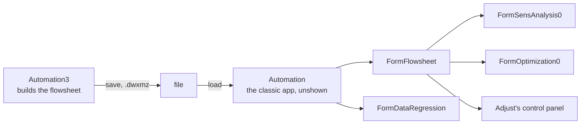

# Spike: DWSIM 9's sensitivity analysis, Adjust, optimiser and regression, headless (M8 step 0)

**Verdict: go for the study and the spec; the optimiser and the regression
can be run, but mostly don't give an answer to compare.** None of the four
has an API in DWSIM 9.0.5. Each is a window of the classic app, and its
work is the handler of that window's Run button. But the app's first
automation class makes its main window without showing it, and from there
each form can be filled and its handler called from a script. So what this
spike ran is DWSIM's own code, not a copy of it. M3's spike
([spike-dwsim.md](spike-dwsim.md)) covers loading DWSIM, M4's
([spike-dwsim-flowsheet.md](spike-dwsim-flowsheet.md)) its flowsheets, and
M9's ([spike-dwsim-pfr.md](spike-dwsim-pfr.md)) its PFR and the owner's
case.

What it found that the plan didn't expect:
- **A failed point in a study records the last point's numbers,** with "Run
  completed" and no message. If the first point fails, it records the
  numbers of the solve before the study.
- **The flowsheet solver doesn't run an Adjust.** Only its control panel's
  Start button does, by a secant or Brent's method around whole flowsheet
  solves. The solver runs only the Adjusts marked "simultaneous".
- **The simultaneous adjust solver can leave the flowsheet off its own
  answer.** Asked for a tolerance it can't reach, it stops on a small step,
  and the flowsheet stays where its derivative's last difference put it: 1%
  below the answer in the varied value, 1.3 mol/s off a 60 mol/s target,
  with no error.
- **Of the optimiser's 11 methods, one finds an optimum:** Brent's with
  bounds, for one variable.
  - An objective that's an expression of other variables, as W₁ + W₂ is,
    fails in the nine methods that aren't Brent's, with an index error in
    DWSIM's own objective function.
  - Brent's without bounds sets the variable to 0.
  - The two L-BFGS methods stop after one evaluation with one variable.
  - The four DotNumerics methods and IPOPT minimise whether asked to
    minimise or to maximise.
- **The regression ran and fitted nothing.** On nine exact P-x-y points
  from PR with kᵢⱼ = 0.13, none of its four methods came back with 0.13.
  Whether the app itself does better isn't known: see "What isn't settled".
- **"Background parallel" isn't parallel.** Three independent reactors take
  three times one in every solver mode, as the plan read in the source.

The spike is one script,
[spike/dwsim_study/run.py](../spike/dwsim_study/run.py), a uv script like
the fixture generators, run from the repository root:

```bash
uv run --python 3.13 spike/dwsim_study/run.py
```

It takes the sections to run, 1 to 6 and 50: 1 to 6 by default, about
twenty minutes. Section 50 is the owner's 50-point study, by the form and
then by a loop of solves, about 25 minutes more. It builds the owner's case
with M9's spike, `spike/dwsim_pfr/run.py`, and the reference flowsheet with
M4's, `spike/dwsim_flowsheet/run.py`. It prints every number below.

## How the forms are driven



- **`DWSIM.Automation.Automation`,** the first of DWSIM's three automation
  classes, makes the classic app's `FormMain` and never shows it: 2 to 4 s.
  Its flowsheets are `FormFlowsheet`s, which carry the study's and the
  optimiser's forms as fields.
- **A `FormFlowsheet` made bare can't take objects** (`AddObject` throws a
  null reference). So the script builds each flowsheet with `Automation3`,
  as the earlier spikes do, saves it, and loads the file with the classic
  class.
- **Each form reads `My.Application.ActiveSimulation`** when it loads, so
  the script sets it, by reflection.
- **Then, for each form:** make its case object (`SensitivityAnalysisCase`,
  `OptimizationCase`, `RegressionCase`: plain data, in
  `DWSIM.SharedClasses` and `DWSIM.exe`), call the form's `Load` handler,
  give it the case, and call the Run button's handler
  (`btnRun_Click`, `btnDoReg_Click`, the panel's `btnIniciar_Click`), all
  private, by reflection.
- **The handlers post their results to the window,** so the script runs
  `Application.DoEvents()` until the form says it's done, and reads the
  form's own results table. With the flowsheet's number format set to
  `G17`, the table holds every digit.
- **A message box would stop a script for ever.** The optimiser's form
  shows one when another case is selected in its list, so the script sets
  its `selectedoptcase` field and calls `PopulateForm` instead. None
  appeared in any run here.

## Results (Windows 11, DWSIM 9.0.5.0, Python 3.13.17, pythonnet 3.0.5)

| Check | Result |
|---|---|
| The classic app's main window, unshown | made in 2 to 4 s; the owner's case loads into it in 3 to 4 s |
| The owner's study by DWSIM's form, 50 points | 727 s (12.1 min), 14.5 s a point (10.7 s a point over 4 points in another run); every row the answer of a loop of set, solve and read, to the last bit |
| The same by a loop of solves | 639 s (10.7 min), 12.8 s a point. M9 measured 742 s through `Automation3`, and the owner 30 min in the app |
| After a study, the form restores a snapshot | the feed is back at 1000 K; but a solve of the restored flowsheet then fails, "The given key was not present in the dictionary" |
| A failed point, last in the sweep | the form records the point before it again: CH₄ 0.44001494 mol/s and an outlet at 27,115 Pa, for a feed at 11,325 Pa |
| A failed point, first in the sweep | it records the solve before the study: CH₄ 0.68465010 mol/s, the 1 atm answer |
| Either way | "Run #n completed..." for every point, and no error anywhere |
| An Adjust that isn't simultaneous, after a flowsheet solve | the cooler is still at 230 K: the solver doesn't run it |
| Its control panel, unshown | runs, by the secant: 219.75467054 K in 7 flowsheet solves, residual 1.1e-9 mol/s, "Value adjusted successfully." |
| The spec's answer, by SciPy's `brentq` on DWSIM's solves | 219.7546705409 K, residual 1.3e-10 mol/s |
| The simultaneous adjust solver, tolerance 1e-4 | 7 iterations, 19 flowsheet solves, 1.4e-6 K from the answer |
| The same, tolerance 1e-10 | 8 iterations; the flowsheet left at 217.5571238 K, 1.31 mol/s off its target, no error |
| The optimiser's form | runs every one of its 11 methods |
| Two-stage compression, least work: W₁ + W₂ | bounded Brent 6e-3 Pa from the optimum in 18 evaluations; unbounded Brent sets the pressure to 0; the other nine fail on the first evaluation |
| The same with the optimum on a bound | bounded Brent ends 1.5e-6 Pa from the bound in 55 evaluations |
| A drum's liquid propane, most: one property | bounded Brent 2e-6 K from the optimum in 9 evaluations; no other method reaches it |
| Maximise against minimise, DotNumerics' methods and IPOPT | the same end point either way |
| The regression's form | runs unshown; none of its four methods returns kᵢⱼ = 0.13 |
| Three PFRs side by side, each solver mode | 2.6 to 3.0 times one PFR's time |

## What we learned

1. **The sensitivity analysis** (`FormSensAnalysis.btnRun_Click`).
   - For each point it sets the independent variable with the object's
     `SetPropertyValue`, calls the flowsheet's `RequestCalculationAndWait`,
     and reads each dependent variable with `GetPropertyValue`. One or two
     independent variables, each over equally spaced points.
   - Each point starts from the state the last one left, so a study's
     answers can depend on the order of its points. On the owner's case
     they don't: the PFR has no recycle, and every row equals a fresh
     solve.
   - **Nothing checks that a point solved.** DWSIM's units fail silently
     (M4, M9), and the form reads the properties whatever happened. With
     the feed's pressure swept down to where Ergun's drop exceeds it, the
     failed point holds the last point's methane flow and outlet pressure,
     as if the reactor had no pressure drop to speak of. Swept up, the
     failed first point holds the answer at 1 atm. A plot of either looks
     smooth.
   - An exception inside the loop ends the study: the rest of the points
     never run, and the form's log has the error.
   - A property is named by an id: `PROP_MS_0` a stream's T, `PROP_MS_1`
     its P, `PROP_MS_3` its molar flow, `PROP_MS_102/Methane` a mole
     fraction, `PROP_MS_104/Methane` a compound's molar flow; `PROP_CL_2` a
     cooler's outlet T, `PROP_CO_4` a compressor's outlet P, `PROP_ES_0` an
     energy stream's flow. Values are SI.
   - **Timing.** The form and the loop do the same solves: 14.5 s a point
     against 12.8 s here, in one run, with other work on the laptop now and
     then, and its clock moves by up to 2× between runs anyway (M9). So
     the form costs little over its solves, and the owner's 30 minutes in
     the app isn't explained by this spike. Step 13 times both again, in
     one session with reflux.
2. **Adjust** (`Adjust.vb`, `EditingForm_Adjust_ControlPanel.vb`,
   `FlowsheetSolver.vb`). The spec here is on the reference flowsheet, with
   its recycle: the cooler's outlet T, until the first drum's vapour is
   60 mol/s (it's 65.19 at 230 K).
   - **A single Adjust is solved by its control panel,** not by the
     flowsheet solver: a form the user opens and starts. Its methods are
     MathNet's secant (the default) and Brent's, a Newton and IPOPT, each
     around `SolveFlowsheet`. So every evaluation is a whole flowsheet
     solve, recycles and all.
   - Its defaults: a tolerance of 1e-4 in the controlled variable's unit,
     10 iterations, and no bounds, for which the panel takes 0.2 and 2
     times the varied value: 46 to 460 K here.
   - **With the recycle converged tightly** (M4's 1e-8 on its tolerances),
     both methods find the answer:

     | method | tolerance | flowsheet solves | from the answer, K | residual, mol/s |
     |---|---|---|---|---|
     | secant | 1e-4 | 7 | +1.4e-9 | +9.9e-10 |
     | Brent, 200 to 260 K | 1e-4 | 6 | +1.7e-6 | +9.7e-7 |
     | secant | 1e-10 | 10 | −3.7e-10 | −7.5e-11 |
     | Brent, 200 to 260 K | 1e-10 | 7 | 0 | +5.6e-11 |
     | Brent, the panel's 46 to 460 K | 1e-4 | 9 | +2.3e-6 | |

   - **With DWSIM's default recycle tolerances,** each solve's answer
     depends on where its recycle started, so the function the root finder
     sees isn't one function. Brent's ends 0.051 K from the answer with a
     residual of 0.029 mol/s, at either tolerance, and reports success. The
     secant gets within 1.8e-4 K at 1e-4 in 13 solves, and takes 60 solves
     at 1e-10.
   - **The simultaneous adjust solver** is in the flowsheet solver, and
     runs after the flowsheet when an Adjust has `SimultaneousAdjust` set.
     It's Newton's method on every such Adjust:
     - the Jacobian by central differences of ±1% of each varied value, so
       1 + 2n flowsheet solves an iteration;
     - the first steps damped, to 20%, 40%, … of Newton's, so five
       iterations pass before a full step;
     - at most 25 iterations, and each Adjust's own tolerance.
   - **It stops in two ways, and one leaves the flowsheet wrong.** It
     converges when every residual is under its tolerance, checked right
     after a solve at the current values. It also stops when the step falls
     under 1e-6, after the Jacobian's solves, without solving again. Then
     the flowsheet holds the last difference's point: the varied value 1%
     low. At a tolerance of 1e-10, which the recycle's own tolerance keeps
     it from reaching, the cooler was left at 217.5571238 K = 0.99 ×
     219.7546705, and the vapour at 58.69 mol/s for a target of 60. Its
     last message was "Iteration #8, NSSE: 2.3E-18", and the solver's error
     list was empty.
   - Its errors, when it has them, are messages in the log, not
     exceptions.
3. **The optimiser** (`FormOptimization.vb`).
   - Its case has independent variables with bounds, auxiliary variables,
     one dependent variable or an expression of the others, and
     "constraint" variables, which the plan's research didn't find. A
     constraint is a barrier term added to the objective, 1/δ₁ − 1/δ₂ of
     its distances to its two limits, times a multiplier (1e-4 by
     default), not a constraint the method knows.
   - Its defaults: a tolerance of 1e-6, 100 iterations, and derivatives by
     two-point differences of a relative step of 1e-3, so a variable at 0
     has no derivative.
   - It stops when the method does, and nothing checks the answer. After
     any outcome its log says "Optimization finished successfully", unless
     an exception reached it.
   - **Problem a: the pressure between two compression stages,** for the
     least total work. A lean gas (90% methane, 7% ethane, 3% propane) goes
     from 1 to 16 bar in two compressors, each 75% efficient, cooled to
     300 K between them. The work is least at 4.05502495 bar,
     106.1713175 kW (the ideal gas's √(P₁P₂) is 4 bar). The objective is an
     expression of two auxiliary variables, `w1+w2`.
   - **Problem b: a cooler's outlet T,** for the most propane in a drum's
     liquid. The reference flowsheet's feed, cooled and flashed at 30 bar.
     The liquid's propane fraction peaks at 250.71284410 K, 0.2149277970.
     The objective is one property, with no expression.
   - Every method, from 8 bar and 280 K, within 1.5 to 12 bar and 200 to
     290 K:

     | method | a: W₁ + W₂ | b: maximise | b: minimise |
     |---|---|---|---|
     | `AL_BRENT` | sets P to 0 | sets T to 0 | sets T to 0 |
     | `AL_BRENT_B` | **6e-3 Pa from the optimum, 18 evaluations** | **2e-6 K from it, 9 evaluations** | 201.06 K, 35 evaluations |
     | `AL_LBFGS`, `AL_LBFGS_B` | index error | 1 evaluation, no step | 1 evaluation, no step |
     | `DN_TRUNCATED_NEWTON` | index error | 280 K, 104 evaluations | 280 K, 104 evaluations |
     | `DN_NELDERMEAD_SIMPLEX` | index error | 469.69 K | 469.69 K |
     | `DN_LBFGS` | index error | 322.52 K | 322.52 K |
     | `DN_TRUNCATED_NEWTON_B`, `DN_NELDERMEAD_SIMPLEX_B`, `DN_LBFGS_B` | index error | 290 K, 9 to 12 evaluations | 290 K |
     | `IPOPT` | index error | 280.12 K, 101 evaluations | 280.12 K |

   - **The index error is DWSIM's.** `FunctionValue`, the objective of
     every method but Brent's, reads its auxiliary variables with
     `Me.keysaux(j - 1)` in a loop from j = 0 (line 1154 of
     `FormOptimization.vb` in 9.0.5): index −1 on the first. So an
     expression over flowsheet variables, the optimiser's main use, works
     only in Brent's two methods, which have an objective function of their
     own.
   - **Unbounded Brent** brackets from 0 to 100 times `initval(0)`, in an
     array filled from index 1: 0 to 0.
   - **The two L-BFGS methods** take a history of m = n − 1 for fewer than
     five variables: 0 for one variable.
   - **Maximising:** Brent's and L-BFGS's objectives negate the value;
     `FunctionValue` doesn't. So the DotNumerics methods and IPOPT walked
     downhill to the same point when asked to maximise as when asked to
     minimise. Downhill from 280 K is the upper bound, 290 K, which the
     three bounded DotNumerics methods do reach: a correct local minimum.
     The two unbounded ones left the bounds, as they may.
   - **IPOPT** took 100 iterations of 1.6e-3 K each and stopped at its
     iteration limit, 0.12 K from where it started.
   - **With the optimum on a bound** (problem a between 6 and 12 bar),
     bounded Brent ends 1.5e-6 Pa from the bound, in 55 evaluations. It
     never evaluates the bound itself.
4. **The regression** (`FormDataRegression.vb`), a window of its own with
   no flowsheet.
   - It fits one kᵢⱼ for PR, SRK or Lee–Kesler–Plöcker, two for PRSV2, and
     the parameters of NRTL, UNIQUAC and Wilson, to T-x-y, P-x-y or T-P-x-y
     data, LLE and SLE data, by L-BFGS-B, a truncated Newton, Nelder–Mead
     or IPOPT. Its objectives are least squares on T or P, on y, or on
     both, weighted or not. A parameter has bounds, −0.5 to 0.5 for a kᵢⱼ.
   - **The data here:** nine bubble points of CO₂ and ethane at 250 K, x
     from 0.1 to 0.9, from thermo 0.6.1's PR with kᵢⱼ = 0.13 (15.64 bar at
     x = 0.1, 20.96 at 0.5, 20.10 at 0.9). So the fit has an exact answer,
     but for DWSIM's rounded constants (M3).
   - **What its four methods did,** from kᵢⱼ = 0, pressures in Pa:

     | method | iterations | with a value | the last value's kᵢⱼ | reported |
     |---|---|---|---|---|
     | Limited Memory BFGS | 63 | 3 | 0.0000 | nothing |
     | Truncated Newton | 946 | 164 | 0.0407 | nothing |
     | Nelder–Mead | 8 | 0 | | nothing |
     | IPOPT | 586 | 578 | 0.1047 | nothing |

     Each run's log ends with an exception at the last iteration, "Index
     was outside the bounds of the array", and then "Finished!". The
     form's `regressedparameters` is empty.
   - **Where the exception comes from:** the objective's bubble-point call.
     With the app's "parallel processing" setting off, as it is here, the
     objective calls its Excel add-in's `TVFFlash` and indexes the result
     as a table of numbers; when that flash fails, the result isn't one.
     With the setting on it calls the property package directly, and the
     failures show as themselves: "PT/PV/TV Flash: Maximum number of
     iterations reached" and "PR EOS: Unable to calculate compressibility
     factor". The methods step kᵢⱼ far enough for a bubble point to fail,
     the first to its bound at 0.5.
   - **The objective isn't scaled.** At kᵢⱼ = 0 it's 1.56e12, the squared
     pressure errors in Pa². With the pressures entered in bar it's
     1.41e24, not smaller, as it would be if the form converted the
     pressures the wrong way. Then the truncated Newton and IPOPT do report
     a value, 0.0406 and 0.3031, neither near 0.13.
5. **The solver's modes** (`FlowsheetSolver.SolveFlowsheet`). Its
   `SolverMode` is 0 for the main thread, 1 for a background thread and 2
   for "background parallel threads", and `EnableParallelProcessing` is
   another setting. Three of the owner's PFRs, each with a feed of its own,
   took 2.6 to 3.0 times one PFR's solve in all five combinations tried.
   The parallel queue is never reached, as the plan read in the source.

## What isn't settled

- **Whether the regression fits in the app.** The spike ran the form's own
  handler on a case the form stored back correctly (compounds, model, data
  type, units and all nine points, printed by the script). But a form that
  was never shown may lack something the app sets up. The owner can settle
  it in two minutes: the nine points go into Utilities > Data Regression as
  they are.
- **Whether the optimiser's index error shows in the app.** The same
  reasoning, though here the source says why, and the line number is
  DWSIM's.
- **Why a study's restored flowsheet doesn't solve again.** After the
  form's `RestoreSnapshot`, `CalculateFlowsheet2` returned "The given key
  was not present in the dictionary". It may be the unshown form's. The
  script solves on a flowsheet loaded fresh instead.

## What M8's steps must do

- **Step 6, studies:** a failed point must say so (D9). DWSIM's records the
  last point's numbers, which is criterion 3's reason in one line.
- **Step 4, specs,** and step 13's comparison:
  - The spec to compare is this one, on the reference flowsheet: the
    cooler's outlet T between 200 and 260 K until the first drum's vapour
    is 60 mol/s. DWSIM's answer is 219.7546705409 K with its recycle's
    tolerances scaled by 1e-8, as M4 needed.
  - reflux's answer will differ as M4's flowsheet did, by DWSIM's rounded
    constants and its pump's density, so compare by state, as M4 compared.
  - Count passes against DWSIM's flowsheet solves: 6 to 10 for a single
    Adjust, 19 for the simultaneous solver at its default tolerance.
  - Don't compare with the simultaneous solver at a tight tolerance: it
    leaves the flowsheet 1% off.
- **Step 13, the study** (criterion 11): time reflux against the form, run
  by this script's section 50, and against the loop. Both in one session,
  taking turns, as M9 step 11 did.
- **Step 10, optimisation,** and step 13's comparison (criterion 8):
  - Problem a, the two-stage compression, is the one to compare: it has an
    interior optimum, and one on a bound when the bounds are 6 to 12 bar.
    reflux can pose it as `minimize = "c1.work + c2.work"`.
  - DWSIM's answer is bounded Brent's, the only method that gives one:
    4.05502495 bar and 106.1713175 kW by its own solves.
  - Record the other ten methods as they stand here.
- **Step 12, fitting kᵢⱼ,** and criterion 9: the comparison with DWSIM's
  regression is recorded as not possible from a script, unless the owner's
  run in the app gives 0.13. The data set is this one, so that SciPy's fit
  and reflux's have the same nine points.
